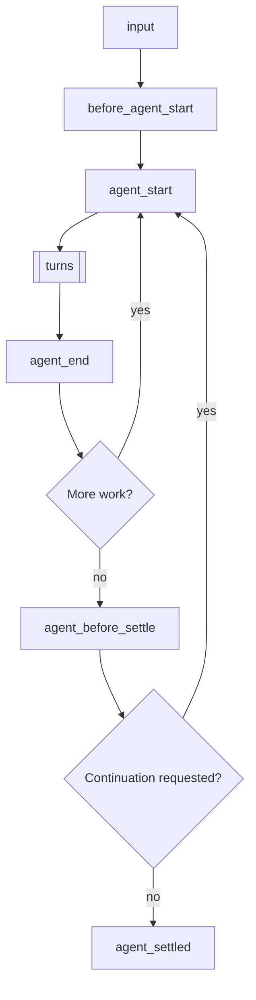
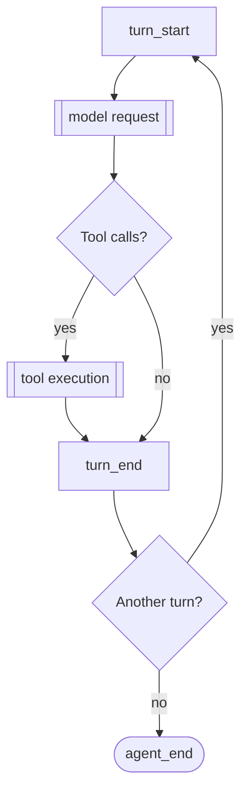
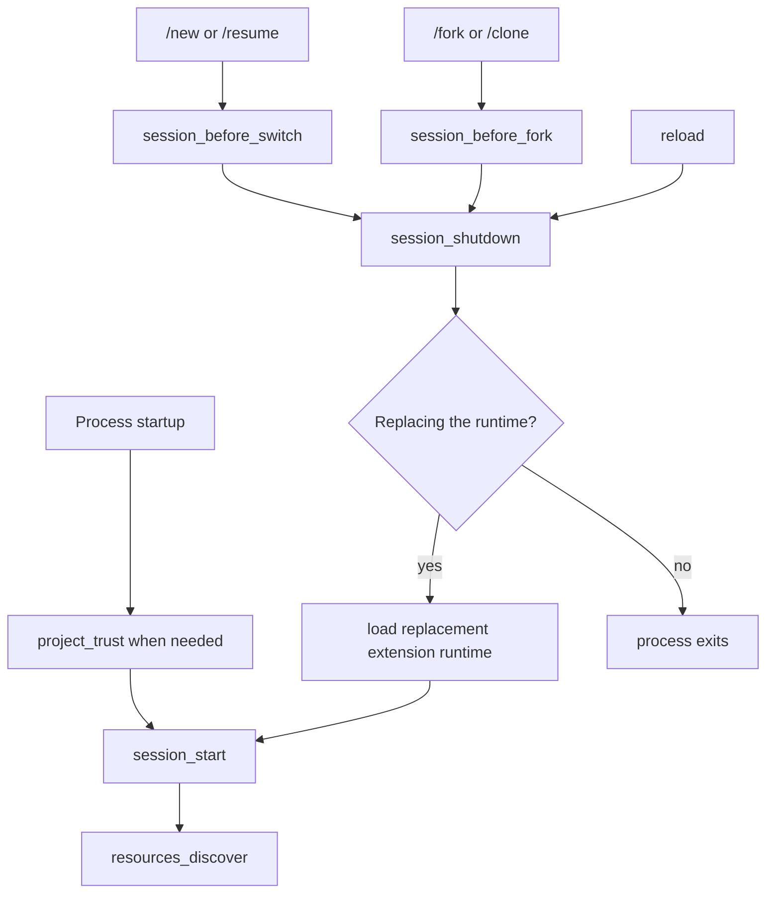

# 扩展

扩展是为 Pi 添加可执行行为的 TypeScript 模块。当工作流需要工具、命令、事件处理器、模型提供商、会话状态或终端界面，而不仅仅是指令时，可使用扩展。

扩展在 Pi 进程内运行，拥有相同的操作系统权限。它可以检查提示词、工具调用、文件、凭据和会话历史，因此请仅从您信任的来源加载扩展。

典型的扩展可添加代理工具、保护路径、确认危险命令、响应会话事件、修改上下文、公开命令或显示持久状态。

<a id="quick-start"></a>
<a id="writing-an-extension"></a>
<a id="create-an-extension"></a>

## 创建并加载扩展

扩展导出一个默认工厂函数，该函数接收 `ExtensionAPI`。工厂为当前扩展运行时注册各项能力。

创建 `~/.pi/agent/extensions/hello.ts`：

```typescript
import type { ExtensionAPI } from "@earendil-works/pi-coding-agent";

export default function (pi: ExtensionAPI) {
  pi.registerCommand("hello", {
    description: "Show a greeting",
    handler: async (name, ctx) => {
      ctx.ui.notify(`Hello, ${name || "world"}!`, "info");
    },
  });
}
```

启动 Pi 并运行 `/hello`。开发期间，可直接加载文件：

```bash
pi --extension ./hello.ts
```

Pi 使用 `jiti`，因此本地 TypeScript 扩展无需单独编译步骤。如需分发扩展及管理依赖，请使用 [Pi 软件包](/docs/packages/)。

<a id="extension-locations"></a>
<a id="available-imports"></a>
<a id="choose-where-it-loads"></a>

## 将其添加到 Pi

将扩展放置在用户或项目扩展目录中。Pi 会加载直接的 TypeScript 或 JavaScript 文件，以及包含 `index.ts` 或 `index.js` 入口点的子目录。

小型扩展使用单个文件，多文件实现则使用目录。将 npm 依赖项放在附近的 `package.json` 中。有关常规位置，请参阅 [配置](/docs/configuration/)；有关其他路径，请参阅 [设置](settings.md#resources)。

重新加载会替换扩展运行时，因此 `await ctx.reload()` 之后的代码不得复用旧运行时的状态。只有个人和显式命令行扩展才能参与在项目扩展加载之前运行的 `project_trust` 事件。

<a id="understand-the-lifecycle"></a>

## 理解运行时生命周期

工厂函数可以是同步或异步的。Pi 会等待异步工厂完成后才继续启动流程，以便在启动期间获取配置或注册所需的提供商。

不要在工厂函数中启动进程、套接字、监视器或定时器，因为某些调用会加载扩展而不启动会话。
应从 `session_start` 或需要这些资源的命令或工具中启动长期存在的资源。
应从幂等的 `session_shutdown` 处理器中关闭会话范围内的资源。

正常的提示会启动一次运行。运行会重复执行多轮，然后检查是否有更多工作需要启动另一个低层代理运行：



更多工作指的是重试、恢复、压缩重试或排队的工作。

每一轮发送一次模型请求，并执行助手响应中的工具调用：



模型请求按顺序运行以下钩子：

1. `context`
2. `context_with_system`
3. `before_provider_headers`
4. `before_provider_request`
5. `after_provider_response`
6. `provider_stream_event` 和助手消息事件

工具执行对每个工具调用按顺序运行以下钩子：

1. `tool_execution_start`
2. `tool_call`
3. `tool_execution_update`（工具执行期间）
4. `tool_result`
5. `tool_execution_end`

生命周期涉及以下事件组：

| 区域 | 事件 |
|---|---|
| 输入准备 | `input`, `before_agent_start` |
| 代理运行 | `agent_start`, `agent_end` |
| 模型轮次 | `turn_start`, `context`, `context_with_system`, `turn_end` |
| 提供商调用 | `before_provider_headers`, `before_provider_request`, `after_provider_response`, `provider_stream_event` |
| 消息生命周期 | `message_start`, `message_update`, `message_end` |
| 工具执行 | `tool_execution_start`, `tool_call`, `tool_execution_update`, `tool_result`, `tool_execution_end` |
| 结算 | `agent_before_settle`, `agent_settled` |

Pi 在运行启动期间（包括压缩检查和 `before_agent_start`）被视为忙碌状态，因此在此期间发送的消息会进入正在启动的运行。消息生命周期事件也涵盖用户和工具结果消息；模型请求列表仅将助手流放置在每轮中对应的位置。

工具钩子对每个工具调用运行，一个助手响应可以通过返回工具调用来启动另一轮。提供商钩子仅在该传输暴露相应阶段时运行。有关确切的事件负载和结果类型，请参阅 [`extensions/types.ts`](https://github.com/earendil-works/pi/blob/main/packages/coding-agent/src/core/extensions/types.ts) 中的导出声明。

会话启动和替换遵循单独的生命周期：



`project_trust` 在受信任的项目资源加载之前运行，并且当会话替换进入新的工作目录时可以再次运行。重试、恢复、压缩和排队消息可以在 `agent_end` 之后启动另一个代理运行，因此 `agent_end` 不是最终空闲信号。重载和会话替换会使旧运行时失效。`await ctx.reload()` 之后的代码仍属于旧运行时，不得重用其会话绑定状态。

### 按意图选择事件

| 目标 | 事件 |
|---|---|
| 检查、转换或消费原始用户输入 | `input` |
| 在运行前更改提示词各部分、启用工具或添加上下文 | `before_agent_start` |
| 观察一次低级代理运行 | `agent_start`、`agent_end` |
| 在一次模型响应及其工具调用后执行操作 | `turn_end` |
| 为一次提供商请求过滤会话消息 | `context` |
| 转换完整对话记录，包括系统消息 | `context_with_system` |
| 更改请求标头或序列化的提供商负载 | `before_provider_headers`、`before_provider_request` |
| 观察提供商响应元数据或已解析的流事件 | `after_provider_response`、`provider_stream_event` |
| 授权或修改工具调用 | `tool_call` |
| 编辑、注解或替换工具结果 | `tool_result` |
| 追加最终条目或请求最后一次延续 | `agent_before_settle` |
| 在自动处理停止后运行通知工作 | `agent_settled` |
| 初始化或释放会话级资源 | `session_start`、`session_shutdown` |

<a id="agent_start--agent_end--agent_before_settle--agent_settled"></a>

当扩展必须追加条目或请求最后一次延续时，使用 `agent_before_settle`。当 Pi 没有剩余自动延续时，对于应运行的仅通知工作，使用 `agent_settled`。

<a id="extensionapi-methods"></a>

## 选择集成点

| 能力 | 主要 API |
|---|---|
| 观察或修改生命周期行为 | `pi.on()` |
| 添加模型可调用的操作 | `pi.registerTool()` |
| 添加 `/` 命令 | `pi.registerCommand()` |
| 添加快捷键或 CLI 标志 | `pi.registerShortcut()` 或 `pi.registerFlag()` |
| 发送用户或自定义消息 | `pi.sendUserMessage()` 或 `pi.sendMessage()` |
| 持久化非上下文会话数据 | `pi.appendEntry()` |
| 更改活动工具、模型或思考级别 | `pi` 上的会话控制方法 |
| 添加模型提供商 | `pi.registerProvider()` |
| 添加 MCP 服务器 | `pi.registerMcpServer()` |
| 将每个请求路由到模型 | [`pi.registerVirtualModel()`](/docs/virtual-models/) |
| 添加终端渲染 | 渲染器注册和 `ctx.ui` |
| 与其他扩展通信 | `pi.events` |

使用 [`extensions/types.ts`](https://github.com/earendil-works/pi/blob/main/packages/coding-agent/src/core/extensions/types.ts) 中导出的声明，以获取精确的事件、上下文、工具和结果类型。

## 遵循扩展契约

<a id="events"></a>
<a id="work-with-events"></a>

### 事件与并发

处理程序按扩展加载和注册顺序运行。`pi.on()` 返回一个函数，用于取消该注册；更改不会影响已在进行中的调度。
有些事件仅通知；有些则转换数据、替换结果或取消操作。
请使用每个事件声明的结果类型，而不是假设每个返回值都有效。

事件涵盖资源发现、会话、代理与消息生命周期、提供商、工具及原始输入。

#### 理解处理器组合

| 模式 | 行为 |
|---|---|
| 通知 | 返回值被忽略。仅将事件用于观察。 |
| 就地修改 | 后续处理器能看到对 `before_provider_headers.headers`、`before_agent_start.systemPromptOptions` 和 `tool_call.input` 等值的修改。 |
| 链式转换 | 后续处理器接收先前 `input`、`context`、`context_with_system`、`message_end`、`tool_result` 和 `before_provider_request` 处理器返回的值。 |
| 门控 | 已处理的输入、被阻止的工具调用、被取消的会话操作或已处理的 `user_bash` 命令会停止该操作的正常回退路径。 |
| 可操作边界 | 每个 `turn_end` 或 `agent_before_settle` 处理器都能看到目前提议的条目和继续决策。 |
| 最后覆盖 | 最后一个返回操作的 `cache_warming_decision` 处理器生效。 |

通知处理器不应在流式事件上执行耗时操作。转换处理器应保留其不有意拥有的字段，门控处理器在无法做出安全决策时应默认失败关闭。

`before_agent_start` 同时暴露当前提示词及其结构化的 `systemPromptOptions`。`event.messageType` 指示运行启动方式：`"user"` 表示提示词或 `pi.sendUserMessage()`，带有 `prompt` 和 `images`；`"custom"` 表示 `pi.sendMessage(..., { triggerTurn: true })`，带有起始 `message` 且无 `prompt`。返回的 `message` 会添加到任一类型的运行中；检查 `messageType` 以跳过由自定义消息启动的运行。优先修改提示词部分、所选工具或指南，以便 Pi 能追加转录增量。返回 `systemPrompt` 或设置 `forceSystemPrompt` 会替换该运行的整个提示词，同时转录继续记录结构化部分。提供商将强制文本作为其前置系统提示词接收。

`message_end` 可以替换已定稿的消息，同时保留其角色。`tool_call` 可以修改输入或阻止执行。`tool_result` 处理器可组合，每个处理器都能看到先前的修改。

<a id="provider_stream_event"></a>

`provider_stream_event` 在 Pi 规范化每个解析后的提供商流事件之前触发。该事件标识提供商、API 和模型；`event.data` 是 Pi 可获得的最早结构化值，不一定是原始 HTTP 字节或 SSE 帧。将其视为只读，因为修改可能影响规范化。该事件仅用于通知，不会持久化。

处理器按流顺序等待，因此慢处理器会延迟流消费。处理器错误会被报告，但不会改变提供商响应。参见 [`debug-provider.ts`](https://github.com/earendil-works/pi/blob/main/packages/coding-agent/examples/extensions/debug-provider.ts) 了解一个按助手消息分组原始事件的可选查看器。

<a id="context_with_system"></a>

`context` 转换对话消息，但不包括提示词和工具系统消息；Pi 之后会恢复该状态。仅当请求本地的转换必须拥有完整转录时，才使用 `context_with_system`，并在索引零处保留系统消息。

`turn_end` 和 `agent_before_settle` 是可操作边界。其处理器可以链式提议 `custom`、`custom_message`、`context_edit` 或 `compaction` 条目，并为下一个模型请求返回 `continue: true`。请保护继续条件，因为无条件继续可能导致循环。使用导出的事件声明获取完整的验证和排序契约。

<a id="cache_warming_decision"></a>

`cache_warming_decision` 可以用 `{ action: "warm" }` 或 `{ action: "stop" }` 覆盖空闲提示词缓存刷新。最后一个返回操作的处理器生效。

来自同一助手消息的工具调用可以并行运行。
当另一个工具事件运行时，不要假设兄弟调用或结果存在。
使用 `ctx.signal` 处理活动轮次拥有的嵌套工作；命令和空闲会话事件通常没有操作信号。

返回 `undefined` 的 `user_bash` 处理器会将命令传递给下一个处理器，如果没有任何处理器处理，则最终传递给本地执行。返回 `operations` 或 `result` 会停止传播。处理器失败会阻止命令，而不是回退到本地执行。

<a id="custom-tools"></a>
<a id="register-tools"></a>

### 工具

自定义工具定义了名称、面向模型的描述、TypeBox 参数模式以及 `execute()` 函数。
其结果需要面向模型的 `content` 字段和用于渲染或状态重建的 `details` 字段。
当没有结构化细节时，使用 `details: undefined`。如果工具进行了嵌套模型调用，请在结果中包含它们的 `usage`，以便会话总数保持准确。

从 `execute()` 中抛出异常以产生失败的工具结果。
返回对象并不表示其为错误。
仅当该批次中所有已完成的工具都同意终止，且代理应跳过其自动追问时，才返回 `terminate: true`。

当工具共享可变的内存状态时，使用顺序执行。
修改文件的工具应使用 `withFileMutationQueue()` 包裹完整的读-修改-写操作。
截断大型的面向模型的结果，并告知模型在哪里读取完整输出。

当结果是数据时，声明 `outputSchema` 并返回匹配的 `structuredContent`。模型仍会收到 `content`；程序化调用者（如 codemode 脚本）会收到 `structuredContent` 而不是文本。没有 `outputSchema` 的工具会作为文本内容传递给脚本。要报告仍携带数据的失败，请返回带有 `isError: true` 的结果，而不是抛出异常：模型会看到错误，而脚本仍会收到 `structuredContent`。

工具可以使用 `ctx.executeTool(name, args, { signal, onUpdate })` 运行其他工具。嵌套调用会像模型发出的调用一样，经过参数验证以及 `tool_call` 和 `tool_result` 处理器，并发出 `tool_execution_start`、`tool_execution_update` 和 `tool_execution_end` 事件；所有这些事件都携带 `parentToolCallId`，其 `toolCallId` 由 pi 分配为 `<parent id>/<n>`。这些 ID 不会作为工具调用或工具结果出现在记录中。嵌套调用不会添加记录条目：其结果仅到达调用工具，由调用工具自行报告，例如通过 `onUpdate` 和 `details`。会话会保留它们的有限记录（名称、参数、状态、持续时间、错误；绝不包含结果），作为调用工具结果消息上的 `nestedCalls`。它用于压缩文件列表，并显示在 HTML 导出中。每次调用超过 8 KiB 或每个工具结果超过 32 KiB 的参数会被省略，最多保留 256 次调用，并且 `complete: false` 标记丢失了任何内容的记录。嵌套结果（无论深度如何）的 `usage` 都会添加到调用工具的结果 `usage` 中，因此工具只报告自己的使用情况，而不报告其调用的工具的使用情况。`ctx.tools` 列出了 `ctx.executeTool()` 可以调用的工具。编辑 `content` 的 `tool_result` 处理器也应替换 `structuredContent`；仅替换 `content` 会将其丢弃。

参见 [`hello.ts`](https://github.com/earendil-works/pi/blob/main/packages/coding-agent/examples/extensions/hello.ts)、[`todo.ts`](https://github.com/earendil-works/pi/blob/main/packages/coding-agent/examples/extensions/todo.ts)、[`dynamic-tools.ts`](https://github.com/earendil-works/pi/blob/main/packages/coding-agent/examples/extensions/dynamic-tools.ts) 和 [`truncated-tool.ts`](https://github.com/earendil-works/pi/blob/main/packages/coding-agent/examples/extensions/truncated-tool.ts)。

### 工具暴露

`exposure` 控制模型如何触达工具。“可调用”意味着可通过 `ctx.executeTool()`（`ctx.tools`）从其他工具调用，正如 `codemode` 工具的脚本所做的那样：

- `direct`（默认）：在激活期间向模型声明，并在激活期间可调用。
- `model-only`：在激活期间向模型声明，但永不可调用。用于编排其他工具或询问用户的工具。
- `codemode`：注册后即可调用，并由 `codemode` 工具列出。除非显式激活，否则不向模型声明。
- `deferred`：类似于 `codemode`，但 `codemode` 工具不会列出它；`tool_search` 可以找到并激活它。
- `hidden`：已注册但不可达。使用 `exposure: "hidden"` 重新注册工具以将其撤回，因为工具无法注销。

`namespace: { name, aliases, description, instructions }` 将相关工具分组，类似于 MCP 服务器。`codemode` 工具在一个标题下列出带有其 `description` 的命名空间。`instructions` 包含更长的使用指南；它不会被列出，`codemode` 脚本通过 `describeNamespace(name)` 读取它。`aliases` 是脚本可能用于查找命名空间的其他名称，例如服务器名称 `docs` 对应 `mcp__docs`；名称与脚本标识符同名（`my-docs`、`my_docs`）匹配方式相同。

注册 `direct` 或 `model-only` 工具会激活它；其他暴露类型在注册时不会激活。活动集（`pi.getActiveTools()`、`pi.setActiveTools()`）是向模型声明的工具集。`pi.getAllTools()` 报告每个工具的 `exposure`、`namespace`、`annotations` 和 `reachesTools`。

`annotations` 是关于工具功能的提示，含义与 MCP 工具注解一致：`readOnlyHint`、`destructiveHint`、`idempotentHint` 和 `openWorldHint`。MCP 工具携带其服务器声明的提示。缺失的提示采用 MCP 默认值：工具不是只读的，可能具有破坏性，并可能触达开放世界。这些提示不会被验证，但权限扩展可以使用它们来决定确认哪些调用。以下代码确认了 Codex 请求批准的调用：

```typescript
pi.on("tool_call", async (event, ctx) => {
  const hints = pi.getAllTools().find((tool) => tool.name === event.toolName)?.annotations;
  const needsApproval =
    hints?.destructiveHint === true ||
    (!hints?.readOnlyHint && ((hints?.destructiveHint ?? true) || (hints?.openWorldHint ?? true)));
  if (needsApproval && !(await ctx.ui.confirm("Allow tool call?", event.toolName))) {
    return { block: true, reason: `${event.toolName} was not approved` };
  }
});
```

编排其他工具的工具可以在激活期间通过 `prepareLoadout(loadout)` 调整模型看到的内容。它在活动工具变化时运行，并接收已声明的工具、可调用的工具以及每个已注册工具及其暴露类型、命名空间和提示指南。它返回已声明工具（包括其自身）的替换 `descriptions` 和 `hiddenDeclarations`：在保持活动且可调用的同时，其声明请求被省略的活动工具。默认系统提示会将隐藏工具从其工具列表和规则中排除，并且在文件读取器被隐藏时，技能提示中不提及任何工具名称，因此编排工具应自行呈现其指南。`codemode` 仅使用此钩子、`exposure`、`reachesTools` 和 `ctx.executeTool()`，因此另一个工具可以在不同名称下实现相同行为。

触达其他工具的工具通过 `reachesTools(input)` 声明调用可能触达哪些工具：`"all"`，或输入中可能命名它们的词语，其中词语指代名称包含它的每个工具或命名空间。`codemode` 对搜索或列出工具的脚本返回 `"all"`，否则返回脚本中的词语；`tool_search` 始终返回 `"all"`。延迟注册工具的扩展在其 `tool_call` 处理器中使用它，以便在调用运行前完成注册调用所需的工具，正如 MCP 扩展对仍在连接的服务器所做的那样。MCP 扩展还仅在同名工具声明 `reachesTools` 时，才为 MCP 工具激活 `codemode` 或 `tool_search`。

### 动态激活工具

首先注册所有工具，保持可选工具非激活状态，并使用加载器工具中的 `pi.setActiveTools()` 来选择所需的激活工具。名称必须已注册；未知名称会被忽略。

Pi 在记录的第一条系统消息中记录初始提示和工具集，然后在下一个模型请求之前附加工具和提示更改。无法表示该转换的提供商会收到完整的记录检查点，这可能会使缓存的先前内容失效。

### 工具渲染

工具的 `renderCall` 和 `renderResult` 方法负责在交互式转录及 HTML 导出中绘制其调用。`pi.registerToolRenderer((toolName, next) => renderers)` 为任意工具的调用选择渲染器，包括尚未注册的工具，例如在恢复的会话中服务器尚未连接的 MCP 工具。`next()` 返回的是剩余解析器（按扩展加载顺序）及已注册工具将使用的内容，因此 `next() ?? mine` 仅在必要时才进行填充。

### MCP 服务器

`pi.registerMcpServer(name, config)` 为当前会话添加一个 MCP 服务器。`config` 的结构与 [`mcp.json`](/docs/mcp/) 中的 `mcpServers` 条目一致：stdio 服务器包含 `command`、`args`、`env` 和 `cwd`，HTTP 服务器包含 `url`、`headers` 和 `oauth`，此外还有 `exposure`、`toolExposure`、`description`、`enabled` 和 `timeout`。

```typescript
pi.registerMcpServer("jira", { url: "https://mcp.example.com/jira", exposure: "codemode" });
pi.unregisterMcpServer("jira");
```

扩展加载期间注册的服务器会在会话启动时与 `mcp.json` 中的服务器一同连接；之后注册的服务器会立即连接，而 `pi.unregisterMcpServer()` 会关闭连接并使该服务器的工具不可访问。注册不会被保存：每次加载时都要重新注册，例如基于扩展自身的设置。`mcp.json` 中同名服务器具有更高优先级，`/mcp` 命令会显示覆盖情况。重复注册同名服务器会替换扩展先前的注册；由其他扩展注册的名称、无效名称和无效配置会抛出错误。

内置 MCP 支持会连接注册的服务器。当内置支持被其他扩展替换而无法连接时（参见 [MCP](mcp.md#replace-the-built-in-mcp-support)），每次注册都会被报告为扩展错误。其他 MCP 扩展也可以连接注册的服务器：在 `session_start` 时通过 `pi.getMcpServers()` 读取它们，并处理 `mcp_servers_change` 事件以获取后续变更。

<a id="extensioncontext"></a>
<a id="extensioncommandcontext"></a>
<a id="use-extension-context"></a>

### 上下文与会话变化

`ExtensionContext` 提供工作目录、模式、UI、会话管理器、模型运行时、中止信号、上下文使用情况，以及压缩和关闭的控制。
使用 `ctx.modelRegistry.streamSimple()` 进行与提供商无关的嵌套模型调用。

命令处理器接收 `ExtensionCommandContext`，它增加了等待空闲、重新加载、树导航和会话替换等操作。
这些操作仅限命令使用，因为从生命周期处理器调用它们可能导致运行时死锁。

会话替换会使旧上下文失效。在切换前仅捕获纯数据，然后使用 `withSession` 提供的新上下文执行会话相关的工作。

<a id="state-management"></a>
<a id="persist-state"></a>

### 状态

根据状态在对话中的参与方式选择存储：

| 状态 | 存储 |
|---|---|
| 跟随活动分支的工具状态 | 工具结果 `details` |
| 从模型上下文排除的持久数据 | `pi.appendEntry()` |
| 存储并发送至模型的自定义内容 | `pi.sendMessage()` |
| 一次会话之外的数据 | 外部存储 |

在 `session_start` 期间从 `ctx.sessionManager.getBranch()` 重建分支敏感状态。
不要从每个文件条目重建它，因为被放弃的分支表示替代历史。
当自定义存储内容应出现在转录中时，注册一个条目或消息渲染器。

<a id="custom-ui"></a>
<a id="mode-behavior"></a>
<a id="interact-with-the-user"></a>
<a id="account-for-each-mode"></a>

### UI 与模式

`ctx.ui` 提供对话框、通知、状态文本、小部件、标题、编辑器访问以及自定义组件。
仅当交互需要自身渲染和输入时，才使用 `ctx.ui.custom()`。
有关组件、焦点、覆盖层、主题和性能指南，请参阅 [终端 UI](/docs/tui/)。

扩展在交互、RPC、JSON 和打印模式下加载。
交互模式提供完整的终端 UI。
RPC 可以通过 [RPC 扩展 UI 协议](/docs/rpc-extension-ui/) 转发支持的对话框和通知，但不支持自定义终端组件；JSON 和打印模式没有 UI。
使用 `ctx.mode === "tui"` 保护仅终端行为，并使用 `ctx.hasUI` 处理交互和 RPC 客户端支持的交互。

保持工具和事件行为与渲染无关，以便非交互模式保持可用。

<a id="error-handling"></a>
<a id="handle-errors-and-shutdown"></a>

### 错误与清理

Pi 会报告处理器错误并尽可能继续运行。作为故障安全措施，`tool_call` 处理器失败会阻断该工具；工具执行失败则成为模型的一个错误结果。

即使正常操作已尝试清理，也要在 `session_shutdown` 中释放资源。

保持清理操作的幂等性，因为取消、重载、会话替换和进程退出可能汇聚到同一路径。

使用 `ctx.shutdown()` 请求有序关闭进程。

<a id="examples-reference"></a>
<a id="use-examples-as-the-implementation-reference"></a>

## 示例与参考

已检查的[扩展示例](https://github.com/earendil-works/pi/tree/main/packages/coding-agent/examples/extensions/)是实现参考。从与您所需行为匹配的最小示例开始：

| 目标 | 起始示例 | 理由 |
|---|---|---|
| 确认或阻止工具调用 | [`permission-gate.ts`](https://github.com/earendil-works/pi/blob/main/packages/coding-agent/examples/extensions/permission-gate.ts) | 结合了`tool_call`、感知模式（mode-aware）的 UI 和默认拒绝（fail-closed）行为。 |
| 为某个运行会话修改提示词部分 | [`prompt-customizer.ts`](https://github.com/earendil-works/pi/blob/main/packages/coding-agent/examples/extensions/prompt-customizer.ts) | 使用结构化提示词选项而非替换完整提示词。 |
| 维护分支感知的工具状态 | [`todo.ts`](https://github.com/earendil-works/pi/blob/main/packages/coding-agent/examples/extensions/todo.ts) | 从持久化条目重建状态并在 TUI 中渲染。 |
| 启动后注册工具 | [`dynamic-tools.ts`](https://github.com/earendil-works/pi/blob/main/packages/coding-agent/examples/extensions/dynamic-tools.ts) | 在生命周期和命令处理器之间共享注册逻辑。 |
| 从命令运行可取消的模型任务 | [`qna.ts`](https://github.com/earendil-works/pi/blob/main/packages/coding-agent/examples/extensions/qna.ts) | 结合了嵌套模型调用、取消和自定义 UI。 |
| 替换主编辑器 | [`modal-editor.ts`](https://github.com/earendil-works/pi/blob/main/packages/coding-agent/examples/extensions/modal-editor.ts) | 在保留应用程序控制的同时扩展`CustomEditor`。 |
| 在关闭时执行终结工作 | [`auto-commit-on-exit.ts`](https://github.com/earendil-works/pi/blob/main/packages/coding-agent/examples/extensions/auto-commit-on-exit.ts) | 使用会话关闭钩子进行终结工作。 |
| 将内置工具路由到另一台机器 | [`ssh.ts`](https://github.com/earendil-works/pi/blob/main/packages/coding-agent/examples/extensions/ssh.ts) | 复用工具操作接口而非重新创建工具契约。 |
| 添加 OAuth 和提供商特定的流式传输 | [`custom-provider-gitlab-duo/`](https://github.com/earendil-works/pi/tree/main/packages/coding-agent/examples/extensions/custom-provider-gitlab-duo/) | 展示了完整的提供商集成，同时委托支持协议。 |

使用[自定义提供商](/docs/custom-provider/)进行模型服务集成，使用[终端 UI](/docs/tui/)进行自定义组件，使用[Pi 软件包](/docs/packages/)安装或分发包含其他资源的扩展。使用导出的声明获取精确的签名、负载和结果模式；本指南侧重于生命周期选择、组合和持久化实现模式。
