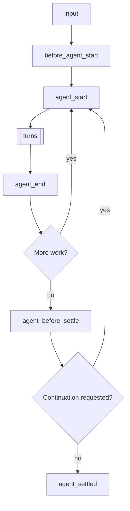
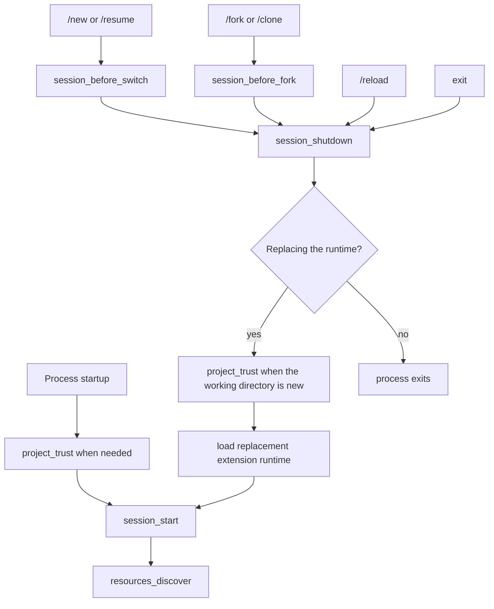

> Pi 可以创建扩展。要求它为你的用例构建一个。

# 扩展

扩展是用于扩展 Pi 行为的 TypeScript 模块。它们可以订阅生命周期事件、注册 LLM 可调用的自定义工具、添加命令等。

扩展在 Pi 进程内运行，拥有相同的操作系统权限。它可以检查提示词、工具调用、文件、凭据和会话历史，因此请仅从可信来源加载扩展。

> **放在 /reload 下：** 将扩展放在 `~/.pi/agent/extensions/`（全局）或 `.pi/extensions/`（项目本地）中以便自动发现。仅在快速测试时使用 `pi -e ./path.ts`。位于自动发现位置的扩展可以通过 `/reload` 热重载。

**主要能力：**
- **自定义工具** - 通过 `pi.registerTool()` 注册 LLM 可调用的工具
- **事件拦截** - 阻止或修改工具调用、注入上下文、自定义压缩
- **用户交互** - 通过 `ctx.ui` 提示用户（选择、确认、输入、通知）
- **自定义 UI 组件** - 通过 `ctx.ui.custom()` 提供带键盘输入的完整 TUI 组件，用于复杂交互
- **自定义命令** - 通过 `pi.registerCommand()` 注册如 `/mycommand` 之类的命令
- **会话持久化** - 通过 `pi.appendEntry()` 存储重启后仍保留的状态
- **自定义渲染** - 控制工具调用/结果和消息在 TUI 中的显示方式
- **提供商和 MCP 服务器** - 注册模型提供商、虚拟模型和 MCP 服务器

**示例用例：**
- 权限门（在 `rm -rf`、`sudo` 等操作前确认）
- Git 检查点（每轮暂存，在分支上恢复）
- 路径保护（阻止写入 `.env`、`node_modules/`）
- 自定义压缩（按你的方式总结对话）
- 对话摘要（参见 `summarize.ts` 示例）
- 交互式工具（提问、向导、自定义对话框）
- 有状态工具（待办列表、连接池）
- 外部集成（文件监视器、Webhook、CI 触发器）
- 等待期间的小游戏（参见 `snake.ts` 示例）

另见 [examples/extensions/](https://github.com/earendil-works/pi/tree/main/packages/coding-agent/examples/extensions/) 获取可运行的实现。

## 目录

- [快速开始](#quick-start)
- [扩展位置](#extension-locations)
- [可用的导入](#available-imports)
- [编写扩展](#writing-an-extension)
  - [扩展风格](#extension-styles)
- [事件](#events)
  - [生命周期概述](#lifecycle-overview)
  - [处理器组成](#handler-composition)
  - [启动事件](#startup-events)
  - [资源事件](#resource-events)
  - [会话事件](#session-events)
  - [代理事件](#agent-events)
  - [模型事件](#model-events)
  - [工具事件](#tool-events)
  - [用户 Bash 事件](#user-bash-events)
  - [输入事件](#input-events)
- [扩展上下文](#extensioncontext)
- [扩展命令上下文](#extensioncommandcontext)
- [扩展 API 方法](#extensionapi-methods)
- [状态管理](#state-management)
- [自定义工具](#custom-tools)
  - [工具暴露](#tool-exposure)
  - [调用其他工具](#calling-other-tools)
  - [动态工具加载](#dynamic-tool-loading)
- [MCP 服务器](#mcp-servers)
- [自定义 UI](#custom-ui)
- [错误处理](#error-handling)
- [模式行为](#mode-behavior)
- [示例参考](#examples-reference)

<a id="create-an-extension"></a>

## 快速开始

创建 `~/.pi/agent/extensions/my-extension.ts`：

```typescript
import { type ExtensionAPI, isToolCallEventType } from "@earendil-works/pi-coding-agent";
import { Type } from "typebox";

export default function (pi: ExtensionAPI) {
  // 响应事件
  pi.on("session_start", async (_event, ctx) => {
    ctx.ui.notify("扩展已加载！", "info");
  });

  pi.on("tool_call", async (event, ctx) => {
    if (isToolCallEventType("bash", event) && event.input.command.includes("rm -rf")) {
      const ok = await ctx.ui.confirm("危险操作！", "是否允许 rm -rf？");
      if (!ok) return { block: true, reason: "用户已阻止" };
    }
  });

  // 注册自定义工具
  pi.registerTool({
    name: "greet",
    label: "问候",
    description: "按名称问候某人",
    parameters: Type.Object({
      name: Type.String({ description: "被问候者的姓名" }),
    }),
    async execute(toolCallId, params, signal, onUpdate, ctx) {
      return {
        content: [{ type: "text", text: `你好，${params.name}！` }],
        details: {},
      };
    },
  });

  // 注册命令
  pi.registerCommand("hello", {
    description: "打招呼",
    handler: async (args, ctx) => {
      ctx.ui.notify(`你好，${args || "世界"}！`, "info");
    },
  });
}
```

使用 `--extension`（或 `-e`）标志进行测试：

```bash
pi -e ./my-extension.ts
```

<a id="choose-where-it-loads"></a>

## 扩展位置

> **安全提示：** 扩展程序拥有您的完整系统权限，可以执行任意代码。请仅从您信任的来源安装。

扩展程序会自动从可信位置被发现。项目本地的 `.pi/extensions` 条目仅在该项目被信任后才会加载。

| 位置 | 作用域 |
|------|--------|
| `~/.pi/agent/extensions/*.ts` 或 `*.js` | 全局（所有项目） |
| `~/.pi/agent/extensions/*/index.ts` 或 `index.js` | 全局（子目录） |
| `~/.pi/agent/extensions/*/package.json` 且包含 `pi.extensions` 字段 | 全局（带清单的子目录） |
| `.pi/extensions/...` | 项目本地，布局同上 |

发现机制仅扫描一级深度。较大的软件包在 `package.json` 清单中声明其入口点。

可通过 `settings.json` 添加额外路径：

```json
{
  "packages": [
    "npm:@foo/bar@1.0.0",
    "git:github.com/user/repo@v1"
  ],
  "extensions": [
    "/path/to/local/extension.ts",
    "/path/to/local/extension/dir"
  ]
}
```

设置也接受内置扩展作为 `builtin:<name>` 条目；参见 [设置](settings.md#resources)。要通过 npm 或 git 以 Pi 软件包的形式共享扩展，请参见 [packages.md](/docs/packages/)。

## 可用导入

| 软件包 | 用途 |
|---------|---------|
| `@earendil-works/pi-coding-agent` | 扩展类型（`ExtensionAPI`、`ExtensionContext`、事件）及辅助工具 |
| `@earendil-works/pi-agent-core` | 智能体消息与工具类型 |
| `typebox`, `typebox/compile`, `typebox/value` | 工具参数的架构定义 |
| `@earendil-works/pi-ai` | AI 实用工具（用于字符串枚举的 `StringEnum`、转录辅助工具、模型类型） |
| `@earendil-works/pi-ai/compat`, `/models`, `/oauth`, `/providers/all` | 提供商构建、内置 API 及 OAuth 辅助工具 |
| `@earendil-works/pi-tui` | 用于自定义渲染的 TUI 组件 |

Pi 会将这些导入映射到其自身的副本，因此扩展与 Pi 共享类与注册表。旧的 `@mariozechner/*` 与 `@sinclair/typebox` 名称映射到相同的模块。

npm 依赖同样可用。在扩展旁边（或父目录中）放置一个 `package.json`，运行 `npm install`，来自 `node_modules/` 的导入会被自动解析。

对于通过 `pi install`（npm 或 git）安装的已分发 Pi 软件包，运行时依赖必须放在 `dependencies` 中；`devDependencies` 不会被安装。请勿将上述宿主提供的软件包列入 `dependencies`。参见[声明依赖](packages.md#declare-dependencies)。

Node.js 内置模块（`node:fs`、`node:path` 等）同样可用。

## 编写扩展

扩展导出一个默认工厂函数，该函数接收 `ExtensionAPI`。工厂函数可以是同步的，也可以是异步的：

```typescript
import type { ExtensionAPI } from "@earendil-works/pi-coding-agent";

export default function (pi: ExtensionAPI) {
  // 订阅事件
  pi.on("event_name", async (event, ctx) => {
    // ctx.ui 用于用户交互
    const ok = await ctx.ui.confirm("Title", "Are you sure?");
    ctx.ui.notify("Done!", "info");
    ctx.ui.setStatus("my-ext", "Processing...");  // 底部状态栏
    ctx.ui.setWidget("my-ext", ["Line 1", "Line 2"]);  // 编辑器上方的组件（默认）
  });

  // 注册工具、命令、快捷键、标志
  pi.registerTool({ ... });
  pi.registerCommand("name", { ... });
  pi.registerShortcut("ctrl+x", { ... });
  pi.registerFlag("my-flag", { ... });
}
```

扩展通过 [jiti](https://github.com/unjs/jiti) 加载，因此 TypeScript 无需编译即可运行。

如果工厂函数返回 `Promise`，Pi 会等待其完成后再继续启动。这意味着异步初始化会在 `session_start`、`resources_discover` 之前完成，并且通过 `pi.registerProvider()` 排队注册的提供商也会在刷新前完成注册。

### 异步工厂函数

对于一次性启动工作（如获取远程配置或动态发现可用模型），可使用异步工厂函数。

```typescript
import type { ExtensionAPI } from "@earendil-works/pi-coding-agent";

export default async function (pi: ExtensionAPI) {
  const response = await fetch("http://localhost:1234/v1/models");
  const payload = (await response.json()) as {
    data: Array<{
      id: string;
      name?: string;
      context_window?: number;
      max_tokens?: number;
    }>;
  };

  pi.registerProvider("local-openai", {
    baseUrl: "http://localhost:1234/v1",
    apiKey: "$LOCAL_OPENAI_API_KEY",
    api: "openai-completions",
    models: payload.data.map((model) => ({
      id: model.id,
      name: model.name ?? model.id,
      reasoning: false,
      input: ["text"],
      cost: { input: 0, output: 0, cacheRead: 0, cacheWrite: 0 },
      contextWindow: model.context_window ?? 128000,
      maxTokens: model.max_tokens ?? 4096,
    })),
  });
}
```

这种模式使获取到的模型在正常启动期间以及 `pi --list-models` 命令中可用。若模型列表在 Pi 运行期间会变化，请改为实现 `refreshModels`；参见 [pi.registerProvider()](#piregisterprovidername-config)。

### 长生命周期资源与关闭

扩展工厂可能在从未启动会话的调用中运行。不要从工厂启动后台资源，如进程、套接字、文件监视器或定时器。

推迟后台资源的启动，直到 `session_start` 或需要该资源的命令/工具/事件。注册一个幂等的 `session_shutdown` 处理程序，以关闭你启动的任何会话级资源。

### 扩展样式

**单文件** - 最简单，适用于小型扩展：

```
~/.pi/agent/extensions/
└── my-extension.ts
```

**带 index.ts 的目录** - 用于多文件扩展：

```
~/.pi/agent/extensions/
└── my-extension/
    ├── index.ts        # 入口点（导出默认函数）
    ├── tools.ts        # 辅助模块
    └── utils.ts        # 辅助模块
```

**带依赖的软件包** - 用于需要 npm 软件包的扩展：

```
~/.pi/agent/extensions/
└── my-extension/
    ├── package.json    # 声明依赖和入口点
    ├── package-lock.json
    ├── node_modules/   # 在 npm install 之后
    └── src/
        └── index.ts
```

```json
// package.json
{
  "name": "my-extension",
  "dependencies": {
    "zod": "^3.0.0",
    "chalk": "^5.0.0"
  },
  "pi": {
    "extensions": ["./src/index.ts"]
  }
}
```

在扩展目录中运行 `npm install`，然后自动从 `node_modules/` 导入。

<a id="extension-events"></a>

## 事件

<a id="understand-the-lifecycle"></a>

### 生命周期概述

提示词启动一次运行。输入处理首先进行：

1. 扩展命令（`/name`）执行其处理器。`input` 事件不会触发。键入和 RPC 提示词始终检查命令；`pi.sendUserMessage()` 仅在 `expandPromptTemplates: true` 时检查。
2. `input` 处理器可以拦截、转换或处理文本。
3. 技能命令（`/skill:name`）和提示词模板（`/template`）展开。
4. `before_agent_start` 运行，然后代理循环开始。

运行重复轮次，然后检查是否有更多工作启动另一个低级代理运行：



更多工作意味着重试、最终尝试恢复、压缩重试或排队消息。因此，`agent_end` 不是最终空闲信号；请使用 `agent_settled` 来表示。中止的运行会跳过 `agent_before_settle`，直接从 `agent_end` 进入 `agent_settled`。当运行启动时（包括压缩检查和 `before_agent_start`），Pi 被视为忙碌，因此在此期间发送的消息会进入正在启动的运行。

每一轮发送一个模型请求，并执行助手响应中的工具调用：


模型请求按顺序运行以下钩子：

1. `context`（可以修改对话消息）
2. `context_with_system`（可以修改完整记录）
3. `before_provider_headers`（可以修改头部）
4. `before_provider_request`（可以检查或替换负载）
5. `after_provider_response`（状态和头部，在流被消费之前）
6. `provider_stream_event`（原始解析的流事件）以及用于助手消息的 `message_start` / `message_update` / `message_end`

执行的工具调用按顺序运行以下钩子：

1. `tool_execution_start`
2. `tool_call`（可以阻止或修改输入）
3. 工具执行期间的 `tool_execution_update`
4. `tool_result`（可以修改结果）
5. `tool_execution_end`

未执行的调用提前结束。未知工具或无效参数跳过 `tool_call`；被阻止或中止的调用跳过执行和 `tool_result`。这些调用中的每一个仍然会以错误结果获得 `tool_execution_end`，因此使用 `tool_execution_end` 来观察每个已完成的调用。

`turn_end` 可以追加条目并请求继续。阈值压缩在自然需要的下一轮之前运行。消息事件也会为其他消息触发，例如用户、工具结果和自定义消息。提供商钩子仅在传输暴露相应阶段时运行。

会话启动和替换遵循单独的生命周期：



`session_start` 携带 `reason: "startup" | "reload" | "new" | "resume" | "fork"`，`session_shutdown` 携带 `reason: "quit" | "reload" | "new" | "resume" | "fork"`。`resources_discover` 在重载后使用 `reason: "reload"`，否则使用 `"startup"`。退出涵盖 Ctrl+C、Ctrl+D、SIGHUP 和 SIGTERM。`project_trust` 在受信任的项目资源加载之前运行，并且当会话替换进入新的工作目录时可以再次运行。

其他操作更改当前会话而不替换运行时：

| 操作 | 事件 |
|---|---|
| `/compact` 或自动压缩 | `session_before_compact`（可以取消或自定义），然后 `session_compact` 或 `session_compact_failed` |
| `/tree` 导航 | `session_before_tree`（可以取消或自定义），然后 `session_tree` |
| `/name` 或 `pi.setSessionName()` | `session_info_changed` |
| `/model` 或模型循环（`Ctrl+P`） | 如果级别更改或被限制，则 `thinking_level_select`，然后 `model_select` |
| 思考级别更改（设置、按键绑定、`pi.setThinkingLevel()`） | `thinking_level_select` |
| `!` 或 `!!` 命令 | `user_bash`（可以拦截） |
| 扩展对话框或自定义屏幕等待用户 | `ui_prompt_start`、`ui_prompt_end` |
| 空闲提示缓存刷新 | `cache_warming_decision` |
| 扩展在启动后注册或移除 MCP 服务器 | `mcp_servers_change` |

<a id="events-and-concurrency"></a>
<a id="work-with-events"></a>

### 处理器组合

处理器按扩展加载顺序执行，然后是注册顺序。某些事件仅用于通知；另一些则转换数据、替换结果或取消操作：

| 模式 | 行为 |
|---|---|
| 通知 | 返回值被忽略。仅将事件用于观察。 |
| 原地修改 | 后续处理器看到对 `before_provider_headers.headers`、`before_agent_start.systemPromptOptions` 和 `tool_call.input` 等值的修改。 |
| 链式转换 | 后续处理器接收由较早的 `input`、`context`、`context_with_system`、`message_end`、`tool_result` 和 `before_provider_request` 处理器返回的值。 |
| 门控 | 已处理的输入、被阻止的工具调用、被取消的会话操作或已处理的 `user_bash` 命令会停止该操作的正常回退路径。 |
| 可操作边界 | 每个 `turn_end` 或 `agent_before_settle` 处理器都会看到目前提出的条目和继续决策。 |
| 最后覆盖 | 最后一个返回动作的 `cache_warming_decision` 处理器获胜。 |

通知处理器不应对流式事件执行耗时操作。转换处理器应保留其非有意拥有的字段，门控处理器在无法做出安全决策时应默认关闭。

### 启动事件

#### project_trust

在 Pi 决定是否信任一个带有动态配置（`.pi` 或 `.agents/skills`）的项目之前，会触发 `project_trust` 事件。该事件在启动时以及会话替换（例如 `/resume`）进入当前进程中信任状态尚未解析的工作目录时运行。只有用户/全局扩展和 CLI `-e` 扩展参与其中；项目本地扩展在信任解析完成之前不会被加载。

```typescript
pi.on("project_trust", async (event, ctx) => {
  // event.cwd - 当前工作目录
  // ctx 提供一个受限的信任上下文：cwd、模式、hasUI，以及 select/confirm/input/notify UI 辅助工具
  if (await ctx.ui.confirm("信任该项目？", event.cwd)) {
    return { trusted: "yes", remember: true };
  }
  return { trusted: "undecided" };
});
```

`project_trust` 事件处理器必须返回 `{ trusted: "yes" | "no" | "undecided" }`。返回 `"yes"` 或 `"no"` 的用户/全局或 CLI 扩展拥有决策权；首个 yes/no 决策胜出，并抑制内置的信任提示。使用 `remember: true` 来持久化一个 yes/no 决策；否则该决策仅适用于当前进程。返回 `"undecided"` 让后续处理器或内置信任流程来决定。在提示之前检查 `ctx.hasUI`。如果没有处理器返回 yes/no，则继续正常的信任解析流程：先应用已保存的 `trust.json` 决策，然后 `defaultProjectTrust` 决定 Pi 默认是询问、信任还是拒绝。

### 资源事件

#### resources_discover

在 `session_start` 之后触发，以便扩展能够贡献额外的技能、提示词模板和主题路径。
启动路径使用 `reason: "startup"`。重新加载使用 `reason: "reload"`。

```typescript
pi.on("resources_discover", async (event, _ctx) => {
  // event.cwd - 当前工作目录
  // event.reason - "startup" | "reload"
  return {
    skillPaths: ["/path/to/skills"],
    promptPaths: ["/path/to/prompts"],
    themePaths: ["/path/to/themes"],
  };
});
```

#### mcp_servers_change

当扩展在绑定后注册或注销MCP服务器时触发。`event.servers` 在变更后列出所有已注册的服务器。处理此事件会将扩展标记为连接注册服务器的扩展；参见 [MCP服务器](#mcp-servers)。

### 会话事件

关于会话存储的内部机制及 SessionManager API，请参阅 [会话格式](/docs/session-format/)。

#### session_start

当会话启动、加载或重新加载时触发。

```typescript
pi.on("session_start", async (event, ctx) => {
  // event.reason - "startup" | "reload" | "new" | "resume" | "fork"
  // event.previousSessionFile - 在 "new"、"resume" 和 "fork" 时存在
  ctx.ui.notify(`会话: ${ctx.sessionManager.getSessionFile() ?? "临时"}`, "info");
});
```

#### session_info_changed

当通过 `/name` 命令、RPC 或 `pi.setSessionName()` 设置当前会话显示名称时触发。

```typescript
pi.on("session_info_changed", async (event, ctx) => {
  // event.name - 当前规范化名称，若已清除则为 undefined
  ctx.ui.notify(`会话已重命名：${event.name ?? "(无)"}`, "info");
});
```

#### session_before_switch

在开始新会话（`/new`）或切换会话（`/resume`）之前触发。

```typescript
pi.on("session_before_switch", async (event, ctx) => {
  // event.reason - "new" 或 "resume"
  // event.targetSessionFile - 即将切换到的会话（仅 "resume" 时存在）

  if (event.reason === "new") {
    const ok = await ctx.ui.confirm("清空?", "删除所有消息?");
    if (!ok) return { cancel: true };
  }
});
```

成功切换或开始新会话后，Pi 会为旧的扩展实例发出 `session_shutdown`，重新加载并绑定新会话的扩展，然后发出带有 `reason: "new" | "resume"` 和 `previousSessionFile` 的 `session_start`。
在 `session_shutdown` 中执行清理工作，然后在 `session_start` 中重建任何内存状态。

#### session_before_fork

通过 `/fork` 分叉或 `/clone` 克隆时触发。

```typescript
pi.on("session_before_fork", async (event, ctx) => {
  // event.entryId - 所选条目的 ID
  // event.position - "/fork" 时为 "before"，"/clone" 时为 "at"
  return { cancel: true }; // 取消分叉/克隆
  // 或
  return { skipConversationRestore: true }; // 保留用于未来的会话恢复控制
});
```

分叉或克隆成功后，Pi 会为旧扩展实例发出 `session_shutdown`，为新会话重新加载并重新绑定扩展，然后发出带有 `reason: "fork"` 和 `previousSessionFile` 的 `session_start`。
在 `session_shutdown` 中执行清理工作，然后在 `session_start` 中重新建立任何内存状态。

<a id="session_before_compact--session_compact"></a>

#### session_before_compact / session_compact / session_compact_failed

在压缩时触发。详见 [compaction.md](/docs/compaction/)。

```typescript
pi.on("session_before_compact", async (event, ctx) => {
  const { preparation, branchEntries, customInstructions, reason, willRetry, signal } = event;

  // reason - "manual" (/compact)、"threshold" 或 "overflow"
  // willRetry - 压缩后是否重试被中止的回合（溢出恢复）

  // 取消：
  return { cancel: true };

  // 自定义摘要：
  return {
    compaction: {
      summary: "...",
      firstKeptEntryId: preparation.firstKeptEntryId,
      tokensBefore: preparation.tokensBefore,
      // usage: summaryResponse.usage, // 可选；包含在会话总计中
    }
  };
});

pi.on("session_compact", async (event, ctx) => {
  // event.compactionEntry - 保存的压缩内容
  // event.fromExtension - 是否由扩展提供
  // event.reason - "manual" (/compact)、"threshold" 或 "overflow"
  // event.willRetry - 压缩后是否重试被中止的回合（溢出恢复）
});

pi.on("session_compact_failed", async (event, ctx) => {
  // event.reason - "manual" (/compact)、"threshold" 或 "overflow"
  // event.errorMessage - 非中止失败时存在
  // event.aborted - 对于已取消/中止的压缩为 true
  // event.willRetry - 压缩后是否重试被中止的回合
  // event.fromExtension - 是否使用了扩展提供的压缩内容
});
```

#### session_before_tree / session_tree

在 `/tree` 导航时触发。有关树导航的概念，请参阅 [会话](/docs/sessions/)。

```typescript
pi.on("session_before_tree", async (event, ctx) => {
  const { preparation, signal } = event;
  // preparation.targetId, oldLeafId, commonAncestorId, entriesToSummarize,
  // userWantsSummary, customInstructions, replaceInstructions, label
  return { cancel: true };
  // 或者提供自定义摘要（仅在 preparation.userWantsSummary 为 true 时使用）：
  return {
    summary: {
      summary: "...",
      // usage: summaryResponse.usage, // 可选；包含在会话总计中
      details: {},
    },
  };
  // 或者覆盖摘要选项：customInstructions、replaceInstructions、label
});

pi.on("session_tree", async (event, ctx) => {
  // event.newLeafId, oldLeafId, summaryEntry, fromExtension
});
```

#### session_shutdown

在已启动的会话运行时被销毁之前触发。利用此事件清理从 `session_start` 或其他会话作用域钩子中打开的资源。

```typescript
pi.on("session_shutdown", async (event, ctx) => {
  // event.reason - "quit" | "reload" | "new" | "resume" | "fork"
  // event.targetSessionFile - 会话替换流程的目标会话
  // 清理资源、保存状态等。
});
```

### 代理事件

#### before_agent_start

在运行开始前触发，发生在输入处理和扩展之后。可以注入消息和/或修改系统提示。

`event.messageType` 说明是什么启动了运行：`"user"` 表示提示词或 `pi.sendUserMessage()`，带有 `prompt` 和 `images`；`"custom"` 表示空闲时通过 `pi.sendMessage(..., { triggerTurn: true })` 启动，带有起始 `message` 且没有 `prompt`。

```typescript
pi.on("before_agent_start", async (event, ctx) => {
  // event.messageType - "user" | "custom"
  // event.prompt、event.images - 用户的提示词文本和图片（messageType 为 "user"）
  // event.message - 启动运行的自定义消息（messageType 为 "custom"）
  // event.systemPrompt - 当前处理器链式系统提示
  //   （包含之前 before_agent_start 处理器所做的更改）
  // event.systemPromptOptions - 用于构建系统提示的结构化选项
  //   .customPrompt - 来自 --system-prompt、SYSTEM.md 或自定义模板的精确提示词前缀
  //   .forceSystemPrompt - 可选，完整提示词的精确替换
  //   .selectedTools - 提示词中当前启用的工具
  //   .hiddenTools - 所选工具中声明请求省略的部分
  //   .toolSnippets - 每个工具的一行描述
  //   .toolGuidelines - 按工具名称索引的规则要点
  //   .promptGuidelines - 附加的自定义规则要点
  //   .sections - 按标签名称索引的自定义 XML 包装部分
  //   .appendSystemPrompt - 来自 --append-system-prompt 标志的文本
  //   .cwd - 工作目录
  //   .contextFiles - AGENTS.md 文件和其他已加载的上下文文件
  //   .skills - 已加载的技能

  return {
    // 注入持久消息（存储在会话中，发送给 LLM）
    message: {
      customType: "my-extension",
      content: "Additional context for the LLM",
      display: true,
    },
    // 替换此轮的系统提示（跨扩展链式）
    systemPrompt: event.systemPrompt + "\n\nExtra instructions for this turn...",
  };
});
```

返回的 `message` 会被添加到任一类型的运行中；检查 `messageType` 可以跳过由自定义消息启动的运行。

`systemPromptOptions` 字段让扩展可以访问 Pi 用来构建系统提示的相同结构化数据。集合是可变的。优先修改 `sections`、`selectedTools` 或 `promptGuidelines`：Pi 会将生成的提示部分与模型已拥有的内容进行对比，并追加一条系统消息，仅修补已更改的部分。返回 `systemPrompt` 或设置 `forceSystemPrompt` 会替换整个运行的提示：每个提供商都会收到强制文本作为其主导系统提示（更改时会产生缓存未命中），而会话记录会继续记录结构化部分。工具选择更改会同时更新提示贡献和可执行的提供商工具；在处理器内调用 `pi.setActiveTools()` 与编辑 `selectedTools` 效果相同。在对话中途接受系统消息的模型会原地接收补丁并保留其缓存前缀；其他模型会获得重放的提示作为其系统提示，每次更改都会产生一次缓存未命中。

在 `before_agent_start` 内部，`event.systemPrompt` 和 `ctx.getSystemPrompt()` 都反映当前处理器链中的系统提示。后面的 `before_agent_start` 处理器仍可再次修改它。

<a id="agent_start--agent_end--agent_settled"></a>

#### agent_start / agent_end / agent_before_settle / agent_settled

`agent_start` 在底层智能体运行开始时触发。`agent_end` 在该运行结束时触发，但 Pi 可能仍会自动重试、自动压缩后重试，或继续处理排队的追问消息。`agent_before_settle` 是最终的可操作边界：它可以追加会话条目并请求一次继续运行。`agent_settled` 是最终阶段，仅用于通知；适合需要确认 Pi 不会继续自动运行的状态集成场景使用。

```typescript
pi.on("agent_start", async (_event, ctx) => {});

pi.on("agent_end", async (event, ctx) => {
  // event.messages - 本次底层运行产生的消息
});

let addedReviewReminder = false;
pi.on("agent_before_settle", async (event, ctx) => {
  if (addedReviewReminder) return;
  addedReviewReminder = true;
  return {
    entries: [...event.entries, {
      type: "custom_message",
      customType: "review-reminder",
      content: "回复前请检查最终差异。",
      display: false,
    }],
    continue: true,
  };
});

pi.on("agent_settled", async (event, ctx) => {
  // event.aborted - 当运行因中止而结束时为 true，例如按 Escape 键
  // ctx.isIdle() 为 true；此处请求的运行会在所有 settled 处理器完成后开始。
});
```

如果运行在 `agent_before_settle` 处理器执行期间被中止，返回的合法条目仍会被提交，但请求的继续运行会被抑制。从 `agent_settled` 请求的工作会延迟到所有 settled 处理器完成后执行，因此通知分发是不可重入的。

#### ui_prompt_start / ui_prompt_end

面向用户的外壳扩展 UI 提示的仅通知生命周期事件。这些事件在 `ctx.ui.select()`、`ctx.ui.confirm()`、`ctx.ui.input()`、`ctx.ui.editor()` 以及 `ctx.ui.custom()` 周围触发，以便主机/状态集成可以报告“正在等待用户”而不仅仅是“正在运行”。

嵌套或重叠的提示会被合并为一个外层等待区间。处理程序以尽力而为的方式调用，在显示或关闭提示前不会被等待。

```typescript
pi.on("ui_prompt_start", async (event, ctx) => {
  // event.reason === "ui_prompt"
  // event.kind: "select" | "confirm" | "input" | "editor" | "custom"
  // event.title: 可用时的提示标题
});

pi.on("ui_prompt_end", async (event, ctx) => {
  // Pi 不再等待该 UI 提示区间。
});
```

#### turn_start / turn_end

每个回合（一次 LLM 响应 + 工具调用）触发。

```typescript
pi.on("turn_start", async (event, ctx) => {
  // event.turnIndex, event.timestamp
});

let replacedResponse = false;
pi.on("turn_end", async (event, ctx) => {
  // event.turnIndex, event.message, event.toolResults
  // event.entries 包含目前提议的结构化条目。
  if (replacedResponse || event.outcome !== "completed" || event.toolResults.length > 0) return;
  replacedResponse = true;
  return {
    entries: [
      ...event.entries,
      { type: "context_edit", targetId: event.messageEntryId, replacement: null },
      {
        type: "custom_message",
        customType: "replacement-instruction",
        content: "Answer again using the persisted user request.",
        display: false,
      },
    ],
    continue: true,
  };
});
```

`turn_end` 在助手和工具结果消息持久化之后、底层 `turn_end` 事件之前运行。重试退避和最终尝试恢复仍在 `agent_end` 之后发生，保留其现有生命周期和队列顺序；`agent_before_settle` 在该工作完成后看到修复后的投影。边界处理器按扩展加载和注册顺序运行。每个处理器在 `event.entries` 中看到先前的提议，并看到从它们重建的 `event.context`。返回 `entries` 或 `continue` 仅替换该字段；省略的字段保留当前提议。允许的草稿条目类型为 `custom`、`custom_message`、`context_edit` 和 `compaction`。完整提议在所有处理器完成后按列表顺序追加前进行验证；处理器错误会被报告，后续处理器仍会运行。验证可防止部分应用的语义错误，但持久化并非事务性的。

`continue: true` 确保该边界调用有一次后续提供商请求。如果工具结果、引导或追问已导致该请求，则满足决策且不再发出额外请求；否则 Pi 会发出一次仅上下文的请求。错误和中止的响应仍是硬退出。`continue: false` 从不抑制自然工作。守护继续条件：无条件的 `continue: true` 会在下一次响应后再次评估，可能造成无限循环。`custom_message` 草稿贡献一条用户角色模型消息，但由扩展编写：它不运行人类输入钩子、斜杠命令、技能或提示词模板。

构造 `TurnEndEvent` 值的主机集成必须提供 `messageEntryId`、`toolResultEntryIds`、`outcome`、`entries`、`continue` 和 `context`。`ExtensionEvent` 穷举切换也必须处理 `agent_before_settle`。`ExtensionRunner.emit()` 排除可操作的回合边界；通过 `emitBoundary(baseEvent, buildContext)` 分发 `turn_end` 和 `agent_before_settle`，以便处理器接收链式预览。其他专用运行器方法仍为 `session_before_*` 等事件返回结果。

#### message_start / message_update / message_end

为消息生命周期更新触发的事件。

- `message_start` 和 `message_end` 为每一条消息触发，包括用户消息、助手消息、工具结果消息以及自定义消息。
- `message_update` 为助手流式更新触发。
- `message_end` 处理器可以返回 `{ message }` 来替换最终确定的消息。替换后的消息必须保持相同的 `role`。

```typescript
pi.on("message_start", async (event, ctx) => {
  // event.message
});

pi.on("message_update", async (event, ctx) => {
  // event.message
  // event.assistantMessageEvent (token-by-token stream event)
});

pi.on("message_end", async (event, ctx) => {
  if (event.message.role !== "assistant") return;

  return {
    message: {
      ...event.message,
      usage: {
        ...event.message.usage,
        cost: {
          ...event.message.usage.cost,
          total: 0.123,
        },
      },
    },
  };
});
```

#### tool_execution_start / tool_execution_update / tool_execution_end

在工具执行生命周期更新时触发。

在并行工具模式下：
- `tool_execution_start` 在预检阶段按助手源顺序发出
- `tool_execution_update` 事件可能在不同工具之间交错出现
- `tool_execution_end` 在每个工具完成处理后按工具完成顺序发出
- 最终的 `toolResult` 消息事件仍会在稍后按助手源顺序发出

```typescript
pi.on("tool_execution_start", async (event, ctx) => {
  // event.toolCallId, event.toolName, event.args
});

pi.on("tool_execution_update", async (event, ctx) => {
  // event.toolCallId, event.toolName, event.args, event.partialResult
});

pi.on("tool_execution_end", async (event, ctx) => {
  // event.toolCallId, event.toolName, event.result, event.isError
  // event.durationMs - execute() 耗时（毫秒）；工具未运行时缺失
});
```

这三个事件以及 `tool_call` 和 `tool_result` 在由另一个工具发起调用时都会携带 `parentToolCallId`；参见 [调用其他工具](#calling-other-tools)。

#### context

每次调用 LLM 之前触发。以非破坏性方式修改消息。消息类型参见 [会话格式](/docs/session-format/)。

```typescript
pi.on("context", async (event, ctx) => {
  // event.messages - 不含系统消息的深拷贝，可安全修改
  const filtered = event.messages.filter(m => !shouldPrune(m));
  return { messages: filtered };
});
```

`event.messages` 保存的是不含系统消息的对话内容。提示词与工具声明属于 Pi，不属于此钩子的处理范围：当 handler 返回修改后的消息列表时，Pi 会将当前的提示词片段和工具声明重放为一条位于返回消息之前的首条系统消息。因此，基于压缩摘要的过滤、窗口化或切片操作无法移除提示词或工具。若返回未修改的列表，则对话中途的系统消息会保留原样，从而让接受这些系统消息的模型维持其缓存前缀。handler 新增的系统消息会置于 Pi 的头条消息之后。如需持久修改提示词或工具集，请使用 [`before_agent_start`](#before_agent_start) 或 `pi.setActiveTools()`；如需针对单次请求编辑系统消息，请使用 [`context_with_system`](#context_with_system)。

#### context_with_system

在每次 LLM 调用前触发，在所有 `context` 处理器运行后，Pi 已恢复提示词和工具状态。`event.messages` 是完整记录，包括开头的系统消息以及会话中途的任何提示词或工具补丁（参见[会话格式](session-format.md#sessionmessageentry)）。返回的消息原样发送：此钩子拥有请求的提示词和工具声明。

```typescript
import { getCurrentSystemMessage } from "@earendil-works/pi-ai";

pi.on("context_with_system", async (event, ctx) => {
  const cut = findCutIndex(event.messages);
  // 折叠被丢弃的前缀，使其提示词和工具状态作为新头部保留。
  const head = getCurrentSystemMessage(event.messages.slice(0, cut));
  return { messages: head ? [head, ...event.messages.slice(cut)] : event.messages.slice(cut) };
});
```

规则：保持索引 0 处有系统消息（提供商在此读取提示词和初始工具声明；如果处理器丢弃它，Pi 会报告错误）。移除系统消息会移除其携带的工具声明和区块补丁。使用 `@earendil-works/pi-ai` 中的 `getCurrentSystemPrompt()` 和 `getCurrentTools()` 检查输出。处理器按扩展加载顺序运行；从 `before_agent_start` 强制的 `systemPrompt` 仍会在之后投射到请求上。

#### before_provider_headers

在出站HTTP请求头组装完成后触发。用于添加、覆盖或删除请求头。

处理器直接修改 `event.headers`。将键设为字符串以添加或覆盖，设为 `null` 以删除。

```typescript
pi.on("before_provider_headers", (event, ctx) => {
  // 添加或覆盖——例如用于网关追踪/归属的会话ID
  event.headers["x-session-id"] = ctx.sessionManager.getSessionId();

  // 删除本次调用中 pi 添加的追踪请求头
  event.headers["X-OpenRouter-Title"] = null;
});
```

每次提供商请求执行一次；重试时复用相同的请求头，而非重新触发该钩子。

#### before_provider_request

在提供商特定载荷构建完成后、请求发送前触发。处理器按扩展加载顺序执行。返回 `undefined` 保持载荷不变。返回其他任何值将替换载荷，供后续处理器和实际请求使用。

此钩子可重写提供商级别的系统指令或完全移除它们。这些载荷级别的更改不会反映在 `ctx.getSystemPrompt()` 中，后者报告的是 Pi 的系统提示词字符串，而非最终序列化的提供商载荷。

```typescript
pi.on("before_provider_request", (event, ctx) => {
  console.log(JSON.stringify(event.payload, null, 2));

  // 可选：替换载荷
  // return { ...event.payload, temperature: 0 };
});
```

这主要用于调试提供商序列化和缓存行为。

#### after_provider_response

在收到 HTTP 响应之后、消费其流式正文之前触发。处理程序按扩展加载顺序执行。

```typescript
pi.on("after_provider_response", (event, ctx) => {
  // event.status - HTTP 状态码
  // event.headers - 规范化后的响应头
  if (event.status === 429) {
    console.log("请求被限流", event.headers["retry-after"]);
  }
});
```

响应头是否可用取决于提供商和传输层。抽象了 HTTP 响应的提供商可能不会暴露响应头。

#### provider_stream_event

在 Pi 规范化每个已解析的提供商流事件之前触发。仅作通知用途，不持久化。

```typescript
pi.on("provider_stream_event", (event, ctx) => {
  // event.provider, event.api, event.model
  // event.data - Pi 可用的最早结构化值（只读）
});
```

`event.data` 不一定是原始的 HTTP 字节或 SSE 帧。应将其视为只读，因为修改可能影响规范化。处理程序按流顺序等待执行，因此缓慢的处理程序会延迟流的消费。处理程序错误会被上报，但不会改变提供商的响应。参见 [`debug-provider.ts`](https://github.com/earendil-works/pi/blob/main/packages/coding-agent/examples/extensions/debug-provider.ts) 了解一个可选加入的查看器，它按助手消息对原始事件进行分组。

> 完整代码见英文原文。

#### cache_warming_decision

在每次提示词缓存刷新之前触发，并附带 Pi 的决策。事件仅携带 Pi 的成本估算；其余信息请使用 `ctx.model`、`ctx.isIdle()` 和 `ctx.getContextUsage()` 获取。

```typescript
pi.on("cache_warming_decision", (event, ctx) => {
  // event.warmCost: 本次刷新的价格
  // event.missCost: 如果条目丢失，下一次请求的额外价格
  // event.continuationProbability: Pi 对请求准时到达的估计
  // event.action: "warm" | "stop"，Pi 的决策

  if (ctx.model?.provider === "my-provider") {
    return { action: "stop" };
  }
});
```

返回 `{ action: "warm" }` 或 `{ action: "stop" }` 以覆盖决策；最后返回动作的处理程序生效。`"stop"` 将结束预热，直到下一次真实请求。

### 模型事件</think>### 模型事件

#### 模型选择

当通过 `/model` 命令、模型循环（`Ctrl+P`）或 `pi.setModel()` 更改模型时触发。恢复会话不会触发此事件；请在 `session_start` 中读取 `ctx.model` 以初始化依赖模型的状态。

```typescript
pi.on("model_select", async (event, ctx) => {
  // event.model - 新选定的模型
  // event.previousModel - 之前的模型（首次选择时为 undefined）
  // event.source - "set" | "cycle"

  const prev = event.previousModel
    ? `${event.previousModel.provider}/${event.previousModel.id}`
    : "none";
  const next = `${event.model.provider}/${event.model.id}`;

  ctx.ui.notify(`模型已更改 (${event.source}): ${prev} -> ${next}`, "info");
});
```

在活动模型更改时，使用此事件更新 UI 元素（状态栏、页脚）或执行特定于模型的初始化。

#### thinking_level_select

当思考级别发生变化时触发。此事件仅用于通知；处理函数的返回值会被忽略。

```typescript
pi.on("thinking_level_select", async (event, ctx) => {
  // event.level - 新选择的思考级别
  // event.previousLevel - 之前的思考级别

  ctx.ui.setStatus("thinking", `thinking: ${event.level}`);
});
```

当 `pi.setThinkingLevel()`、模型变更或内置思考级别控件更改当前思考级别时，可使用此事件来更新扩展 UI。

<a id="tool-call-events"></a>

### 工具事件

#### tool_call

在 `tool_execution_start` 之后、工具执行之前触发。**可阻塞。** 使用 `isToolCallEventType` 来缩小范围并获得类型化的输入。

在 `tool_call` 运行之前，Pi 会等待先前发出的 Agent 事件通过 `AgentSession` 完成排空。这意味着 `ctx.sessionManager` 已更新到当前的助手工具调用消息。

在默认的并行工具执行模式下，来自同一助手消息的兄弟工具调用会按顺序预检，然后并发执行。`tool_call` 不保证在 `ctx.sessionManager` 中能看到来自同一助手消息的兄弟工具结果。

`event.input` 是可变的。在执行前直接修改它来修补工具参数。

行为保证：
- 对 `event.input` 的修改会影响实际的工具执行
- 后续的 `tool_call` 处理器能看到前面处理器所做的修改
- 修改后不再进行重新验证
- `tool_call` 的返回值通过 `{ block: true, reason?: string, terminate?: boolean }` 控制阻塞
- `terminate` 仅适用于被阻塞的调用；只有当批次中每个最终结果都是终止性的，代理才会提前停止

```typescript
import { isToolCallEventType } from "@earendil-works/pi-coding-agent";

pi.on("tool_call", async (event, ctx) => {
  // event.toolName - "bash", "read", "write", "edit" 等
  // event.toolCallId
  // event.input - 工具参数（可变）

  // 内置工具：无需类型参数
  if (isToolCallEventType("bash", event)) {
    // event.input 是 { command: string; timeout?: number }
    event.input.command = `source ~/.profile\n${event.input.command}`;

    if (event.input.command.includes("rm -rf")) {
      return { block: true, reason: "危险命令", terminate: true };
    }
  }

  if (isToolCallEventType("read", event)) {
    // event.input 是 { path: string; offset?: number; limit?: number }
    console.log(`正在读取: ${event.input.path}`);
  }
});
```

#### 自定义工具输入类型

自定义工具应导出其输入类型：

```typescript
// my-tool.ts
import { type Static, Type } from "typebox";

export const myToolSchema = Type.Object({ action: Type.String() });
export type MyToolInput = Static<typeof myToolSchema>;
```

使用带有显式类型参数的 `isToolCallEventType`：

```typescript
import { isToolCallEventType } from "@earendil-works/pi-coding-agent";
import type { MyToolInput } from "./my-tool.ts";

pi.on("tool_call", (event) => {
  if (isToolCallEventType<"my_tool", MyToolInput>("my_tool", event)) {
    event.input.action;  // 类型化
  }
});
```

#### tool_result

工具执行结束后触发，紧随其后的是 `tool_execution_end` 以及最终的 tool result 消息事件。**可修改结果。**

在并行工具模式下，`tool_result` 与 `tool_execution_end` 可能按照工具完成顺序交错出现，而最终的 `toolResult` 消息事件仍会在后续按助手源顺序发出。

`tool_result` 处理器以中间件方式链式执行：
- 处理器按扩展加载顺序执行
- 每个处理器都能看到先前处理器修改后的最新结果
- 处理器可以返回部分补丁（`content`、`details`、`structuredContent`、`isError` 或 `usage`）；省略的字段将保留当前值
- 仅替换 `content` 而未返回 `structuredContent` 时，结构化内容将被丢弃，因为其可能不再匹配

在处理器内部进行嵌套异步操作时，请使用 `ctx.signal`。这允许通过 Esc 取消模型调用、`fetch()` 以及扩展启动的其他支持中止的操作。

```typescript
import { isBashToolResult } from "@earendil-works/pi-coding-agent";

pi.on("tool_result", async (event, ctx) => {
  // event.toolName、event.toolCallId、event.input、event.parentToolCallId
  // event.content、event.details、event.structuredContent、event.isError、event.usage

  if (isBashToolResult(event)) {
    // event.details 类型为 BashToolDetails
  }

  const response = await fetch("https://example.com/summarize", {
    method: "POST",
    body: JSON.stringify({ content: event.content }),
    signal: ctx.signal,
  });

  // 修改结果：
  return { content: [...], details: {...}, isError: false, usage: nestedModelUsage };
});
```

### 用户 Bash 事件

#### user_bash

当用户执行 `!` 或 `!!` 命令时触发。**可被拦截。**

```typescript
import { createLocalBashOperations } from "@earendil-works/pi-coding-agent";

pi.on("user_bash", (event, ctx) => {
  // event.command - 执行的 bash 命令
  // event.excludeFromContext - 若为 true 表示使用 !! 前缀
  // event.cwd - 当前工作目录

  // 选项 1：提供自定义操作（例如 SSH）
  return { operations: remoteBashOps };

  // 选项 2：包裹 pi 的内置本地 bash 后端
  const local = createLocalBashOperations();
  return {
    operations: {
      exec(command, cwd, options) {
        return local.exec(`source ~/.profile\n${command}`, cwd, options);
      }
    }
  };

  // 选项 3：完全替换——直接返回结果
  return { result: { output: "...", exitCode: 0, cancelled: false, truncated: false } };
});
```

返回 `undefined` 会继续传递给下一个处理程序，若无任何处理程序则执行本地命令。有效返回值会终止传播：`operations` 通过提供的外部后端执行命令，而 `result` 则不执行命令，仅记录已完成的命令。

### 输入事件

#### input

当收到用户输入时触发，此时扩展命令已检查完毕，但技能和模板尚未展开。该事件看到的是原始输入文本，因此 `/skill:foo` 和 `/template` 尚未展开。

**处理顺序：**
1. 首先检查扩展命令（`/cmd`）——如果找到，则运行处理程序并跳过输入事件。来自 `pi.sendUserMessage()` 的消息仅在 `expandPromptTemplates: true` 时检查。
2. 触发 `input` 事件——可以拦截、转换或处理
3. 如果未处理：技能命令（`/skill:name`）展开为技能内容
4. 如果未处理：提示词模板（`/template`）展开为模板内容
5. 代理处理开始（`before_agent_start` 等）

```typescript
pi.on("input", async (event, ctx) => {
  // event.text - 原始输入（在技能/模板展开之前）
  // event.images - 附加的图片（如果有）
  // event.source - "interactive"（键入）、"rpc"（API）或 "extension"（通过 sendUserMessage）
  // event.streamingBehavior - "steer" | "followUp" | undefined
  //   空闲时为 undefined，"steer" 表示流中中断，
  //   "followUp" 表示消息排队直到代理完成

  // 转换：在展开之前重写输入
  if (event.text.startsWith("?quick "))
    return { action: "transform", text: `简要回复：${event.text.slice(7)}` };

  // 处理：无需 LLM 即可响应（扩展显示自己的反馈）
  if (event.text === "ping") {
    ctx.ui.notify("pong", "info");
    return { action: "handled" };
  }

  // 按来源路由：跳过扩展注入消息的处理
  if (event.source === "extension") return { action: "continue" };

  // 在展开之前拦截技能命令
  if (event.text.startsWith("/skill:")) {
    // 可以转换、阻止或放行
  }

  return { action: "continue" };  // 默认：放行到展开
});
```

**结果：**
- `continue` - 原样放行（如果处理程序不返回任何内容，则为默认值）
- `transform` - 修改文本/图片，然后继续展开
- `handled` - 完全跳过代理（第一个返回此值的处理程序获胜）

转换会在处理程序之间链式传递。有关 `streamingBehavior` 感知的路由，请参阅 [input-transform.ts](https://github.com/earendil-works/pi/blob/main/packages/coding-agent/examples/extensions/input-transform.ts) 和 [input-transform-streaming.ts](https://github.com/earendil-works/pi/blob/main/packages/coding-agent/examples/extensions/input-transform-streaming.ts)。

<a id="use-extension-context"></a>

## ExtensionContext

所有处理器都会收到 `ctx: ExtensionContext`。工具 `execute()` 接收 `ExtensionToolContext`，它增加了 `ctx.tools` 和 `ctx.executeTool()`（参见[调用其他工具](#calling-other-tools)）。命令处理器接收 [`ExtensionCommandContext`](#extensioncommandcontext)。

### ctx.ui

用于用户交互的UI方法。完整详情请参阅[自定义UI](#custom-ui)。

### ctx.mode

当前运行模式：`"tui"`、`"rpc"`、`"json"` 或 `"print"`。使用 `ctx.mode === "tui"` 来判断是否处于终端专属功能可用的环境中，例如 `custom()`、组件工厂、终端输入以及直接 TUI 渲染。

### ctx.hasUI

在 TUI 和 RPC 模式下为 `true`，在打印模式（`-p`）和 JSON 模式下为 `false`。可使用此属性来保护在 TUI 和 RPC 模式下均可用的对话框方法（`select`、`confirm`、`input`、`editor`）和即发即弃方法（`notify`、`setStatus`、`setWidget`、`setTitle`、`setEditorText`）。在 RPC 模式下，某些 TUI 专属方法是空操作或返回默认值（参见 [RPC 扩展界面](/docs/rpc-extension-ui/)）。

### ctx.cwd

当前工作目录。

在构造项目本地配置路径时，请使用 `CONFIG_DIR_NAME` 而非硬编码 `.pi`。改版后的发行版可能使用不同的配置目录名。

```typescript
import { CONFIG_DIR_NAME, type ExtensionAPI } from "@earendil-works/pi-coding-agent";
import { join } from "node:path";

export default function (pi: ExtensionAPI) {
  pi.on("session_start", (_event, ctx) => {
    // 构建项目本地配置路径
    const projectConfigPath = join(ctx.cwd, CONFIG_DIR_NAME, "my-extension.json");
    // ...
  });
}
```

### ctx.isProjectTrusted()

返回当前会话上下文中项目本地信任是否处于激活状态。这包括临时信任决策和 CLI 信任覆盖，而不仅仅是全局信任存储中保存的决策。

在读取仅应对受信任项目生效的项目本地扩展配置之前，请使用此方法。

### ctx.sessionManager

对会话状态的只读访问：`getCwd()`、`getSessionDir()`、`getSessionId()`、`getSessionFile()`、`getSessionName()`、`getHeader()`、`getEntries()`、`getEntry()`、`getBranch()`、`getTree()`、`getLeafId()`、`getLeafEntry()`、`getLabel()`、`buildContextEntries()` 和 `buildSessionProjection()`。条目类型参见[会话格式](/docs/session-format/)。

对于 `tool_call`，该状态在处理程序运行前通过当前助手消息同步。在并行工具执行模式下，仍不保证包含来自同一助手消息的兄弟工具结果。

```typescript
ctx.sessionManager.getEntries()             // 所有条目
ctx.sessionManager.getBranch()              // 当前分支
ctx.sessionManager.buildContextEntries()    // 应用压缩后的活动分支条目
ctx.sessionManager.getLeafId()              // 当前叶子条目 ID
```

### ctx.modelRegistry / ctx.model / ctx.thinkingLevel / ctx.scopedModels

访问模型、提供商和已解析的认证信息。`ctx.modelRegistry.getProvider(id)` 返回有效的 pi-ai 提供商，而 `getProviderAuth(id)` 解析其当前的 API 密钥、请求头、基础 URL 和提供商作用域环境，无需加载模型。`ctx.model` 是当前活动的模型，`ctx.thinkingLevel` 是其当前生效的思考级别。

`ctx.scopedModels` 是当前会话作用域内的模型只读列表——与 `/scoped-models` 命令显示的集合相同。它在会话启动时从 `--models` 命令行标志和 `enabledModels` 设置中解析（通过 minimatch 在 `provider/modelId` 或裸 `modelId` 上匹配可用目录）。当未配置作用域时为空列表，表示所有可用模型均可使用。每个条目为 `{ model, thinkingLevel? }`，其中 `thinkingLevel` 仅在模式固定时设置（例如 `anthropic/*:high`）。使用它来填充与内置选择器一致的模型选择器，而不是通过 `ctx.modelRegistry.getAvailable()` 枚举整个目录。

#### 流式模型调用

使用 `ctx.modelRegistry.streamSimple()` 处理如 `reasoning` 等提供商无关的选项，或使用 `streamComplete()` 等待最终助手消息并包含特定于 API 的选项。两者均使用配置的提供商并解析认证，包括通过 `pi.registerProvider()` 注册的提供商。请优先使用这些函数，而非 `pi-ai/compat` 中的流式函数，因为后者无法识别扩展提供商的注册。

`streamSimple()` 返回一个 `AssistantMessageEventStream`。遍历它以获取响应事件，并等待 `.result()` 以获取最终消息。设置失败会产生错误事件和错误结果。

对于非聊天模型，`findOfType()`、`getModelsOfType()`、`getAvailableOfType()` 和 `getModelOfType()` 查找图像及分类器模型，而 `classify()` 和 `generateImages()` 则会调用这些方法。详见 [使用分类器模型](models.md#use-classifier-models) 与 [使用图像模型](models.md#use-image-models)。

### ctx.signal

当前的代理中止信号，当没有代理轮次激活时为 `undefined`。

适用于由扩展处理器启动的感知中止的嵌套任务，例如：
- `fetch(..., { signal: ctx.signal })`
- 接受 `signal` 参数的模型调用
- 接受 `AbortSignal` 的文件或进程辅助函数

`ctx.signal` 通常在活跃轮次事件期间定义，如 `tool_call`、`tool_result`、`message_update` 和 `turn_end`。
在空闲或非轮次上下文中，通常是 `undefined`，例如会话事件、扩展命令以及在 Pi 空闲时触发的快捷键。

```typescript
pi.on("tool_result", async (event, ctx) => {
  const response = await fetch("https://example.com/api", {
    method: "POST",
    body: JSON.stringify(event),
    signal: ctx.signal,
  });

  const data = await response.json();
  return { details: data };
});
```

### ctx.isIdle() / ctx.abort() / ctx.hasPendingMessages()

控制流辅助函数。当 Pi 正在处理代理运行、自动重试、自动压缩重试或排队中的后续任务时，`ctx.isIdle()` 返回 `false`。

### ctx.shutdown()

请求 pi 进行优雅关闭。

- **交互模式：** 延迟至代理变为空闲时（在处理完所有排队的引导和追问消息之后）。
- **RPC 模式：** 延迟至下一个空闲状态（在当前命令响应完成，并等待下一条命令时）。
- **打印模式：** 不执行任何操作。当所有提示处理完毕后，进程自动退出。

在退出前，会向所有扩展发出 `session_shutdown` 事件。在所有上下文（事件处理器、工具、命令、快捷键）中均可使用。

```typescript
pi.on("tool_call", (event, ctx) => {
  if (isFatal(event.input)) {
    ctx.shutdown();
  }
});
```

### ctx.getContextUsage()

返回当前活动模型的上下文使用情况。若存在最近的助手使用记录，则优先采用该记录；否则，估算后续消息的令牌数。

```typescript
const usage = ctx.getContextUsage();
if (usage?.tokens != null && usage.tokens > 100_000) {
  // ...
}
```

### ctx.compact()

触发压缩而不等待完成。使用 `onComplete` 和 `onError` 进行后续操作。

```typescript
ctx.compact({
  customInstructions: "Focus on recent changes",
  onComplete: (result) => {
    ctx.ui.notify("Compaction completed", "info");
  },
  onError: (error) => {
    ctx.ui.notify(`Compaction failed: ${error.message}`, "error");
  },
});
```

### ctx.getSystemPrompt()

返回 Pi 当前的系统提示词字符串。

- 在 `before_agent_start` 期间，此方法反映当前轮次迄今为止所做的串联式系统提示词变更。
- 不包含后续 `context` 消息的修改。
- 不包含 `before_provider_request` 阶段的载荷重写。
- 如果稍后加载的扩展在你的扩展之后运行，它们仍然可以改变最终发送的内容。

```typescript
pi.on("before_agent_start", (event, ctx) => {
  const prompt = ctx.getSystemPrompt();
  console.log(`系统提示词长度: ${prompt.length}`);
});
```

## 扩展命令上下文

命令处理器接收到 `ExtensionCommandContext`，它扩展了 `ExtensionContext`，并添加了会话控制方法。这些方法仅在命令中可用，因为如果从事件处理器调用，它们可能导致死锁。

### ctx.getSystemPromptOptions()

返回 Pi 当前用于构建系统提示词的基础输入。

```typescript
const options = ctx.getSystemPromptOptions();
const contextPaths = options.contextFiles?.map((file) => file.path) ?? [];
```

其形状和可变性与 `before_agent_start` 的 `event.systemPromptOptions` 相同：自定义或强制提示词、启用的工具、工具片段、按工具和自定义规则、自定义部分、追加的提示词文本、当前工作目录、加载的上下文文件和加载的技能。它可能包含完整的上下文文件内容，因此请将其视为敏感的扩展本地数据，并避免通过命令列表、日志或自动补全元数据暴露它。

此方法报告当前的基准提示词输入。它不包括每轮的 `before_agent_start` 链式系统提示词更改、后续 `context` 事件消息修改，或 `before_provider_request` 负载重写。

### ctx.waitForIdle()

等待代理完全稳定，包括自动重试、自动压缩重试以及排队的后续操作：

```typescript
pi.registerCommand("my-cmd", {
  handler: async (args, ctx) => {
    await ctx.waitForIdle();
    // 代理现在处于空闲状态，可以安全地修改会话
  },
});
```

### ctx.newSession(options?)

创建一个新会话：

```typescript
const parentSession = ctx.sessionManager.getSessionFile();
const kickoff = "在替换会话中继续";

const result = await ctx.newSession({
  parentSession,
  setup: async (sm) => {
    sm.appendMessage({
      role: "user",
      content: [{ type: "text", text: "之前会话的上下文..." }],
      timestamp: Date.now(),
    });
  },
  withSession: async (ctx) => {
    // 这里仅使用替换会话的 `ctx`
    await ctx.sendUserMessage(kickoff);
  },
});

if (result.cancelled) {
  // 扩展取消了新会话
}
```

参数：
- `parentSession`：在新会话头部记录父会话文件。
- `setup`：在 `withSession` 运行前，修改新会话的 `SessionManager`。
- `withSession`：切换后，使用新的替换会话上下文执行操作。不要使用捕获的旧 `pi` / 命令 `ctx`；参见 [会话替换生命周期与陷阱](#session-replacement-lifecycle-and-footguns)。

### ctx.fork(entryId, options?)

从特定条目分叉（fork），创建新的会话文件：

```typescript
const result = await ctx.fork("entry-id-123", {
  withSession: async (ctx) => {
    // 此处仅使用替代会话的 ctx。
    ctx.ui.notify("Now in the forked session", "info");
  },
});
if (result.cancelled) {
  // 某扩展取消了分叉
}

const cloneResult = await ctx.fork("entry-id-456", { position: "at" });
if (cloneResult.cancelled) {
  // 某扩展取消了克隆
}
```

选项：
- `position`：`"before"`（默认）在选定的用户消息之前分叉，将提示词恢复至编辑器
- `position`：`"at"` 复制选定条目处的活动路径，不恢复编辑器文本
- `withSession`：在全新的替代会话上下文上执行切换后的工作。不要使用捕获的旧 `pi` / 命令 `ctx`；参见 [会话替换生命周期与踩坑](#session-replacement-lifecycle-and-footguns)。

### ctx.navigateTree(targetId, options?)

在会话树中导航到不同节点。当代理响应、手动或自动压缩，或另一个树导航正在进行时，即使使用 `summarize: false`，也会拒绝操作。这些冲突将使当前活动分支保持不变，并拒绝承诺，而不是返回 `{ cancelled: true }`。请等待活动操作完成（例如，在命令处理程序中使用 `await ctx.waitForIdle()`）后重试。当设置了 `summarize` 但没有可用模型，或目标条目不存在时，也会拒绝：

```typescript
const result = await ctx.navigateTree("entry-id-456", {
  summarize: true,
  customInstructions: "Focus on error handling changes",
  replaceInstructions: false, // true = 完全替换默认提示词
  label: "review-checkpoint",
});
```

选项：
- `summarize`：是否为被放弃的分支生成摘要
- `customInstructions`：为摘要器提供的自定义指令
- `replaceInstructions`：如果为 true，`customInstructions` 将替换默认提示词而不是追加
- `label`：添加到分支摘要条目（或目标条目，如果不进行摘要时）的标签

### ctx.switchSession(sessionPath, options?)

切换到不同的会话文件：

```typescript
const result = await ctx.switchSession("/path/to/session.jsonl", {
  withSession: async (ctx) => {
    await ctx.sendUserMessage("在替换后的会话中恢复工作");
  },
});
if (result.cancelled) {
  // 某个扩展通过 session_before_switch 取消了切换
}
```

选项：
- `withSession`：在全新的替换会话上下文中运行切换后工作。不要使用捕获的旧 `pi` / 命令 `ctx`；参见[会话替换生命周期与陷阱](#session-replacement-lifecycle-and-footguns)。

要发现可用的会话，请使用静态 `SessionManager.list()` 或 `SessionManager.listAll()` 方法：

```typescript
import { SessionManager } from "@earendil-works/pi-coding-agent";

pi.registerCommand("switch", {
  description: "切换到另一个会话",
  handler: async (args, ctx) => {
    const sessions = await SessionManager.list(ctx.cwd);
    if (sessions.length === 0) return;
    const choice = await ctx.ui.select(
      "选择会话：",
      sessions.map((s) => s.path),
    );
    if (choice) {
      await ctx.switchSession(choice, {
        withSession: async (ctx) => {
          ctx.ui.notify("已切换会话", "info");
        },
      });
    }
  },
});
```

### 会话替换的生命周期与隐患

`withSession` 会接收一个全新的 `ReplacedSessionContext`，该上下文扩展了 `ExtensionCommandContext`，并绑定了异步的 `sendMessage()` 和 `sendUserMessage()` 辅助方法到替换后的会话。

生命周期与隐患：

- `withSession` 仅在旧会话发出 `session_shutdown`、旧运行时被销毁、替换会话已重新绑定、且新扩展实例已收到 `session_start` 之后才会运行。
- 回调仍然在原始的闭包中执行，而非新扩展实例内部。这意味着你的旧扩展实例可能已在 `withSession` 开始之前执行了关闭清理。
- 捕获的旧 `pi` / 旧命令 `ctx` 中与会话绑定的对象在会话替换后已失效，使用会抛出异常。在做会话相关操作时，仅可使用传递给 `withSession` 的 `ctx`。
- 之前提取出的原始对象仍由你负责。例如，如果在替换前捕获了 `const sm = ctx.sessionManager`，`sm` 仍然是旧的 `SessionManager` 对象。替换后请勿复用。
- `withSession` 中的代码应假定任何被你的 `session_shutdown` 处理器所废弃的状态均已不存在。仅捕获能安全存活的纯数据，如字符串、ID 和序列化配置。

安全用法示例：

```typescript
pi.registerCommand("handoff", {
  handler: async (_args, ctx) => {
    const kickoff = "从替换后的会话继续";
    await ctx.newSession({
      withSession: async (ctx) => {
        await ctx.sendUserMessage(kickoff);
      },
    });
  },
});
```

危险用法示例：

```typescript
pi.registerCommand("handoff", {
  handler: async (_args, ctx) => {
    const oldSessionManager = ctx.sessionManager;
    await ctx.newSession({
      withSession: async (_ctx) => {
        // 旧的失效对象：切勿这样做
        oldSessionManager.getSessionFile();
        pi.sendUserMessage("wrong");
      },
    });
  },
});
```

### `ctx.reload()`

执行与 `/reload` 相同的重载流程。

```typescript
pi.registerCommand("reload-runtime", {
  description: "重载扩展、技能、提示词模板、主题及上下文文件",
  handler: async (_args, ctx) => {
    await ctx.reload();
    return;
  },
});
```

重要行为说明：
- `await ctx.reload()` 会为当前扩展运行时发出 `session_shutdown` 事件
- 随后重载资源，并发出触发原因为 `"reload"` 的 `session_start` 事件，以及触发原因为 `"reload"` 的 `resources_discover` 事件
- 当前正在运行的命令处理器仍会在旧的调用帧中继续执行
- `await ctx.reload()` 之后的代码仍由重载前的版本运行
- `await ctx.reload()` 之后的代码不得假设旧的内存中扩展状态仍然有效
- 处理器返回后，后续的命令、事件、工具调用将使用新版本的扩展

为保证行为可预测，请将重载视为该处理器的终止操作（`await ctx.reload(); return;`）。

工具使用 `ExtensionToolContext` 而非 `ExtensionCommandContext` 运行，因此它们无法调用 `ctx.reload()`，且 Pi 在代理运行期间不能重载。若要允许 LLM 触发重载，可让工具记录该请求，并在 `agent_settled` 事件中运行该命令——处理器发送的消息会在所有已定居的处理器完成后被处理：

```typescript
let reloadRequested = false;

pi.registerTool({
  name: "reload_runtime",
  label: "重载运行时",
  description: "重载扩展、技能、提示词模板、主题及上下文文件",
  parameters: Type.Object({}),
  async execute() {
    reloadRequested = true;
    return {
      content: [{ type: "text", text: "已请求重载。Pi 将在本次响应后重载。" }],
      details: {},
      terminate: true,
    };
  },
});

pi.on("agent_settled", () => {
  if (!reloadRequested) return;
  reloadRequested = false;
  pi.sendUserMessage("/reload-runtime", { expandPromptTemplates: true });
});
```

`expandPromptTemplates: true` 会将该文本作为命令分发。若未设置该选项，或使用 `deliverAs` 排队发送，则文本将作为普通用户消息传给模型。参见 [reload-runtime.ts](https://github.com/earendil-works/pi/blob/main/packages/coding-agent/examples/extensions/reload-runtime.ts)。

## 扩展API 方法

### pi.on(event, handler)

订阅事件。返回一个取消订阅函数，仅移除该注册。事件类型和返回值参见 [事件](#events)。

```typescript
const unsubscribe = pi.on("agent_end", async (event) => {
  unsubscribe();
  await updateIntegration(event.messages);
});
```

处理器按扩展加载顺序运行，然后在每个扩展内按注册顺序运行。添加或移除处理器不影响已在进行中的调度。

### pi.registerTool(definition)

注册一个可供 LLM 调用的自定义工具。完整细节请参阅 [自定义工具](#custom-tools)。

`pi.registerTool()` 既可在扩展加载期间调用，也可在启动后调用。你可以在 `session_start`、命令处理器或其他事件处理器中调用它。新工具会在同一会话中立即刷新，因此无需 `/reload` 即可在 `pi.getAllTools()` 中看到它们。注册工具即会激活它，除非该工具设置了 `defaultActive: false` 或 [暴露方式](#tool-exposure) 不是 `direct` 或 `model-only`。

使用 `pi.setActiveTools()` 可在运行时启用或禁用工具（包括动态添加的工具）。

使用 `promptSnippet` 可将自定义工具以单行条目形式加入默认系统提示词的 `<tools>` 部分；使用 `promptGuidelines` 可在工具激活时向其 `<rules>` 部分追加工具特定的要点。

**重要提示：** `promptGuidelines` 的要点会以扁平形式追加到 `<rules>` 部分，且不带工具名称前缀。每条要点必须指明其引用的工具——避免使用“使用此工具时……”这类表述，因为 LLM 无法判断“此工具”指的是哪个。请改为“使用 my_tool 时……”。

完整示例请参阅 [dynamic-tools.ts](https://github.com/earendil-works/pi/blob/main/packages/coding-agent/examples/extensions/dynamic-tools.ts)。

```typescript
import { Type } from "typebox";
import { StringEnum } from "@earendil-works/pi-ai";

pi.registerTool({
  name: "my_tool",
  label: "My Tool",
  description: "What this tool does",
  promptSnippet: "Summarize or transform text according to action",
  promptGuidelines: ["Use my_tool when the user asks to summarize previously generated text."],
  parameters: Type.Object({
    action: StringEnum(["list", "add"] as const),
    text: Type.Optional(Type.String()),
  }),

  async execute(toolCallId, params, signal, onUpdate, ctx) {
    // Stream progress; partial results also need details
    onUpdate?.({ content: [{ type: "text", text: "Working..." }], details: { result: "pending" } });

    return {
      content: [{ type: "text", text: "Done" }],
      details: { result: "..." },
    };
  },

  // Optional: Custom rendering
  renderCall(args, theme, context) { ... },
  renderResult(result, options, theme, context) { ... },
});
```

### pi.sendMessage(message, options?)

将会话中注入一条自定义消息。自定义消息会参与 LLM 上下文。对于仅用于 TUI 展示、不应发送给 LLM 的持久内容，请使用 [`pi.appendEntry()`](#piappendentrycustomtype-data) 配合 [`pi.registerEntryRenderer()`](#piregisterentryrenderercustomtype-renderer)。

```typescript
pi.sendMessage({
  customType: "my-extension",
  content: "Message text",
  display: true,
  details: { ... },
}, {
  triggerTurn: true,
  deliverAs: "steer",
});
```

**选项：**
- `deliverAs` - 投递模式：
  - `"steer"`（默认）- 在流式输出期间将消息排队。在当前助手回合完成其工具调用后、下一次 LLM 调用前投递。
  - `"followUp"` - 等待智能体完成。仅在智能体不再有工具调用时投递。
  - `"nextTurn"` - 排队等待下一条用户提示。不中断或触发任何操作。
- `triggerTurn: true` - 如果智能体处于空闲状态，立即触发 LLM 响应。仅适用于 `"steer"` 和 `"followUp"` 模式（对 `"nextTurn"` 忽略）。若不设置，空闲会话会存储消息而不启动回合。
- `triggerTurn: false`（流式输出期间）- 消息不会被引导或作为追问排队；它会在当前回合结束后追加。

### pi.sendUserMessage(content, options?)

向代理发送一条用户消息。与发送自定义消息的 `sendMessage()` 不同，此方法发送的是真实的用户消息，显示效果如同用户亲自输入。它会启动或排队一个会话轮次，除非有 `input` 处理器接管该消息，或者当 `expandPromptTemplates: true` 时，它会执行一个扩展命令。

```typescript
// 简单文本消息
pi.sendUserMessage("2+2等于多少？");

// 使用内容数组（文本+图片）
pi.sendUserMessage([
  { type: "text", text: "描述这张图片：" },
  { type: "image", data: "...", mimeType: "image/png" },
]);

// 流式输出期间 - 必须指定投递模式
pi.sendUserMessage("重点关注错误处理", { deliverAs: "steer" });
pi.sendUserMessage("然后进行总结", { deliverAs: "followUp" });

// 选择启用扩展命令分发以及技能/提示词模板展开
pi.sendUserMessage("/review src/index.ts", { expandPromptTemplates: true });
```

**选项：**
- `deliverAs` - 当代理处于流式输出时必填：
  - `"steer"` - 将消息排队，在当前助手轮次完成其工具调用后投递
  - `"followUp"` - 等待代理完成所有工具操作
- `expandPromptTemplates` - 分发扩展命令并展开技能命令和提示词模板。默认值为 `false`。

非流式输出时，消息会立即发送并触发新的轮次。流式输出时若未指定 `deliverAs`，消息将被拒绝，Pi 会报告扩展错误。

完整的示例请参阅 [send-user-message.ts](https://github.com/earendil-works/pi/blob/main/packages/coding-agent/examples/extensions/send-user-message.ts)。

### pi.appendEntry(customType, data?)

持久化扩展数据。自定义条目不参与 LLM 上下文。在交互模式下，当与 `pi.registerEntryRenderer()` 配合使用时，它们还可以在聊天记录中渲染。

```typescript
pi.appendEntry("my-state", { count: 42 });
pi.appendEntry("status-card", { title: "索引的文件", count: 17 });

// 在重新加载时恢复
pi.on("session_start", async (_event, ctx) => {
  for (const entry of ctx.sessionManager.getEntries()) {
    if (entry.type === "custom" && entry.customType === "my-state") {
      // 从 entry.data 重建状态
    }
  }
});
```

### pi.setSessionName(name)

设置会话显示名称（在会话选择器中显示，替代首条消息）。

```typescript
pi.setSessionName("Refactor auth module");
```

### pi.getSessionName()

获取当前会话名称（如果已设置）。

```typescript
const name = pi.getSessionName();
if (name) {
  console.log(`Session: ${name}`);
}
```

### pi.setLabel(entryId, label)

在条目上设置或清除标签。标签是用户自定义的标记，用于书签和导航（在 `/tree` 选择器中显示）。

```typescript
// 设置标签
pi.setLabel(entryId, "checkpoint-before-refactor");

// 清除标签
pi.setLabel(entryId, undefined);

// 通过会话管理器读取标签
const label = ctx.sessionManager.getLabel(entryId);
```

标签在会话中持久保存，并在重启后依然存在。使用标签来标记对话树中的重要节点（如转折点、检查点）。

### pi.registerCommand(name, options)

注册一个命令。

如果多个扩展注册了相同的命令名称，Pi 会保留所有命令，并按加载顺序分配数字调用后缀，例如 `/review:1` 和 `/review:2`。

```typescript
pi.registerCommand("stats", {
  description: "显示会话统计信息",
  handler: async (args, ctx) => {
    const count = ctx.sessionManager.getEntries().length;
    ctx.ui.notify(`${count} 条记录`, "info");
  }
});
```

可选：为 `/command ...` 添加参数自动补全。`getArgumentCompletions` 也可以返回一个 `Promise`：

```typescript
import type { AutocompleteItem } from "@earendil-works/pi-tui";

pi.registerCommand("deploy", {
  description: "部署到环境",
  getArgumentCompletions: (prefix: string): AutocompleteItem[] | null => {
    const envs = ["dev", "staging", "prod"];
    const items = envs.map((e) => ({ value: e, label: e }));
    const filtered = items.filter((i) => i.value.startsWith(prefix));
    return filtered.length > 0 ? filtered : null;
  },
  handler: async (args, ctx) => {
    ctx.ui.notify(`正在部署: ${args}`, "info");
  },
});
```

### pi.getCommands()

获取当前会话中可通过 `prompt` 调用的斜杠命令。包括扩展命令、提示词模板和技能命令。
列表顺序与 RPC `get_commands` 一致：先是扩展，然后是模板，最后是技能。技能命令命名为 `skill:<name>`。

```typescript
const commands = pi.getCommands();
const bySource = commands.filter((command) => command.source === "extension");
const userScoped = commands.filter((command) => command.sourceInfo.scope === "user");
```

每个条目具有以下结构：

```typescript
{
  name: string; // 可调用的命令名称，不含前导斜杠。可能带有后缀，如 "review:1"
  description?: string;
  source: "extension" | "prompt" | "skill";
  sourceInfo: {
    path: string;
    source: string;
    scope: "user" | "project" | "temporary";
    origin: "package" | "top-level";
    baseDir?: string;
  };
}
```

使用 `sourceInfo` 作为权威的来源字段。不要根据命令名称或临时路径解析来推断所有权。

内置交互式命令（如 `/model` 和 `/settings`）不包含在此列表中。它们仅在交互模式下处理，如果通过 `prompt` 发送则不会执行。

### pi.registerMessageRenderer(customType, renderer)

为带有您的 `customType` 的自定义消息注册自定义 TUI 渲染器。自定义消息通过 `pi.sendMessage()` 创建，并参与 LLM 上下文。参见 [自定义 UI](#custom-ui)。

### pi.registerMarkdownTransformer(transformer)

为常规用户文本、助手文本和思考块中的 Markdown 注册一个转换器。转换器按扩展加载顺序执行，每个转换器接收上一个转换器返回的 Markdown。链结束后，Pi 使用内置渲染器渲染转换后的内容。

转换器接收 Markdown 字符串及一个包含以下字段的上下文：

- `messageType` — `"user"`、`"assistant"` 或 `"assistant-thinking"`
- `isStreaming` — 对于部分助手更新为 `true`；对于用户、最终化助手及恢复消息为 `false`
- `availableWidth` — 转换后 Markdown 内容可用的精确终端列数
- `messageId`、`timestamp` — 从持久化会话条目渲染时的会话条目 ID 和 ISO 时间戳；实时消息为 `undefined`

返回转换后的 Markdown：

```typescript
pi.registerMarkdownTransformer((markdown, { messageType, isStreaming }) => {
  if (isStreaming || messageType === "assistant-thinking") return markdown;
  return markdown.replaceAll("-->", "→");
});
```

如果转换器抛出异常，Pi 保留已生成的 Markdown 并继续执行下一个转换器。该钩子仅用于显示：原始消息在会话和模型上下文中保持不变。它会在新的用户消息、助手流式更新、恢复的会话消息以及终端宽度变化时运行，因此转换器应保持同步且开销较小。

### pi.registerEntryRenderer(customType, renderer)

为你的 `customType` 注册自定义 TUI 渲染器，用于自定义条目。自定义条目通过 `pi.appendEntry()` 创建，不参与 LLM 上下文。

```typescript
import { Box, Text } from "@earendil-works/pi-tui";

pi.registerEntryRenderer("status-card", (entry, { expanded }, theme) => {
  const data = entry.data as { title: string; count: number };
  const box = new Box(1, 1, (text) => theme.bg("customMessageBg", text));
  box.addChild(new Text(`${theme.bold(data.title)}: ${data.count}`));
  if (expanded) {
    box.addChild(new Text(theme.fg("dim", JSON.stringify(data, null, 2))));
  }
  return box;
});

pi.appendEntry("status-card", { title: "Indexed files", count: 17 });
```

### pi.registerShortcut(shortcut, options)

注册一个键盘快捷键。有关快捷键格式和内置快捷键绑定的信息，请参阅 [keybindings.md](/docs/keybindings/)。

```typescript
pi.registerShortcut("ctrl+shift+p", {
  description: "切换规划模式",
  handler: async (ctx) => {
    ctx.ui.notify("已切换！");
  },
});
```

### pi.registerFlag(name, options)

注册一个命令行标志。

```typescript
pi.registerFlag("plan", {
  description: "以计划模式启动",
  type: "boolean",
  default: false,
});

// 加载后检查值；在工厂中，getFlag() 返回默认值
pi.on("session_start", () => {
  if (pi.getFlag("plan")) {
    // 计划模式已启用
  }
});
```

### pi.exec(command, args, options?)

在不使用外壳的情况下执行命令。

```typescript
const result = await pi.exec("git", ["status"], { signal, timeout: 5000 });
// result.stdout, result.stderr, result.code, result.killed, result.truncated
```

选项：`signal` 和 `timeout` 用于终止命令，`cwd` 设置工作目录，`maxBuffer` 限制 stdout 和 stderr 的总大小（默认 256 MiB）。当输出超过 `maxBuffer` 时，pi 会终止命令，并返回达到限制的输出，同时设置 `truncated: true`、`killed: true` 以及非零的 `code`。只要 pi 终止了命令（超时、中止或达到 `maxBuffer`），`killed` 即为 `true`。忽略 SIGTERM 的命令会在 5 秒后被 SIGKILL 强制终止。

### pi.getActiveTools() / pi.getAllTools() / pi.setActiveTools(names)

管理活动工具。此功能既适用于内置工具，也适用于动态注册的工具。`pi.getActiveTools()` 返回活动工具名称，类型为 `string[]`；`pi.getAllTools()` 返回所有已配置工具的元数据。

```typescript
const active = pi.getActiveTools(); // ["read", "bash", ...]
const all = pi.getAllTools();
// 全部工具 = [{
//   name: "read",
//   description: "读取文件内容...",
//   parameters: ...,
//   promptGuidelines: ["使用read工具读取文件，而非cat或sed。"],
//   exposure: "direct",
//   sourceInfo: { path: "builtin:read", source: "builtin", scope: "temporary", origin: "top-level" }
// }, ...]
// Pi 随附的工具：核心工具以及来自内置扩展（如 builtin:mcp）的工具
const shippedTools = all.filter((t) => t.sourceInfo.source === "builtin");
// 来自已安装或本地扩展的工具
const extensionTools = all.filter((t) => t.sourceInfo.source !== "builtin" && t.sourceInfo.source !== "sdk");
pi.setActiveTools([...new Set([...active, "my_custom_tool"])]); // 保留当前工具并启用 my_custom_tool
pi.setActiveTools(["read", "bash"]); // 仅保留 read 和 bash
```

`pi.getAllTools()` 返回 `name`、`description`、`parameters`、`promptGuidelines`、`exposure`、`sourceInfo`，以及在设置时的 `namespace`、`annotations` 和 `reachesTools`。

典型的 `sourceInfo` 值：
- `source: "builtin"` 用于 Pi 随附的工具：核心工具（`path: "builtin:<tool>"`）以及由内置扩展（如 `builtin:mcp`）注册的工具（`path: "builtin:<extension>"`）
- `source: "sdk"` 用于通过 `createAgentSession({ customTools })` 传入的工具
- 扩展注册工具时的扩展源元数据

`pi.setActiveTools()` 会忽略未知工具和 `hidden` 工具。具有 `codemode` 或 `deferred` 暴露方式的工具，无论是否处于活动状态，都可由 codemode 脚本调用。

### pi.setModel(model)

为当前会话设置模型。该更改会记录在会话历史中，并在恢复该会话时恢复，但不会更改新会话使用的已配置 `defaultProvider` 或 `defaultModel`。如果模型的提供商未配置身份验证，则返回 `false`。有关配置自定义模型，请参阅 [models.md](/docs/models/)。

```typescript
const model = ctx.modelRegistry.find("anthropic", "claude-sonnet-4-5");
if (model) {
  const success = await pi.setModel(model);
  if (!success) {
    ctx.ui.notify("No API key for this model", "error");
  }
}
```

### pi.getThinkingLevel() / pi.setThinkingLevel(level)

获取当前思考级别。级别会被限制在模型能力范围内（非推理模型始终使用“off”）。更改会触发 `thinking_level_select` 事件。

`pi.setThinkingLevel()` 更改当前会话的思考级别。该更改会记录在会话历史中，并在恢复该会话时恢复，但不会更改新会话使用的配置默认值。

```typescript
const current = pi.getThinkingLevel();  // "off" | "minimal" | "low" | "medium" | "high" | "xhigh" | "max"
pi.setThinkingLevel("high");
```

### pi.events

用于扩展间通信的共享事件总线：

```typescript
pi.events.on("my:event", (data) => { ... });
pi.events.emit("my:event", { ... });
```

### pi.registerProvider(name, config)

动态注册或覆盖模型提供商。适用于代理服务器、自定义端点或团队级模型配置。

在扩展工厂函数执行期间进行的调用会进入队列，待运行器初始化后统一应用。此后的调用——例如用户设置流程完成后从命令处理器发起的调用——会立即生效，无需执行 `/reload`。

动态提供商可以实现 `refreshModels`。Pi 在模型刷新期间会调用该方法，将返回的列表通过提供商同步发布，并传递规范的凭据/存储目录/网络/信号上下文。扩展通过生成校验的 `context.publish({ persist: entry })` 决定是否持久化目录元数据；llama.cpp 等实时服务器可以返回模型而不持久化。

`context.signal` 始终是一个具体的信号，提供商回调必须将其传递给阻塞式 I/O。公开的 `ModelRuntime.refresh()` 和 `ModelRegistry.refresh()` 调用接受可选信号，省略时无边界；扩展和应用程序自行选择截止时间。即使提供商忽略信号，取消操作也会停止调用方等待，但停止底层工作仍需协作。

需要原生提供商认证、过滤、刷新或流式行为的扩展可以从 `@earendil-works/pi-ai` 注册完整的 `Provider`。该提供商成为组合基础，`models.json` 覆盖仍在其上方生效。

```typescript
import { createProvider, openAICompletionsApi } from "@earendil-works/pi-ai/compat";

const provider = createProvider({
  id: "local-server",
  name: "本地服务器",
  baseUrl: "http://localhost:8080/v1",
  auth: {
    apiKey: {
      name: "本地服务器设置",
      async login(interaction) {
        return {
          type: "api_key",
          key: await interaction.prompt({ type: "secret", message: "API 密钥" }),
        };
      },
      async resolve({ credential }) {
        return credential?.key
          ? { auth: { apiKey: credential.key }, source: "已存储的 API 密钥" }
          : undefined;
      },
    },
  },
  models: [],
  api: openAICompletionsApi(),
});

pi.registerProvider(provider);

// 使用自定义模型注册新提供商
pi.registerProvider("my-proxy", {
  name: "我的代理",
  baseUrl: "https://proxy.example.com",
  apiKey: "$PROXY_API_KEY",  // 环境变量引用
  api: "anthropic-messages",
  models: [
    {
      id: "claude-sonnet-4-20250514",
      name: "Claude 4 Sonnet（代理）",
      reasoning: false,
      input: ["text", "image"],
      cost: { input: 0, output: 0, cacheRead: 0, cacheWrite: 0 },
      contextWindow: 200000,
      maxTokens: 16384
    }
  ]
});

// 注册实时 llama.cpp 目录而不持久化发现的模型
pi.registerProvider("llama.cpp", {
  baseUrl: "http://localhost:8080/v1",
  apiKey: "local",
  api: "openai-completions",
  async refreshModels({ signal }) {
    const response = await fetch("http://localhost:8080/v1/models", { signal });
    const { data } = (await response.json()) as { data: Array<{ id: string }> };
    return data.map(({ id }) => ({
      id,
      name: id,
      reasoning: false,
      input: ["text"],
      cost: { input: 0, output: 0, cacheRead: 0, cacheWrite: 0 },
      contextWindow: 128000,
      maxTokens: 16384
    }));
  }
});

// 覆盖现有提供商的 baseUrl（保留所有模型）
pi.registerProvider("anthropic", {
  baseUrl: "https://proxy.example.com"
});

// 注册支持 /login 的 OAuth 提供商
pi.registerProvider("corporate-ai", {
  baseUrl: "https://ai.corp.com",
  api: "openai-responses",
  models: [...],
  oauth: {
    name: "企业 AI（SSO）",
    async login(callbacks) {
      // 自定义 OAuth 流程
      callbacks.onAuth({ url: "https://sso.corp.com/..." });
      const code = await callbacks.onPrompt({ message: "输入代码：" });
      return { refresh: code, access: code, expires: Date.now() + 3600000 };
    },
    async refreshToken(credentials, signal) {
      signal.throwIfAborted();
      // 刷新逻辑
      return credentials;
    },
    getApiKey(credentials) {
      return credentials.access;
    }
  }
});
```

对象形式接受完整的 pi-ai `Provider`，包括原生 `auth`、`getModels`、`refreshModels`、`filterModels`、`stream` 和 `streamSimple` 行为。

**旧版配置选项：**
- `name` — 提供商在 UI（如 `/login`）中显示的名称。
- `baseUrl` — API 端点 URL。每个定义的模型都需要一个，来自模型定义或提供商。
- `apiKey` — API 密钥字面量、环境变量插值（`$ENV_VAR` 或 `${ENV_VAR}`），或带前置 `!` 的命令。可选：未设置时，用户通过 `/login` 存储密钥。`$$` 转义 `$`，`$!` 转义字面量 `!` 而不触发命令执行。
- `api` — API 类型：`"anthropic-messages"`、`"openai-completions"`、`"openai-responses"` 等。
- `headers` — 自定义请求头。
- `authHeader` — 若为 true，自动添加 `Authorization: Bearer` 请求头。
- `models` — 模型定义数组。若提供，将替换该提供商的所有现有模型。模型定义可设置 `baseUrl` 以覆盖该模型的提供商端点。
- `refreshModels` — 异步动态发现回调。其返回的模型替换扩展提供的模型。`context.stored` 包含持久化的提供商快照；仅在更新后的目录数据应持久化时使用生成校验的 `context.publish({ persist: entry })`。使用 `persist: null` 删除该快照。
- `oauth` — 支持 `/login` 的 OAuth 提供商配置。提供后，该提供商出现在登录菜单中。
- `streamSimple` — 用于非标准 API 的自定义流式实现。

高级主题参见 [custom-provider.md](/docs/custom-provider/)：自定义流式 API、OAuth 详情、模型定义参考。

### pi.unregisterProvider(name)

移除先前注册的提供商及其模型。被该提供商覆盖的内置模型将恢复。如果该提供商未被注册，则此操作无效。

与`registerProvider`类似，在初始加载阶段之后调用时立即生效，因此无需执行`/reload`。

```typescript
pi.registerCommand("my-setup-teardown", {
  description: "移除自定义代理提供商",
  handler: async (_args, _ctx) => {
    pi.unregisterProvider("my-proxy");
  },
});
```

### pi.registerVirtualModel(model) / pi.unregisterVirtualModel(provider, id)

注册一个可选目录条目，将每次请求路由到物理模型。`ctx.model` 和会话的模型选择命名虚拟模型；助手消息记录路由器选择的物理模型和思考级别。再次注册相同的提供商和 ID 会替换虚拟模型。参见 [虚拟模型](/docs/virtual-models/)。

### pi.registerMcpServer(name, config) / pi.unregisterMcpServer(name) / pi.getMcpServers()

注册一个用于当前会话的 MCP 服务器。参见 [MCP 服务器](#mcp-servers)。

### pi.registerToolRenderer(resolver)

选择如何绘制对任何工具的调用，包括尚未注册的工具，例如在恢复会话中，服务端尚未连接时的 MCP 工具。解析器接收工具名称和 `next()`，`next()` 返回剩余的解析器（按扩展加载顺序）以及已注册工具将使用的内容，因此 `next() ?? mine` 仅补充缺省。

```typescript
pi.registerToolRenderer((toolName, next) => {
  if (!toolName.startsWith("mcp__")) return next();
  return next() ?? { renderCall: (args, theme) => new Text(theme.fg("toolTitle", toolName), 0, 0) };
});
```

### pi.getSettings()

返回有效设置的副本，其中全局和项目设置已合并并应用了覆盖。

<a id="persist-state"></a>

## 状态管理

带有状态的扩展应将状态存储在工具结果的 `details` 字段中，以支持正确的分支处理：

```typescript
export default function (pi: ExtensionAPI) {
  let items: string[] = [];

  // 从活动分支重建状态
  const reconstruct = (ctx: ExtensionContext) => {
    items = [];
    for (const entry of ctx.sessionManager.getBranch()) {
      if (entry.type === "message" && entry.message.role === "toolResult") {
        if (entry.message.toolName === "my_tool") {
          items = (entry.message.details as { items?: string[] } | undefined)?.items ?? [];
        }
      }
    }
  };
  pi.on("session_start", async (_event, ctx) => reconstruct(ctx));
  pi.on("session_tree", async (_event, ctx) => reconstruct(ctx)); // /tree 切换分支

  pi.registerTool({
    name: "my_tool",
    // ...
    async execute(toolCallId, params, signal, onUpdate, ctx) {
      items.push("new item");
      return {
        content: [{ type: "text", text: "Added" }],
        details: { items: [...items] },  // 存储以供重建
      };
    },
  });
}
```

应从 `getBranch()` 重建状态，而不是从每条记录重建：被放弃的分支代表替代历史。对于不应传递给模型的持久数据，请使用 [`pi.appendEntry()`](#piappendentrycustomtype-data)。

<a id="register-tools"></a>

## 自定义工具

通过 `pi.registerTool()` 注册可供 LLM 调用的工具。工具会出现在系统提示词中，并支持自定义渲染。

使用 `promptSnippet` 在默认系统提示词的 `<tools>` 部分添加一行简短的条目。如果省略，自定义工具将不会出现在该部分中。

使用 `promptGuidelines` 在默认系统提示词的 `<rules>` 部分添加工具特定的规则条目。这些条目仅在工具处于激活状态时包含（例如，在 `pi.setActiveTools([...])` 之后）。

**重要提示：** `promptGuidelines` 条目以平铺方式追加到 `<rules>` 部分，不带工具名称前缀或分组。每个条目必须指明其对应的工具——避免使用“Use this tool when...”这类表述，因为 LLM 无法判断“this”指的是哪个工具。应改为“Use my_tool when...”这样的写法。

注意：某些模型会在工具路径参数中包含 @ 前缀。内置工具在解析路径前会去除开头的 @。如果你的自定义工具接受路径参数，也应规范化开头的 @。

如果你的自定义工具会修改文件，请使用 `withFileMutationQueue()`，使其与内置的 `edit` 和 `write` 工具一样，参与相同的按文件队列。这一点很重要，因为工具调用默认是并行执行的。如果没有该队列，两个工具可能读取同一份旧文件内容，计算出不同的更新，最后落盘的写入会覆盖另一个的变更。

失败案例：你的自定义工具编辑 `foo.ts`，同时内置的 `edit` 工具在同一轮助手交互中也修改了 `foo.ts`。如果你的工具不参与队列，两者都可能读取原始的 `foo.ts`，应用各自的更改，导致其中一个更改丢失。

请将真实的目标文件路径传给 `withFileMutationQueue()`，而非原始的用户参数。先将其解析为绝对路径，基于 `ctx.cwd` 或你的工具的工作目录。对于已存在的文件，该辅助函数会通过 `realpath()` 进行规范化，因此同一文件的符号链接别名会共享同一个队列。对于新文件，由于尚无内容可进行 `realpath()`，它会回退到解析后的绝对路径。

将整个变更操作窗口都排队到该目标路径上。这包括读取-修改-写入的完整逻辑，而不仅仅是最终的写入操作。

```typescript
import { withFileMutationQueue } from "@earendil-works/pi-coding-agent";
import { mkdir, readFile, writeFile } from "node:fs/promises";
import { dirname, resolve } from "node:path";

async execute(_toolCallId, params, _signal, _onUpdate, ctx) {
  const absolutePath = resolve(ctx.cwd, params.path);

  return withFileMutationQueue(absolutePath, async () => {
    await mkdir(dirname(absolutePath), { recursive: true });
    const current = await readFile(absolutePath, "utf8");
    const next = current.replace(params.oldText, params.newText);
    await writeFile(absolutePath, next, "utf8");

    return {
      content: [{ type: "text", text: `Updated ${params.path}` }],
      details: {},
    };
  });
}
```

### 工具定义

```typescript
import { type Static, Type } from "typebox";
import { StringEnum } from "@earendil-works/pi-ai";

const myToolSchema = Type.Object({
  action: StringEnum(["list", "add"] as const),
  text: Type.Optional(Type.String()),
});

pi.registerTool({
  name: "my_tool",
  label: "我的工具",
  description: "该工具的功能描述（展示给大语言模型）",
  promptSnippet: "在项目待办列表中列出或添加项目",
  promptGuidelines: [
    "当用户请求任务列表时，请使用 my_tool 进行待办规划，而非直接编辑文件。"
  ],
  parameters: myToolSchema,
  prepareArguments(args) {
    // 将旧的 `oldAction` 字段合并到 `action` 中。模式验证仍会在之后执行。
    const input = (args ?? {}) as { action?: unknown; oldAction?: unknown };
    if (input.action === undefined && input.oldAction !== undefined) {
      return { ...input, action: input.oldAction } as Static<typeof myToolSchema>;
    }
    return args as Static<typeof myToolSchema>;
  },

  async execute(toolCallId, params, signal, onUpdate, ctx) {
    // 检查是否已取消
    if (signal?.aborted) {
      return { content: [{ type: "text", text: "已取消" }], details: {} };
    }

    // 流式传输进度更新；部分结果也需要 details
    onUpdate?.({
      content: [{ type: "text", text: "正在处理..." }],
      details: {},
    });

    // 通过 pi.exec 运行命令（从扩展闭包中捕获）
    const result = await pi.exec("some-command", [], { signal });

    // 返回结果
    return {
      content: [{ type: "text", text: "完成" }],  // 发送给大语言模型
      details: { data: result },                   // 用于渲染和状态
      // usage: nestedModelResponse.usage,          // 可选的嵌套大语言模型用量
      // 可选：当该批次中所有最终工具结果都返回 terminate: true 时，在此工具批次后停止。
      terminate: true,
    };
  },

  // 可选：自定义渲染
  renderCall(args, theme, context) { ... },
  renderResult(result, options, theme, context) { ... },
});
```

**结果字段：** 每个结果（包括传递给 `onUpdate` 的部分结果）都需要面向模型的 `content` 和 `details` 值。当没有内容需要存储时，使用 `details: undefined`；`details` 的类型必须在工具的所有结果中保持一致。

**用量统计：** 如果工具进行了嵌套的大语言模型调用，请将其合并后的 `Usage` 作为 `usage` 返回。Pi 会将其持久化在工具结果中，并包含在页脚、`/session` 和 RPC 会话总计中。`tool_result` 处理器可以检查或替换此值。

**错误信号：** 要将工具执行标记为失败，可从 `execute` 中抛出错误，或返回带有 `isError: true` 的结果。两者都会向大语言模型报告错误结果；返回的结果还会保留 `details` 和 `structuredContent` 用于渲染和脚本。其他返回值不会设置错误标志。

**提前终止：** 从 `execute()` 返回 `terminate: true` 以提示在当前工具批次后应跳过自动追问的大语言模型调用。仅当该批次中所有最终工具结果都返回终止时，此设置才会生效。参见 [examples/extensions/structured-output.ts](https://github.com/earendil-works/pi/blob/main/packages/coding-agent/examples/extensions/structured-output.ts) 获取一个最小示例，其中代理在最终的结构化输出工具调用后结束。

```typescript
// 正确：抛出错误以指示失败
async execute(toolCallId, params) {
  if (!isValid(params.input)) {
    throw new Error(`无效输入：${params.input}`);
  }
  return { content: [{ type: "text", text: "OK" }], details: {} };
}
```

**字符串枚举：** 优先使用 `@earendil-works/pi-ai` 中的 `StringEnum`。它生成一个所有提供商都接受的普通 `enum` 模式。

**结构化输出：** 当结果是数据时，声明 `outputSchema` 并返回匹配的 `structuredContent`。模型仍会收到 `content`；程序化调用者（如 codemode 脚本）会收到 `structuredContent` 而非文本。没有 `outputSchema` 的工具会作为文本内容传递给脚本。要报告仍携带数据的失败，请返回带有 `isError: true` 的结果，而不是抛出错误：模型会看到错误，脚本仍会收到 `structuredContent`。

**执行模式：** 默认情况下，来自一条助手消息的工具调用会并行运行。当工具不能与其他调用并发运行时（例如因为它共享可变的内存状态），请设置 `executionMode: "sequential"`。

**其他定义字段：**

| 字段 | 用途 |
|---|---|
| `defaultActive` | 设置为 `false` 以将工具注册为非活动状态；`--tools`、`defaultTools` 设置或 `pi.setActiveTools()` 可激活它 |
| `exposure`、`namespace`、`annotations`、`reachesTools`、`prepareLoadout` | 控制模型和其他工具如何访问该工具；参见 [工具暴露](#tool-exposure) |
| `renderShell`、`renderCall`、`renderResult` | 自定义渲染；参见 [自定义渲染](#custom-rendering) |
| `constrainedSampling` | 可选的提供商端约束采样请求，用于工具参数 |

在将工具定义赋值给变量后注册之前，使用 `defineTool()` 以保持参数类型推断。

**参数准备：** `prepareArguments(args)` 是可选的。如果定义，它会在模式验证和 `execute()` 之前运行。当 Pi 恢复旧会话且存储的工具调用参数不再匹配当前模式时，使用它来模拟旧的可接受输入形状。返回您希望根据 `parameters` 进行验证的对象。保持公共模式严格。不要仅仅为了保持旧恢复会话正常工作而向 `parameters` 添加已弃用的兼容字段。

示例：旧会话可能包含一个带有顶层 `oldText` 和 `newText` 的 `edit` 工具调用，而当前模式仅接受 `edits: [{ oldText, newText }]`。

```typescript
const editSchema = Type.Object({
  path: Type.String(),
  edits: Type.Array(
    Type.Object({
      oldText: Type.String(),
      newText: Type.String(),
    }),
  ),
});
type EditInput = Static<typeof editSchema>;

pi.registerTool({
  name: "edit",
  label: "编辑",
  description: "使用精确文本替换编辑单个文件",
  parameters: editSchema,
  prepareArguments(args) {
    const input = (args ?? {}) as Partial<EditInput> & { oldText?: unknown; newText?: unknown };
    if (typeof input.oldText !== "string" || typeof input.newText !== "string") {
      return args as EditInput; // 验证会报告任何仍然无效的内容
    }

    const { oldText, newText, ...rest } = input;
    return { ...rest, edits: [...(input.edits ?? []), { oldText, newText }] } as EditInput;
  },
  async execute(toolCallId, params, signal, onUpdate, ctx) {
    // params 现在匹配当前模式
    return {
      content: [{ type: "text", text: `正在应用 ${params.edits.length} 个编辑块` }],
      details: {},
    };
  },
});
```

### 覆盖内置工具

扩展可以通过注册同名工具来覆盖内置工具（`read`、`bash`、`powershell`、`edit`、`write`、`grep`、`find`、`ls`）。扩展工具会直接替换内置工具，且不会发出警告。

```bash
# 扩展的 read 工具替换内置的 read
pi -e ./tool-override.ts
```

或者，使用 `--no-builtin-tools` 启动时不加载任何内置工具，同时保留扩展工具：

```bash
# 无内置工具，仅扩展工具
pi --no-builtin-tools -e ./my-extension.ts
```

参见 [examples/extensions/tool-override.ts](https://github.com/earendil-works/pi/blob/main/packages/coding-agent/examples/extensions/tool-override.ts) 获取一个完整的示例，该示例用日志记录和访问控制覆盖了 `read`。

**渲染：** 内置渲染器的继承按槽位（slot）解析。执行覆盖与渲染覆盖相互独立。如果你的覆盖省略了 `renderCall`，则使用内置的 `renderCall`。如果你的覆盖省略了 `renderResult`，则使用内置的 `renderResult`。如果两者都省略，则自动使用内置渲染器（语法高亮、差异对比等）。这让你可以在不重新实现 UI 的情况下，为内置工具添加日志记录或访问控制。

**提示词元数据：** `promptSnippet` 和 `promptGuidelines` 不会从内置工具继承。如果你的覆盖需要保留这些提示词指令，请在覆盖中显式定义它们。

**你的实现必须匹配精确的结果形状**，包括 `details` 类型。UI 和会话逻辑依赖这些形状进行渲染和状态跟踪。

内置工具实现：
- [read.ts](https://github.com/earendil-works/pi/blob/main/packages/coding-agent/src/core/tools/read.ts) - `ReadToolDetails`
- [bash.ts](https://github.com/earendil-works/pi/blob/main/packages/coding-agent/src/core/tools/bash.ts) - `BashToolDetails`
- [powershell.ts](https://github.com/earendil-works/pi/blob/main/packages/coding-agent/src/core/tools/powershell.ts) - `PowerShellToolDetails`
- [edit.ts](https://github.com/earendil-works/pi/blob/main/packages/coding-agent/src/core/tools/edit.ts)
- [write.ts](https://github.com/earendil-works/pi/blob/main/packages/coding-agent/src/core/tools/write.ts)
- [grep.ts](https://github.com/earendil-works/pi/blob/main/packages/coding-agent/src/core/tools/grep.ts) - `GrepToolDetails`
- [find.ts](https://github.com/earendil-works/pi/blob/main/packages/coding-agent/src/core/tools/find.ts) - `FindToolDetails`
- [ls.ts](https://github.com/earendil-works/pi/blob/main/packages/coding-agent/src/core/tools/ls.ts) - `LsToolDetails`

### 远程执行

内置工具支持可插拔操作，用于委托远程系统（SSH、容器等）执行：

```typescript
import { createReadTool, type ReadOperations } from "@earendil-works/pi-coding-agent";

const localRead = createReadTool(cwd);

// 注册，在运行时检查远程配置
pi.registerTool({
  ...localRead,
  async execute(id, params, signal, onUpdate, _ctx) {
    const ssh = getSshConfig();
    if (ssh) {
      const operations: ReadOperations = {
        readFile: (path) => sshReadBuffer(ssh, path), // 必须解析为 Buffer
        access: (path) => sshExec(ssh, `test -r ${path}`).then(() => {}),
      };
      return createReadTool(cwd, { operations }).execute(id, params, signal, onUpdate);
    }
    return localRead.execute(id, params, signal, onUpdate);
  },
});
```

`create*ToolDefinition()` 工厂函数（如 `createReadToolDefinition()`）出于相同目的返回完整工具定义，包括内置提示词片段和指导准则。渲染无需复制：以内置名称注册的工具会继承其省略的每个插槽（slot）的内置渲染器（参见 [覆盖内置工具](#overriding-built-in-tools)）。

**操作接口：** `ReadOperations`、`WriteOperations`、`EditOperations`、`BashOperations`、`PowerShellOperations`、`LsOperations`、`GrepOperations`、`FindOperations`

对于 `user_bash`，扩展可以通过 `createLocalBashOperations()`（或 `createLocalPowerShellOperations()`）复用 Pi 的本地 shell 后端，而无需重新实现本地进程生成、shell 解析和进程树终止。

`bash` 和 `powershell` 工具还支持生成钩子（spawn hook），在执行前调整命令、cwd 或环境变量：

```typescript
import { createBashTool } from "@earendil-works/pi-coding-agent";

const bashTool = createBashTool(cwd, {
  spawnHook: ({ command, cwd, env }) => ({
    command: `source ~/.profile\n${command}`,
    cwd: `/mnt/sandbox${cwd}`,
    env: { ...env, CI: "1" },
  }),
});
```

`createBashTool()` 和 `createPowerShellTool()` 通过 `PI_SESSION_ID`、`PI_SESSION_FILE`、`PI_PROVIDER`、`PI_MODEL` 和 `PI_REASONING_LEVEL` 向命令暴露当前会话。注入发生在 `spawnHook` 之前，因此钩子在 `env` 中接收这些值，并在展开现有环境时保留它们（如上例所示）。设置 `exposeSessionEnvironment: false` 可禁用它们：

```typescript
const bashTool = createBashTool(cwd, {
  exposeSessionEnvironment: false,
});
```

变量语义参见 [Shell 工具会话环境](environment-variables.md#shell-tool-session-environment)。完整的 SSH 示例（含 `--ssh` 标志）参见 [examples/extensions/ssh.ts](https://github.com/earendil-works/pi/blob/main/packages/coding-agent/examples/extensions/ssh.ts)。

### 输出截断

**工具必须截断其输出**，以避免淹没 LLM 上下文。过大的输出可能导致：
- 上下文溢出错误（提示词过长）
- 压缩失败
- 模型性能下降

内置限制为 **50KB**（约 1 万 token）和 **2000 行**，以先达到者为准。使用导出的截断工具：

```typescript
import {
  truncateHead,      // 保留前 N 行/字节（适用于文件读取、搜索结果）
  truncateTail,      // 保留后 N 行/字节（适用于日志、命令输出）
  truncateLine,      // 将单行截断为指定字符数；返回 { text, wasTruncated }
  formatSize,        // 人类可读的大小（例如 "50KB"、"1.5MB"）
  DEFAULT_MAX_BYTES, // 50KB
  DEFAULT_MAX_LINES, // 2000
} from "@earendil-works/pi-coding-agent";

async execute(toolCallId, params, signal, onUpdate, ctx) {
  const output = await runCommand();

  // 应用截断
  const truncation = truncateHead(output, {
    maxLines: DEFAULT_MAX_LINES,
    maxBytes: DEFAULT_MAX_BYTES,
  });

  let result = truncation.content;

  if (truncation.truncated) {
    // 将完整输出写入临时文件
    const tempFile = writeTempFile(output);

    // 告知 LLM 完整输出的位置
    result += `\n\n[输出已截断：${truncation.outputLines} / ${truncation.totalLines} 行`;
    result += `（${formatSize(truncation.outputBytes)} / ${formatSize(truncation.totalBytes)}）。`;
    result += ` 完整输出已保存至：${tempFile}]`;
  }

  return { content: [{ type: "text", text: result }], details: { truncation } };
}
```

**关键要点：**
- 对于开头重要的内容（搜索结果、文件读取），使用 `truncateHead`
- 对于结尾重要的内容（日志、命令输出），使用 `truncateTail`
- 输出被截断时，务必告知 LLM 完整版本的存放位置
- 在工具描述中记录截断限制

> 完整代码见英文原文。

### 多个工具

一个扩展可以使用共享状态注册多个工具：

```typescript
export default function (pi: ExtensionAPI) {
  let connection = null;

  pi.registerTool({ name: "db_connect", ... });
  pi.registerTool({ name: "db_query", ... });
  pi.registerTool({ name: "db_close", ... });

  pi.on("session_shutdown", async () => {
    connection?.close();
  });
}
```

<a id="tool-rendering"></a>

### 自定义渲染

工具可以提供 `renderCall` 和 `renderResult` 来实现自定义 TUI 显示。完整的组件 API 请参阅 [tui.md](/docs/tui/)，工具行的组成方式请参阅 [tool-execution.ts](https://github.com/earendil-works/pi/blob/main/packages/coding-agent/src/modes/interactive/components/tool-execution.ts)。

默认情况下，工具输出会被包裹在一个 `Box` 组件中，该组件处理来自 `outputPad` 设置的背景和水平内边距。工具渲染器也用于 HTML 导出。定义的 `renderCall` 或 `renderResult` 必须返回一个 `Component`。如果某个插槽的渲染器未定义，`tool-execution.ts` 会为该插槽使用回退渲染。

当工具应自行渲染外壳而不是使用默认的 `Box` 时，设置 `renderShell: "self"`。这对于需要完全控制框架或背景行为的工具非常有用，例如必须在工具结束后保持视觉稳定的大型预览。

```typescript
pi.registerTool({
  name: "my_tool",
  label: "My Tool",
  description: "自定义外壳示例",
  parameters: Type.Object({}),
  renderShell: "self",
  async execute() {
    return { content: [{ type: "text", text: "ok" }], details: undefined };
  },
  renderCall(args, theme, context) {
    return new Text(theme.fg("accent", "我的自定义外壳"), 0, 0);
  },
});
```

`renderCall` 和 `renderResult` 各自接收一个 `context` 对象，包含以下内容：
- `args` - 当前工具调用的参数
- `state` - 跨 `renderCall` 和 `renderResult` 共享的行局部状态
- `lastComponent` - 该插槽先前返回的组件（如果有）
- `invalidate()` - 请求重新渲染此工具行
- `toolCallId`、`cwd`、`executionStarted`、`argsComplete`、`isPartial`、`expanded`、`showImages`、`isError`
- `durationMs` - 执行耗时（取自最终结果），运行中时为 `undefined`
- `outputPad` - 来自 `outputPad` 设置的水平内边距；`renderShell: "self"` 的渲染器自行应用该设置

使用 `context.state` 实现跨插槽共享状态。当你想在多次渲染间重用并修改同一组件时，将插槽局部缓存保存在返回的组件实例上。

#### renderCall

渲染调用工具的示例。

```typescript
import { Text } from "@earendil-works/pi";

renderCall(args, theme, context) {
  const text = (context.lastComponent as Text | undefined) ?? new Text("", 0, 0);
  let content = theme.fg("toolTitle", theme.bold("my_tool "));
  content += theme.fg("muted", args.action);
  if (args.text) {
    content += " " + theme.fg("dim", `"${args.text}"`);
  }
  text.setText(content);
  return text;
}
```

#### renderResult

渲染工具结果或输出：

```typescript
renderResult(result, { expanded, isPartial }, theme, context) {
  if (isPartial) {
    return new Text(theme.fg("warning", "Processing..."), 0, 0);
  }

  if (result.details?.error) {
    return new Text(theme.fg("error", `Error: ${result.details.error}`), 0, 0);
  }

  let text = theme.fg("success", "✓ Done");
  if (expanded && result.details?.items) {
    for (const item of result.details.items) {
      text += "\n  " + theme.fg("dim", item);
    }
  }
  return new Text(text, 0, 0);
}
```

如果某个插槽有意不显示可见内容，则返回一个空的 `Component`，例如空的 `Container`。

#### 按键绑定提示

使用 `keyHint()` 来显示符合当前按键绑定配置的按键绑定提示：

```typescript
import { keyHint } from "@earendil-works/pi-coding-agent";

renderResult(result, { expanded }, theme, context) {
  let text = theme.fg("success", "✓ Done");
  if (!expanded) {
    text += ` (${keyHint("app.tools.expand", "to expand")})`;
  }
  return new Text(text, 0, 0);
}
```

可用函数：
- `keyHint(keybinding, description)` - 格式化配置的按键绑定 ID，如 `"app.tools.expand"` 或 `"tui.select.confirm"`
- `keyText(keybinding)` - 返回按键绑定 ID 对应的原始配置按键文本
- `rawKeyHint(key, description)` - 格式化原始按键字符串

使用带命名空间的按键绑定 ID：
- 编码代理 ID 使用 `app.*` 命名空间，例如 `app.tools.expand`、`app.editor.external`、`app.session.rename`
- 共享 TUI ID 使用 `tui.*` 命名空间，例如 `tui.select.confirm`、`tui.select.cancel`、`tui.input.tab`

关于按键绑定 ID 及其默认值的完整列表，请参阅 [keybindings.md](/docs/keybindings/)。`keybindings.json` 使用相同的命名空间 ID。

自定义编辑器和 `ctx.ui.custom()` 组件会收到一个注入参数 `keybindings: KeybindingsManager`。它们应直接使用该注入的管理器，而不是调用 `getKeybindings()` 或 `setKeybindings()`。

#### 最佳实践

- 使用 `Text` 并设置内边距 `(0, 0)`。默认外壳会处理内边距。
- 使用 `\n` 表示多行内容。
- 处理 `isPartial` 以支持流式进度。
- 支持 `expanded` 以按需展示详细信息。
- 保持默认视图紧凑。
- 在 `renderResult` 中读取 `context.args`，而不是将参数复制到 `context.state` 中。
- 仅在需要跨调用和结果槽共享数据时使用 `context.state`。
- 当同一组件实例可以原地更新时，复用 `context.lastComponent`。
- 仅在默认盒式外壳妨碍使用时，才使用 `renderShell: "self"`。在自绘外壳模式下，工具负责自身的框架、内边距和背景。

#### 回退

如果插槽渲染器未定义或抛出异常：
- `renderCall`：显示工具名称
- `renderResult`：显示来自`content`的原始文本

### 动态工具加载

扩展可以注册许多工具，同时仅保持少量初始激活状态。工具可以在执行期间通过 `pi.setActiveTools()` 更改激活集。Pi 将初始提示词和工具负载存储在对话记录的首条系统消息中，然后在下一个模型请求之前附加工具和提示词的增量变化。对于无法表示状态转换的提供商，Pi 会提供完整的对话记录检查点，这可能使缓存前缀失效。

生命周期如下：

1. 使用 `pi.registerTool()` 注册每个工具，使其出现在 `pi.getAllTools()` 中。使用 `defaultActive: false` 注册可搜索工具，使其初始为非激活状态。
2. 保持加载器工具（如 `search_tools`）处于激活状态。
3. 在加载器执行期间，使用所需的激活工具名称调用 `pi.setActiveTools()`。名称必须已注册；未知名称和 `hidden` 名称将被忽略。

Pi 还内置了 `tool_search` 工具。使用 `exposure: "deferred"` 注册工具，使其可以被该工具发现，而无需自行编写加载器；参见 [工具暴露](#tool-exposure)。

#### 搜索工具示例

以下扩展注册了两个非活动的可搜索工具，并将 `search_tools` 保持为活动状态作为它们的加载器。该示例使用简单的关键词匹配，但搜索实现可以使用 BM25、嵌入、远程目录或项目特定的路由。

```typescript
import type { ExtensionAPI } from "@earendil-works/pi-coding-agent";
import { Type } from "typebox";

const SEARCHABLE_TOOL_NAMES = new Set(["lookup_weather", "search_issues"]);

export default function (pi: ExtensionAPI) {
  pi.registerTool({
    name: "lookup_weather",
    label: "Lookup Weather",
    defaultActive: false,
    description: "Look up the current weather for a city",
    parameters: Type.Object({ city: Type.String() }),
    async execute(_toolCallId, params) {
      return {
        content: [{ type: "text", text: `Weather for ${params.city}: sunny` }],
        details: {},
      };
    },
  });

  pi.registerTool({
    name: "search_issues",
    label: "Search Issues",
    defaultActive: false,
    description: "Search project issues by keyword",
    parameters: Type.Object({ query: Type.String() }),
    async execute(_toolCallId, params) {
      return {
        content: [{ type: "text", text: `No open issues matching ${params.query}` }],
        details: {},
      };
    },
  });

  pi.registerTool({
    name: "search_tools",
    label: "Search Tools",
    description: "Search for and enable tools relevant to a task",
    promptSnippet: "Search for additional tools when the active tools cannot perform the task",
    promptGuidelines: [
      "Use search_tools when a task requires a capability that is not currently available.",
    ],
    parameters: Type.Object({
      query: Type.String({ description: "Capability or task to search for" }),
      limit: Type.Optional(Type.Integer({ minimum: 1, maximum: 10 })),
    }),
    async execute(_toolCallId, params) {
      const terms = params.query.toLowerCase().split(/[^a-z0-9]+/).filter(Boolean);
      const matches = pi.getAllTools()
        .filter((tool) => SEARCHABLE_TOOL_NAMES.has(tool.name))
        .map((tool) => ({
          tool,
          score: terms.reduce(
            (score, term) =>
              score + (`${tool.name} ${tool.description}`.toLowerCase().includes(term) ? 1 : 0),
            0,
          ),
        }))
        .filter((match) => match.score > 0)
        .sort((a, b) => b.score - a.score)
        .slice(0, params.limit ?? 3)
        .map((match) => match.tool.name);

      if (matches.length === 0) {
        return {
          content: [{ type: "text", text: `No tools found for: ${params.query}` }],
          details: { matches: [] as string[], added: [] as string[] },
        };
      }

      const active = pi.getActiveTools();
      const added = matches.filter((name) => !active.includes(name));
      pi.setActiveTools([...new Set([...active, ...added])]);

      return {
        content: [{
          type: "text",
          text: added.length > 0
            ? `Loaded tools: ${added.join(", ")}`
            : `Matching tools already active: ${matches.join(", ")}`,
        }],
        details: { matches, added },
      };
    },
  });
}
```

当 `search_tools` 添加匹配项时，模型会在紧接的后续请求中收到完整的更新后的工具列表。

### 工具暴露性

`exposure` 控制模型如何调用工具。“可调用”意味着可通过 `ctx.executeTool()`（`ctx.tools`）从其他工具调用，如 `codemode` 工具的脚本所做的那样：

- `direct`（默认）：激活时向模型声明，且在激活期间可调用。
- `model-only`：激活时向模型声明，但永远不可调用。适用于编排其他工具或向用户提问的工具。
- `codemode`：注册后即可调用，并由 `codemode` 工具列出。除非显式激活，否则不向模型声明。
- `deferred`：类似于 `codemode`，但 `codemode` 工具不会列出它；`tool_search` 可以找到并激活它。
- `hidden`：已注册但不可访问。使用 `exposure: "hidden"` 重新注册工具以将其撤回，因为工具无法注销。

`namespace: { name, aliases, description, instructions }` 将相关工具分组，如同 MCP 服务器所做的那样。Codemode 工具在一个标题下列出命名空间及其 `description`。`instructions` 存放更长的使用指南；它不会被列出，codemode 脚本通过 `describeNamespace(name)` 读取。`aliases` 是脚本可以用来查找命名空间的其他名称，例如服务器名称 `docs` 对应 `mcp__docs`；名称与脚本标识符同名（`my-docs`、`my_docs`）视为一致。

注册 `direct` 或 `model-only` 工具会激活它，除非其设置了 `defaultActive: false`；其他暴露性的工具在注册时不会被激活。活动集（`pi.getActiveTools()`、`pi.setActiveTools()`）是向模型声明的工具集合，但那些 `prepareLoadout` 隐藏了其声明的活动工具除外。`pi.getAllTools()` 报告每个工具的 `exposure`、`namespace`、`annotations` 和 `reachesTools`。

`annotations` 是关于工具功能的提示，含义与 MCP 工具注解相同：`readOnlyHint`、`destructiveHint`、`idempotentHint` 和 `openWorldHint`。MCP 工具携带其服务器声明的提示。缺失的提示采用 MCP 默认值：工具非只读，可能具有破坏性并可触及开放世界。这些提示不会被验证，但权限扩展可以利用它们来决定哪些调用需要确认。以下代码确认了 Codex 请求批准的调用：

```typescript
pi.on("tool_call", async (event, ctx) => {
  const hints = pi.getAllTools().find((tool) => tool.name === event.toolName)?.annotations;
  const needsApproval =
    hints?.destructiveHint === true ||
    (!hints?.readOnlyHint && ((hints?.destructiveHint ?? true) || (hints?.openWorldHint ?? true)));
  if (needsApproval && !(await ctx.ui.confirm("Allow tool call?", event.toolName))) {
    return { block: true, reason: `${event.toolName} was not approved` };
  }
});
```

编排其他工具的工具可以在其活动期间通过 `prepareLoadout(loadout)` 调整模型所见内容。每当活动工具集合发生变化时，它都会运行，并接收已声明的工具、可调用的工具以及所有已注册工具及其暴露性、命名空间和提示词指南。它返回已声明工具的替代 `descriptions`（包括其自身的）以及 `hiddenDeclarations`：在保持活动和可调用状态下，其声明请求略去的活动工具。默认系统提示词会将隐藏工具从其工具列表和规则中排除，并且当文件读取器被隐藏时，不会在技能提示中提及任何工具，因此编排工具应自行展示其指南。`codemode` 仅使用此钩子、`exposure`、`reachesTools` 和 `ctx.executeTool()`，因此另一个工具可以在不同名称下实现相同的行为。

能够触及其他工具的工具通过 `reachesTools(input)` 声明一次调用可能触及哪些工具：`"all"`，或输入中可能提及它们的词语，其中词语指代其名称包含该词的所有工具或命名空间。`codemode` 对搜索或列出工具的脚本返回 `"all"`，否则返回脚本中的词语；`tool_search` 始终返回 `"all"`。延迟注册工具的扩展在其 `tool_call` 处理器中使用此机制，在调用运行前完成所需工具的注册，如同 MCP 扩展对仍在连接的服务器所做的那样。MCP 扩展也仅在同名工具声明 `reachesTools` 时，才为 MCP 工具激活 `codemode` 或 `tool_search`。

### 调用其他工具

工具可以通过 `ctx.executeTool(name, args, { signal, onUpdate })` 运行其他工具。`ctx.tools` 列出其可调用的工具。该调用不会因工具失败而拒绝：未知工具、验证错误、被阻止的调用以及抛出的错误都会作为 `isError: true` 的结果返回。

嵌套调用会像模型发起的调用一样，经过参数验证以及 `tool_call` 和 `tool_result` 处理程序，并发出 `tool_execution_start`、`tool_execution_update` 和 `tool_execution_end` 事件。所有这些事件都携带 `parentToolCallId`，其 `toolCallId` 由 Pi 分配为 `<parent id>/<n>`。这些 ID 不会作为工具调用或工具结果显示在记录中。

嵌套调用不会添加记录条目：其结果仅到达调用工具，由该工具自行报告，例如通过 `onUpdate` 和 `details`。会话会保留这些调用的有限记录（名称、参数、状态、持续时间、错误；从不包含结果），作为调用工具结果消息上的 `nestedCalls`。该记录用于压缩文件列表，并显示在 HTML 导出中。每次调用超过 8 KiB 或每个工具结果超过 32 KiB 的参数会被省略，最多保留 256 个调用，`complete: false` 标记丢失任何内容的记录。

嵌套结果（无论深度如何）的 `usage` 都会添加到调用工具的结果 `usage` 中，因此工具只报告自身的用量，而不报告其调用工具的用量。

## MCP 服务器

`pi.registerMcpServer(name, config)` 为当前会话添加一个 MCP 服务器。`config` 具有 [`mcp.json`](/docs/mcp/) 中 `mcpServers` 条目的格式：stdio 服务器使用 `command`、`args`、`env` 和 `cwd`，HTTP 服务器使用 `url`、`headers` 和 `oauth`，此外还有 `exposure`、`toolExposure`、`description`、`enabled` 和 `timeout`。

```typescript
pi.registerMcpServer("jira", { url: "https://mcp.example.com/jira", exposure: "codemode" });
pi.unregisterMcpServer("jira");
```

扩展加载时注册的服务器会在会话启动时与 `mcp.json` 中的服务器一起连接；之后注册的服务器会立即连接，`pi.unregisterMcpServer()` 会关闭连接并使该服务器的工具不可用。注册不会被保存：每次加载时都需要重新注册，例如基于扩展自身的设置。`mcp.json` 中同名的服务器优先，`/mcp` 会显示覆盖情况。再次注册同名会替换扩展之前的注册；由其他扩展注册的名称、无效名称和无效配置会抛出错误。

内置的 MCP 支持会连接已注册的服务器。当这种情况不发生（例如被其他扩展替换了，参见 [MCP](mcp.md#replace-the-built-in-mcp-support)）时，每次注册都会报告为扩展错误。其他 MCP 扩展也可以连接已注册的服务器：在 `session_start` 时使用 `pi.getMcpServers()` 读取它们，并处理 `mcp_servers_change` 事件以获取后续更改。

<a id="interact-with-the-user"></a>

## 自定义UI

扩展可以通过 `ctx.ui` 方法与用户交互，并自定义消息/工具的渲染方式。

关于自定义组件、焦点、覆盖层、主题及渲染性能，请参阅 [终端UI](/docs/tui/)。其中列举的示例展示了选择列表、设置开关、可取消的加载指示器、页脚及小部件。

### 对话框

```typescript
// 从选项中选择
const choice = await ctx.ui.select("Pick one:", ["A", "B", "C"]);

// 确认对话框
const ok = await ctx.ui.confirm("Delete?", "This cannot be undone");

// 文本输入
const name = await ctx.ui.input("Name:", "placeholder");

// 多行编辑器
const text = await ctx.ui.editor("Edit:", "prefilled text");

// 通知（非阻塞）
ctx.ui.notify("Done!", "info");  // "info" 或 "warning" 或 "error"
```

#### 带倒计时的定时对话框

对话框支持 `timeout` 选项，可显示实时倒计时并自动关闭：

```typescript
// 对话框显示 "标题 (5s)" → "标题 (4s)" → ... → 倒计时归零时自动关闭
const confirmed = await ctx.ui.confirm(
  "定时确认",
  "此对话框将在 5 秒后自动取消。确认？",
  { timeout: 5000 }
);

if (confirmed) {
  // 用户已确认
} else {
  // 用户已取消或已超时
}
```

**超时时的返回值：**
- `select()` 返回 `undefined`
- `confirm()` 返回 `false`
- `input()` 返回 `undefined`

#### 使用 AbortSignal 手动关闭

如需更精细的控制（例如区分超时与用户取消），可使用 `AbortSignal`：

```typescript
const controller = new AbortController();
const timeoutId = setTimeout(() => controller.abort(), 5000);

const confirmed = await ctx.ui.confirm(
  "定时确认",
  "此对话框将在 5 秒后自动取消。是否确认？",
  { signal: controller.signal }
);

clearTimeout(timeoutId);

if (confirmed) {
  // 用户已确认
} else if (controller.signal.aborted) {
  // 对话框超时
} else {
  // 用户取消（按下 Escape 或选择“否”）
}
```

完整示例参见 [examples/extensions/timed-confirm.ts](https://github.com/earendil-works/pi/blob/main/packages/coding-agent/examples/extensions/timed-confirm.ts)。

### 组件、状态与页脚

```typescript
// 页脚中的状态（持续显示直至清除）
ctx.ui.setStatus("my-ext", "处理中...");
ctx.ui.setStatus("my-ext", undefined);  // 清除

// 工作加载提示（流式输出期间显示）
ctx.ui.setWorkingMessage("深入思考中...");
ctx.ui.setWorkingMessage();  // 恢复默认
ctx.ui.setWorkingVisible(false);  // 完全隐藏内置的工作加载提示行
ctx.ui.setWorkingVisible(true);   // 显示内置的工作加载提示行

// 工作指示器（流式输出期间显示）
ctx.ui.setWorkingIndicator({ frames: [ctx.ui.theme.fg("accent", "●")] });  // 静态圆点
ctx.ui.setWorkingIndicator({
  frames: [
    ctx.ui.theme.fg("dim", "·"),
    ctx.ui.theme.fg("muted", "•"),
    ctx.ui.theme.fg("accent", "●"),
    ctx.ui.theme.fg("muted", "•"),
  ],
  intervalMs: 120,
});
ctx.ui.setWorkingIndicator({ frames: [] });  // 隐藏指示器
ctx.ui.setWorkingIndicator();  // 恢复默认旋转指示器

// 编辑器上方的组件（默认）
ctx.ui.setWidget("my-widget", ["第 1 行", "第 2 行"]);
// 编辑器下方的组件
ctx.ui.setWidget("my-widget", ["第 1 行", "第 2 行"], { placement: "belowEditor" });
ctx.ui.setWidget("my-widget", (tui, theme) => new Text(theme.fg("accent", "自定义"), 0, 0));
ctx.ui.setWidget("my-widget", undefined);  // 清除

// 自定义页脚（完全替换内置页脚）
// footerData 提供 git 分支名称和通过 setStatus() 设置的扩展状态
ctx.ui.setFooter((tui, theme, footerData) => ({
  render(width) { return [theme.fg("dim", "自定义页脚")]; },
  invalidate() {},
}));
ctx.ui.setFooter(undefined);  // 恢复内置页脚

// 启动时显示在聊天窗口上方的自定义页眉
ctx.ui.setHeader((tui, theme) => new Text(theme.fg("accent", "我的项目"), 0, 0));
ctx.ui.setHeader(undefined);  // 恢复内置页眉

// 隐藏思考块对应的标签
ctx.ui.setHiddenThinkingLabel("推理中...");
ctx.ui.setHiddenThinkingLabel();  // 恢复默认

// 原始终端输入（仅限交互模式）；返回 { consume: true } 以吞掉该输入
const unsubscribe = ctx.ui.onTerminalInput((data) => undefined);

// 终端标题
ctx.ui.setTitle("pi - 我的项目");

// 编辑器内容
ctx.ui.setEditorText("预填充文本");
const current = ctx.ui.getEditorText();

// 粘贴到编辑器（触发粘贴处理，包括对大段内容进行折叠）
ctx.ui.pasteToEditor("粘贴的内容");

// 在内置自动补全提供商之上叠加自定义自动补全行为
ctx.ui.addAutocompleteProvider((current) => ({
  triggerCharacters: ["#"],
  async getSuggestions(lines, line, col, options) {
    const beforeCursor = (lines[line] ?? "").slice(0, col);
    const match = beforeCursor.match(/(?:^|[ \t])#([^\s#]*)$/);
    if (!match) {
      return current.getSuggestions(lines, line, col, options);
    }

    return {
      prefix: `#${match[1] ?? ""}`,
      items: [{ value: "#2983", label: "#2983", description: "用于自动补全的扩展 API" }],
    };
  },
  applyCompletion(lines, line, col, item, prefix) {
    return current.applyCompletion(lines, line, col, item, prefix);
  },
  shouldTriggerFileCompletion(lines, line, col) {
    return current.shouldTriggerFileCompletion?.(lines, line, col) ?? true;
  },
}));

// 工具输出展开
const wasExpanded = ctx.ui.getToolsExpanded();
ctx.ui.setToolsExpanded(true);
ctx.ui.setToolsExpanded(wasExpanded);

// 自定义编辑器（vim 模式、emacs 模式等）
ctx.ui.setEditorComponent((tui, theme, keybindings) => new VimEditor(tui, theme, keybindings));
const currentEditor = ctx.ui.getEditorComponent();
ctx.ui.setEditorComponent((tui, theme, keybindings) =>
  new WrappedEditor(tui, theme, keybindings, currentEditor?.(tui, theme, keybindings))
);
ctx.ui.setEditorComponent(undefined);  // 恢复默认编辑器

// 主题管理（创建主题请参阅 themes.md）
const themes = ctx.ui.getAllThemes();  // [{ name: "dark", path: "/..." | undefined }, ...]
const lightTheme = ctx.ui.getTheme("light");  // 加载而不切换
const result = ctx.ui.setTheme("light");  // 按名字切换
if (!result.success) {
  ctx.ui.notify(`切换失败：${result.error}`, "error");
}
ctx.ui.setTheme(lightTheme!);  // 或按主题对象切换
ctx.ui.theme.fg("accent", "带样式的文本");  // 读取当前主题
```

自定义的工作指示器帧会按原样渲染。如果需要颜色，请自行添加到帧字符串中，例如使用 `ctx.ui.theme.fg(...)`。

### 自动补全提供商

通过 `ctx.ui.addAutocompleteProvider()` 可以在内置的斜杠命令与路径提供商之上叠加自定义自动补全逻辑。设置 `triggerCharacters` 以定义自定义的自然触发字符，如 `$`。

典型模式：

- 检查光标之前的文本
- 当你的扩展特定语法匹配时返回你自定义的建议
- 否则委托给 `current.getSuggestions(...)`
- 除非你需要自定义插入行为，否则委托 `applyCompletion(...)`

```typescript
pi.on("session_start", (_event, ctx) => {
  ctx.ui.addAutocompleteProvider((current) => ({
    triggerCharacters: ["#"],
    async getSuggestions(lines, cursorLine, cursorCol, options) {
      const line = lines[cursorLine] ?? "";
      const beforeCursor = line.slice(0, cursorCol);
      const match = beforeCursor.match(/(?:^|[ \t])#([^\s#]*)$/);
      if (!match) {
        return current.getSuggestions(lines, cursorLine, cursorCol, options);
      }

      return {
        prefix: `#${match[1] ?? ""}`,
        items: [
          { value: "#2983", label: "#2983", description: "扩展 API，用于注册自定义的 @ 自动补全提供商" },
          { value: "#2753", label: "#2753", description: "重新加载过期的资源设置" },
        ],
      };
    },

    applyCompletion(lines, cursorLine, cursorCol, item, prefix) {
      return current.applyCompletion(lines, cursorLine, cursorCol, item, prefix);
    },

    shouldTriggerFileCompletion(lines, cursorLine, cursorCol) {
      return current.shouldTriggerFileCompletion?.(lines, cursorLine, cursorCol) ?? true;
    },
  }));
});
```

详见 [github-issue-autocomplete.ts](https://github.com/earendil-works/pi/blob/main/packages/coding-agent/examples/extensions/github-issue-autocomplete.ts)，这是一个完整示例：使用 `gh issue list` 预加载最新的 GitHub 打开问题，并在本地过滤，以实现快速的 `#...` 补全。该示例需要 GitHub CLI（`gh`）以及一个 GitHub 仓库的检出副本。

### 自定义组件

对于复杂界面，请使用 `ctx.ui.custom()`。该方法会临时用你的组件替换编辑器，直到调用 `done()` 为止：

```typescript
import { truncateToWidth } from "@earendil-works/pi-tui";

const result = await ctx.ui.custom<boolean>((tui, theme, keybindings, done) => ({
  render(width: number): string[] {
    return [truncateToWidth(theme.fg("accent", "按回车确认，按 Esc 取消"), width)];
  },
  handleInput(data: string): void {
    if (keybindings.matches(data, "tui.select.confirm")) done(true);
    else if (keybindings.matches(data, "tui.select.cancel")) done(false);
  },
  invalidate() {},
}));

if (result) {
  // 用户按下了回车键
}
```

回调函数接收：

- `tui` - TUI 实例（用于获取屏幕尺寸、管理焦点）
- `theme` - 当前主题，用于样式设置
- `keybindings` - 应用按键绑定管理器（用于检查快捷键）
- `done(value)` - 调用以关闭组件并返回值

工厂函数也可以返回一个组件的 `Promise`。参见 [终端界面](tui.md#build-a-minimal-custom-screen) 了解带有缓存渲染的完整自定义屏幕示例。

#### 覆盖模式（实验性）

将 `{ overlay: true }` 传递给渲染组件，使其作为浮动模态层级显示在现有内容之上，而不需要清空屏幕：

```typescript
const result = await ctx.ui.custom<string | null>(
  (tui, theme, keybindings, done) => new MyOverlayComponent({ onClose: done }),
  { overlay: true }
);
```

对于高级定位（锚点、边距、百分比、响应式可见性），传递 `overlayOptions`。使用 `onHandle` 以编程方式控制焦点或可见性：

```typescript
const result = await ctx.ui.custom<string | null>(
  (tui, theme, keybindings, done) => new MyOverlayComponent({ onClose: done }),
  {
    overlay: true,
    overlayOptions: { anchor: "top-right", width: "50%", margin: 2 },
    onHandle: (handle) => {
      handle.focus(); // 聚焦此覆盖层并将其显示于视觉最前端
      // handle.unfocus({ target: editorComponent }); // 将输入释放到特定组件
      // handle.setHidden(true/false); // 切换可见性
      // handle.isHidden(), handle.isFocused(), handle.getBounds()
    }
  }
);
```

`overlayOptions` 也可以是函数，以便对动态定位重新求值。使用 `done()` 结束交互；不要对由 `ctx.ui.custom()` 创建的覆盖层调用 `handle.hide()`。

一个处于聚焦状态的可见覆盖层可以在临时非覆盖自定义 UI 关闭后重新获得输入。如果你有意让其他组件在覆盖层保持可见时继续接收输入，请调用 `handle.unfocus({ target })`。传递 `{ target: null }` 会释放覆盖层而不聚焦其他组件。

参见 [`OverlayOptions` 和 `OverlayHandle`](https://github.com/earendil-works/pi/blob/main/packages/tui/src/tui.ts) 获取完整 API，以及 [overlay-qa-tests.ts](https://github.com/earendil-works/pi/blob/main/packages/coding-agent/examples/extensions/overlay-qa-tests.ts) 获取示例。

### 自定义编辑器

用自定义实现（vim 模式、emacs 模式等）替换主输入编辑器：

```typescript
import { CustomEditor, type ExtensionAPI } from "@earendil-works/pi-coding-agent";
import { matchesKey } from "@earendil-works/pi-tui";

class VimEditor extends CustomEditor {
  private mode: "normal" | "insert" = "insert";

  handleInput(data: string): void {
    if (matchesKey(data, "escape") && this.mode === "insert") {
      this.mode = "normal";
      return;
    }
    if (this.mode === "normal" && data === "i") {
      this.mode = "insert";
      return;
    }
    super.handleInput(data);  // 应用按键绑定 + 文本编辑
  }
}

export default function (pi: ExtensionAPI) {
  pi.on("session_start", (_event, ctx) => {
    ctx.ui.setEditorComponent((tui, theme, keybindings) =>
      new VimEditor(tui, theme, keybindings)
    );
  });
}
```

**关键要点：**
- 扩展 `CustomEditor`（而非基础 `Editor`）以获得应用按键绑定（escape 中止、ctrl+d、模型切换）
- 对未处理的按键调用 `super.handleInput(data)`
- 自定义编辑器默认保留独立的操作行。传入 `{ embedWorkingStatus: true }` 作为 `CustomEditor` 构造函数的第四个参数，改用内置的编辑器边框旋转指示器。
- 工厂函数接收来自应用的 `tui`、`theme` 和 `keybindings`
- 在 `setEditorComponent()` 之前使用 `ctx.ui.getEditorComponent()`，以包装先前配置的自定义编辑器
- 传入 `undefined` 恢复默认：`ctx.ui.setEditorComponent(undefined)`

若要与其他已替换编辑器的扩展组合，请在设置你自己的工厂函数之前捕获前一个工厂函数：

```typescript
const previous = ctx.ui.getEditorComponent();
ctx.ui.setEditorComponent((tui, theme, keybindings) =>
  new MyEditor(tui, theme, keybindings, { base: previous?.(tui, theme, keybindings) })
);
```

完整的带模式指示器的示例，请参阅 [modal-editor.ts](https://github.com/earendil-works/pi/blob/main/packages/coding-agent/examples/extensions/modal-editor.ts)。

### 消息与条目渲染

为带有 `customType` 的消息注册自定义渲染器。对于应参与 LLM 上下文的内容，使用消息渲染器：

```typescript
import { Text } from "@earendil-works/pi-tui";

pi.registerMessageRenderer("my-extension", (message, options, theme) => {
  const { expanded, outputPad } = options;
  let text = theme.fg("accent", `[${message.customType}] `);
  text += message.content;

  if (expanded && message.details) {
    text += "\n" + theme.fg("dim", JSON.stringify(message.details, null, 2));
  }

  return new Text(text, outputPad, 0);
});
```

消息通过 `pi.sendMessage()` 发送：

```typescript
pi.sendMessage({
  customType: "my-extension",  // 与 registerMessageRenderer 对应
  content: "Status update",
  display: true,               // 在 TUI 中显示
  details: { ... },            // 渲染器中可用
});
```

对于不应发送给 LLM 的 TUI 专属内容，可改为渲染自定义条目：

```typescript
pi.registerEntryRenderer("my-card", (entry, options, theme) => {
  return new Text(theme.fg("accent", JSON.stringify(entry.data)));
});

pi.appendEntry("my-card", { status: "done" });
```

### 主题颜色

所有渲染函数都会接收一个 `theme` 对象。有关创建自定义主题及完整调色板的信息，请参阅 [themes.md](/docs/themes/)。

```typescript
// 前景色
theme.fg("toolTitle", text)   // 工具名称
theme.fg("accent", text)      // 高亮
theme.fg("success", text)     // 成功（绿色）
theme.fg("error", text)       // 错误（红色）
theme.fg("warning", text)     // 警告（黄色）
theme.fg("muted", text)       // 次要文本
theme.fg("dim", text)         // 三级文本

// 文本样式
theme.bold(text)
theme.italic(text)
theme.underline(text)
theme.strikethrough(text)

// 组合前景色、背景色与属性
theme.style(text, { fg: "success", bg: "toolSuccessBg", bold: true })
```

`theme.colors` 暴露具体颜色，`theme.appearance` 为 `"dark"` 或 `"light"`。请参阅 [正确应用主题](tui.md#apply-themes-correctly)。

在自定义工具渲染器中进行语法高亮：

```typescript
import { highlightCode, getLanguageFromPath } from "@earendil-works/pi-coding-agent";

// 使用显式语言高亮代码；每行返回一个字符串
const lines = highlightCode("const x = 1;", "typescript");

// 根据文件路径自动检测语言
const lang = getLanguageFromPath("/path/to/file.rs");  // "rust"，或 undefined
const highlighted = highlightCode(code, lang);
```

<a id="handle-errors-and-shutdown"></a>

## 错误处理

- 扩展错误会被记录，代理继续
- `tool_call` 错误会阻止工具（故障安全）
- `user_bash` 错误会阻止命令，而不是继续到本地执行
- 工具 `execute` 错误通过抛出或返回 `isError: true` 来标记；抛出的错误会被捕获，作为错误结果报告给 LLM，然后执行继续

<a id="ui-and-modes"></a>
<a id="account-for-each-mode"></a>

## 模式行为

| 模式 | `ctx.mode` | `ctx.hasUI` | 说明 |
|------|------------|-------------|------|
| 交互式 | `"tui"` | `true` | 具有终端渲染的完整 TUI |
| RPC（`--mode rpc`） | `"rpc"` | `true` | 通过 JSON 协议进行对话框和通知；`custom()` 返回 `undefined`，组件工厂被忽略。参见 [RPC 扩展 UI](/docs/rpc-extension-ui/) |
| JSON（`--mode json`） | `"json"` | `false` | 事件流输出到标准输出；UI 方法为无操作 |
| 打印（`-p`） | `"print"` | `false` | 扩展运行但无法提示 |

在使用特定于 TUI 的功能（`custom()`、组件工厂、终端输入）之前，请使用 `ctx.mode === "tui"`。在使用同时适用于 TUI 和 RPC 模式的对话框和通知方法之前，请使用 `ctx.hasUI`。

<a id="use-examples-as-the-implementation-reference"></a>

## 示例参考

所有示例位于 [examples/extensions/](https://github.com/earendil-works/pi/tree/main/packages/coding-agent/examples/extensions/)。

| 示例 | 描述 | 关键 API |
|---------|-------------|----------|
| **工具** |||
| `hello.ts` | 最小工具注册 | `registerTool` |
| `question.ts` | 带用户交互的工具 | `registerTool`, `ui.custom`, `renderResult` |
| `questionnaire.ts` | 多步骤向导工具 | `registerTool`, `ui.custom` |
| `todo.ts` | 在 `details` 中维护分支感知状态的有状态工具 | `registerTool`, `renderResult`, `registerCommand`, `on("session_start")`, `on("session_tree")` |
| `dynamic-tools.ts` | 启动后及命令执行期间注册工具 | `registerTool`, `session_start`, `registerCommand` |
| `structured-output.ts` | 带 `terminate: true` 的最终结构化输出工具 | `registerTool`, 终止工具结果 |
| `truncated-tool.ts` | 输出截断示例 | `registerTool`, `truncateHead` |
| `tic-tac-toe.ts` | 必须顺序执行的工具 | `registerTool`, `executionMode: "sequential"`, `ui.custom` |
| `tool-override.ts` | 覆盖内置读取工具 | `registerTool`（与内置同名） |
| `built-in-tool-renderer.ts` | 内置工具的自定义渲染 | `create*ToolDefinition`, `renderCall`, `renderResult`, `renderShell` |
| `minimal-mode.ts` | 内置工具的折叠显示 | 内置工具覆盖, `renderResult` |
| **命令** |||
| `pirate.ts` | 每轮修改系统提示词 | `registerCommand`, `before_agent_start` |
| `summarize.ts` | 对话摘要命令 | `registerCommand`, `ui.custom` |
| `handoff.ts` | 跨提供商模型交接 | `registerCommand`, `ui.editor`, `ui.custom` |
| `qna.ts` | 带自定义 UI 的问答 | `registerCommand`, `ui.custom`, `setEditorText` |
| `send-user-message.ts` | 注入用户消息 | `registerCommand`, `sendUserMessage` |
| `reload-runtime.ts` | 重载命令与 LLM 工具交接 | `registerCommand`, `ctx.reload()`, `on("agent_settled")`, `sendUserMessage` |
| `shutdown-command.ts` | 优雅关闭命令 | `registerCommand`, `shutdown()` |
| **事件与门控** |||
| `permission-gate.ts` | 阻止危险命令 | `on("tool_call")`, `ui.select` |
| `project-trust.ts` | 从用户/全局或 CLI 扩展决定或延迟项目信任 | `on("project_trust")`, 信任 UI, 必需信任结果 |
| `protected-paths.ts` | 阻止写入特定路径 | `on("tool_call")` |
| `confirm-destructive.ts` | 确认会话变更 | `on("session_before_switch")`, `on("session_before_fork")` |
| `dirty-repo-guard.ts` | 在 git 仓库脏时发出警告 | `on("session_before_*")`, `exec` |
| `input-transform.ts` | 转换用户输入 | `on("input")` |
| `input-transform-streaming.ts` | 支持流式的输入转换 | `on("input")`, `streamingBehavior` |
| `model-status.ts` | 响应模型变更 | `on("model_select")`, `setStatus` |
| `provider-payload.ts` | 检查载荷与提供商响应头 | `on("before_provider_request")`, `on("after_provider_response")` |
| `debug-provider.ts` | 查看原始提供商流事件 | `on("provider_stream_event")`, `appendEntry`, `registerEntryRenderer` |
| `system-prompt-header.ts` | 显示系统提示词信息 | `on("agent_start")`, `getSystemPrompt` |
| `claude-rules.ts` | 从文件加载规则 | `on("session_start")`, `on("before_agent_start")` |
| `prompt-customizer.ts` | 使用 `systemPromptOptions` 添加上下文感知的工具引导 | `on("before_agent_start")`, `BuildSystemPromptOptions` |
| `file-trigger.ts` | 文件监视器触发消息 | `sendMessage` |
| **压缩与会话** |||
| `custom-compaction.ts` | 自定义压缩摘要 | `on("session_before_compact")` |
| `trigger-compact.ts` | 手动触发压缩 | `compact()` |
| `git-checkpoint.ts` | 轮次间 git stash | `on("turn_start")`, `on("tool_result")`, `on("agent_settled")`, `on("session_before_fork")`, `exec` |
| `git-merge-and-resolve.ts` | 拉取、合并并解决冲突 | `on("agent_end")`, `exec`, `sendUserMessage` |
| `auto-commit-on-exit.ts` | 关闭时自动提交 | `on("session_shutdown")`, `exec` |
| **UI 组件** |||
| `status-line.ts` | 底部状态指示器 | `setStatus`, 会话事件 |
| `working-indicator.ts` | 自定义流式工作指示器 | `setWorkingIndicator`, `registerCommand` |
| `github-issue-autocomplete.ts` | 通过预加载 `gh issue list` 中的近期未关闭问题，在内置自动补全之上添加 `#1234` 问题补全 | `addAutocompleteProvider`, `on("session_start")`, `exec` |
| `custom-footer.ts` | 完全替换底部栏 | `registerCommand`, `setFooter` |
| `custom-header.ts` | 替换启动头部 | `on("session_start")`, `setHeader` |
| `modal-editor.ts` | Vim 风格模态编辑器 | `setEditorComponent`, `CustomEditor` |
| `rainbow-editor.ts` | 自定义编辑器样式 | `setEditorComponent` |
| `widget-placement.ts` | 编辑器上方/下方的小部件 | `setWidget` |
| `overlay-test.ts` | 覆盖层组件 | 带覆盖层选项的 `ui.custom` |
| `overlay-qa-tests.ts` | 全面的覆盖层测试 | `ui.custom`, 所有覆盖层选项 |
| `notify.ts` | 代理完成时发送原生终端通知 | `on("agent_settled")` |
| `titlebar-spinner.ts` | 工作时在终端标题中显示旋转指示器 | `setTitle` |
| `hidden-thinking-label.ts` | 隐藏思考块的标签 | `setHiddenThinkingLabel` |
| `border-status-editor.ts` | 编辑器边框中的状态 | `setEditorComponent`, `CustomEditor` |
| `rpc-demo.ts` | 所有支持 RPC 的 UI 方法 | RPC 模式下的 `ui.*` |
| `timed-confirm.ts` | 带超时的对话框 | 带超时/信号的 `ui.confirm` |
| `mac-system-theme.ts` | 自动切换主题 | `setTheme`, `exec` |
| **复杂扩展** |||
| `plan-mode/` | 完整计划模式实现 | 所有事件类型, `registerCommand`, `registerShortcut`, `registerFlag`, `setStatus`, `setWidget`, `sendMessage`, `setActiveTools` |
| `preset.ts` | 可保存的预设（模型、工具、思考） | `registerCommand`, `registerShortcut`, `registerFlag`, `setModel`, `setActiveTools`, `setThinkingLevel`, `appendEntry` |
| `tools.ts` | 工具开关 UI | `registerCommand`, `setActiveTools`, `SettingsList`, 会话事件 |
| **远程与沙箱** |||
| `ssh.ts` | SSH 远程执行 | `registerFlag`, `on("user_bash")`, `on("before_agent_start")`, 工具操作 |
| `interactive-shell.ts` | 持久 shell 会话 | `on("user_bash")` |
| `sandbox/` | 沙箱化工具执行 | 工具操作 |
| `gondolin/` | 将内置工具和 `!` 命令路由到 Gondolin 微虚拟机 | 工具操作, 内置工具覆盖, `on("user_bash")` |
| `subagent/` | 生成子代理 | `registerTool`, `exec` |
| **游戏** |||
| `snake.ts` | 贪吃蛇游戏 | `registerCommand`, `ui.custom`, 键盘处理 |
| `space-invaders.ts` | 太空侵略者游戏 | `registerCommand`, `ui.custom` |
| `doom-overlay/` | 覆盖层中的 Doom | 带覆盖层的 `ui.custom` |
| **提供商** |||
| `custom-provider-anthropic/` | 自定义 Anthropic 代理 | `registerProvider` |
| `custom-provider-gitlab-duo/` | GitLab Duo 集成 | 带 OAuth 的 `registerProvider` |
| `jev-router.ts` | 将规划与实现路由到不同模型的虚拟模型 | `registerVirtualModel` |
| **消息与通信** |||
| `message-renderer.ts` | 自定义消息渲染 | `registerMessageRenderer`, `sendMessage` |
| `entry-renderer.ts` | 仅 TUI 的自定义条目渲染 | `registerEntryRenderer`, `appendEntry` |
| `event-bus.ts` | 扩展间事件 | `pi.events` |
| **会话元数据** |||
| `session-name.ts` | 为选择器命名会话 | `setSessionName`, `getSessionName` |
| `bookmark.ts` | 为 /tree 添加书签条目 | `setLabel` |
| **其他** |||
| `commands.ts` | 列出可用的斜杠命令 | `getCommands` |
| `dynamic-resources/` | 运行时添加技能、提示词和主题 | `on("resources_discover")` |
| `inline-bash.ts` | 在用户提示词中展开内联 `!{command}` | `on("input")`, `exec` |
| `bash-spawn-hook.ts` | 执行前调整 bash 命令、cwd 和环境变量 | `createBashTool`, `spawnHook` |
| `with-deps/` | 带 npm 依赖的扩展 | 带 `package.json` 的软件包结构 |
