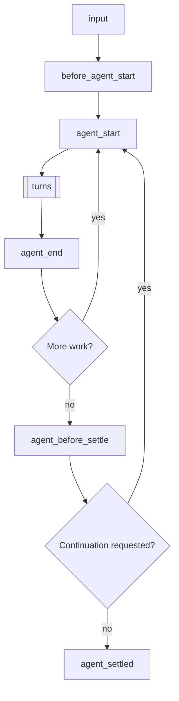
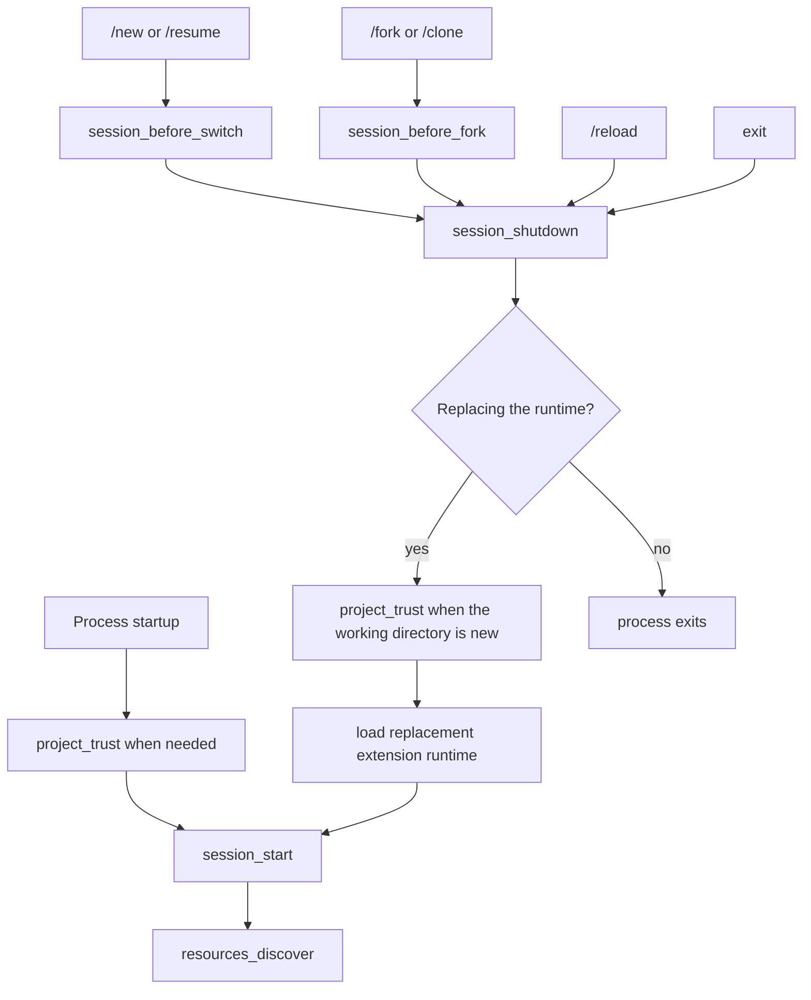

> Pi 可以创建扩展。请让它为你的使用场景构建一个扩展。

# 扩展

扩展是 TypeScript 模块，能够扩展 Pi 的行为。它们可以订阅生命周期事件、注册可供 LLM 调用的自定义工具、添加命令等。

扩展在 Pi 进程中运行，具有相同的操作系统权限。它可以查看提示词、工具调用、文件、凭据和会话历史，因此只应从可信来源加载扩展。

> **针对 /reload 的放置说明：** 将扩展放入 `~/.pi/agent/extensions/`（全局）或 `.pi/extensions/`（项目级）以实现自动发现。仅在快速测试时使用 `pi -e ./path.ts`。位于自动发现位置的扩展可通过 `/reload` 进行热重载。

**关键能力：**
- **自定义工具** — 通过 `pi.registerTool()` 注册可供 LLM 调用的工具
- **事件拦截** — 阻止或修改工具调用、注入上下文、自定义压缩逻辑
- **用户交互** — 通过 `ctx.ui` 向用户发出提示（选择、确认、输入、通知）
- **自定义 UI 组件** — 通过 `ctx.ui.custom()` 支持键盘输入的完整 UI 组件，用于复杂交互
- **自定义命令** — 通过 `pi.registerCommand()` 注册如 `/mycommand` 之类的命令
- **会话持久化** — 通过 `pi.appendEntry()` 存储跨重启存活的状态
- **自定义渲染** — 控制工具调用/结果及消息在 UI 中的呈现方式
- **提供商与 MCP 服务器** — 注册模型提供商、虚拟模型和 MCP 服务器

**示例使用场景：**
- 权限门控（在 `rm -rf`、`sudo` 等操作前进行确认）
- Git 检查点（每轮切换时暂存，分支切换时恢复）
- 路径保护（阻止写入 `.env`、`node_modules/`）
- 自定义压缩（按你的方式总结对话）
- 对话摘要（参见 `summarize.ts` 示例）
- 交互式工具（提问、向导、自定义对话框）
- 有状态工具（待办列表、连接池）
- 外部集成（文件监视器、webhook、CI 触发器）
- 等待间隙的小游戏（参见 `snake.ts` 示例）

工作实现参见 [examples/extensions/](https://github.com/earendil-works/pi/tree/main/packages/coding-agent/examples/extensions/)。

## 目录

- [快速开始](#quick-start)
- [扩展位置](#extension-locations)
- [可用导入](#available-imports)
- [编写扩展](#writing-an-extension)
  - [扩展样式](#extension-styles)
- [事件](#events)
  - [生命周期概述](#lifecycle-overview)
  - [处理器组合](#handler-composition)
  - [启动事件](#startup-events)
  - [资源事件](#resource-events)
  - [会话事件](#session-events)
  - [代理事件](#agent-events)
  - [模型事件](#model-events)
  - [工具事件](#tool-events)
  - [用户Bash事件](#user-bash-events)
  - [输入事件](#input-events)
- [扩展上下文](#extensioncontext)
- [扩展命令上下文](#extensioncommandcontext)
- [扩展API方法](#extensionapi-methods)
- [状态管理](#state-management)
- [自定义工具](#custom-tools)
  - [工具暴露](#tool-exposure)
  - [调用其他工具](#calling-other-tools)
  - [动态工具加载](#dynamic-tool-loading)
- [MCP服务器](#mcp-servers)
- [自定义UI](#custom-ui)
- [错误处理](#error-handling)
- [模式行为](#mode-behavior)
- [示例参考](#examples-reference)

<a id="create-an-extension"></a>

## 快速入门

创建 `~/.pi/agent/extensions/my-extension.ts`：

```typescript
import { type ExtensionAPI, isToolCallEventType } from "@earendil-works/pi-coding-agent";
import { Type } from "typebox";

export default function (pi: ExtensionAPI) {
  // 响应事件
  pi.on("session_start", async (_event, ctx) => {
    ctx.ui.notify("扩展已加载！", "info");
  });

  pi.on("tool_call", async (event, ctx) => {
    if (isToolCallEventType("bash", event) && event.input.command.includes("rm -rf")) {
      const ok = await ctx.ui.confirm("危险操作！", "允许执行 rm -rf 吗？");
      if (!ok) return { block: true, reason: "已被用户阻止" };
    }
  });

  // 注册自定义工具
  pi.registerTool({
    name: "greet",
    label: "问候",
    description: "按姓名问候某人",
    parameters: Type.Object({
      name: Type.String({ description: "要问候的姓名" }),
    }),
    async execute(toolCallId, params, signal, onUpdate, ctx) {
      return {
        content: [{ type: "text", text: `你好，${params.name}！` }],
        details: {},
      };
    },
  });

  // 注册命令
  pi.registerCommand("hello", {
    description: "打个招呼",
    handler: async (args, ctx) => {
      ctx.ui.notify(`你好${args || "世界"}！`, "info");
    },
  });
}
```

使用 `--extension`（或 `-e`）标志进行测试：

```bash
pi -e ./my-extension.ts
```

<a id="choose-where-it-loads"></a>

## 扩展位置

> **安全警告：** 扩展会以您的完整系统权限运行，并可执行任意代码。请仅从您信任的来源安装。

扩展会从受信任的位置自动发现。项目本地的 `.pi/extensions` 目录条目仅在项目被信任后才会加载。

| 位置 | 作用域 |
|----------|-------|
| `~/.pi/agent/extensions/*.ts` 或 `*.js` | 全局（所有项目） |
| `~/.pi/agent/extensions/*/index.ts` 或 `index.js` | 全局（子目录） |
| `~/.pi/agent/extensions/*/package.json`（含 `pi.extensions` 字段） | 全局（带清单的子目录） |
| `.pi/extensions/...` | 项目本地，布局相同 |

发现机制仅深入一层。较大的软件包通过 `package.json` 清单声明其入口点。

可通过 `settings.json` 添加更多路径：

```json
{
  "packages": [
    "npm:@foo/bar@1.0.0",
    "git:github.com/user/repo@v1"
  ],
  "extensions": [
    "/path/to/local/extension.ts",
    "/path/to/local/extension/dir"
  ]
}
```

设置项也接受将内置扩展作为 `builtin:<name>` 条目；请参见[设置](settings.md#resources)。要通过 npm 或 git 以 Pi 软件包形式共享扩展，请参见[packages.md](/docs/packages/)。

## 可用导入

| 软件包 | 用途 |
|---------|---------|
| `@earendil-works/pi-coding-agent` | 扩展类型（`ExtensionAPI`、`ExtensionContext`、事件）和辅助工具 |
| `@earendil-works/pi-agent-core` | 代理消息和工具类型 |
| `typebox`、`typebox/compile`、`typebox/value` | 工具参数的架构定义 |
| `@earendil-works/pi-ai` | AI 实用工具（用于字符串枚举的 `StringEnum`、转录辅助工具、模型类型） |
| `@earendil-works/pi-ai/compat`、`/models`、`/oauth`、`/providers/all` | 提供商构建、内置 API 和 OAuth 辅助工具 |
| `@earendil-works/pi-tui` | 用于自定义渲染的 TUI 组件 |

Pi 将这些导入映射到其自身的副本，因此扩展共享 Pi 的类和注册表。旧版 `@mariozechner/*` 和 `@sinclair/typebox` 名称映射到相同的模块。

npm 依赖同样有效。在扩展旁边（或父目录中）添加一个 `package.json`，运行 `npm install`，来自 `node_modules/` 的导入会自动解析。

对于通过 `pi install`（npm 或 git）安装的分布式 Pi 软件包，运行时依赖必须放在 `dependencies` 中；`devDependencies` 不会被安装。不要将上面提到的宿主提供的软件包列在 `dependencies` 中。参见[声明依赖](packages.md#declare-dependencies)。

Node.js 内置模块（`node:fs`、`node:path` 等）也可用。

## 编写扩展

扩展导出一个默认工厂函数，该函数接收 `ExtensionAPI`。工厂函数可以是同步或异步的：

```typescript
import type { ExtensionAPI } from "@earendil-works/pi-coding-agent";

export default function (pi: ExtensionAPI) {
  // 订阅事件
  pi.on("event_name", async (event, ctx) => {
    // ctx.ui 用于用户交互
    const ok = await ctx.ui.confirm("标题", "您确定吗？");
    ctx.ui.notify("完成！", "info");
    ctx.ui.setStatus("my-ext", "处理中...");  // 底部状态栏
    ctx.ui.setWidget("my-ext", ["第 1 行", "第 2 行"]);  // 编辑器上方的组件（默认）
  });

  // 注册工具、命令、快捷键、标志
  pi.registerTool({ ... });
  pi.registerCommand("name", { ... });
  pi.registerShortcut("ctrl+x", { ... });
  pi.registerFlag("my-flag", { ... });
}
```

扩展通过 [jiti](https://github.com/unjs/jiti) 加载，因此 TypeScript 无需编译即可使用。

如果工厂函数返回 `Promise`，Pi 会在继续启动前等待其完成。这意味着异步初始化会在 `session_start`、`resources_discover` 以及通过 `pi.registerProvider()` 排队注册的提供商刷新之前完成。

### 异步工厂函数

使用异步工厂函数处理一次性启动工作，例如获取远程配置或动态发现可用的模型。

```typescript
import type { ExtensionAPI } from "@pi-coding-agent/pi";

export default async function (pi: ExtensionAPI) {
  const response = await fetch("http://localhost:1234/v1/models");
  const payload = (await response.json()) as {
    data: Array<{
      id: string;
      name?: string;
      context_window?: number;
      max_tokens?: number;
    }>;
  };

  pi.registerProvider("local-openai", {
    baseUrl: "http://localhost:1234/v1",
    apiKey: "$LOCAL_OPENAI_API_KEY",
    api: "openai-completions",
    models: payload.data.map((model) => ({
      id: model.id,
      name: model.name ?? model.id,
      reasoning: false,
      input: ["text"],
      cost: { input: 0, output: 0, cacheRead: 0, cacheWrite: 0 },
      contextWindow: model.context_window ?? 128000,
      maxTokens: model.max_tokens ?? 4096,
    })),
  });
}
```

此模式使得获取的模型在正常启动期间及执行 `pi --list-models` 时可用。若模型列表在 Pi 运行期间发生变化，则应实现 `refreshModels`；参见 [pi.registerProvider()](#piregisterprovidername-config)。

### 长期资源与关闭

扩展工厂可能在从未启动会话的调用中运行。请勿在工厂中启动后台资源，例如进程、套接字、文件监视器或定时器。

将后台资源的启动推迟到 `session_start` 或需要该资源的命令/工具/事件时。注册一个幂等的 `session_shutdown` 处理器，以关闭你启动的任何会话范围内的资源。

### 扩展样式

**单文件**——最简单，适用于小型扩展：

```
~/.pi/agent/extensions/
└── my-extension.ts
```

**带 index.ts 的目录**——适用于多文件扩展：

```
~/.pi/agent/extensions/
└── my-extension/
    ├── index.ts        # 入口点（导出默认函数）
    ├── tools.ts        # 辅助模块
    └── utils.ts        # 辅助模块
```

**带依赖的软件包**——适用于需要 npm 包的扩展：

```
~/.pi/agent/extensions/
└── my-extension/
    ├── package.json    # 声明依赖和入口点
    ├── package-lock.json
    ├── node_modules/   # 执行 npm install 后生成
    └── src/
        └── index.ts
```

```json
// package.json
{
  "name": "my-extension",
  "dependencies": {
    "zod": "^3.0.0",
    "chalk": "^5.0.0"
  },
  "pi": {
    "extensions": ["./src/index.ts"]
  }
}
```

在扩展目录中运行 `npm install`，然后从 `node_modules/` 的导入会自动生效。

<a id="extension-events"></a>

## 事件

<a id="understand-the-lifecycle"></a>

### 生命周期概览

提示词启动一次运行。输入处理首先进行：

1. 扩展命令（`/name`）执行其处理器。`input` 事件不会触发。键入和 RPC 提示词始终检查命令；`pi.sendUserMessage()` 仅在 `expandPromptTemplates: true` 时检查。
2. `input` 处理器可以拦截、转换或处理文本。
3. 技能命令（`/skill:name`）和提示词模板（`/template`）展开。
4. `before_agent_start` 运行，然后代理循环开始。

运行重复轮次，然后检查是否有更多工作启动另一个低层代理运行：



更多工作意味着重试、最终尝试恢复、压缩重试或排队消息。因此，`agent_end` 不是最终空闲信号；请使用 `agent_settled` 表示该状态。中止的运行会跳过 `agent_before_settle`，直接从 `agent_end` 进入 `agent_settled`。当运行启动时（包括压缩检查和 `before_agent_start`），Pi 被视为忙碌，因此期间发送的消息会进入正在启动的运行。

每一轮发送一个模型请求，并执行助手响应中的工具调用：


模型请求按顺序运行以下钩子：

1. `context`（可以修改对话消息）
2. `context_with_system`（可以修改完整记录）
3. `before_provider_headers`（可以修改头部）
4. `before_provider_request`（可以检查或替换负载）
5. `after_provider_response`（状态和头部，在流被消费之前）
6. `provider_stream_event`（原始解析的流事件）以及助手消息的 `message_start` / `message_update` / `message_end`

执行的工具调用按顺序运行以下钩子：

1. `tool_execution_start`
2. `tool_call`（可以阻止或修改输入）
3. 工具执行期间的 `tool_execution_update`
4. `tool_result`（可以修改结果）
5. `tool_execution_end`

未执行的调用提前结束。未知工具或无效参数跳过 `tool_call`；被阻止或中止的调用跳过执行和 `tool_result`。这些调用仍会以错误结果获得 `tool_execution_end`，因此使用 `tool_execution_end` 观察每个最终确定的调用。

`turn_end` 可以追加条目并请求继续。阈值压缩在自然需要的下一轮之前运行。消息事件也会为其他消息触发，例如用户、工具结果和自定义消息。提供商钩子仅在传输暴露相应阶段时运行。

会话启动和替换遵循单独的生命周期：



`session_start` 携带 `reason: "startup" | "reload" | "new" | "resume" | "fork"`，`session_shutdown` 携带 `reason: "quit" | "reload" | "new" | "resume" | "fork"`。`resources_discover` 在重载后使用 `reason: "reload"`，否则使用 `"startup"`。退出涵盖 Ctrl+C、Ctrl+D、SIGHUP 和 SIGTERM。`project_trust` 在受信任的项目资源加载之前运行，并且当会话替换进入新的工作目录时可以再次运行。

其他操作更改当前会话而不替换运行时：

| 操作 | 事件 |
|---|---|
| `/compact` 或自动压缩 | `session_before_compact`（可以取消或自定义），然后 `session_compact` 或 `session_compact_failed` |
| `/tree` 导航 | `session_before_tree`（可以取消或自定义），然后 `session_tree` |
| `/name` 或 `pi.setSessionName()` | `session_info_changed` |
| `/model` 或模型循环（`Ctrl+P`） | 如果级别更改或被限制，则 `thinking_level_select`，然后 `model_select` |
| 思考级别更改（设置、按键绑定、`pi.setThinkingLevel()`） | `thinking_level_select` |
| `!` 或 `!!` 命令 | `user_bash`（可以拦截） |
| 扩展对话框或自定义屏幕等待用户 | `ui_prompt_start`、`ui_prompt_end` |
| 空闲提示缓存刷新 | `cache_warming_decision` |
| 扩展在启动后注册或移除 MCP 服务器 | `mcp_servers_change` |

<a id="events-and-concurrency"></a>
<a id="work-with-events"></a>

### 处理器组合

处理器按扩展加载顺序运行，然后按注册顺序。有些事件通知；其他事件转换数据、替换结果或取消操作：

| 模式 | 行为 |
|---|---|
| 通知 | 返回值被忽略。仅将事件用于观察。 |
| 就地修改 | 后续处理器会看到对诸如 `before_provider_headers.headers`、`before_agent_start.systemPromptOptions` 和 `tool_call.input` 等值的更改。 |
| 链式转换 | 后续处理器会接收先前 `input`、`context`、`context_with_system`、`message_end`、`tool_result` 和 `before_provider_request` 处理器返回的值。 |
| 门控 | 已处理的输入、被阻止的工具调用、已取消的会话操作或已处理的 `user_bash` 命令会停止该操作正常的回退路径。 |
| 可操作边界 | 每个 `turn_end` 或 `agent_before_settle` 处理器会看到目前提出的条目和继续决策。 |
| 最后覆盖 | 返回操作的最后一个 `cache_warming_decision` 处理器胜出。 |

通知处理器不应在流式事件上执行缓慢工作。转换处理器应保留其不故意拥有的字段，并且门控处理器在无法做出安全决策时应默认拒绝。

### 启动事件

#### project_trust

在Pi决定是否信任带有动态配置（`.pi`或`.agents/skills`）的项目之前触发。它会在启动期间以及当会话替换（例如`/resume`）进入一个在当前进程中尚未解决信任的cwd时运行。只有用户/全局扩展和CLI `-e`扩展参与；项目本地扩展在信任解决之前不会被加载。

```typescript
pi.on("project_trust", async (event, ctx) => {
  // event.cwd - 当前工作目录
  // ctx 具有有限的信任上下文：cwd、mode、hasUI 以及 select/confirm/input/notify UI辅助函数
  if (await ctx.ui.confirm("信任此项目？", event.cwd)) {
    return { trusted: "yes", remember: true };
  }
  return { trusted: "undecided" };
});
```

一个`project_trust`处理器必须返回`{ trusted: "yes" | "no" | "undecided" }`。返回`"yes"`或`"no"`的用户/全局或CLI扩展拥有决定权；第一个是/否决定获胜，并抑制内置的信任提示。使用`remember: true`来持久化是/否决定；否则仅适用于当前进程。返回`"undecided"`以便让后续处理器或内置信任流程决定。在提示之前检查`ctx.hasUI`。如果没有处理器返回是/否，则继续正常的信任解决：首先应用已保存的`trust.json`决定，然后`defaultProjectTrust`控制Pi默认是询问、信任还是拒绝。

### 资源事件

#### resources_discover

在 `session_start` 之后触发，以便扩展可以贡献额外的技能、提示词模板和主题路径。
启动路径使用 `reason: "startup"`。重新加载使用 `reason: "reload"`。

```typescript
pi.on("resources_discover", async (event, _ctx) => {
  // event.cwd - 当前工作目录
  // event.reason - "startup" | "reload"
  return {
    skillPaths: ["/path/to/skills"],
    promptPaths: ["/path/to/prompts"],
    themePaths: ["/path/to/themes"],
  };
});
```

#### mcp_servers_change

当扩展在绑定后注册或取消注册 MCP 服务器时触发。`event.servers` 在变更后列出所有已注册的服务器。处理此事件可将扩展标记为连接已注册服务器的扩展；参见 [MCP 服务器](#mcp-servers)。

### 会话事件

关于会话存储内部机制及 SessionManager API，请参阅 [会话格式](/docs/session-format/)。

#### session_start

当会话启动、加载或重新加载时触发。

```typescript
pi.on("session_start", async (event, ctx) => {
  // event.reason - "startup" | "reload" | "new" | "resume" | "fork"
  // event.previousSessionFile - 在 "new"、"resume" 和 "fork" 情况下存在
  ctx.ui.notify(`会话: ${ctx.sessionManager.getSessionFile() ?? "临时"}`, "info");
});
```

#### session_info_changed

当通过 `/name` 命令、RPC 或 `pi.setSessionName()` 设置当前会话显示名称时触发。

```typescript
pi.on("session_info_changed", async (event, ctx) => {
  // event.name - 当前规范化名称，若已清除则为 undefined
  ctx.ui.notify(`会话已重命名：${event.name ?? "(无)"}`, "info");
});
```

#### session_before_switch

在开始新会话（`/new`）或切换会话（`/resume`）之前触发。

```typescript
pi.on("session_before_switch", async (event, ctx) => {
  // event.reason - "new" 或 "resume"
  // event.targetSessionFile - 要切换到的会话（仅用于"resume"）

  if (event.reason === "new") {
    const ok = await ctx.ui.confirm("清除？", "删除所有消息？");
    if (!ok) return { cancel: true };
  }
});
```

成功切换或新建会话后，Pi 会为旧扩展实例触发 `session_shutdown`，为新会话重新加载并绑定扩展，然后以 `reason: "new" | "resume"` 和 `previousSessionFile` 触发 `session_start`。
在 `session_shutdown` 中执行清理工作，然后在 `session_start` 中重建任何内存状态。

#### session_before_fork

通过 `/fork` 分叉或 `/clone` 克隆时触发。

```typescript
pi.on("session_before_fork", async (event, ctx) => {
  // event.entryId - 所选条目的 ID
  // event.position - "/fork" 时为 "before"，"/clone" 时为 "at"
  return { cancel: true }; // 取消分叉/克隆
  // 或
  return { skipConversationRestore: true }; // 保留用于未来的会话恢复控制
});
```

分叉或克隆成功后，Pi 会为旧扩展实例发出 `session_shutdown`，为新会话重新加载并重新绑定扩展，然后发出带有 `reason: "fork"` 和 `previousSessionFile` 的 `session_start`。
在 `session_shutdown` 中执行清理工作，然后在 `session_start` 中重新建立任何内存状态。

<a id="session_before_compact--session_compact"></a>

#### session_before_compact / session_compact / session_compact_failed

在压缩时触发。详见 [compaction.md](/docs/compaction/)。

```typescript
pi.on("session_before_compact", async (event, ctx) => {
  const { preparation, branchEntries, customInstructions, reason, willRetry, signal } = event;

  // reason - "manual" (/compact)、"threshold" 或 "overflow"
  // willRetry - 压缩后是否重试被中断的回合（溢出恢复）

  // 取消：
  return { cancel: true };

  // 自定义摘要：
  return {
    compaction: {
      summary: "...",
      firstKeptEntryId: preparation.firstKeptEntryId,
      tokensBefore: preparation.tokensBefore,
      // usage: summaryResponse.usage, // 可选；包含在会话总计中
    }
  };
});

pi.on("session_compact", async (event, ctx) => {
  // event.compactionEntry - 保存的压缩内容
  // event.fromExtension - 是否由扩展提供
  // event.reason - "manual" (/compact)、"threshold" 或 "overflow"
  // event.willRetry - 压缩后是否重试被中断的回合（溢出恢复）
});

pi.on("session_compact_failed", async (event, ctx) => {
  // event.reason - "manual" (/compact)、"threshold" 或 "overflow"
  // event.errorMessage - 非中止失败时存在
  // event.aborted - 已取消/中止的压缩为 true
  // event.willRetry - 压缩后是否重试被中断的回合
  // event.fromExtension - 是否正在使用扩展提供的压缩内容
});
```

#### session_before_tree / session_tree

在 `/tree` 导航时触发。有关树导航的概念，请参阅 [会话](/docs/sessions/)。

```typescript
pi.on("session_before_tree", async (event, ctx) => {
  const { preparation, signal } = event;
  // preparation.targetId, oldLeafId, commonAncestorId, entriesToSummarize,
  // userWantsSummary, customInstructions, replaceInstructions, label
  return { cancel: true };
  // 或者提供自定义摘要（仅在 preparation.userWantsSummary 为 true 时使用）：
  return {
    summary: {
      summary: "...",
      // usage: summaryResponse.usage, // 可选；包含在会话总计中
      details: {},
    },
  };
  // 或者覆盖摘要选项：customInstructions、replaceInstructions、label
});

pi.on("session_tree", async (event, ctx) => {
  // event.newLeafId, oldLeafId, summaryEntry, fromExtension
});
```

#### session_shutdown

在已启动的会话运行时被拆除之前触发。利用此事件清理从 `session_start` 或其他会话作用域钩子中打开的资源。

```typescript
pi.on("session_shutdown", async (event, ctx) => {
  // event.reason - "quit" | "reload" | "new" | "resume" | "fork"
  // event.targetSessionFile - 会话替换流程的目标会话
  // 清理、保存状态等
});
```

### 代理事件

#### before_agent_start

在运行开始之前触发，发生在输入处理和扩展之后。可以注入消息和/或修改系统提示词。

`event.messageType` 指示运行是如何启动的：`"user"` 表示由提示词或 `pi.sendUserMessage()` 启动，包含 `prompt` 和 `images`；`"custom"` 表示在空闲状态下由 `pi.sendMessage(..., { triggerTurn: true })` 启动，包含起始 `message` 但没有 `prompt`。

```typescript
pi.on("before_agent_start", async (event, ctx) => {
  // event.messageType - "user" | "custom"
  // event.prompt, event.images - 用户的提示词文本和图片（messageType 为 "user"）
  // event.message - 启动运行的自定义消息（messageType 为 "custom"）
  // event.systemPrompt - 当前为此处理器链式拼接的系统提示词
  //   （包含早期 before_agent_start 处理器的修改）
  // event.systemPromptOptions - 用于构建系统提示词的结构化选项
  //   .customPrompt - 来自 --system-prompt、SYSTEM.md 或自定义模板的精确提示词前缀
  //   .forceSystemPrompt - 可选，完整提示词的精确替换
  //   .selectedTools - 提示词中当前启用的工具
  //   .hiddenTools - 已选择但其声明请求排除的工具
  //   .toolSnippets - 每个工具的单行描述
  //   .toolGuidelines - 按工具名键控的规则要点
  //   .promptGuidelines - 附加的自定义规则要点
  //   .sections - 按标签名键控的自定义 XML 包裹部分
  //   .appendSystemPrompt - 来自 --append-system-prompt 标志的文本
  //   .cwd - 工作目录
  //   .contextFiles - AGENTS.md 文件和其他已加载的上下文文件
  //   .skills - 已加载的技能

  return {
    // 注入持久消息（存储在会话中，发送给 LLM）
    message: {
      customType: "my-extension",
      content: "为 LLM 提供的额外上下文",
      display: true,
    },
    // 替换本轮的系统提示词（在扩展间链式传递）
    systemPrompt: event.systemPrompt + "\n\n本轮额外指令...",
  };
});
```

返回的 `message` 会被添加到任一类型的运行中；检查 `messageType` 可跳过由自定义消息启动的运行。

`systemPromptOptions` 字段让扩展能够访问与 Pi 构建系统提示词时相同的结构化数据。集合是可变的。建议修改 `sections`、`selectedTools` 或 `promptGuidelines`：Pi 会对比生成的提示词部分与模型已有的内容，并通过追加一条系统消息来仅修补发生变化的部分。返回 `systemPrompt`，或设置 `forceSystemPrompt`，则会替换整个运行的系统提示词：每个提供商都会将该强制文本作为其引导系统提示词（当其改变时会造成缓存未命中），而会话记录仍会保留结构化的部分。工具选择的更改会同时更新提示词贡献和可执行的提供商工具；在处理器内调用 `pi.setActiveTools()` 与编辑 `selectedTools` 效果相同。支持在对话中途接收系统消息的模型会就地接收补丁并保留其缓存前缀；其他模型则将回放的提示词作为其系统提示词，这每次更改都会造成一次缓存未命中。

在 `before_agent_start` 内部，`event.systemPrompt` 和 `ctx.getSystemPrompt()` 都反映当前处理器的链式系统提示词。后续的 `before_agent_start` 处理器仍然可以再次修改它。

<a id="agent_start--agent_end--agent_settled"></a>

#### agent_start / agent_end / agent_before_settle / agent_settled

`agent_start` 在底层代理运行开始时触发。`agent_end` 在该运行结束时触发，但 Pi 可能仍会自动重试、自动压缩后重试，或继续处理排队的追问消息。`agent_before_settle` 是最后一个可操作边界：它可以追加会话条目并请求一次延续。`agent_settled` 是最终且仅通知用的；用于需要知晓 Pi 不会自动继续运行的状态集成。

```typescript
pi.on("agent_start", async (_event, ctx) => {});

pi.on("agent_end", async (event, ctx) => {
  // event.messages - 来自此次底层运行的消息
});

let addedReviewReminder = false;
pi.on("agent_before_settle", async (event, ctx) => {
  if (addedReviewReminder) return;
  addedReviewReminder = true;
  return {
    entries: [...event.entries, {
      type: "custom_message",
      customType: "review-reminder",
      content: "回复之前请审阅最终差异。",
      display: false,
    }],
    continue: true,
  };
});

pi.on("agent_settled", async (event, ctx) => {
  // event.aborted - 当运行因中止而结束时为 true，例如按 Escape 键
  // ctx.isIdle() 为 true；此处请求的运行会在所有 settled 处理器完成后启动。
});
```

如果在 `agent_before_settle` 处理器运行期间该运行被中止，则已返回的有效条目仍会被提交，但请求的延续会被抑制。从 `agent_settled` 请求的工作会延迟到每个 settled 处理器完成之后执行，因此通知分发是不可重入的。

#### ui_prompt_start / ui_prompt_end

仅用于通知的生命周期事件，针对阻塞用户界面的扩展 UI 提示。它们在 `ctx.ui.select()`、`ctx.ui.confirm()`、`ctx.ui.input()`、`ctx.ui.editor()` 和 `ctx.ui.custom()` 周围触发，以便主机/状态集成可以报告“正在等待用户”而非仅仅“正在运行”。

嵌套或重叠的提示会被合并为一个外部等待范围。处理程序以尽力而为的方式调用，在显示或关闭提示之前不会被等待。

```typescript
pi.on("ui_prompt_start", async (event, ctx) => {
  // event.reason === "ui_prompt"
  // event.kind: "select" | "confirm" | "input" | "editor" | "custom"
  // event.title: 提示标题（如有）
});

pi.on("ui_prompt_end", async (event, ctx) => {
  // Pi 不再等待该 UI 提示范围。
});
```

#### turn_start / turn_end

每个回合（一次 LLM 响应 + 工具调用）触发。

```typescript
pi.on("turn_start", async (event, ctx) => {
  // event.turnIndex, event.timestamp
});

let replacedResponse = false;
pi.on("turn_end", async (event, ctx) => {
  // event.turnIndex, event.message, event.toolResults
  // event.entries 包含目前提议的结构性条目。
  if (replacedResponse || event.outcome !== "completed" || event.toolResults.length > 0) return;
  replacedResponse = true;
  return {
    entries: [
      ...event.entries,
      { type: "context_edit", targetId: event.messageEntryId, replacement: null },
      {
        type: "custom_message",
        customType: "replacement-instruction",
        content: "Answer again using the persisted user request.",
        display: false,
      },
    ],
    continue: true,
  };
});
```

`turn_end` 在助手和工具结果消息持久化之后、低级 `turn_end` 事件之前运行。重试退避和最终尝试恢复仍在 `agent_end` 之后发生，保持其现有生命周期和队列顺序；`agent_before_settle` 在该工作完成后看到修复后的投影。边界处理程序按扩展加载和注册顺序运行。每个处理程序在 `event.entries` 中看到先前的提议，并看到从这些提议重建的 `event.context`。返回 `entries` 或 `continue` 仅替换该字段；省略的字段保留当前提议。允许的草稿条目类型为 `custom`、`custom_message`、`context_edit` 和 `compaction`。完整提议在所有处理程序完成后按列表顺序追加前进行验证；处理程序错误会被报告，后续处理程序仍会运行。验证可防止部分应用的语义错误，但持久化不是事务性的。

`continue: true` 确保该边界调用有一次后续提供商请求。如果工具结果、引导或追问已导致该请求，则它们满足该决定且不会发出额外请求；否则 Pi 会发出一次仅上下文的请求。错误和中止的响应仍是硬退出。`continue: false` 从不抑制自然工作。守卫继续条件：无条件的 `continue: true` 会在下一次响应后再次评估，可能造成无限循环。`custom_message` 草稿贡献一条用户角色模型消息，但由扩展编写：它不运行人类输入钩子、斜杠命令、技能或提示词模板。

构造 `TurnEndEvent` 值的主机集成必须提供 `messageEntryId`、`toolResultEntryIds`、`outcome`、`entries`、`continue` 和 `context`。`ExtensionEvent` 穷举切换也必须处理 `agent_before_settle`。`ExtensionRunner.emit()` 排除可操作的回合边界；通过 `emitBoundary(baseEvent, buildContext)` 分发 `turn_end` 和 `agent_before_settle`，以便处理程序接收链式预览。其他专用运行器方法仍为 `session_before_*` 等事件返回结果。

#### message_start / message_update / message_end

为消息生命周期更新触发。

- `message_start` 和 `message_end` 为每条消息触发，包括用户、助手、工具结果和自定义消息。
- `message_update` 为助手流式更新触发。
- `message_end` 处理器可以返回 `{ message }` 来替换最终消息。替换必须保持相同的 `role`。

```typescript
pi.on("message_start", async (event, ctx) => {
  // 事件消息
});

pi.on("message_update", async (event, ctx) => {
  // 事件消息
  // 事件助手消息事件（逐令牌流事件）
});

pi.on("message_end", async (event, ctx) => {
  if (event.message.role !== "assistant") return;

  return {
    message: {
      ...event.message,
      usage: {
        ...event.message.usage,
        cost: {
          ...event.message.usage.cost,
          total: 0.123,
        },
      },
    },
  };
});
```

#### tool_execution_start / tool_execution_update / tool_execution_end

在工具执行生命周期更新时触发。

在并行工具模式下：
- `tool_execution_start` 在预检阶段按助手源顺序发出
- `tool_execution_update` 事件可能跨工具交错出现
- `tool_execution_end` 在每个工具完成后按工具完成顺序发出
- 最终的 `toolResult` 消息事件仍会在稍后按助手源顺序发出

```typescript
pi.on("tool_execution_start", async (event, ctx) => {
  // event.toolCallId, event.toolName, event.args
});

pi.on("tool_execution_update", async (event, ctx) => {
  // event.toolCallId, event.toolName, event.args, event.partialResult
});

pi.on("tool_execution_end", async (event, ctx) => {
  // event.toolCallId, event.toolName, event.result, event.isError
  // event.durationMs - execute() 耗时（毫秒）；工具未运行时缺失
});
```

当另一个工具发起调用时，这三个事件以及 `tool_call` 和 `tool_result` 都会携带 `parentToolCallId`；参见 [调用其他工具](#calling-other-tools)。

#### 上下文

每次LLM调用前触发。可非破坏性地修改消息。消息类型参见[会话格式](/docs/session-format/)。

```typescript
pi.on("context", async (event, ctx) => {
  // event.messages - 不含系统消息的深层副本，可安全修改
  const filtered = event.messages.filter(m => !shouldPrune(m));
  return { messages: filtered };
});
```

`event.messages` 保存了不含系统消息的会话内容。提示词和工具声明属于Pi，不属于此钩子的一部分：当处理器返回修改后的列表时，Pi会先在返回的消息前面重放当前提示词段落和工具声明，组合成一条头部系统消息。因此，通过过滤、窗口截取或压缩摘要进行切片，都无法丢弃提示词或工具。若返回未修改的列表，则会保留会话中的系统消息，使支持这些消息的模型能够保留其缓存前缀。处理器添加的系统消息会保留在Pi头部消息之后。若要持久化修改提示词或工具集，请使用 [`before_agent_start`](#before_agent_start) 或 `pi.setActiveTools()`；若要针对单个请求编辑系统消息，请使用 [`context_with_system`](#context_with_system)。

#### context_with_system

在每次 LLM 调用之前触发，此时所有 `context` 处理器已运行完毕，Pi 已恢复提示词和工具状态。`event.messages` 是完整的对话记录，包括开头的系统消息以及对话中途的提示词或工具补丁（参见[会话格式](session-format.md#sessionmessageentry)）。返回的消息将按原样发送：此钩子负责请求中的提示词和工具声明。

```typescript
import { getCurrentSystemMessage } from "@earendil-works/pi-ai";

pi.on("context_with_system", async (event, ctx) => {
  const cut = findCutIndex(event.messages);
  // 折叠被丢弃的前缀，使其提示词和工具状态作为新的头部保留。
  const head = getCurrentSystemMessage(event.messages.slice(0, cut));
  return { messages: head ? [head, ...event.messages.slice(cut)] : event.messages.slice(cut) };
});
```

规则：索引 0 处必须保留系统消息（提供商从该位置读取提示词和初始工具声明；若处理器将其丢弃，Pi 会报告错误）。移除系统消息会同时移除其携带的工具声明和分节补丁。请使用 `@earendil-works/pi-ai` 中的 `getCurrentSystemPrompt()` 和 `getCurrentTools()` 检查输出。处理器按扩展加载顺序执行；由 `before_agent_start` 强制指定的 `systemPrompt` 仍会在之后应用到请求上。

#### before_provider_headers

在出站 HTTP 标头组装完成后触发。用于添加、覆盖或移除请求标头。

处理程序直接修改 `event.headers`。将某个键设为字符串以添加或覆盖该项，设为 `null` 以删除该项。

```typescript
pi.on("before_provider_headers", (event, ctx) => {
  // 添加或覆盖——例如，用于网关追踪/归属的会话 ID
  event.headers["x-session-id"] = ctx.sessionManager.getSessionId();

  // 删除 pi 为此调用添加的跟踪标头
  event.headers["X-OpenRouter-Title"] = null;
});
```

每个提供商请求运行一次；重试会复用相同的标头，而不会重新触发该钩子。

#### before_provider_request

在提供商特定载荷构建完成后、请求发送前触发。处理器按扩展加载顺序执行。返回 `undefined` 保持载荷不变。返回任何其他值将替换后续处理器及实际请求使用的载荷。

此钩子可重写提供商级系统指令或完全移除它们。这些载荷级更改不会反映在 `ctx.getSystemPrompt()` 中，后者报告的是 Pi 的系统提示词字符串，而非最终序列化的提供商载荷。

```typescript
pi.on("before_provider_request", (event, ctx) => {
  console.log(JSON.stringify(event.payload, null, 2));

  // 可选：替换载荷
  // return { ...event.payload, temperature: 0 };
});
```

这主要用于调试提供商序列化和缓存行为。

#### after_provider_response

在收到 HTTP 响应之后、其流式内容被消费之前触发。处理程序按扩展加载顺序执行。

```typescript
pi.on("after_provider_response", (event, ctx) => {
  // event.status - HTTP 状态码
  // event.headers - 归一化后的响应头
  if (event.status === 429) {
    console.log("rate limited", event.headers["retry-after"]);
  }
});
```

响应头的可用性取决于提供商和传输方式。抽象了 HTTP 响应的提供商可能不会暴露响应头。

#### provider_stream_event

在 Pi 规范化每个解析后的提供商流事件之前触发。仅用于通知，不做持久化。

```typescript
pi.on("provider_stream_event", (event, ctx) => {
  // event.provider, event.api, event.model
  // event.data - Pi 可用的最早结构化值（只读）
});
```

`event.data` 不一定是原始的 HTTP 字节或 SSE 帧。应将其视为只读，因为修改可能影响规范化。处理程序按流顺序等待，因此慢处理程序会延迟流消费。处理程序错误会被报告，但不会改变提供商的响应。参见 [`debug-provider.ts`](https://github.com/earendil-works/pi/blob/main/packages/coding-agent/examples/extensions/debug-provider.ts)，了解一个可选择加入的查看器，它按助手消息分组原始事件。

#### cache_warming_decision

在每次提示词缓存刷新前触发，并带有 Pi 的决策填充。该事件仅携带 Pi 的成本估算；其他所有信息请使用 `ctx.model`、`ctx.isIdle()` 和 `ctx.getContextUsage()`。

```typescript
pi.on("cache_warming_decision", (event, ctx) => {
  // event.warmCost: 本次刷新的价格
  // event.missCost: 如果缓存项丢失，下一次请求的额外价格
  // event.continuationProbability: pi 对请求及时到达的估算概率
  // event.action: "warm" | "stop"——pi 的决策

  if (ctx.model?.provider === "my-provider") {
    return { action: "stop" };
  }
});
```

返回 `{ action: "warm" }` 或 `{ action: "stop" }` 可覆盖该决策；最后一个返回动作的处理程序生效。`"stop"` 会结束预热，直到下一个真实请求。

### 模型事件

#### model_select

当模型通过 `/model` 命令、模型循环切换（`Ctrl+P`）或 `pi.setModel()` 发生变更时触发。恢复会话不会触发该事件；请在 `session_start` 中读取 `ctx.model` 以初始化依赖模型的状态。

```typescript
pi.on("model_select", async (event, ctx) => {
  // event.model - 新选中的模型
  // event.previousModel - 先前的模型（首次选择时为 undefined）
  // event.source - "set" | "cycle"

  const prev = event.previousModel
    ? `${event.previousModel.provider}/${event.previousModel.id}`
    : "none";
  const next = `${event.model.provider}/${event.model.id}`;

  ctx.ui.notify(`模型已切换 (${event.source}): ${prev} -> ${next}`, "info");
});
```

当活动模型发生变化时，使用此事件更新 UI 元素（状态栏、页脚）或执行特定于模型的初始化操作。

#### thinking_level_select

当思考级别发生变化时触发。此事件仅用于通知；处理函数的返回值将被忽略。

```typescript
pi.on("thinking_level_select", async (event, ctx) => {
  // event.level - 新选择的思考级别
  // event.previousLevel - 之前的思考级别

  ctx.ui.setStatus("thinking", `thinking: ${event.level}`);
});
```

当 `pi.setThinkingLevel()`、模型变更或内置思考级别控件更改当前思考级别时，使用此事件更新扩展 UI。

<a id="tool-call-events"></a>

### 工具事件

#### tool_call

在 `tool_execution_start` 之后触发，在工具执行之前。**可阻塞。** 使用 `isToolCallEventType` 来收窄范围并获取类型化输入。

在 `tool_call` 运行之前，Pi 会等待先前发出的智能体事件通过 `AgentSession` 完成排空。这意味着 `ctx.sessionManager` 会一直更新到当前的助手工具调用消息为止。

在默认的并行工具执行模式下，来自同一助手消息的同级工具调用会按顺序预检，然后并发执行。`tool_call` 不保证能在 `ctx.sessionManager` 中看到来自同一助手消息的同级工具结果。

`event.input` 是可变的。请在原地修改它以在执行前修补工具参数。

行为保证：
- 对 `event.input` 的修改会影响实际的工具执行
- 后续的 `tool_call` 处理器可以看到先前处理器所做的修改
- 您的修改之后不会执行重新验证
- `tool_call` 的返回值通过 `{ block: true, reason?: string, terminate?: boolean }` 控制阻塞
- `terminate` 仅适用于被阻塞的调用；只有当批次中所有最终确定的结果都是终止性的时，智能体才会提前停止

```typescript
import { isToolCallEventType } from "@earendil-works/pi-coding-agent";

pi.on("tool_call", async (event, ctx) => {
  // event.toolName - "bash", "read", "write", "edit" 等
  // event.toolCallId
  // event.input - 工具参数（可修改）

  // 内置工具：无需类型参数
  if (isToolCallEventType("bash", event)) {
    // event.input 为 { command: string; timeout?: number }
    event.input.command = `source ~/.profile\n${event.input.command}`;

    if (event.input.command.includes("rm -rf")) {
      return { block: true, reason: "危险命令", terminate: true };
    }
  }

  if (isToolCallEventType("read", event)) {
    // event.input 为 { path: string; offset?: number; limit?: number }
    console.log(`正在读取: ${event.input.path}`);
  }
});
```

#### 自定义工具输入类型

自定义工具应导出其输入类型：

```typescript
// my-tool.ts
import { type Static, Type } from "typebox";

export const myToolSchema = Type.Object({ action: Type.String() });
export type MyToolInput = Static<typeof myToolSchema>;
```

使用带有显式类型参数的 `isToolCallEventType`：

```typescript
import { isToolCallEventType } from "@earendil-works/pi-coding-agent";
import type { MyToolInput } from "./my-tool.ts";

pi.on("tool_call", (event) => {
  if (isToolCallEventType<"my_tool", MyToolInput>("my_tool", event)) {
    event.input.action;  // 类型化
  }
});
```

#### tool_result

工具执行完成后、`tool_execution_end` 及最终工具结果消息事件发出前触发。**可修改结果。**

在并行工具模式下，`tool_result` 与 `tool_execution_end` 可能按工具完成顺序交错出现，而最终的 `toolResult` 消息事件仍按助手源顺序稍后发出。

`tool_result` 处理器像中间件一样串联执行：
- 处理器按扩展加载顺序运行
- 每个处理器都在前一处理器修改后的最新结果上运行
- 处理器可返回部分补丁（`content`、`details`、`structuredContent`、`isError` 或 `usage`）；未提供的字段保持当前值
- 替换 `content` 但不返回 `structuredContent` 时会丢弃结构化内容，因为它可能不再匹配

在处理器内部使用 `ctx.signal` 处理嵌套异步工作。这样可让 Esc 取消模型调用、`fetch()` 及其他由扩展启动的、支持中止感知的操作。

> 完整代码见英文原文。

### 用户 Bash 事件

## user_bash 事件

```python
import { createLocalBashOperations } from "@earendil-works/pi-coding-agent";

pi.on("user_bash", (event, ctx) => {
  // event.command - bash 命令
  // event.excludeFromContext - true 表示带有 !! 前缀
  // event.cwd - 工作目录

  // 方案 1：提供自定义操作（例如 SSH）
  return { operations: remoteBashOps };

  // 方案 2：包装 pi 的内置本地 bash 后端
  const local = createLocalBashOperations();
  return {
    operations: {
      exec(command, cwd, options) {
        return local.exec(`source ~/.profile\n${command}`, cwd, options);
      }
    }
  };

  // 方案 3：完全替换 - 直接返回结果
  return { result: { output: "...", exitCode: 0, cancelled: false, truncated: false } };
});
```

返回 `undefined` 会继续传递到下一个事件处理器，若没有处理器处理该事件，则最终执行本地命令。有效的返回结果会停止传播：`operations` 通过所提供的后端执行命令，而 `result` 则直接记录已完成的命令而不执行它。

### 输入事件

#### input

在收到用户输入时触发，此时扩展命令已检查完毕，但技能和模板尚未展开。该事件看到的是原始输入文本，因此 `/skill:foo` 和 `/template` 尚未展开。

**处理顺序：**
1. 首先检查扩展命令（`/cmd`）——如果找到，则运行处理器并跳过输入事件。来自 `pi.sendUserMessage()` 的消息仅在 `expandPromptTemplates: true` 时检查。
2. 触发 `input` 事件——可以拦截、转换或处理
3. 如果未处理：技能命令（`/skill:name`）展开为技能内容
4. 如果未处理：提示词模板（`/template`）展开为模板内容
5. 代理处理开始（`before_agent_start` 等）

```typescript
pi.on("input", async (event, ctx) => {
  // event.text - 原始输入（在技能/模板展开之前）
  // event.images - 附加的图片（如果有）
  // event.source - "interactive"（键入）、"rpc"（API）或 "extension"（通过 sendUserMessage）
  // event.streamingBehavior - "steer" | "followUp" | undefined
  //   空闲时为 undefined，"steer" 表示流中断时的引导，
  //   "followUp" 表示排队等待代理完成的消息

  // 转换：在展开前重写输入
  if (event.text.startsWith("?quick "))
    return { action: "transform", text: `简要回复：${event.text.slice(7)}` };

  // 处理：无需 LLM 直接响应（扩展显示自己的反馈）
  if (event.text === "ping") {
    ctx.ui.notify("pong", "info");
    return { action: "handled" };
  }

  // 按来源路由：跳过扩展注入消息的处理
  if (event.source === "extension") return { action: "continue" };

  // 在展开前拦截技能命令
  if (event.text.startsWith("/skill:")) {
    // 可以转换、阻止或放行
  }

  return { action: "continue" };  // 默认：放行至展开
});
```

**结果：**
- `continue` - 原样放行（处理器无返回时的默认行为）
- `transform` - 修改文本/图片，然后继续展开
- `handled` - 完全跳过代理（第一个返回此值的处理器生效）

转换会在多个处理器之间串联。参见 [input-transform.ts](https://github.com/earendil-works/pi/blob/main/packages/coding-agent/examples/extensions/input-transform.ts) 和 [input-transform-streaming.ts](https://github.com/earendil-works/pi/blob/main/packages/coding-agent/examples/extensions/input-transform-streaming.ts) 了解基于 `streamingBehavior` 的路由。

<a id="use-extension-context"></a>

## ExtensionContext（扩展上下文）

所有处理器都会收到 `ctx: ExtensionContext`。工具 `execute()` 接收 `ExtensionToolContext`，它额外提供了 `ctx.tools` 和 `ctx.executeTool()`（参见[调用其他工具](#calling-other-tools)）。命令处理器接收 [`ExtensionCommandContext`](#extensioncommandcontext)。

te amo el plan.

## 原样以原样作为主要提供者的

你是资深技术文档翻译，把 MIT 协议开源项目 pi 的官方英文文档翻译成简体中文。
规则：
1. 只输出译文 markdown，不要任何解释或前言，不要用代码围栏包裹全文。
2. 代码块中的代码、命令、环境变量名、API 字段名、文件路径、URL、HTML 保持原样；代码块内的注释可译为中文。
3. 完整保留 markdown 结构：标题层级、列表、表格、引用、粗体、front-matter 键名；front-matter 的值译为中文。
4. 术语表：harness→外壳；extension→扩展；skill→技能；prompt template→提示词模板；theme→主题；package→软件包；session→会话；compaction→压缩；steering→引导；follow-up→追问；provider→提供商；model→模型；tool→工具；command→命令。
5. /model、Ctrl+L 这类命令与按键组合保留原样；链接文字翻译，URL 和锚点保持不变。
6. 风格：简洁、准确、面向开发者的技术文档体；不添加原文没有的内容，不遗漏原文内容。
7. 本文属于《使用 Pi》大章中《配置》小节的一部分，前文是“环境变量”，后文是“Shell 命令”；上下文中的“部分”（section）、“章节”（chapter）均指本文档内部结构，不要将其翻译成文档外部的书籍/教程章节。

请翻译以下内容：

# Configuration — Pi Documentation

## Sections

This section describes the different ways to configure Pi.

## Configuration Files

Configuration files store configuration in the JSONC format (JSON with comments), with a ".pi" extension. The default configuration file is stored in the user's home directory.

Three configuration files are loaded: the user's default configuration file, a local configuration file in the current working directory, and a project configuration file in the current working directory. All existing configuration files are loaded and merged on top of the default configuration file.

The default configuration file is read from a platform-specific path, commonly `~/.pi`.

For a full list of CLI options, see the 'Global and Shell Command Options' section in the Shell Commands chapter.

### Editing your configuration

You can edit your configuration easily using the "/config" command. See the "Commands" section in the "Shell Commands" chapter for more details.

A configuration may contain comments. Comments start with "//", and can be positioned anywhere except within a string value.

For more information, see the reference documentation for JSONC.

### Example configuration

A configuration contains one or more sections. Here is an example configuration file:

```jsonc
{
  // When set to "true", MCP servers must be authenticated before they can be used.
  "mcp": { "requireAuthentication": true }
}
```

The configuration is loaded by the app, and settings are applied from the sections. A settings section contains configuration items. They can also contain subsections, which may be repeated. A repeatable subsection is denoted with square brackets after the name, like `"[item]"`.

### Configuration sections

A configuration section can contain a single configuration item with the same name as the section. For example:

```jsonc
{
  "shell": { "useBashOnWindows": false, "defaultCommand": "pwsh" }
}
```

Here, the `shell` section contains the `useBashOnWindows` and `defaultCommand` configuration items.

Boolean values are `true` or `false`, and can also be referenced from other settings using the `"${...}"` substitution, which is described below.

### Subsections

A subsection is a configuration section that is nested within another section. Certain sections can have repeated subsections. For example, a "provider" section may contain one or more "model" subsections.

Here is an example of a provider section with two model subsections:

```jsonc
{
  "provider": {
    "model": {
      "default": {
        "name": "gpt-5",
        "maxTokens": 32000
      },
      "long": {
        "name": "gpt-5.2",
        "maxTokens": 128000
      }
    }
  }
}
```

In this example, the `model` subsection is repeatable. A repeatable subsection must contain an identifier, called a "key", in its name, like `"default"` and `"long"` above.

## The "user" section

The `user` section contains personalizable settings.

### User identity

The `"name"` and `"location"` items are used to personalize the model's responses to the user's input.

```jsonc
{
  "user": {
    "name": "Your Name",
    "location": "Global"
  }
}
```

These personalize the model's responses. The `name` can also be specified using the `/user` command.

### User instructions

The `"instructions"` item provides

global instructions to the model:

```jsonc
{
  "user": {
    "instructions": "You are a helpful assistant. Always reply with concise responses. Use bullet points to present information."
  }
}
```

#### File-based instructions

Global user instructions can also be specified via a file. The file is specified via a `"file"` item in the `user` section:

```jsonc
{
  "user": {
    "instructions": {
      "file": "instructions.md"
    }
  }
}
```

The file may be a text, markdown, or HTML file.

## The "shell" section

The `shell` section contains settings related to the shell in which commands are executed.

Here is an example:

```jsonc
{
  "shell": {
    "useBashOnWindows": false,
    "defaultCommand": "pwsh",
    "workFrom": "/Users/username"
  }
}
```

## The "mcp" section

The `mcp` section contains configuration for MCP servers, including the option to require authentication from MCP servers before they can be used. Here is an example:

```jsonc
{
  "mcp": {
    "requireAuthentication": true
  }
}
```

See the "MCP" section of the "Extensions" chapter for details on configuring MCP servers.

## The "provider" section

The `provider` section allows configuration of one or more providers and models.

### Configuring providers

You can add providers and models using the `/provider` command in the Pi app.

Providers are configured as repeatable subsections under `provider`, in the format "provider.name". The configuration for a provider can be used to set the base URL and any other arguments to the provider.

Here is an example of a provider configuration section.

```jsonc
{
  "provider": {
    "my-provider": {
      "baseURL": "http://localhost:8000"
    }
  }
}
```

### Configuring models

Here is an example of a model configuration section.

```jsonc
{
  "provider": {
    "model": {
      "fast": {
        "name": "gpt-4o-mini",
        "reasoning": false,
        "maxTokens": 4096
      },
      "thinking": {
        "name": "o3",
        "reasoning": true,
        "maxTokens": 32000
      }
    }
  }
}
```

The configuration options for models are the following:

- "name": The name of the model to use on the provider.
- "maxTokens": The maximum number of tokens to be sent to the model.
- "reasoning": An optional "true" or "false" value that indicates whether reasoning effort should be enabled for the model. "true" if not set.
- "temperature": An optional value that sets the temperature of the model, for models that use temperature.
- "toolChoice": An optional "auto" or "none" value that controls how tools are used.
    - "auto" means the model will automatically choose which tools to call (if any).
    - "none" means the model must not call any tools.
- "topP": An optional value that sets the top-P value of the model.

Only "name" is a compulsory option; all other options are optional. If a model cannot be found, its name will be inferred from the configuration key. The "fast" and "thinking" models are examples of named models.

### Model aliases

A model alias is an alias that points to another model configuration. Here is an example of a model alias:

```jsonc
{
  "provider": {
    "model": {
      "mine": "my-model"
    }
  }
}
```

In this example, the alias "mine" points to the "my-model" model configuration.

A model alias is specified as a string value, rather than an object with properties. The "default" and "long" model names are used by the configuration system.

## The "experimental" section

The `experimental` section allows you to experiment with Pi features. Experimental features are subject to change at any time and may not be supported in the future.

## The "extensions" section

The `extensions` section is used to:

- Enable or disable extensions.
- Load extensions from packages.
- Manage extension configuration.

An extension can be enabled or disabled by adding it to the extensions section. Extensions are enabled by default.

Here is an example of the `extensions` section of a configuration file:

```jsonc
{
  "extensions": ["pi-mcp-server"],
  "extension": {
    // Configures the experimental MCP server extension with a custom identifier.
    "pi-mcp-server": {
      "identifier": "my-org-mcp-server"
    }
  }
}
```

Extensions can be disabled using a minus prefix. See the section on disabling an extension in the "Extensions" chapter.

## The "theme" section

The `theme` section is used to specify a custom theme. The following example shows a custom theme with a light background:

```jsonc
{
  "theme": {
    "name": "custom",
    "background": "light",
    "ansi": {
      "black": "#181B1F",
      "white": "#DCE6F2"
    }
  }
}
```

## Custom configuration items

You can define your own configuration items in configuration files which can be used by extension configuration, scripts and prompts. Custom configuration items can also be set through the `/config` command. For example:

```jsonc
{
  "custom": {
    "retries": 3,
    "mode": "balanced"
  }
}
```

These settings can be referenced from scripts/prompts. The `/config` command will recognize them as configuration items even though they are not used by the host application.

## Variable substitution

Configuration items in a configuration file can be referenced by other configuration items. This is done by providing a string value with a substitution expression, like `"${...}"`.

For example, if you wanted to set the temperature of your "long" model to 0.2, or 0.4 if the "o3" model is in use, you can use the following example:

```jsonc
{
  "temperature": "${if model=o3 then 0.4 else 0.2}",
  "provider": {
    "model": {
      "long": {
        "temperature": "${temperature}"
      }
    }
  }
}
```

Here, the `"long"` model's `temperature` refers to the top-level `"temperature"` item, which, in turn, uses an "if / then / else" expression to check if the `model` variable is "o3".

### Supported expressions

Here are some expressions which can be used with the `${...}` substitution:

- `"${true}"` — resolves to boolean `true`.
- `"${"hello"}"` — resolves to the string "hello".
- `"${1 + 2}"` — resolves to the integer `3`.
- `"${1 / 2}"` — resolves to the floating point value `0.5`.
- `"${1 < 2}"` — resolves to boolean `true`.
- `"${1 > 2}"` — resolves to boolean `false`.
- `"${1 >= 2}"` — resolves to boolean `false`.
- `"${model=o3}"` — resolves to a boolean if `model` equals "o3".
- `"${model != null}"` — resolves to whether `model` is not null.
- `"${1 + 2 if true else 0}"` — resolves to the integer `3`.
- `"${1 + 2 if false else 0}"` — resolves to the integer `0`.

### Referencing other configuration items

You can reference other configuration items using the `${...}` substitution. For example:

```jsonc
{
  "custom": { "defaults": { "mode": "balanced" } },
  "shell": { "defaultCommand": "${custom.defaults.mode}" }
}
```

In this example, the `defaultCommand` item in the `shell` section references the `mode` item in the `custom.defaults` section. The reference is substituted with the value "balanced".

### The "input" variable

In a script or prompt context, the input variable represents the input provided by the user. Here is an example of using the input variable:

```jsonc
{
  "prompt": {
    "instruction": "You are an expert C# programmer. Write a valid program for the following specification. Only output code, and nothing else. Input specification: ${input}"
  }
}
```

### Shell environment variables

Environment variables defined in the shell are available as variables in the substitution expression. For example, if an environment variable `MY_VAR` is defined with the value "my-value", you can reference it with the expression `"${MY_VAR}"`.

### Available variables

Here is a list of variables that can be used in a substitution expression:

- `input` — The input provided by the user.
- `model` — The name of the model currently in use.
- `provider` — The name of the provider currently in use.
- `theme` — The name of the theme currently in use.
- `session` — The name of the current session, which is usually the name of the tool used to create the session.
- `workspace` — The current working directory.
- `true` — The boolean value `true`.
- `false` — The boolean value `false`.
- `null` — The null value.

### Custom variables

Custom configuration items can also be referenced using a dot path, like `"${custom.retries}"`. For example:

```jsonc
{
  "custom": { "retries": 3 },
  "shell": { "defaultCommand": "${custom.retries}" }
}
```

### Available functions

These functions are available in substitution expressions:

- `if` — The if / then / else construct: `"${if model=o3 then 0.4 else 0.2}"`.
- `contains` — Checks if a list contains a specific value: `"${contains([1, 2, 3], 2)}"`.
- `not` — The boolean negation operator: `"${not false}"` resolves to `true`.
- `substring` — Returns a substring of a string: `"${substring("hello", 1, 3)}"` resolves to `"ell"`.
- `lowercase` — Converts a string to lowercase: `"${lowercase("HELLO")}"` resolves to `"hello"`.
- `uppercase` — Converts a string to uppercase: `"${uppercase("hello")}"` resolves to `"HELLO"`.
- `length` — Returns the length of a list or string: `"${length("hello")}"` resolves to `5`.

## The "prompt" section

The `prompt` section provides the ability to configure system prompts and user prompts for the model.

It contains configuration items and subsections that can be used to specify the parts of a prompt. A prompt template consists of static text and substitution expressions.

Here is an example of the `prompt` section:

```jsonc
{
  "prompt": {
    "instruction": "You are a concise assistant. Answer in the user's language. Use bullet points. Omit the preamble.",
    "user": "Question: ${input}"
  }
}
```

The `prompt` section supports the following:

- A system prompt: the `instruction` item, a single string value for the system prompt.
- A user prompt: the `user` item, a single string value for the user prompt.
- A prompt template: an object, with named prompt part properties. See the sections below for more details.

For a dynamic prompt, use a prompt template. Here is an example:

```jsonc
{
  "prompt": {
    "prompt": {
      "instruction": "You are a C# coding assistant. Complete the program based on the specification provided by the user. Output only code. Specification: ${input}",
      "output": "Only output plain text. No formatting, no code fences, no explanations."
    }
  }
}
```

### System prompt

The system prompt is a message to the model that provides instructions for the model to follow.

In a prompt template, the system prompt is represented by the `instruction` item, which is a single string value. An example:

```jsonc
{
  "prompt": {
    "prompt": {
      "instruction": "You are a helpful assistant."
    }
  }
}
```

### User prompt

The user prompt in a prompt template is represented by the `user` item. This item is a single string value. Here is an example:

```jsonc
{
  "prompt": {
    "prompt": {
      "user": "Question: ${input}"
    }
  }
}
```

## The "scripts" section

The `scripts` section provides the ability to define custom scripts that can be invoked by name. A script can be invoked by providing its name as the first parameter to the `/run` command, or by pressing "Ctrl+G" and selecting the script name.

The section contains script definitions, which are named items. Each item consists of a dictionary with `script` and `args` items.

- "script": A script that is run by the shell.
- "args": An array of arguments passed to the script.

Here is an example of the scripts section:

```jsonc
{
  "scripts": {
    "myscript": {
      "script": "echo hello",
      "args": []
    }
  }
}
```

For more information on how to use scripts, see the 'Scripts' section of the 'Shell Commands' chapter.

脚本参数可用 `${...}` 替换表达式引用自定义配置项。此处示例展示了如何在脚本中使用自定义配置：

```jsonc
{
  "custom": { "hello": { "name": "world" } },
  "scripts": {
    "myscript": {
      "script": "echo ${custom.hello.name}",
      "args": []
    }
  }
}
```

## The "model" section

The `model` section contains the configuration for a model. It may contain a "default" model name and a "long" model name, which can be used for long-running contexts.

Here is an example:

```jsonc
{
  "model": {
    "default": "gpt-5",
    "long": "gpt-5.2"
  }
}
```

## The "extensions" section

The `extensions` section is used to:

- Enable or disable extensions.
- Load extensions from packages.
- Manage extension configuration.

An extension can be enabled or disabled by adding it to the `extensions` section. Extensions are enabled by default.

Here is an example of the `extensions` section of a configuration file:

```jsonc
{
  "extensions": ["pi-mcp-server"],
  "extension": {
    // Configures the experimental MCP server extension with a custom identifier.
    "pi-mcp-server": {
      "identifier": "my-org-mcp-server"
    }
  }
}
```

Extensions can be disabled using a minus prefix. See the section on disabling an extension in the "Extensions" chapter.

## The "model" section

The `model` section contains the configuration for a model. It may contain a "default" model name and a "long" model name, which can be used for long-running contexts.

Here is an example:

```jsonc
{
  "model": {
    "default": "gpt-5",
    "long": "gpt-5.2"
  }
}
```

## The "extensions" section

The `extensions` section is used to:

- Enable or disable extensions.
- Load extensions from packages.
- Manage extension configuration.

An extension can be enabled or disabled by adding it to the `extensions` section. Extensions are enabled by default.

Here is an example of the `extensions` section of a configuration file:

```jsonc
{
  "extensions": ["pi-mcp-server"],
  "extension": {
    // Configures the experimental MCP server extension with a custom identifier.
    "pi-mcp-server": {
      "identifier": "my-org-mcp-server"
    }
  }
}
```

Extensions can be disabled using a minus prefix. See the section on disabling an extension in the "Extensions" chapter.

## The "theme" section

The `theme` section is used to specify a custom theme. The following example shows a custom theme with a light background:

```jsonc
{
  "theme": {
    "name": "custom",
    "background": "light",
    "ansi": {
      "black": "#181B1F",
      "white": "#DCE6F2"
    }
  }
}
```

## Custom configuration items

You can define your own configuration items in configuration files which can be used by extension configuration, scripts and prompts. Custom configuration items can also be set through the `/config` command. For example:

```jsonc
{
  "custom": {
    "retries": 3,
    "mode": "balanced"
  }
}
```

These settings can be referenced from scripts/prompts. The `/config` command will recognize them as configuration items even though they are not used by the host application.

## Variable substitution

Configuration items in a configuration file can be referenced by other configuration items. This is done by providing a string value with a substitution expression, like `"${...}"`.

For example, if you wanted to set the temperature of your "long" model to 0.2, or 0.4 if the "o3" model is in use, you can use the following example:

```jsonc
{
  "temperature": "${if model=o3 then 0.4 else 0.2}",
  "provider": {
    "model": {
      "long": {
        "temperature": "${temperature}"
      }
    }
  }
}
```

Here, the `"long"` model's `temperature` refers to the top-level `"temperature"` item, which, in turn, uses an "if / then / else" expression to check if the `model` variable is "o3".

### Supported expressions

Here are some expressions which can be used with the `${...}` substitution:

- `"${true}"` — resolves to boolean `true`.
- `"${"hello"}"` — resolves to the string "hello".
- `"${1 + 2}"` — resolves to the integer `3`.
- `"${1 / 2}"` — resolves to the floating point value `0.5`.
- `"${1 < 2}"` — resolves to boolean `true`.
- `"${1 > 2}"` — resolves to boolean `false`.
- `"${1 >= 2}"` — resolves to boolean `false`.
- `"${model=o3}"` — resolves to a boolean if `model` equals "o3".
- `"${model != null}"` — resolves to whether `model` is not null.
- `"${1 + 2 if true else 0}"` — resolves to the integer `3`.
- `"${1 + 2 if false else 0}"` — resolves to the integer `0`.

### Referencing other configuration items

You can reference other configuration items using the `${...}` substitution. For example:

```jsonc
{
  "custom": { "defaults": { "mode": "balanced" } },
  "shell": { "defaultCommand": "${custom.defaults.mode}" }
}
```

In this example, the `defaultCommand` item in the `shell` section references the `mode` item in the `custom.defaults` section. The reference is substituted with the value "balanced".

### The "input" variable

In a script or prompt context, the input variable represents the input provided by the user. Here is an example of using the input variable:

```jsonc
{
  "prompt": {
    "instruction": "You are an expert C# programmer. Write a valid program for the following specification. Only output code, and nothing else. Input specification: ${input}"
  }
}
```

### Shell environment variables

Environment variables defined in the shell are available as variables in the substitution expression. For example, if an environment variable `MY_VAR` is defined with the value "my-value", you can reference it with the expression `"${MY_VAR}"`.

### Available variables

Here is a list of variables that can be used in a substitution expression:

- `input` — The input provided by the user.
- `model` — The name of the model currently in use.
- `provider` — The name of the provider currently in use.
- `theme` — The name of the theme currently in use.
- `session` — The name of the current session, which is usually the name of the tool used to create the session.
- `workspace` — The current working directory.
- `true` — The boolean value `true`.
- `false` — The boolean value `false`.
- `null` — The null value.

### Custom variables

Custom configuration items can also be referenced using a dot path, like `"${custom.retries}"`. For example:

```jsonc
{
  "custom": { "retries": 3 },
  "shell": { "defaultCommand": "${custom.retries}" }
}
```

### Available functions

These functions are available in substitution expressions:

- `if` — The if / then / else construct: `"${if model=o3 then 0.4 else 0.2}"`.
- `contains` — Checks if a list contains a specific value: `"${contains([1, 2, 3], 2)}"`.
- `not` — The boolean negation operator: `"${not false}"` resolves to `true`.
- `substring` — Returns a substring of a string: `"${substring("hello", 1, 3)}"` resolves to `"ell"`.
- `lowercase` — Converts a string to lowercase: `"${lowercase("HELLO")}"` resolves to `"hello"`.
- `uppercase` — Converts a string to uppercase: `"${uppercase("hello")}"` resolves to `"HELLO"`.
- `length` — Returns the length of a list or string: `"${length("hello")}"` resolves to `5`.

## The "prompt" section

The `prompt` section provides the ability to configure system prompts and user prompts for the model.

It contains configuration items and subsections that can be used to specify the parts of a prompt. A prompt template consists of static text and substitution expressions.

Here is an example of the `prompt` section:

```jsonc
{
  "prompt": {
    "instruction": "You are a concise assistant. Answer in the user's language. Use bullet points. Omit the preamble.",
    "user": "Question: ${input}"
  }
}
```

The `prompt` section supports the following:

- A system prompt: the `instruction` item, a single string value for the system prompt.
- A user prompt: the `user` item, a single string value for the user prompt.
- A prompt template: an object, with named prompt part properties. See the sections below for more details.

For a dynamic prompt, use a prompt template. Here is an example:

```jsonc
{
  "prompt": {
    "prompt": {
      "instruction": "You are a C# coding assistant. Complete the program based on the specification provided by the user. Output only code. Specification: ${input}",
      "output": "Only output plain text. No formatting, no code fences, no explanations."
    }
  }
}
```

### System prompt

The system prompt is a message to the model that provides instructions for the model to follow.

In a prompt template, the system prompt is represented by the `instruction` item, which is a single string value. An example:

```jsonc
{
  "prompt": {
    "prompt": {
      "instruction": "You are a helpful assistant."
    }
  }
}
```

### User prompt

The user prompt in a prompt template is represented by the `user` item. This item is a single string value. Here is an example:

```jsonc
{
  "prompt": {
    "prompt": {
      "user": "Question: ${input}"
    }
  }
}
```

## The "scripts" section

The `scripts` section provides the ability to define custom scripts that can be invoked by name. A script can be invoked by providing its name as the first parameter to the `/run` command, or by pressing "Ctrl+G" and selecting the script name.

The section contains script definitions, which are named items. Each item consists of a dictionary with `script` and `args` items.

- "script": A script that is run by the shell.
- "args": An array of arguments passed to the script.

Here is an example of the scripts section:

```jsonc
{
  "scripts": {
    "myscript": {
      "script": "echo hello",
      "args": []
    }
  }
}
```

Script arguments can reference custom configuration items using the `${...}` substitution. Here is an example of a script that uses a custom configuration item:

```jsonc
{
  "custom": { "hello": { "name": "world" } },
  "scripts": {
    "myscript": {
      "script": "echo ${custom.hello.name}",
      "args": []
    }
  }
}
```

## The "model" section

The `model` section contains the configuration for a model. It may contain a "default" model name and a "long" model name, which can be used for long-running contexts.

Here is an example:

```jsonc
{
  "model": {
    "default": "gpt-5",
    "long": "gpt-5.2"
  }
}
```

## The "extensions" section

The `extensions` section is used to:

- Enable or disable extensions.
- Load extensions from packages.
- Manage extension configuration.

An extension can be enabled or disabled by adding it to the `extensions` section. Extensions are enabled by default.

Here is an example of the `extensions` section of a configuration file:

```jsonc
{
  "extensions": ["pi-mcp-server"],
  "extension": {
    // 使用自定义标识符配置实验性 MCP 服务器扩展。
    "pi-mcp-server": {
      "identifier": "my-org-mcp-server"
    }
  }
}
```

扩展可以使用减号前缀来禁用。有关禁用扩展的小节，请参阅"扩展"章节。

## The "model" section

The `model` section contains the configuration for a model. It may contain a "default" model name and a "long" model name, which can be used for long-running contexts.

Here is an example:

```jsonc
{
  "model": {
    "default": "gpt-5",
    "long": "gpt-5.2"
  }
}
```

## The "extensions" section

The `extensions` section is used to:

- Enable or disable extensions.
- Load extensions from packages.
- Manage extension configuration.

An extension can be enabled or disabled by adding it to the `extensions` section. Extensions are enabled by default.

Here is an example of the `extensions` section of a configuration file:

```jsonc
{
  "extensions": ["pi-mcp-server"],
  "extension": {
    // Configures the experimental MCP server extension with a custom identifier.
    "pi-mcp-server": {
      "identifier": "my-org-mcp-server"
    }
  }
}
```

Extensions can be disabled using a minus prefix. See the section on disabling an extension in the "Extensions" chapter.

## The "theme" section

The `theme` section is used to specify a custom theme. The following example shows a custom theme with a light background:

```jsonc
{
  "theme": {
    "name": "custom",
    "background": "light",
    "ansi": {
      "black": "#181B1F",
      "white": "#DCE6F2"
    }
  }
}
```

## Custom configuration items

You can define your own configuration items in configuration files which can be used by extension configuration, scripts and prompts. Custom configuration items can also be set through the `/config` command. For example:

```jsonc
{
  "custom": {
    "retries": 3,
    "mode": "balanced"
  }
}
```

These settings can be referenced from scripts/prompts. The `/config` command will recognize them as configuration items even though they are not used by the host application.

## Variable substitution

Configuration items in a configuration file can be referenced by other configuration items. This is done by providing a string value with a substitution expression, like `"${...}"`.

For example, if you wanted to set the temperature of your "long" model to 0.2, or 0.4 if the "o3" model is in use, you can use the following example:

```jsonc
{
  "temperature": "${if model=o3 then 0.4 else 0.2}",
  "provider": {
    "model": {
      "long": {
        "temperature": "${temperature}"
      }
    }
  }
}
```

Here, the `"long"` model's `temperature` refers to the top-level `"temperature"` item, which, in turn, uses an "if / then / else" expression to check if the `model` variable is "o3".

### Supported expressions

Here are some expressions which can be used with the `${...}` substitution:

- `"${true}"` — resolves to boolean `true`.
- `"${"hello"}"` — resolves to the string "hello".
- `"${1 + 2}"` — resolves to the integer `3`.
- `"${1 / 2}"` — resolves to the floating point value `0.5`.
- `"${1 < 2}"` — resolves to boolean `true`.
- `"${1 > 2}"` — resolves to boolean `false`.
- `"${1 >= 2}"` — resolves to boolean `false`.
- `"${model=o3}"` — resolves to a boolean if `model` equals "o3".
- `"${model != null}"` — resolves to whether `model` is not null.
- `"${1 + 2 if true else 0}"` — resolves to the integer `3`.
- `"${1 + 2 if false else 0}"` — resolves to the integer `0`.

### Referencing other configuration items

You can reference other configuration items using the `${...}` substitution. For example:

```jsonc
{
  "custom": { "defaults": { "mode": "balanced" } },
  "shell": { "defaultCommand": "${custom.defaults.mode}" }
}
```

In this example, the `defaultCommand` item in the `shell` section references the `mode` item in the `custom.defaults` section. The reference is substituted with the value "balanced".

### The "input" variable

In a script or prompt context, the input variable represents the input provided by the user. Here is an example of using the input variable:

```jsonc
{
  "prompt": {
    "instruction": "You are an expert C# programmer. Write a valid program for the following specification. Only output code, and nothing else. Input specification: ${input}"
  }
}
```

### Shell environment variables

Environment variables defined in the shell are available as variables in the substitution expression. For example, if an environment variable `MY_VAR` is defined with the value "my-value", you can reference it with the expression `"${MY_VAR}"`.

### Available variables

Here is a list of variables that can be used in a substitution expression:

- `input` — The input provided by the user.
- `model` — The name of the model currently in use.
- `provider` — The name of the provider currently in use.
- `theme` — The name of the theme currently in use.

### ctx.mode

当前运行模式：`"tui"`、`"rpc"`、`"json"` 或 `"print"`。使用 `ctx.mode === "tui"` 来限定终端专属功能，如 `custom()`、组件工厂、终端输入和直接 TUI 渲染。

### ctx.hasUI

在TUI和RPC模式下其值为`true`，在打印模式（`-p`）和JSON模式下为`false`。可使用此属性来保护在TUI和RPC模式下均能工作的对话框方法（`select`、`confirm`、`input`、`editor`）和即时触发方法（`notify`、`setStatus`、`setWidget`、`setTitle`、`setEditorText`）。在RPC模式下，某些TUI专用方法为无操作或返回默认值（参见 [RPC扩展UI](/docs/rpc-extension-ui/)）。

### ctx.cwd

当前工作目录。

在构建项目本地配置路径时，请使用 `CONFIG_DIR_NAME` 而非硬编码 `.pi`。重新品牌化的发行版可能使用不同的配置目录名称。

```typescript
import { CONFIG_DIR_NAME, type ExtensionAPI } from "@earendil-works/pi-coding-agent";
import { join } from "node:path";

export default function (pi: ExtensionAPI) {
  pi.on("session_start", (_event, ctx) => {
    const projectConfigPath = join(ctx.cwd, CONFIG_DIR_NAME, "my-extension.json");
    // ... 此处编写其他逻辑
  });
}
```

### ctx.isProjectTrusted()

返回当前会话上下文中是否启用了项目本地信任。这包括临时信任决策和 CLI 信任覆盖，而不仅仅是全局信任存储中保存的决策。

在读取仅应对受信任项目生效的项目本地扩展配置之前，请使用此方法。

### ctx.sessionManager

对会话状态的只读访问：`getCwd()`、`getSessionDir()`、`getSessionId()`、`getSessionFile()`、`getSessionName()`、`getHeader()`、`getEntries()`、`getEntry()`、`getBranch()`、`getTree()`、`getLeafId()`、`getLeafEntry()`、`getLabel()`、`buildContextEntries()` 和 `buildSessionProjection()`。条目类型参见 [会话格式](/docs/session-format/)。

对于 `tool_call`，此状态在处理器运行前通过当前助手消息同步。在并行工具执行模式下，仍不保证包含来自同一助手消息的兄弟工具结果。

```typescript
ctx.sessionManager.getEntries()             // 所有条目
ctx.sessionManager.getBranch()              // 当前分支
ctx.sessionManager.buildContextEntries()    // 应用压缩后的活动分支条目
ctx.sessionManager.getLeafId()              // 当前叶条目 ID
```

### ctx.modelRegistry / ctx.model / ctx.thinkingLevel / ctx.scopedModels

访问模型、提供商和解析后的认证。`ctx.modelRegistry.getProvider(id)` 返回有效的 pi-ai 提供商，而 `getProviderAuth(id)` 解析其当前的 API 密钥、请求头、基础 URL 和提供商作用域环境，无需加载模型。`ctx.model` 是当前活动的模型，`ctx.thinkingLevel` 是它当前有效的思维级别。

`ctx.scopedModels` 是当前会话作用域内模型的只读列表，与 `/scoped-models` 命令显示的集合相同。它在会话开始时从 `--models` 命令行标志和 `enabledModels` 设置解析得出（通过 `provider/modelId` 或裸 `modelId` 上的 minimatch 与可用目录匹配）。未配置作用域时其为空，意味着所有可用模型均可使用。每个条目为 `{ model, thinkingLevel? }`，其中 `thinkingLevel` 仅在模式固定时设置（例如 `anthropic/*:high`）。使用它来填充一个镜像内置选择器的模型选择器，而不是通过 `ctx.modelRegistry.getAvailable()` 枚举整个目录。

#### 流式模型调用

对于提供商中立的选项（如 `reasoning`），使用 `ctx.modelRegistry.streamSimple(model, context, options)`；若需等待最终助手消息并附带 API 特定选项，则使用 `complete(model, context, options)`。两者均使用已配置的提供商，并解析身份验证，包括通过 `pi.registerProvider()` 注册的提供商。请优先使用这些函数，而非 `pi-ai/compat` 的流式函数，因为后者无法识别扩展注册的提供商。

`streamSimple()` 返回一个 `AssistantMessageEventStream`。可迭代它来获取响应事件，并等待 `.result()` 获取最终消息。设置失败会产生错误事件和错误结果。

对于非聊天模型，`findOfType()`、`getModelsOfType()`、`getAvailableOfType()` 和 `getModelOfType()` 用于查找图像与分类器模型，而 `classify()` 和 `generateImages()` 会调用它们。参见 [使用分类器模型](models.md#use-classifier-models) 和 [使用图像模型](models.md#use-image-models)。

### ctx.signal

当前智能体的中止信号，当没有智能体回合处于活动状态时为 `undefined`。

供扩展处理器启动的、可感知中止的嵌套工作使用，例如：
- `fetch(..., { signal: ctx.signal })`
- 接受 `signal` 的模型调用
- 接受 `AbortSignal` 的文件或进程辅助工具

`ctx.signal` 通常在活动回合事件（如 `tool_call`、`tool_result`、`message_update` 和 `turn_end`）期间定义。
在空闲或非回合上下文（如会话事件、扩展命令以及 Pi 空闲时触发的快捷键）中，它通常是 `undefined`。

```typescript
pi.on("tool_result", async (event, ctx) => {
  const response = await fetch("https://example.com/api", {
    method: "POST",
    body: JSON.stringify(event),
    signal: ctx.signal,
  });

  const data = await response.json();
  return { details: data };
});
```

### ctx.isIdle() / ctx.abort() / ctx.hasPendingMessages()

控制流辅助函数。当 Pi 正在处理代理运行、自动重试、自动压缩重试或排队中的后续任务时，`ctx.isIdle()` 返回 `false`。

### ctx.shutdown()

请求优雅关闭 pi。

- **交互模式：** 延迟至代理变为空闲状态（处理完所有排队的引导和追问消息之后）。
- **RPC 模式：** 延迟至下一个空闲状态（完成当前命令响应后，等待下一个命令时）。
- **打印模式：** 无操作。所有提示词处理完毕后进程自动退出。

退出前向所有扩展发出 `session_shutdown` 事件。在所有上下文（事件处理器、工具、命令、快捷键）中均可用。

```typescript
pi.on("tool_call", (event, ctx) => {
  if (isFatal(event.input)) {
    ctx.shutdown();
  }
});
```

### ctx.getContextUsage()

返回当前活动模型的上下文使用情况。若存在最近的助手使用记录，则优先采用该记录，否则估算后续消息的令牌数。

```typescript
const usage = ctx.getContextUsage();
if (usage?.tokens != null && usage.tokens > 100_000) {
  // ...
}
```

### ctx.compact()

触发压缩但不等待其完成。如需后续操作，可使用 `onComplete` 和 `onError` 回调。

> 完整代码见英文原文。

```typescript
ctx.compact({
  customInstructions: "Focus on recent changes", // 聚焦最新变更
  onComplete: (result) => {
    ctx.ui.notify("Compaction completed", "info"); // 压缩完成通知
  },
  onError: (error) => {
    ctx.ui.notify(`Compaction failed: ${error.message}`, "error"); // 压缩失败通知
  },
});
```

### ctx.getSystemPrompt()

返回 Pi 当前的系统提示词字符串。

-  在 `before_agent_start` 期间，此方法反映当前回合到目前为止已进行的链式系统提示词更改。
-  不包含后续 `context` 消息的变更。
-  不包含 `before_provider_request` 负载的重写。
-  如果在你的扩展之后加载了其他扩展，它们仍可能更改最终发送的内容。

```typescript
pi.on("before_agent_start", (event, ctx) => {
  const prompt = ctx.getSystemPrompt();
  console.log(`System prompt length: ${prompt.length}`);
});
```

## ExtensionCommandContext

命令处理器接收 `ExtensionCommandContext`，它扩展了 `ExtensionContext` 并添加了会话控制方法。这些方法仅在命令中可用，因为如果从事件处理器调用可能导致死锁。

### ctx.getSystemPromptOptions()

返回 Pi 当前用于构建系统提示词的基础输入。

```typescript
const options = ctx.getSystemPromptOptions();
const contextPaths = options.contextFiles?.map((file) => file.path) ?? [];
```

其形状和可变性与 `before_agent_start` 的 `event.systemPromptOptions` 相同：自定义或强制提示词、活动工具、工具片段、按工具和自定义规则、自定义部分、附加提示词文本、当前工作目录、加载的上下文文件和加载的技能。它可能包含完整的上下文文件内容，因此请将其视为敏感的扩展本地数据，避免通过命令列表、日志或自动补全元数据暴露。

此方法报告当前的基础提示词输入。它不包括每轮的 `before_agent_start` 链式系统提示词更改、后续 `context` 事件消息修改，或 `before_provider_request` 负载重写。

### ctx.waitForIdle()

等待代理完全稳定，包括自动重试、自动压缩重试以及排队的后续操作：

```typescript
pi.registerCommand("my-cmd", {
  handler: async (args, ctx) => {
    await ctx.waitForIdle();
    // 代理现在处于空闲状态，可以安全地修改会话
  },
});
```

### ctx.newSession(options?)

创建新会话：

```typescript
const parentSession = ctx.sessionManager.getSessionFile();
const kickoff = "在替换会话中继续";

const result = await ctx.newSession({
  parentSession,
  setup: async (sm) => {
    sm.appendMessage({
      role: "user",
      content: [{ type: "text", text: "来自先前会话的上下文..." }],
      timestamp: Date.now(),
    });
  },
  withSession: async (ctx) => {
    // 这里仅使用替换会话的 ctx。
    await ctx.sendUserMessage(kickoff);
  },
});

if (result.cancelled) {
  // 某个扩展取消了新会话
}
```

选项：
- `parentSession`: 要记录在新会话头部的父会话文件
- `setup`: 在 `withSession` 运行之前修改新会话的 `SessionManager`
- `withSession`: 在切换后基于新的替换会话上下文执行后续工作。不要使用捕获的旧 `pi` / 命令 `ctx`；参见[会话替换生命周期及其陷阱](#session-replacement-lifecycle-and-footguns)。

### ctx.fork(entryId, options?)

从特定条目分叉，创建新的会话文件：

```typescript
const result = await ctx.fork("entry-id-123", {
  withSession: async (ctx) => {
    // 仅在此处使用替换后的会话上下文。
    ctx.ui.notify("现在处于分叉会话中", "info");
  },
});
if (result.cancelled) {
  // 某个扩展取消了分叉
}

const cloneResult = await ctx.fork("entry-id-456", { position: "at" });
if (cloneResult.cancelled) {
  // 某个扩展取消了克隆
}
```

选项：
- `position`: `"before"`（默认）在选定的用户消息之前分叉，将该提示词恢复到编辑器中
- `position`: `"at"` 复制通过所选条目的活动路径，不恢复编辑器文本
- `withSession`: 在切换后针对新的替换会话上下文执行操作。请勿使用捕获的旧 `pi` / 命令 `ctx`；参见[会话替换生命周期与陷阱](#session-replacement-lifecycle-and-footguns)。

### ctx.navigateTree(targetId, options?)

在会话树中导航到不同位置。当代理响应、手动或自动压缩，或另一个树导航处于活动状态时，该调用会被拒绝，即使设置了 `summarize: false` 也是如此。这些冲突会保持当前活动分支不变，并拒绝该 promise，而非返回 `{ cancelled: true }`。请等待当前操作完成（例如，在命令处理器中使用 `await ctx.waitForIdle()`），然后重试。当设置了 `summarize` 但没有可用模型，或目标条目不存在时，该调用同样会被拒绝：

```typescript
const result = await ctx.navigateTree("entry-id-456", {
  summarize: true,
  customInstructions: "Focus on error handling changes",
  replaceInstructions: false, // true = 完全替换默认提示词
  label: "review-checkpoint",
});
```

选项：
- `summarize`：是否为被弃用的分支生成摘要
- `customInstructions`：提供给摘要器的自定义指令
- `replaceInstructions`：若为 true，则 `customInstructions` 会替换默认提示词，而非追加其中
- `label`：附加到分支摘要条目（若未进行摘要，则为目标条目）上的标签

### 切换会话(Switch Session)

```typescript
const result = await ctx.switchSession("/path/to/session.jsonl", {
  withSession: async (ctx) => {
    await ctx.sendUserMessage("在新会话中恢复工作");
  },
});
if (result.cancelled) {
  // 某个扩展通过 session_before_switch 取消了切换
}
```

选项：
- `withSession`：在全新的替换会话上下文中执行切换后的工作。请勿使用已捕获的旧 `pi` 或命令 `ctx`；参见 [会话替换生命周期与注意事项](#session-replacement-lifecycle-and-footguns)。

要发现可用会话，请使用静态 `SessionManager.list()` 或 `SessionManager.listAll()` 方法：

```typescript
import { SessionManager } from "@earendil-works/pi-coding-agent";

pi.registerCommand("switch", {
  description: "切换到另一个会话",
  handler: async (args, ctx) => {
    const sessions = await SessionManager.list(ctx.cwd);
    if (sessions.length === 0) return;
    const choice = await ctx.ui.select(
      "选择会话:",
      sessions.map((s) => s.path),
    );
    if (choice) {
      await ctx.switchSession(choice, {
        withSession: async (ctx) => {
          ctx.ui.notify("已切换会话", "info");
        },
      });
    }
  },
});
```

### 会话替换生命周期与陷阱

`withSession` 接收一个全新的 `ReplacedSessionContext`，它扩展自 `ExtensionCommandContext`，并带有异步的 `sendMessage()` 和 `sendUserMessage()` 辅助方法，这些方法绑定到替换后的会话上。

生命周期与陷阱：
- `withSession` 仅在旧会话发出 `session_shutdown`、旧运行时被拆除、替换会话已重新绑定，并且新扩展实例已经收到 `session_start` 之后才会运行。
- 回调仍然在原始闭包中执行，而不是在新的扩展实例内部。这意味着你的旧扩展实例可能在 `withSession` 开始之前已经执行了其关闭清理工作。
- 捕获的旧 `pi` / 旧命令 `ctx` 中绑定会话的对象在替换后会变得过时，使用时会抛出异常。请仅使用传递给 `withSession` 的 `ctx` 进行会话绑定相关的工作。
- 之前提取的原始对象仍需你自行负责。例如，如果你在替换前捕获了 `const sm = ctx.sessionManager`，则 `sm` 仍然是旧的 `SessionManager` 对象。替换后请勿再使用它。
- `withSession` 中的代码应假定任何被你的 `session_shutdown` 处理器失效的状态都已消失。只捕获能够干净存活的普通数据，例如字符串、ID 和序列化配置。

安全模式：

```typescript
pi.registerCommand("handoff", {
  handler: async (_args, ctx) => {
    const kickoff = "从替换会话继续";
    await ctx.newSession({
      withSession: async (ctx) => {
        await ctx.sendUserMessage(kickoff);
      },
    });
  },
});
```

不安全模式：

```typescript
pi.registerCommand("handoff", {
  handler: async (_args, ctx) => {
    const oldSessionManager = ctx.sessionManager;
    await ctx.newSession({
      withSession: async (_ctx) => {
        // 过时的旧对象：切勿这样做
        oldSessionManager.getSessionFile();
        pi.sendUserMessage("wrong");
      },
    });
  },
});
```

### ctx.reload()

执行与 `/reload` 相同的重载流程。

```typescript
pi.registerCommand("reload-runtime", {
  description: "Reload extensions, skills, prompts, themes, and context files",
  handler: async (_args, ctx) => {
    await ctx.reload();
    return;
  },
});
```

重要行为：
- `await ctx.reload()` 为当前扩展运行时发出 `session_shutdown` 事件
- 然后重新加载资源，并以 `reason: "reload"` 发出 `session_start` 事件，以及以 `"reload"` 为原因发出 `resources_discover` 事件
- 当前正在运行的命令处理器仍会在旧的调用帧中继续执行
- `await ctx.reload()` 之后的代码仍从重载前的版本运行
- `await ctx.reload()` 之后的代码不得假设旧的进程内扩展状态仍然有效
- 处理器返回后，后续的命令/事件/工具调用将使用新的扩展版本

为了获得可预测的行为，请将重载视为该处理器的终态操作（`await ctx.reload(); return;`）。

工具使用 `ExtensionToolContext` 而不使用 `ExtensionCommandContext` 运行，因此它们无法调用 `ctx.reload()`，且 Pi 在代理运行时也无法重载。若要让 LLM 触发重载，可让工具记录请求并从 `agent_settled` 事件运行命令，在该阶段，处理器发送的消息会在所有已确定的处理器完成后被处理：

```typescript
let reloadRequested = false;

pi.registerTool({
  name: "reload_runtime",
  label: "Reload Runtime",
  description: "Reload extensions, skills, prompts, themes, and context files",
  parameters: Type.Object({}),
  async execute() {
    reloadRequested = true;
    return {
      content: [{ type: "text", text: "Reload requested. Pi reloads after this response." }],
      details: {},
      terminate: true,
    };
  },
});

pi.on("agent_settled", () => {
  if (!reloadRequested) return;
  reloadRequested = false;
  pi.sendUserMessage("/reload-runtime", { expandPromptTemplates: true });
});
```

`expandPromptTemplates: true` 会将文本作为命令分发。若不设置该选项，或使用 `deliverAs` 排队时，文本会作为普通用户消息发送给模型。另见 [reload-runtime.ts](https://github.com/earendil-works/pi/blob/main/packages/coding-agent/examples/extensions/reload-runtime.ts)。

## 扩展API方法

### pi.on(event, handler)

订阅事件。返回一个退订函数，仅移除该次注册。参见 [事件](#events) 了解事件类型及返回值。

```typescript
const unsubscribe = pi.on("agent_end", async (event) => {
  unsubscribe();
  await updateIntegration(event.messages);
});
```

处理函数按扩展加载顺序依次执行，随后在每个扩展内部按注册顺序执行。添加或移除处理函数不会影响已在分发中的事件。

### pi.registerTool(definition)

注册一个可供 LLM 调用的自定义工具。完整细节请参阅 [自定义工具](#custom-tools)。

`pi.registerTool()` 既可在扩展加载期间调用，也可在启动后调用。你可以在 `session_start`、命令处理器或其他事件处理器中调用它。新工具会在同一会话中立即刷新，因此无需 `/reload` 即可在 `pi.getAllTools()` 中看到它们。注册工具即会激活它，除非该工具设置了 `defaultActive: false` 或设置了 `direct`、`model-only` 之外的[曝光方式](#tool-exposure)。

使用 `pi.setActiveTools()` 可在运行时启用或禁用工具（包括动态添加的工具）。

使用 `promptSnippet` 可将自定义工具以单行条目形式纳入默认系统提示词的 `<tools>` 部分；使用 `promptGuidelines` 可在工具激活时向其 `<rules>` 部分追加工具特定的要点。

**重要提示：** `promptGuidelines` 的要点会以扁平形式追加到 `<rules>` 部分，且不带工具名称前缀。每条要点必须指明其引用的工具——避免使用“当……时使用此工具”这类表述，因为 LLM 无法判断“此”指的是哪个工具。请改为“当……时使用 my_tool”。

完整示例请参阅 [dynamic-tools.ts](https://github.com/earendil-works/pi/blob/main/packages/coding-agent/examples/extensions/dynamic-tools.ts)。

```typescript
import { Type } from "typebox";
import { StringEnum } from "@earendil-works/pi-ai";

pi.registerTool({
  name: "my_tool",
  label: "My Tool",
  description: "What this tool does",
  promptSnippet: "Summarize or transform text according to action",
  promptGuidelines: ["Use my_tool when the user asks to summarize previously generated text."],
  parameters: Type.Object({
    action: StringEnum(["list", "add"] as const),
    text: Type.Optional(Type.String()),
  }),

  async execute(toolCallId, params, signal, onUpdate, ctx) {
    // 流式进度；部分结果也需要 details
    onUpdate?.({ content: [{ type: "text", text: "Working..." }], details: { result: "pending" } });

    return {
      content: [{ type: "text", text: "Done" }],
      details: { result: "..." },
    };
  },

  // 可选：自定义渲染
  renderCall(args, theme, context) { ... },
  renderResult(result, options, theme, context) { ... },
});
```

### pi.sendMessage(message, options?)

将会话中注入一条自定义消息。自定义消息会参与 LLM 上下文。对于仅用于 TUI 展示、不应发送给 LLM 的持久内容，请使用 [`pi.appendEntry()`](#piappendentrycustomtype-data) 配合 [`pi.registerEntryRenderer()`](#piregisterentryrenderercustomtype-renderer)。

```typescript
pi.sendMessage({
  customType: "my-extension",
  content: "Message text",
  display: true,
  details: { ... },
}, {
  triggerTurn: true,
  deliverAs: "steer",
});
```

**选项：**
- `deliverAs` - 投递模式：
  - `"steer"`（默认）- 在流式输出期间将消息排队。在当前助手回合完成其工具调用后、下一次 LLM 调用之前投递。
  - `"followUp"` - 等待代理完成。仅在代理不再有工具调用时投递。
  - `"nextTurn"` - 排队等待下一条用户提示。不中断或触发任何操作。
- `triggerTurn: true` - 如果代理处于空闲状态，立即触发 LLM 响应。仅适用于 `"steer"` 和 `"followUp"` 模式（对 `"nextTurn"` 忽略）。若不设置，空闲会话会存储消息而不启动回合。
- 流式输出期间设置 `triggerTurn: false` - 消息不会被引导或作为追问排队；它会在当前回合结束后追加。

### pi.sendUserMessage(content, options?)

向代理发送一条用户消息。与发送自定义消息的 `sendMessage()` 不同，此方法发送的是实际用户消息，呈现效果如同用户亲自输入。除非有 `input` 处理器处理该消息，或者当 `expandPromptTemplates: true` 时运行扩展命令，否则它会启动或排队一轮对话。

```typescript
// 简单文本消息
pi.sendUserMessage("2+2等于多少？");

// 使用内容数组（文本 + 图片）
pi.sendUserMessage([
  { type: "text", text: "描述这张图片：" },
  { type: "image", data: "...", mimeType: "image/png" },
]);

// 流式传输中——必须指定投递模式
pi.sendUserMessage("重点关注错误处理", { deliverAs: "steer" });
pi.sendUserMessage("然后总结一下", { deliverAs: "followUp" });

// 选择启用扩展命令分发以及技能/提示词模板展开
pi.sendUserMessage("/review src/index.ts", { expandPromptTemplates: true });
```

**选项：**
- `deliverAs` - 当代理处于流式传输状态时必填：
  - `"steer"` - 将消息排队，在当前助手回合完成其工具调用后进行投递
  - `"followUp"` - 等待代理完成所有工具的操作
- `expandPromptTemplates` - 分发扩展命令并展开技能命令和提示词模板。默认为 `false`。

非流式传输状态下，消息会立即发送并触发新的回合。流式传输中若未指定 `deliverAs`，消息将被拒绝，Pi 会报告扩展错误。

完整示例请参见 [send-user-message.ts](https://github.com/earendil-works/pi/blob/main/packages/coding-agent/examples/extensions/send-user-message.ts)。

### pi.appendEntry(customType, data?)

持久化扩展数据。自定义条目不参与LLM上下文。在交互模式下，它们还可以与`pi.registerEntryRenderer()`配对，在聊天记录中渲染。

```typescript
pi.appendEntry("my-state", { count: 42 });
pi.appendEntry("status-card", { title: "Indexed files", count: 17 });

// 重新加载时恢复
pi.on("session_start", async (_event, ctx) => {
  for (const entry of ctx.sessionManager.getEntries()) {
    if (entry.type === "custom" && entry.customType === "my-state") {
      // 从entry.data重建
    }
  }
});
```

### pi.setSessionName(name)

设置会话显示名称（在会话选择器中显示，替代第一条消息）。

```typescript
pi.setSessionName("Refactor auth module");
```

### pi.getSessionName()

获取当前会话名称（如果已设置）。

```typescript
const name = pi.getSessionName();
if (name) {
  console.log(`Session: ${name}`);
}
```

### pi.setLabel(entryId, label)

在条目上设置或清除标签。标签是用户定义的标记，用于书签和导航（在 `/tree` 选择器中显示）。

```typescript
// 设置标签
pi.setLabel(entryId, "checkpoint-before-refactor");

// 清除标签
pi.setLabel(entryId, undefined);

// 通过 sessionManager 读取标签
const label = ctx.sessionManager.getLabel(entryId);
```

标签在会话中持久保存，并在重启后仍然存在。使用它们来标记对话树中的重要节点（轮次、检查点）。

### pi.registerCommand(name, options)

注册一个命令。

如果多个扩展注册了相同的命令名称，Pi 会保留所有命令，并按加载顺序分配数字调用后缀，例如 `/review:1` 和 `/review:2`。

```typescript
pi.registerCommand("stats", {
  description: "显示会话统计信息",
  handler: async (args, ctx) => {
    const count = ctx.sessionManager.getEntries().length;
    ctx.ui.notify(`${count} 条记录`, "info");
  }
});
```

可选：为 `/command ...` 添加参数自动补全。`getArgumentCompletions` 也可以返回一个 `Promise`：

```typescript
import type { AutocompleteItem } from "@earendil-works/pi-tui";

pi.registerCommand("deploy", {
  description: "部署到环境",
  getArgumentCompletions: (prefix: string): AutocompleteItem[] | null => {
    const envs = ["dev", "staging", "prod"];
    const items = envs.map((e) => ({ value: e, label: e }));
    const filtered = items.filter((i) => i.value.startsWith(prefix));
    return filtered.length > 0 ? filtered : null;
  },
  handler: async (args, ctx) => {
    ctx.ui.notify(`正在部署: ${args}`, "info");
  },
});
```

### pi.getCommands()

获取当前会话中可通过 `prompt` 调用的斜杠命令。包括扩展命令、提示词模板和技能命令。
列表顺序与 RPC `get_commands` 一致：先是扩展，然后是模板，最后是技能。技能命令命名为 `skill:<name>`。

```typescript
const commands = pi.getCommands();
const bySource = commands.filter((command) => command.source === "extension");
const userScoped = commands.filter((command) => command.sourceInfo.scope === "user");
```

每个条目具有以下结构：

```typescript
{
  name: string; // 可调用的命令名，不含前导斜杠。可能带有后缀，如 "review:1"
  description?: string;
  source: "extension" | "prompt" | "skill";
  sourceInfo: {
    path: string;
    source: string;
    scope: "user" | "project" | "temporary";
    origin: "package" | "top-level";
    baseDir?: string;
  };
}
```

使用 `sourceInfo` 作为规范的来源字段。不要根据命令名或临时路径解析来推断所有权。

内置交互命令（如 `/model` 和 `/settings`）不包含在此列表中。它们仅在交互模式下处理，如果通过 `prompt` 发送则不会执行。

### pi.registerMessageRenderer(customType, renderer)

为你的 `customType` 注册一个自定义 TUI 渲染器。自定义消息通过 `pi.sendMessage()` 创建，并参与 LLM 上下文。参见[自定义 UI](#custom-ui)。

### 注册 Markdown 转换器

为普通用户文本、助手文本和思考块中的 Markdown 注册一个转换器。转换器按扩展加载顺序执行，每个转换器接收上一个转换器返回的 Markdown。链式处理完成后，Pi 使用其内置渲染器渲染转换后的内容。

转换器接收 Markdown 字符串和一个上下文对象，其中包含：

- `messageType` — `"user"`（用户）、`"assistant"`（助手）或 `"assistant-thinking"`（助手思考）
- `isStreaming` — 对于部分助手更新为 `true`；对于用户消息、最终确定的助手消息和恢复的消息为 `false`
- `availableWidth` — 转换后 Markdown 内容可用的精确终端列数
- `messageId`、`timestamp` — 从持久化会话条目渲染时对应的会话条目 ID 和 ISO 时间戳；对于实时消息为 `undefined`

返回转换后的 Markdown：

```typescript
pi.registerMarkdownTransformer((markdown, { messageType, isStreaming }) => {
  if (isStreaming || messageType === "assistant-thinking") return markdown;
  return markdown.replaceAll("-->", "→");
});
```

如果某个转换器抛出异常，Pi 会保留到目前为止生成的 Markdown，并继续执行下一个转换器。该钩子仅影响显示：原始消息在会话和模型上下文中保持不变。它会在新用户消息、助手流式更新、恢复的会话消息以及终端宽度变化时运行，因此转换器应保持同步且轻量。

### pi.registerEntryRenderer(customType, renderer)

为您的 `customType` 注册自定义 TUI 渲染器，用于渲染自定义条目。自定义条目通过 `pi.appendEntry()` 创建，不参与 LLM 上下文。

```typescript
import { Box, Text } from "@earendil-works/pi-tui";

pi.registerEntryRenderer("status-card", (entry, { expanded }, theme) => {
  const data = entry.data as { title: string; count: number };
  const box = new Box(1, 1, (text) => theme.bg("customMessageBg", text));
  box.addChild(new Text(`${theme.bold(data.title)}: ${data.count}`));
  if (expanded) {
    box.addChild(new Text(theme.fg("dim", JSON.stringify(data, null, 2))));
  }
  return box;
});

pi.appendEntry("status-card", { title: "Indexed files", count: 17 });
```

### pi.registerShortcut(shortcut, options)

注册一个键盘快捷键。关于快捷键格式和内置按键绑定，参见 [keybindings.md](/docs/keybindings/)。

```typescript
pi.registerShortcut("ctrl+shift+p", {
  description: "切换计划模式",
  handler: async (ctx) => {
    ctx.ui.notify("已切换！");
  },
});
```

### pi.registerFlag(name, options)

注册一个命令行标志。

```typescript
pi.registerFlag("plan", {
  description: "以计划模式启动",
  type: "boolean",
  default: false,
});

// 加载后检查值；在工厂中，getFlag() 返回默认值
pi.on("session_start", () => {
  if (pi.getFlag("plan")) {
    // 计划模式已启用
  }
});
```

### pi.exec(command, args, options?)

在不使用外壳的情况下执行命令。

```typescript
const result = await pi.exec("git", ["status"], { signal, timeout: 5000 });
// result.stdout, result.stderr, result.code, result.killed, result.truncated
```

选项：`signal` 和 `timeout` 用于终止命令，`cwd` 设置工作目录，`maxBuffer` 限制 stdout 和 stderr 的总大小（默认 256 MiB）。当输出超过 `maxBuffer` 时，pi 会终止命令，并返回达到限制的输出，同时设置 `truncated: true`、`killed: true` 以及非零的 `code`。只要 pi 终止了命令（超时、中止或超出 `maxBuffer`），`killed` 即为 `true`。忽略 SIGTERM 的命令会在 5 秒后收到 SIGKILL。

### pi.getActiveTools() / pi.getAllTools() / pi.setActiveTools(names)

管理活动工具。此功能既适用于内置工具，也适用于动态注册的工具。`pi.getActiveTools()` 返回活动工具名称，类型为 `string[]`；`pi.getAllTools()` 返回所有已配置工具的元数据。

```typescript
const active = pi.getActiveTools(); // ["read", "bash", ...]
const all = pi.getAllTools();
// all = [{
//   name: "read",
//   description: "读取文件内容...",
//   parameters: ...,
//   promptGuidelines: ["使用 read 而非 cat 或 sed 来检查文件。"],
//   exposure: "direct",
//   sourceInfo: { path: "builtin:read", source: "builtin", scope: "temporary", origin: "top-level" }
// }, ...]
// Pi 附带工具：核心工具及内置扩展（如 builtin:mcp）注册的工具
const shippedTools = all.filter((t) => t.sourceInfo.source === "builtin");
// 来自已安装或本地扩展的工具
const extensionTools = all.filter((t) => t.sourceInfo.source !== "builtin" && t.sourceInfo.source !== "sdk");
pi.setActiveTools([...new Set([...active, "my_custom_tool"])]); // 保留当前工具并启用 my_custom_tool
pi.setActiveTools(["read", "bash"]); // 仅启用 read 和 bash
```

`pi.getAllTools()` 返回 `name`、`description`、`parameters`、`promptGuidelines`、`exposure`、`sourceInfo`，以及（如已设置）`namespace`、`annotations` 和 `reachesTools`。

典型的 `sourceInfo` 取值：
- `source: "builtin"` 表示 Pi 附带工具：核心工具（`path: "builtin:<tool>"`）及内置扩展（如 `builtin:mcp`）注册的工具（`path: "builtin:<extension>"`）。
- `source: "sdk"` 表示通过 `createAgentSession({ customTools })` 传入的工具。
- 扩展源元数据，表示由扩展注册的工具。

`pi.setActiveTools()` 会忽略未知工具和 `hidden` 工具。具有 `codemode` 或 `deferred` 暴露方式的工具，无论是否激活，均可从 codemode 脚本中调用。

### pi.setModel(model)

为当前会话设置模型。此更改会记录在会话历史中，并在恢复该会话时恢复，但不会更改新会话使用的已配置 `defaultProvider` 或 `defaultModel`。如果模型提供商的认证未配置，则返回 `false`。有关配置自定义模型，请参阅 [models.md](/docs/models/)。

```typescript
const model = ctx.modelRegistry.find("anthropic", "claude-sonnet-4-5");
if (model) {
  const success = await pi.setModel(model);
  if (!success) {
    ctx.ui.notify("No API key for this model", "error");
  }
}
```

### pi.getThinkingLevel() / pi.setThinkingLevel(level)

获取当前的思考级别。该级别会被限制在模型能力范围内（非推理模型始终使用“off”）。更改会触发 `thinking_level_select` 事件。

`pi.setThinkingLevel()` 更改当前会话的思考级别。该更改会记录在会话历史中，并在恢复该会话时恢复，但不会更改新会话使用的配置默认值。

```typescript
const current = pi.getThinkingLevel();  // "off" | "minimal" | "low" | "medium" | "high" | "xhigh" | "max"
pi.setThinkingLevel("high");
```

### pi.events

供扩展之间通信的共享事件总线：

```typescript
pi.events.on("my:event", (data) => { ... });
pi.events.emit("my:event", { ... });
```

### pi.registerProvider(name, config)

动态注册或覆盖模型提供商。适用于代理、自定义端点或团队级模型配置。

在扩展工厂函数执行期间进行的调用会被排队，并在运行时初始化后应用。此后进行的调用——例如用户设置流程后从命令处理器发起的调用——会立即生效，无需执行 `/reload`。

动态提供商可实现 `refreshModels`。Pi 在模型刷新期间调用它，通过提供商同步发布返回的列表，并传递规范的凭证/已存储目录/网络/信号上下文。扩展决定是否通过生成检查的 `context.publish({ persist: entry })` 持久化目录元数据；llama.cpp 等实时服务器可以返回模型而不进行持久化。

`context.signal` 始终是具体的信号，提供商回调必须将其传递给阻塞 I/O。公开的 `ModelRuntime.refresh()` 和 `ModelRegistry.refresh()` 调用接受可选信号，省略时则不受限制；扩展和应用自行选择截止时间。即使提供商忽略信号，取消也会停止调用方等待，但停止底层工作仍需协作。

需要原生提供商认证、过滤、刷新或流式行为的扩展可以从 `@earendil-works/pi-ai` 注册完整的 `Provider`。该提供商成为组合基础，`models.json` 覆盖仍在其之上生效。

```typescript
import { createProvider, openAICompletionsApi } from "@earendil-works/pi-ai/compat";

const provider = createProvider({
  id: "local-server",
  name: "Local Server",
  baseUrl: "http://localhost:8080/v1",
  auth: {
    apiKey: {
      name: "Local server setup",
      async login(interaction) {
        return {
          type: "api_key",
          key: await interaction.prompt({ type: "secret", message: "API key" }),
        };
      },
      async resolve({ credential }) {
        return credential?.key
          ? { auth: { apiKey: credential.key }, source: "stored API key" }
          : undefined;
      },
    },
  },
  models: [],
  api: openAICompletionsApi(),
});

pi.registerProvider(provider);

// 注册带自定义模型的新提供商
pi.registerProvider("my-proxy", {
  name: "My Proxy",
  baseUrl: "https://proxy.example.com",
  apiKey: "$PROXY_API_KEY",  // 环境变量引用
  api: "anthropic-messages",
  models: [
    {
      id: "claude-sonnet-4-20250514",
      name: "Claude 4 Sonnet (proxy)",
      reasoning: false,
      input: ["text", "image"],
      cost: { input: 0, output: 0, cacheRead: 0, cacheWrite: 0 },
      contextWindow: 200000,
      maxTokens: 16384
    }
  ]
});

// 注册实时 llama.cpp 目录而不持久化发现的模型
pi.registerProvider("llama.cpp", {
  baseUrl: "http://localhost:8080/v1",
  apiKey: "local",
  api: "openai-completions",
  async refreshModels({ signal }) {
    const response = await fetch("http://localhost:8080/v1/models", { signal });
    const { data } = (await response.json()) as { data: Array<{ id: string }> };
    return data.map(({ id }) => ({
      id,
      name: id,
      reasoning: false,
      input: ["text"],
      cost: { input: 0, output: 0, cacheRead: 0, cacheWrite: 0 },
      contextWindow: 128000,
      maxTokens: 16384
    }));
  }
});

// 覆盖现有提供商的 baseUrl（保留所有模型）
pi.registerProvider("anthropic", {
  baseUrl: "https://proxy.example.com"
});

// 注册支持 /login 的 OAuth 提供商
pi.registerProvider("corporate-ai", {
  baseUrl: "https://ai.corp.com",
  api: "openai-responses",
  models: [...],
  oauth: {
    name: "Corporate AI (SSO)",
    async login(callbacks) {
      // 自定义 OAuth 流程
      callbacks.onAuth({ url: "https://sso.corp.com/..." });
      const code = await callbacks.onPrompt({ message: "Enter code:" });
      return { refresh: code, access: code, expires: Date.now() + 3600000 };
    },
    async refreshToken(credentials, signal) {
      signal.throwIfAborted();
      // 刷新逻辑
      return credentials;
    },
    getApiKey(credentials) {
      return credentials.access;
    }
  }
});
```

对象形式接受完整的 pi-ai `Provider`，包括原生 `auth`、`getModels`、`refreshModels`、`filterModels`、`stream` 和 `streamSimple` 行为。

**旧版配置选项：**
- `name` — 提供商在 UI（如 `/login`）中的显示名称。
- `baseUrl` — API 端点 URL。每个定义的模型都需要一个，来自模型定义或提供商。
- `apiKey` — API 密钥字面量、环境变量插值（`$ENV_VAR` 或 `${ENV_VAR}`），或以 `!command` 开头。可选：不提供时，用户通过 `/login` 存储密钥。`$$` 转义 `$`，`$!` 转义字面 `!` 而不触发命令执行。
- `api` — API 类型：`"anthropic-messages"`、`"openai-completions"`、`"openai-responses"` 等。
- `headers` — 请求中包含的自定义标头。
- `authHeader` — 若为 true，自动添加 `Authorization: Bearer` 标头。
- `models` — 模型定义数组。若提供，将替换该提供商的所有现有模型。模型定义可设置 `baseUrl` 以覆盖该模型的提供商端点。
- `refreshModels` — 异步动态发现回调。其返回的模型替换扩展提供的模型。`context.stored` 包含持久化的提供商快照；仅在更新后的目录数据应持久化时使用生成检查的 `context.publish({ persist: entry })`。使用 `persist: null` 删除该快照。
- `oauth` — 用于 `/login` 支持的 OAuth 提供商配置。提供时，该提供商出现在登录菜单中。
- `streamSimple` — 用于非标准 API 的自定义流式实现。

高级主题参见 [custom-provider.md](/docs/custom-provider/)：自定义流式 API、OAuth 细节、模型定义参考。

### pi.unregisterProvider(name)

移除先前注册的提供商及其模型。被提供商覆盖的内置模型将被恢复。若提供商未注册，则此操作无效。

与 `registerProvider` 类似，在初始加载阶段之后调用时，此操作会立即生效，因此无需 `/reload`。

```typescript
pi.registerCommand("my-setup-teardown", {
  description: "移除自定义代理提供商",
  handler: async (_args, _ctx) => {
    pi.unregisterProvider("my-proxy");
  },
});
```

### pi.registerVirtualModel(model) / pi.unregisterVirtualModel(provider, id)

注册一个可选目录条目，将每个请求路由到物理模型。`ctx.model` 和会话的模型选择指定虚拟模型；助手消息记录路由器选择的物理模型和思考级别。再次注册相同的提供商和 ID 会替换该虚拟模型。参见[虚拟模型](/docs/virtual-models/)。

### pi.registerMcpServer(name, config) / pi.unregisterMcpServer(name) / pi.getMcpServers()

为当前会话注册一个 MCP 服务器。参见 [MCP 服务器](#mcp-servers)。

### pi.registerToolRenderer(resolver)

选择如何渲染对任何工具的调用，包括尚未注册的工具，例如在恢复会话中，服务器连接之前的 MCP 工具。解析器接收工具名称和 `next()`，`next()` 返回其余解析器（按扩展加载顺序）以及已注册工具将使用的内容，因此 `next() ?? mine` 仅用于填充。

```typescript
pi.registerToolRenderer((toolName, next) => {
  if (!toolName.startsWith("mcp__")) return next();
  return next() ?? { renderCall: (args, theme) => new Text(theme.fg("toolTitle", toolName), 0, 0) };
});
```

### pi.getSettings()

返回有效设置的副本，其中全局设置与项目设置已合并，覆盖项已应用。

<a id="persist-state"></a>

## 状态管理

带有状态的扩展应将其状态存储在工具结果的 `details` 中，以支持正确的分支处理：

```typescript
export default function (pi: ExtensionAPI) {
  let items: string[] = [];

  // 从活动分支重建状态
  const reconstruct = (ctx: ExtensionContext) => {
    items = [];
    for (const entry of ctx.sessionManager.getBranch()) {
      if (entry.type === "message" && entry.message.role === "toolResult") {
        if (entry.message.toolName === "my_tool") {
          items = (entry.message.details as { items?: string[] } | undefined)?.items ?? [];
        }
      }
    }
  };
  pi.on("session_start", async (_event, ctx) => reconstruct(ctx));
  pi.on("session_tree", async (_event, ctx) => reconstruct(ctx)); // /tree 更改分支

  pi.registerTool({
    name: "my_tool",
    // ...
    async execute(toolCallId, params, signal, onUpdate, ctx) {
      items.push("new item");
      return {
        content: [{ type: "text", text: "Added" }],
        details: { items: [...items] },  // 存储以供重建
      };
    },
  });
}
```

从 `getBranch()` 重建，而不是从每个条目重建：被放弃的分支代表替代历史。使用 [`pi.appendEntry()`](#piappendentrycustomtype-data) 存储不应传递给模型的持久数据。

<a id="register-tools"></a>

## 自定义工具

通过 `pi.registerTool()` 注册可供 LLM 调用的工具。工具会出现在系统提示中，并支持自定义渲染。

使用 `promptSnippet` 在默认系统提示的 `<tools>` 部分中生成简短的单行条目。如果省略，自定义工具将不会出现在该部分中。

使用 `promptGuidelines` 为默认系统提示的 `<rules>` 部分添加工具专属的要点。这些要点仅在工具处于活动状态时才会包含（例如，在 `pi.setActiveTools([...])` 之后）。

**重要提示：** `promptGuidelines` 的要点以平铺方式追加到 `<rules>` 部分，不带工具名称前缀或分组。每条指南必须明确指出其针对的工具——避免使用“Use this tool when...”这类表述，因为 LLM 无法分辨“this”指的是哪个工具。请改用“Use my_tool when...”的写法。

注意：某些模型会在工具路径参数中包含 @ 前缀。内置工具在解析路径前会去除开头的 @。如果你的自定义工具接受路径参数，也应同样规范化开头的 @。

如果你的自定义工具会修改文件，请使用 `withFileMutationQueue()`，使其与内置的 `edit` 和 `write` 工具一样参与相同的每文件队列。这一点很重要，因为工具调用默认是并行执行的。如果没有队列，两个工具可能同时读取到相同的旧文件内容，计算出不同的更新，而后写入的操作会覆盖先写入的修改。

失败场景示例：你的自定义工具编辑 `foo.ts`，而内置 `edit` 工具在同一轮助手响应中也修改 `foo.ts`。如果你的工具未参与队列，两者都可能读取到原始的 `foo.ts`，各自应用独立的修改，最终其中一项修改会丢失。

请将真实的目标文件路径传递给 `withFileMutationQueue()`，而不是原始的用户参数。先相对于 `ctx.cwd` 或工具的工作目录解析为绝对路径。对于已存在的文件，该辅助函数会通过 `realpath()` 进行规范化，因此同一文件的符号链接别名会共享同一个队列。对于新文件，由于尚无 `realpath()` 可解析的内容，它会回退到解析后的绝对路径。

将目标路径上的整个变更窗口加入队列，这包括读取-修改-写入的完整逻辑，而不仅仅是最终写入操作。

```typescript
import { withFileMutationQueue } from "@earendil-works/pi-coding-agent";
import { mkdir, readFile, writeFile } from "node:fs/promises";
import { dirname, resolve } from "node:path";

async execute(_toolCallId, params, _signal, _onUpdate, ctx) {
  const absolutePath = resolve(ctx.cwd, params.path);

  return withFileMutationQueue(absolutePath, async () => {
    await mkdir(dirname(absolutePath), { recursive: true });
    const current = await readFile(absolutePath, "utf8");
    const next = current.replace(params.oldText, params.newText);
    await writeFile(absolutePath, next, "utf8");

    return {
      content: [{ type: "text", text: `Updated ${params.path}` }],
      details: {},
    };
  });
}
```

### 工具定义

```typescript
import { type Static, Type } from "typebox";
import { StringEnum } from "@earendil-works/pi-ai";

const myToolSchema = Type.Object({
  action: StringEnum(["list", "add"] as const),
  text: Type.Optional(Type.String()),
});

pi.registerTool({
  name: "my_tool",
  label: "我的工具",
  description: "该工具的功能描述（展示给大语言模型）",
  promptSnippet: "在项目待办列表中列出或添加项目",
  promptGuidelines: [
    "当用户请求任务列表时，应使用 my_tool 进行待办规划，而非直接编辑文件。"
  ],
  parameters: myToolSchema,
  prepareArguments(args) {
    // 将旧的 `oldAction` 字段合并到 `action` 中。之后仍会进行模式验证。
    const input = (args ?? {}) as { action?: unknown; oldAction?: unknown };
    if (input.action === undefined && input.oldAction !== undefined) {
      return { ...input, action: input.oldAction } as Static<typeof myToolSchema>;
    }
    return args as Static<typeof myToolSchema>;
  },

  async execute(toolCallId, params, signal, onUpdate, ctx) {
    // 检查是否已取消
    if (signal?.aborted) {
      return { content: [{ type: "text", text: "已取消" }], details: {} };
    }

    // 流式传输进度更新；部分结果也需要 details
    onUpdate?.({
      content: [{ type: "text", text: "处理中..." }],
      details: {},
    });

    // 通过 pi.exec 运行命令（从扩展闭包中捕获）
    const result = await pi.exec("some-command", [], { signal });

    // 返回结果
    return {
      content: [{ type: "text", text: "完成" }],  // 发送给大语言模型
      details: { data: result },                   // 用于渲染和状态
      // usage: nestedModelResponse.usage,          // 可选的嵌套大语言模型用量
      // 可选：当批次中所有最终工具结果都返回 terminate: true 时，在此工具批次后停止。
      terminate: true,
    };
  },

  // 可选：自定义渲染
  renderCall(args, theme, context) { ... },
  renderResult(result, options, theme, context) { ... },
});
```

**结果字段：** 每个结果（包括传递给 `onUpdate` 的部分结果）都需要面向模型的内容 `content` 和 `details` 值。当没有需要存储的内容时，使用 `details: undefined`；`details` 的类型必须在工具的所有结果中保持一致。

**用量统计：** 如果工具进行了嵌套的大语言模型调用，请将其合并后的 `Usage` 作为 `usage` 返回。Pi 会将其持久化在工具结果中，并包含在页脚、`/session` 和 RPC 会话总计中。`tool_result` 处理器可以检查或替换此值。

**错误信号：** 要将工具执行标记为失败，可以从 `execute` 中抛出错误，或返回带有 `isError: true` 的结果。两者都会向大语言模型报告错误结果；返回的结果还会保留 `details` 和 `structuredContent` 用于渲染和脚本。其他返回值不会设置错误标志。

**提前终止：** 从 `execute()` 返回 `terminate: true` 以提示在当前工具批次后应跳过自动的追问大语言模型调用。仅当该批次中每个最终工具结果都返回终止时，此设置才生效。参见 [examples/extensions/structured-output.ts](https://github.com/earendil-works/pi/blob/main/packages/coding-agent/examples/extensions/structured-output.ts) 获取一个最小示例，其中代理在最终的结构化输出工具调用后结束。

```typescript
// 正确：抛出错误以指示失败
async execute(toolCallId, params) {
  if (!isValid(params.input)) {
    throw new Error(`无效输入：${params.input}`);
  }
  return { content: [{ type: "text", text: "OK" }], details: {} };
}
```

**字符串枚举：** 优先使用 `@earendil-works/pi-ai` 中的 `StringEnum`。它生成一个所有提供商都接受的普通 `enum` 模式。

**结构化输出：** 当结果是数据时，声明 `outputSchema` 并返回匹配的 `structuredContent`。模型仍然接收 `content`；程序化调用者（如 codemode 脚本）接收 `structuredContent` 而不是文本。没有 `outputSchema` 的工具会将其文本内容传递给脚本。要报告仍携带数据的失败，请返回带有 `isError: true` 的结果而不是抛出错误：模型会看到错误，而脚本仍会收到 `structuredContent`。

**执行模式：** 默认情况下，来自一条助手消息的工具调用并行运行。当工具不得与其他调用并发运行时（例如，因为它共享可变的内存状态），请设置 `executionMode: "sequential"`。

**其他定义字段：**

| 字段 | 用途 |
|---|---|
| `defaultActive` | 设置为 `false` 以将工具注册为非活动状态；`--tools`、`defaultTools` 设置或 `pi.setActiveTools()` 可激活它 |
| `exposure`、`namespace`、`annotations`、`reachesTools`、`prepareLoadout` | 控制模型和其他工具如何访问该工具；参见 [工具暴露](#tool-exposure) |
| `renderShell`、`renderCall`、`renderResult` | 自定义渲染；参见 [自定义渲染](#custom-rendering) |
| `constrainedSampling` | 可选的提供商端约束采样请求，用于工具参数 |

在注册工具之前将工具定义分配给变量时，使用 `defineTool()` 以保持参数类型推断。

**参数准备：** `prepareArguments(args)` 是可选的。如果定义，它会在模式验证和 `execute()` 之前运行。当 Pi 恢复旧会话且存储的工具调用参数不再匹配当前模式时，使用它来模拟旧版接受的输入形状。返回您希望根据 `parameters` 进行验证的对象。保持公共模式严格。不要仅仅为了兼容旧恢复会话而将已弃用的兼容性字段添加到 `parameters` 中。

示例：旧会话可能包含一个带有顶层 `oldText` 和 `newText` 的 `edit` 工具调用，而当前模式仅接受 `edits: [{ oldText, newText }]`。

```typescript
const editSchema = Type.Object({
  path: Type.String(),
  edits: Type.Array(
    Type.Object({
      oldText: Type.String(),
      newText: Type.String(),
    }),
  ),
});
type EditInput = Static<typeof editSchema>;

pi.registerTool({
  name: "edit",
  label: "编辑",
  description: "使用精确文本替换编辑单个文件",
  parameters: editSchema,
  prepareArguments(args) {
    const input = (args ?? {}) as Partial<EditInput> & { oldText?: unknown; newText?: unknown };
    if (typeof input.oldText !== "string" || typeof input.newText !== "string") {
      return args as EditInput; // 验证会报告任何仍然无效的内容
    }

    const { oldText, newText, ...rest } = input;
    return { ...rest, edits: [...(input.edits ?? []), { oldText, newText }] } as EditInput;
  },
  async execute(toolCallId, params, signal, onUpdate, ctx) {
    // params 现在匹配当前模式
    return {
      content: [{ type: "text", text: `正在应用 ${params.edits.length} 个编辑块` }],
      details: {},
    };
  },
});
```

### 覆盖内置工具

扩展可以通过注册同名工具来覆盖内置工具（`read`、`bash`、`powershell`、`edit`、`write`、`grep`、`find`、`ls`）。扩展工具会替换内置工具，且不会发出警告。

```bash
# 扩展的 read 工具替换内置的 read
pi -e ./tool-override.ts
```

或者，使用 `--no-builtin-tools` 启动时不加载任何内置工具，同时保留扩展工具：

```bash
# 无内置工具，仅扩展工具
pi --no-builtin-tools -e ./my-extension.ts
```

参见 [examples/extensions/tool-override.ts](https://github.com/earendil-works/pi/blob/main/packages/coding-agent/examples/extensions/tool-override.ts) 获取一个完整的示例，该示例使用日志记录和访问控制覆盖了 `read`。

**渲染：** 内置渲染器的继承按槽位（slot）解析。执行覆盖和渲染覆盖是相互独立的。如果你的覆盖省略了 `renderCall`，则使用内置的 `renderCall`。如果你的覆盖省略了 `renderResult`，则使用内置的 `renderResult`。如果你的覆盖两者都省略，则自动使用内置渲染器（语法高亮、差异对比等）。这使你可以包装内置工具以进行日志记录或访问控制，而无需重新实现 UI。

**提示词元数据：** `promptSnippet` 和 `promptGuidelines` 不会从内置工具继承。如果你的覆盖需要保留这些提示词指令，请在覆盖中显式定义它们。

**你的实现必须匹配精确的结果形状**，包括 `details` 类型。UI 和会话逻辑依赖这些形状进行渲染和状态跟踪。

内置工具实现：
- [read.ts](https://github.com/earendil-works/pi/blob/main/packages/coding-agent/src/core/tools/read.ts) - `ReadToolDetails`
- [bash.ts](https://github.com/earendil-works/pi/blob/main/packages/coding-agent/src/core/tools/bash.ts) - `BashToolDetails`
- [powershell.ts](https://github.com/earendil-works/pi/blob/main/packages/coding-agent/src/core/tools/powershell.ts) - `PowerShellToolDetails`
- [edit.ts](https://github.com/earendil-works/pi/blob/main/packages/coding-agent/src/core/tools/edit.ts)
- [write.ts](https://github.com/earendil-works/pi/blob/main/packages/coding-agent/src/core/tools/write.ts)
- [grep.ts](https://github.com/earendil-works/pi/blob/main/packages/coding-agent/src/core/tools/grep.ts) - `GrepToolDetails`
- [find.ts](https://github.com/earendil-works/pi/blob/main/packages/coding-agent/src/core/tools/find.ts) - `FindToolDetails`
- [ls.ts](https://github.com/earendil-works/pi/blob/main/packages/coding-agent/src/core/tools/ls.ts) - `LsToolDetails`

### 远程执行

内置工具支持可插拔操作，用于将任务委托给远程系统（SSH、容器等）：

```typescript
import { createReadTool, type ReadOperations } from "@earendil-works/pi-coding-agent";

const localRead = createReadTool(cwd);

// 注册工具，在执行时检查远程配置
pi.registerTool({
  ...localRead,
  async execute(id, params, signal, onUpdate, _ctx) {
    const ssh = getSshConfig();
    if (ssh) {
      const operations: ReadOperations = {
        readFile: (path) => sshReadBuffer(ssh, path), // 必须解析为 Buffer
        access: (path) => sshExec(ssh, `test -r ${path}`).then(() => {}),
      };
      return createReadTool(cwd, { operations }).execute(id, params, signal, onUpdate);
    }
    return localRead.execute(id, params, signal, onUpdate);
  },
});
```

`create*ToolDefinition()` 工厂函数（如 `createReadToolDefinition()`）会返回完整的工具定义，包含内置的提示词片段和指南，用途相同。渲染无需复制：以内置名称注册的工具会继承内置渲染器，用于其省略的每个插槽（参见 [覆盖内置工具](#overriding-built-in-tools)）。

**操作接口：** `ReadOperations`、`WriteOperations`、`EditOperations`、`BashOperations`、`PowerShellOperations`、`LsOperations`、`GrepOperations`、`FindOperations`

对于 `user_bash`，扩展可通过 `createLocalBashOperations()`（或 `createLocalPowerShellOperations()`）复用 Pi 的本地 shell 后端，而无需重新实现本地进程启动、shell 解析和进程树终止。

`bash` 和 `powershell` 工具还支持 spawn 钩子，以便在执行前调整命令、工作目录或环境变量：

```typescript
import { createBashTool } from "@earendil-works/pi-coding-agent";

const bashTool = createBashTool(cwd, {
  spawnHook: ({ command, cwd, env }) => ({
    command: `source ~/.profile\n${command}`,
    cwd: `/mnt/sandbox${cwd}`,
    env: { ...env, CI: "1" },
  }),
});
```

`createBashTool()` 和 `createPowerShellTool()` 通过 `PI_SESSION_ID`、`PI_SESSION_FILE`、`PI_PROVIDER`、`PI_MODEL` 和 `PI_REASONING_LEVEL` 向命令暴露当前会话。注入发生在 `spawnHook` 之前，因此钩子会在 `env` 中接收这些值，并在展开现有环境时保留它们（如上所示）。设置 `exposeSessionEnvironment: false` 可禁用此功能：

```typescript
const bashTool = createBashTool(cwd, {
  exposeSessionEnvironment: false,
});
```

变量语义参见 [Shell 工具会话环境](environment-variables.md#shell-tool-session-environment)。完整的 SSH 示例（含 `--ssh` 标志）参见 [examples/extensions/ssh.ts](https://github.com/earendil-works/pi/blob/main/packages/coding-agent/examples/extensions/ssh.ts)。

### 输出截断

**工具必须截断其输出**，以避免淹没 LLM 上下文。过大的输出可能导致：
- 上下文溢出错误（提示词过长）
- 压缩失败
- 模型性能下降

内置限制为 **50KB**（约 1 万 token）和 **2000 行**，以先达到者为准。使用导出的截断工具函数：

```typescript
import {
  truncateHead,      // 保留前 N 行/字节（适用于文件读取、搜索结果）
  truncateTail,      // 保留后 N 行/字节（适用于日志、命令输出）
  truncateLine,      // 将单行截断为指定字符数；返回 { text, wasTruncated }
  formatSize,        // 人类可读的大小（例如 "50KB"、"1.5MB"）
  DEFAULT_MAX_BYTES, // 50KB
  DEFAULT_MAX_LINES, // 2000
} from "@earendil-works/pi-coding-agent";

async execute(toolCallId, params, signal, onUpdate, ctx) {
  const output = await runCommand();

  // 应用截断
  const truncation = truncateHead(output, {
    maxLines: DEFAULT_MAX_LINES,
    maxBytes: DEFAULT_MAX_BYTES,
  });

  let result = truncation.content;

  if (truncation.truncated) {
    // 将完整输出写入临时文件
    const tempFile = writeTempFile(output);

    // 告知 LLM 完整输出的位置
    result += `\n\n[输出已截断：${truncation.outputLines} / ${truncation.totalLines} 行`;
    result += `（${formatSize(truncation.outputBytes)} / ${formatSize(truncation.totalBytes)}）。`;
    result += ` 完整输出已保存至：${tempFile}]`;
  }

  return { content: [{ type: "text", text: result }], details: { truncation } };
}
```

**要点：**
- 对于开头重要的内容（搜索结果、文件读取），使用 `truncateHead`
- 对于结尾重要的内容（日志、命令输出），使用 `truncateTail`
- 当输出被截断时，务必告知 LLM 完整版本的存放位置
- 在工具描述中记录截断限制

参见 [examples/extensions/truncated-tool.ts](https://github.com/earendil-works/pi/blob/main/packages/coding-agent/examples/extensions/truncated-tool.ts) 获取一个完整的示例，该示例使用 `rg`（ripgrep）并进行了适当的截断处理。

### 多个工具

一个扩展可以注册多个共享状态的工具：

```typescript
export default function (pi: ExtensionAPI) {
  let connection = null;

  pi.registerTool({ name: "db_connect", ... });
  pi.registerTool({ name: "db_query", ... });
  pi.registerTool({ name: "db_close", ... });

  pi.on("session_shutdown", async () => {
    connection?.close();
  });
}
```

<a id="tool-rendering"></a>

### 自定义渲染

工具可以提供 `renderCall` 和 `renderResult` 用于自定义 TUI 显示。完整组件 API 参见 [tui.md](/docs/tui/)，工具行的组成方式参见 [tool-execution.ts](https://github.com/earendil-works/pi/blob/main/packages/coding-agent/src/modes/interactive/components/tool-execution.ts)。

默认情况下，工具输出包裹在 `Box` 中，由 `Box` 根据 `outputPad` 设置处理背景和水平内边距。工具渲染器也用于 HTML 导出。已定义的 `renderCall` 或 `renderResult` 必须返回一个 `Component`。若某个插槽的渲染器未定义，`tool-execution.ts` 会为该插槽使用回退渲染。

当工具应自行渲染其外壳而非使用默认的 `Box` 时，设置 `renderShell: "self"`。这适用于需要完全控制边框或背景行为的工具，例如大型预览在工具稳定后必须保持视觉稳定。

```typescript
pi.registerTool({
  name: "my_tool",
  label: "My Tool",
  description: "自定义外壳示例",
  parameters: Type.Object({}),
  renderShell: "self",
  async execute() {
    return { content: [{ type: "text", text: "ok" }], details: undefined };
  },
  renderCall(args, theme, context) {
    return new Text(theme.fg("accent", "我的自定义外壳"), 0, 0);
  },
});
```

`renderCall` 和 `renderResult` 各自接收一个 `context` 对象，包含：
- `args` — 当前工具调用参数
- `state` — 跨 `renderCall` 和 `renderResult` 共享的行级本地状态
- `lastComponent` — 该插槽先前返回的组件（如果有）
- `invalidate()` — 请求重新渲染该工具行
- `toolCallId`、`cwd`、`executionStarted`、`argsComplete`、`isPartial`、`expanded`、`showImages`、`isError`
- `durationMs` — 执行耗时，来自最终结果；运行中为 `undefined`
- `outputPad` — 来自 `outputPad` 设置的水平内边距；使用 `renderShell: "self"` 的渲染器需自行应用
- `keyText()`、`keyHint()` — 格式化用户配置的键位绑定，参见 [键位提示](#keybinding-hints)

使用 `context.state` 存放跨插槽共享状态。当你想在多次渲染间复用并修改同一组件时，将插槽本地缓存保存在返回的组件实例上。

#### renderCall

渲染工具调用或头部：

```typescript
import { Text } from "@earendil-works/pi-tui";

renderCall(args, theme, context) {
  const text = (context.lastComponent as Text | undefined) ?? new Text("", 0, 0);
  let content = theme.fg("toolTitle", theme.bold("my_tool "));
  content += theme.fg("muted", args.action);
  if (args.text) {
    content += " " + theme.fg("dim", `"${args.text}"`);
  }
  text.setText(content);
  return text;
}
```

#### renderResult

渲染工具结果或输出：

```typescript
renderResult(result, { expanded, isPartial }, theme, context) {
  if (isPartial) {
    return new Text(theme.fg("warning", "Processing..."), 0, 0);
  }

  if (result.details?.error) {
    return new Text(theme.fg("error", `Error: ${result.details.error}`), 0, 0);
  }

  let text = theme.fg("success", "✓ Done");
  if (expanded && result.details?.items) {
    for (const item of result.details.items) {
      text += "\n  " + theme.fg("dim", item);
    }
  }
  return new Text(text, 0, 0);
}
```

如果某个插槽有意不显示任何可见内容，则返回一个空的 `Component`，例如空的 `Container`。

#### 快捷键提示

使用渲染上下文中的 `keyHint()` 和 `keyText()` 来显示尊重用户快捷键配置的提示：

```typescript
renderResult(result, { expanded }, theme, context) {
  let text = theme.fg("success", "✓ 完成");
  if (!expanded) {
    text += ` (${context.keyHint("app.tools.expand", "to expand")})`;
  }
  return new Text(text, 0, 0);
}
```

相同的函数在消息和条目渲染器中可作为 `options.keyHint()`/`options.keyText()` 使用：

- `keyHint(keybinding, description)` - 格式化已配置的快捷键 ID（如 `"app.tools.expand"` 或 `"tui.select.confirm"`），后跟描述
- `keyText(keybinding)` - 返回快捷键 ID 的原始配置键文本；若该 ID 没有绑定键，则返回 `""`

在渲染器中，请使用这些函数，而非从 `@earendil-works/pi-coding-agent` 导入 `keyHint()` 或 `keyText()`。扩展可以解析自己的软件包副本，例如从自身的 `node_modules` 中加载，但该副本无法识别 pi 的已配置快捷键：`app.*` ID 届时会格式化为 `""`。`rawKeyHint(key, description)` 格式化字面键字符串，可以安全导入。

使用带命名空间的快捷键 ID：
- 编码代理 ID 使用 `app.*` 命名空间，例如 `app.tools.expand`、`app.editor.external`、`app.session.rename`
- 共享 TUI ID 使用 `tui.*` 命名空间，例如 `tui.select.confirm`、`tui.select.cancel`、`tui.input.tab`

如需完整的快捷键 ID 与默认值列表，请参阅 [keybindings.md](/docs/keybindings/)。`keybindings.json` 使用相同的命名空间 ID。

自定义编辑器和 `ctx.ui.custom()` 组件接收 `keybindings: KeybindingsManager` 作为注入参数。它们应直接使用该注入的管理器，而不是调用 `getKeybindings()` 或 `setKeybindings()`。

#### 最佳实践

- 使用 `Text` 并设置内边距 `(0, 0)`。默认外壳会处理内边距。
- 使用 `\n` 表示多行内容。
- 处理 `isPartial` 以支持流式进度。
- 支持 `expanded` 以便按需展示详细信息。
- 保持默认视图简洁。
- 在 `renderResult` 中读取 `context.args`，而不是将参数复制到 `context.state`。
- 仅在需要跨调用和结果槽共享数据时使用 `context.state`。
- 当同一组件实例可以就地更新时，复用 `context.lastComponent`。
- 仅在默认盒式外壳妨碍使用时，才使用 `renderShell: "self"`。在自绘外壳模式下，工具负责自身的框架、内边距和背景。

#### 回退

如果槽位渲染器未定义或抛出异常：
- `renderCall`：显示工具名称
- `renderResult`：显示来自 `content` 的原始文本

### 动态工具加载

扩展可以注册多个工具，但只保持少量初始工具为激活状态。工具可以在执行过程中通过 `pi.setActiveTools()` 更改激活集合。Pi 将初始提示词和工具配置存储在会话记录的第一条系统消息中，然后在下次模型请求前附加工具和提示词的增量更新。无法表示这种状态切换的提供商将收到完整的会话记录检查点，这可能会使缓存的上下文前缀失效。

生命周期如下：

1. 使用 `pi.registerTool()` 注册每个工具，使其出现在 `pi.getAllTools()` 中。将可搜索工具注册为 `defaultActive: false`，使它们初始为未激活状态。
2. 保持加载器工具（如 `search_tools`）为激活状态。
3. 在加载器执行期间，使用期望的激活工具名称调用 `pi.setActiveTools()`。这些名称必须已经注册；未知名称和 `hidden` 名称会被忽略。

Pi 还内置了一个 `tool_search` 工具。将工具注册为 `exposure: "deferred"` 即可让该工具发现它们，无需自行编写加载器；参见[工具暴露](#tool-exposure)。

#### 搜索工具示例

以下扩展注册了两个非激活的可搜索工具，并保持 `search_tools` 作为它们的加载器处于激活状态。该示例使用简单的关键词匹配，但搜索实现可以使用 BM25、嵌入、远程目录或项目特定的路由。

```typescript
import type { ExtensionAPI } from "@earendil-works/pi-coding-agent";
import { Type } from "typebox";

const SEARCHABLE_TOOL_NAMES = new Set(["lookup_weather", "search_issues"]);

export default function (pi: ExtensionAPI) {
  pi.registerTool({
    name: "lookup_weather",
    label: "查询天气",
    defaultActive: false,
    description: "查询某个城市的当前天气",
    parameters: Type.Object({ city: Type.String() }),
    async execute(_toolCallId, params) {
      return {
        content: [{ type: "text", text: `${params.city} 的天气：晴` }],
        details: {},
      };
    },
  });

  pi.registerTool({
    name: "search_issues",
    label: "搜索问题",
    defaultActive: false,
    description: "按关键词搜索项目问题",
    parameters: Type.Object({ query: Type.String() }),
    async execute(_toolCallId, params) {
      return {
        content: [{ type: "text", text: `没有与 ${params.query} 匹配的未解决问题` }],
        details: {},
      };
    },
  });

  pi.registerTool({
    name: "search_tools",
    label: "搜索工具",
    description: "搜索并启用与任务相关的工具",
    promptSnippet: "当激活的工具无法完成任务时，搜索其他工具",
    promptGuidelines: [
      "当任务需要当前不可用的能力时，使用 search_tools 进行搜索。",
    ],
    parameters: Type.Object({
      query: Type.String({ description: "要搜索的能力或任务" }),
      limit: Type.Optional(Type.Integer({ minimum: 1, maximum: 10 })),
    }),
    async execute(_toolCallId, params) {
      const terms = params.query.toLowerCase().split(/[^a-z0-9]+/).filter(Boolean);
      const matches = pi.getAllTools()
        .filter((tool) => SEARCHABLE_TOOL_NAMES.has(tool.name))
        .map((tool) => ({
          tool,
          score: terms.reduce(
            (score, term) =>
              score + (`${tool.name} ${tool.description}`.toLowerCase().includes(term) ? 1 : 0),
            0,
          ),
        }))
        .filter((match) => match.score > 0)
        .sort((a, b) => b.score - a.score)
        .slice(0, params.limit ?? 3)
        .map((match) => match.tool.name);

      if (matches.length === 0) {
        return {
          content: [{ type: "text", text: `未找到与 ${params.query} 相关的工具` }],
          details: { matches: [] as string[], added: [] as string[] },
        };
      }

      const active = pi.getActiveTools();
      const added = matches.filter((name) => !active.includes(name));
      pi.setActiveTools([...new Set([...active, ...added])]);

      return {
        content: [{
          type: "text",
          text: added.length > 0
            ? `已加载工具：${added.join(", ")}`
            : `匹配的工具已处于激活状态：${matches.join(", ")}`,
        }],
        details: { matches, added },
      };
    },
  });
}
```

当 `search_tools` 添加了一个匹配项时，模型会在紧随其后的请求中收到完整的更新后工具列表。

### 工具暴露

`exposure` 控制模型如何触达一个工具。“可调用”意味着可以通过 `ctx.executeTool()`（`ctx.tools`）从其他工具调用，就像 `codemode` 工具的脚本所做的那样：

- `direct`（默认）：激活时向模型声明，并且激活期间可调用。
- `model-only`：激活时向模型声明，但永不可调用。适用于编排其他工具或向用户提问的工具。
- `codemode`：注册后即可调用，并由 `codemode` 工具列出。除非显式激活，否则不向模型声明。
- `deferred`：类似于 `codemode`，但 codemode 工具不会列出它；`tool_search` 可以找到并激活它。
- `hidden`：已注册但不可访问。使用 `exposure: "hidden"` 重新注册工具即可将其撤下，因为工具一旦注册便无法注销。

`namespace: { name, aliases, description, instructions }` 将相关工具分组，如同 MCP 服务器所做的那样。Codemode 工具在单个标题下列出带有其 `description` 的命名空间。`instructions` 保存更长的使用指南；它不会被列出，codemode 脚本通过 `describeNamespace(name)` 读取它。`aliases` 是脚本可能用于查找命名空间的其他名称，例如服务器名称 `docs` 对应 `mcp__docs`； 一个名称与作为脚本标识符的相同名称（`my-docs`、`my_docs`）匹配方式相同。

注册 `direct` 或 `model-only` 工具会将其激活，除非它设置了 `defaultActive: false`；其他暴露类型在注册时不会被激活。活动工具集（`pi.getActiveTools()`、`pi.setActiveTools()`）是向模型声明的工具集合，但 `prepareLoadout` 隐藏了其声明的活动工具除外。`pi.getAllTools()` 报告每个工具的 `exposure`、`namespace`、`annotations` 和 `reachesTools`。

`annotations` 是关于工具功能的提示，其含义与 MCP 工具注解一致：`readOnlyHint`、`destructiveHint`、`idempotentHint` 和 `openWorldHint`。MCP 工具携带其服务器声明的提示。缺失的提示采用 MCP 默认值：工具不是只读的，可能具有破坏性并可能触达开放世界。这些提示不会被验证，但权限扩展可以利用它们来决定哪些调用需要确认。以下代码确认了 Codex 请求批准的调用：

```typescript
pi.on("tool_call", async (event, ctx) => {
  const hints = pi.getAllTools().find((tool) => tool.name === event.toolName)?.annotations;
  const needsApproval =
    hints?.destructiveHint === true ||
    (!hints?.readOnlyHint && ((hints?.destructiveHint ?? true) || (hints?.openWorldHint ?? true)));
  if (needsApproval && !(await ctx.ui.confirm("Allow tool call?", event.toolName))) {
    return { block: true, reason: `${event.toolName} was not approved` };
  }
});
```

一个编排其他工具的工具，可以在其激活期间通过 `prepareLoadout(loadout)` 调整模型可见的内容。每当活动工具集变化时它都会运行，并接收已声明的工具、可调用的工具以及每个已注册工具及其暴露类型、命名空间和提示词指南。它返回已声明工具（包括其自身）的替换 `descriptions` 和 `hiddenDeclarations`：这些活动工具的声明请求在它们保持活动且可调用时将其排除。默认系统提示词会将隐藏工具从其工具列表和规则中排除，并且当文件阅读器被隐藏时，不会在技能提示中提及任何工具名称，因此编排工具应自行呈现其指南。`codemode` 仅使用这个钩子、`exposure`、`reachesTools` 和 `ctx.executeTool()`，因此另一个工具可以在不同名称下实现相同的行为。

一个能触达其他工具的工具，通过 `reachesTools(input)` 声明一次调用可能触达哪些工具：返回 `"all"`，或者返回输入中可能提及它们的词语，其中某个词语指代其名称包含该词语的每个工具或命名空间。`codemode` 对于搜索或列出工具的脚本返回 `"all"`，对于其他情况则返回脚本中的词语；`tool_search` 始终返回 `"all"`。延迟注册工具的扩展在其 `tool_call` 处理器中使用它，以便在调用运行前完成注册所需工具，就像 MCP 扩展对仍在连接的服务器所做的那样。MCP 扩展也仅在同名工具声明 `reachesTools` 时，才为 MCP 工具激活 `codemode` 或 `tool_search`。

### 调用其他工具

工具可以通过 `ctx.executeTool(name, args, { signal, onUpdate })` 运行其他工具。`ctx.tools` 列出其可调用的工具。该调用不会因工具失败而拒绝：未知工具、验证错误、被阻止的调用以及抛出的错误都会作为 `isError: true` 的结果返回。

嵌套调用会像模型发起的调用一样，经过参数验证以及 `tool_call` 和 `tool_result` 处理器，并发出 `tool_execution_start`、`tool_execution_update` 和 `tool_execution_end` 事件。所有这些事件都携带 `parentToolCallId`，其 `toolCallId` 由 Pi 分配为 `<parent id>/<n>`。这些 ID 不会作为工具调用或工具结果显示在记录中。

嵌套调用不会添加记录条目：其结果仅到达调用工具，由该工具自行报告，例如通过 `onUpdate` 和 `details`。会话会保留这些调用的有限记录（名称、参数、状态、持续时间、错误；从不包含结果），作为调用工具结果消息上的 `nestedCalls`。该记录用于压缩文件列表，并显示在 HTML 导出中。每次调用超过 8 KiB 或每个工具结果超过 32 KiB 的参数会被省略，最多保留 256 个调用，并且 `complete: false` 标记丢失了任何内容的记录。

嵌套结果（无论深度如何）的 `usage` 都会添加到调用工具的结果 `usage` 中，因此工具仅报告其自身的用量，而不报告其调用的工具的用量。

## MCP 服务器

`pi.registerMcpServer(name, config)` 为当前会话添加一个 MCP 服务器。`config` 的形状与 [`mcp.json`](/docs/mcp/) 中的 `mcpServers` 条目一致：stdio 服务器需要 `command`、`args`、`env` 和 `cwd`，HTTP 服务器需要 `url`、`headers` 和 `oauth`，此外还有 `exposure`、`toolExposure`、`description`、`enabled` 和 `timeout`。

```typescript
pi.registerMcpServer("jira", { url: "https://mcp.example.com/jira", exposure: "codemode" });
pi.unregisterMcpServer("jira");
```

在扩展加载期间注册的服务器会在会话启动时与 `mcp.json` 中的服务器一起连接；之后注册的服务器会立即连接，而 `pi.unregisterMcpServer()` 会关闭连接并使该服务器的工具不可访问。注册不会被保存：每次加载时都需要重新注册，例如根据扩展自身的设置进行注册。`mcp.json` 中同名服务器优先，`/mcp` 会显示覆盖情况。重复注册同名服务器会替换扩展先前注册的内容；注册其他扩展已注册的名称、无效名称或无效配置会抛出异常。

内置 MCP 支持会连接已注册的服务器。当内置支持被其他扩展替换而无法连接时（参见 [MCP](mcp.md#replace-the-built-in-mcp-support)），每次注册都会报告为扩展错误。其他 MCP 扩展也可以连接已注册的服务器：在 `session_start` 时通过 `pi.getMcpServers()` 读取它们，并处理 `mcp_servers_change` 事件以获取后续变更。

<a id="interact-with-the-user"></a>

## 自定义UI

扩展可以通过 `ctx.ui` 方法与应用外壳的用户交互，并自定义消息和工具的表达方式。

关于自定义组件、焦点、覆盖层、主题和渲染性能，请参见[终端UI](/docs/tui/)。其中列举的示例展示了选择列表、设置开关、可取消的加载器、页脚和控件。

### 对话框

```typescript
// 从选项中选择
const choice = await ctx.ui.select("请选择一项：", ["A", "B", "C"]);

// 确认对话框
const ok = await ctx.ui.confirm("确认删除？", "此操作无法撤销");

// 文本输入
const name = await ctx.ui.input("姓名：", "占位符");

// 多行编辑器
const text = await ctx.ui.editor("编辑：", "预填文本");

// 通知（非阻塞）
ctx.ui.notify("完成！", "info");  // "info" | "warning" | "error"
```

#### 带倒计时的定时对话框

对话框支持 `timeout` 选项，可实时显示倒计时并自动关闭：

```typescript
// 对话框显示 "标题 (5s)" → "标题 (4s)" → ... → 倒计时归零后自动关闭
const confirmed = await ctx.ui.confirm(
  "定时确认",
  "此对话框将在 5 秒后自动取消。是否确认？",
  { timeout: 5000 }
);

if (confirmed) {
  // 用户已确认
} else {
  // 用户取消或超时
}
```

**超时返回值：**
- `select()` 返回 `undefined`
- `confirm()` 返回 `false`
- `input()` 返回 `undefined`

#### 使用 AbortSignal 手动关闭

为了更精细的控制（例如，区分超时与用户取消），可以使用 `AbortSignal`：

```typescript
const controller = new AbortController();
const timeoutId = setTimeout(() => controller.abort(), 5000);

const confirmed = await ctx.ui.confirm(
  "定时确认",
  "此对话框将在5秒后自动取消。确认？",
  { signal: controller.signal }
);

clearTimeout(timeoutId);

if (confirmed) {
  // 用户已确认
} else if (controller.signal.aborted) {
  // 对话框超时
} else {
  // 用户已取消（按 Escape 键或选择“否”）
}
```

完整示例请参见 [examples/extensions/timed-confirm.ts](https://github.com/earendil-works/pi/blob/main/packages/coding-agent/examples/extensions/timed-confirm.ts)。

### 组件、状态与页脚

```typescript
// 页脚状态（持续显示直至清除）
ctx.ui.setStatus("my-ext", "处理中...");
ctx.ui.setStatus("my-ext", undefined);  // 清除状态

// 工作指示器（流式输出期间显示）
ctx.ui.setWorkingMessage("正在深度思考...");
ctx.ui.setWorkingMessage();  // 恢复默认消息
ctx.ui.setWorkingVisible(false);  // 隐藏内置工作指示器行
ctx.ui.setWorkingVisible(true);   // 显示内置工作指示器行

// 工作旋转指示（流式输出期间显示）
ctx.ui.setWorkingIndicator({ frames: [ctx.ui.theme.fg("accent", "●")] });  // 静态圆点
ctx.ui.setWorkingIndicator({
  frames: [
    ctx.ui.theme.fg("dim", "·"),
    ctx.ui.theme.fg("muted", "•"),
    ctx.ui.theme.fg("accent", "●"),
    ctx.ui.theme.fg("muted", "•"),
  ],
  intervalMs: 120,
});
ctx.ui.setWorkingIndicator({ frames: [] });  // 隐藏指示器
ctx.ui.setWorkingIndicator();  // 恢复默认旋转指示

// 编辑器上方的组件（默认位置）
ctx.ui.setWidget("my-widget", ["第 1 行", "第 2 行"]);
// 编辑器下方的组件
ctx.ui.setWidget("my-widget", ["第 1 行", "第 2 行"], { placement: "belowEditor" });
ctx.ui.setWidget("my-widget", (tui, theme) => new Text(theme.fg("accent", "自定义"), 0, 0));
ctx.ui.setWidget("my-widget", undefined);  // 清除组件

// 自定义页脚（完全替换内置页脚）
// footerData 提供由 setStatus() 设置的 git 分支和扩展状态
ctx.ui.setFooter((tui, theme, footerData) => ({
  render(width) { return [theme.fg("dim", "自定义页脚")]; },
  invalidate() {},
}));
ctx.ui.setFooter(undefined);  // 恢复内置页脚

// 启动时显示在聊天上方的自定义题头
ctx.ui.setHeader((tui, theme) => new Text(theme.fg("accent", "my-project"), 0, 0));
ctx.ui.setHeader(undefined);  // 恢复内置题头

// 隐藏思考块显示的标签
ctx.ui.setHiddenThinkingLabel("推理中...");
ctx.ui.setHiddenThinkingLabel();  // 恢复默认标签

// 原始终端输入（仅交互模式）；返回 { consume: true } 以吞掉输入
const unsubscribe = ctx.ui.onTerminalInput((data) => undefined);

// 终端标题
ctx.ui.setTitle("pi - my-project");

// 编辑器文本
ctx.ui.setEditorText("预填充文本");
const current = ctx.ui.getEditorText();

// 粘贴到编辑器（触发粘贴处理，包括大内容折叠）
ctx.ui.pasteToEditor("粘贴内容");

// 在内置提供商之上叠加自定义自动补全行为
ctx.ui.addAutocompleteProvider((current) => ({
  triggerCharacters: ["#"],
  async getSuggestions(lines, line, col, options) {
    const beforeCursor = (lines[line] ?? "").slice(0, col);
    const match = beforeCursor.match(/(?:^|[ \t])#([^\s#]*)$/);
    if (!match) {
      return current.getSuggestions(lines, line, col, options);
    }

    return {
      prefix: `#${match[1] ?? ""}`,
      items: [{ value: "#2983", label: "#2983", description: "用于自动补全的扩展 API" }],
    };
  },
  applyCompletion(lines, line, col, item, prefix) {
    return current.applyCompletion(lines, line, col, item, prefix);
  },
  shouldTriggerFileCompletion(lines, line, col) {
    return current.shouldTriggerFileCompletion?.(lines, line, col) ?? true;
  },
}));

// 工具输出展开
const wasExpanded = ctx.ui.getToolsExpanded();
ctx.ui.setToolsExpanded(true);
ctx.ui.setToolsExpanded(wasExpanded);

// 自定义编辑器（vim 模式、emacs 模式等）
ctx.ui.setEditorComponent((tui, theme, keybindings) => new VimEditor(tui, theme, keybindings));
const currentEditor = ctx.ui.getEditorComponent();
ctx.ui.setEditorComponent((tui, theme, keybindings) =>
  new WrappedEditor(tui, theme, keybindings, currentEditor?.(tui, theme, keybindings))
);
ctx.ui.setEditorComponent(undefined);  // 恢复默认编辑器

// 主题管理（主题创建参见 themes.md）
const themes = ctx.ui.getAllThemes();  // [{ name: "dark", path: "/..." | undefined }, ...]
const lightTheme = ctx.ui.getTheme("light");  // 加载主题而不切换
const result = ctx.ui.setTheme("light");  // 按名称切换
if (!result.success) {
  ctx.ui.notify(`失败：${result.error}`, "error");
}
ctx.ui.setTheme(lightTheme!);  // 或按 Theme 对象切换
ctx.ui.theme.fg("accent", "样式文本");  // 访问当前主题
```

自定义工作旋转指示帧按原样渲染。如需着色，请自行在帧字符串中添加颜色，例如使用 `ctx.ui.theme.fg(...)`。

### 自动补全提供商

使用 `ctx.ui.addAutocompleteProvider()` 在内置的斜杠命令和路径提供商之上叠加自定义自动补全逻辑。设置 `triggerCharacters` 以启用自定义的自然触发字符，如 `$`。

典型模式：

- 检查光标前的文本
- 当你的扩展特定语法匹配时，返回你自己的建议
- 否则，委托给 `current.getSuggestions(...)`
- 除非你需要自定义插入行为，否则委托 `applyCompletion(...)`

```typescript
pi.on("session_start", (_event, ctx) => {
  ctx.ui.addAutocompleteProvider((current) => ({
    triggerCharacters: ["#"],
    async getSuggestions(lines, cursorLine, cursorCol, options) {
      const line = lines[cursorLine] ?? "";
      const beforeCursor = line.slice(0, cursorCol);
      const match = beforeCursor.match(/(?:^|[ \t])#([^\s#]*)$/);
      if (!match) {
        return current.getSuggestions(lines, cursorLine, cursorCol, options);
      }

      return {
        prefix: `#${match[1] ?? ""}`,
        items: [
          { value: "#2983", label: "#2983", description: "用于注册自定义 @ 自动补全提供商的扩展 API" },
          { value: "#2753", label: "#2753", description: "重新加载过期的资源设置" },
        ],
      };
    },

    applyCompletion(lines, cursorLine, cursorCol, item, prefix) {
      return current.applyCompletion(lines, cursorLine, cursorCol, item, prefix);
    },

    shouldTriggerFileCompletion(lines, cursorLine, cursorCol) {
      return current.shouldTriggerFileCompletion?.(lines, cursorLine, cursorCol) ?? true;
    },
  }));
});
```

完整的示例见 [github-issue-autocomplete.ts](https://github.com/earendil-works/pi/blob/main/packages/coding-agent/examples/extensions/github-issue-autocomplete.ts)，该示例通过 `gh issue list` 预加载最新的 GitHub 开放问题，并在本地筛选以快速完成 `#...` 补全。它需要 GitHub CLI (`gh`) 和 GitHub 仓库检出。

> 完整代码见英文原文。

### 自定义组件

对于复杂 UI，使用 `ctx.ui.custom()`。这会临时用你的组件替换编辑器，直到调用 `done()`：

```typescript
import { truncateToWidth } from "@earendil-works/pi-tui";

const result = await ctx.ui.custom<boolean>((tui, theme, keybindings, done) => ({
  render(width: number): string[] {
    return [truncateToWidth(theme.fg("accent", "Press Enter to confirm, Escape to cancel"), width)];
  },
  handleInput(data: string): void {
    if (keybindings.matches(data, "tui.select.confirm")) done(true);
    else if (keybindings.matches(data, "tui.select.cancel")) done(false);
  },
  invalidate() {},
}));

if (result) {
  // 用户按了 Enter
}
```

回调接收：
- `tui` - TUI 实例（用于屏幕尺寸、焦点管理）
- `theme` - 当前主题，用于样式设置
- `keybindings` - 应用按键绑定管理器（用于检查快捷键）
- `done(value)` - 调用以关闭组件并返回值

工厂也可以返回组件的 `Promise`。参见 [终端 UI](tui.md#build-a-minimal-custom-screen) 获取基于缓存渲染的完整自定义屏幕。

#### 覆盖模式（实验性）

传递 `{ overlay: true }` 将组件渲染为现有内容之上的浮动模态，而不清除屏幕：

```typescript
const result = await ctx.ui.custom<string | null>(
  (tui, theme, keybindings, done) => new MyOverlayComponent({ onClose: done }),
  { overlay: true }
);
```

对于高级定位（锚点、边距、百分比、响应式可见性），传递 `overlayOptions`。使用 `onHandle` 以编程方式控制焦点或可见性：

```typescript
const result = await ctx.ui.custom<string | null>(
  (tui, theme, keybindings, done) => new MyOverlayComponent({ onClose: done }),
  {
    overlay: true,
    overlayOptions: { anchor: "top-right", width: "50%", margin: 2 },
    onHandle: (handle) => {
      handle.focus(); // 聚焦此覆盖层并将其置于视觉前端
      // handle.unfocus({ target: editorComponent }); // 将输入释放到特定组件
      // handle.setHidden(true/false); // 切换可见性
      // handle.isHidden(), handle.isFocused(), handle.getBounds()
    }
  }
);
```

`overlayOptions` 也可以是一个函数，重新评估以进行动态定位。使用 `done()` 完成交互；不要对由 `ctx.ui.custom()` 创建的覆盖层调用 `handle.hide()`。

一个聚焦的可见覆盖层可以在临时非覆盖自定义 UI 关闭后重新获取输入。如果你有意让另一个组件在覆盖层保持可见时继续接收输入，调用 `handle.unfocus({ target })`。传递 `{ target: null }` 会释放覆盖层而不聚焦另一个组件。

参见 [`OverlayOptions` 和 `OverlayHandle`](https://github.com/earendil-works/pi/blob/main/packages/tui/src/tui.ts) 获取完整 API，以及 [overlay-qa-tests.ts](https://github.com/earendil-works/pi/blob/main/packages/coding-agent/examples/extensions/overlay-qa-tests.ts) 获取示例。

### 自定义编辑器

用自定义实现（vim 模式、emacs 模式等）替换主输入编辑器：

```typescript
import { CustomEditor, type ExtensionAPI } from "@earendil-works/pi-coding-agent";
import { matchesKey } from "@earendil-works/pi-tui";

class VimEditor extends CustomEditor {
  private mode: "normal" | "insert" = "insert";

  handleInput(data: string): void {
    if (matchesKey(data, "escape") && this.mode === "insert") {
      this.mode = "normal";
      return;
    }
    if (this.mode === "normal" && data === "i") {
      this.mode = "insert";
      return;
    }
    super.handleInput(data);  // 应用按键绑定 + 文本编辑
  }
}

export default function (pi: ExtensionAPI) {
  pi.on("session_start", (_event, ctx) => {
    ctx.ui.setEditorComponent((tui, theme, keybindings) =>
      new VimEditor(tui, theme, keybindings)
    );
  });
}
```

**要点：**
- 继承 `CustomEditor`（而非基础 `Editor`）以获得应用按键绑定（escape 中止、ctrl+d、模型切换）
- 对于不处理的按键，调用 `super.handleInput(data)`
- 自定义编辑器默认保留独立的工作行，向 `CustomEditor` 构造函数传入第四个参数 `{ embedWorkingStatus: true }` 可使用内置编辑器边框旋转指示器
- 工厂函数接收来自应用的 `tui`、`theme` 和 `keybindings`
- 在 `setEditorComponent()` 之前使用 `ctx.ui.getEditorComponent()` 包装先前配置的自定义编辑器
- 传入 `undefined` 恢复默认：`ctx.ui.setEditorComponent(undefined)`

与已替换编辑器的其他扩展组合时，先捕获之前的工厂函数，再设置自己的：

```typescript
const previous = ctx.ui.getEditorComponent();
ctx.ui.setEditorComponent((tui, theme, keybindings) =>
  new MyEditor(tui, theme, keybindings, { base: previous?.(tui, theme, keybindings) })
);
```

完整示例（含模式指示器）见 [modal-editor.ts](https://github.com/earendil-works/pi/blob/main/packages/coding-agent/examples/extensions/modal-editor.ts)。

### 消息与条目渲染

使用你的 `customType` 为消息注册自定义渲染器。消息渲染器适用于应参与LLM上下文的内容：

```typescript
import { Text } from "@earendil-works/pi-tui";

pi.registerMessageRenderer("my-extension", (message, options, theme) => {
  const { expanded, outputPad } = options;
  let text = theme.fg("accent", `[${message.customType}] `);
  text += message.content;

  if (expanded && message.details) {
    text += "\n" + theme.fg("dim", JSON.stringify(message.details, null, 2));
  } else if (message.details) {
    text += ` (${options.keyHint("app.tools.expand", "to expand")})`;
  }

  return new Text(text, outputPad, 0);
});
```

消息通过 `pi.sendMessage()` 发送：

```typescript
pi.sendMessage({
  customType: "my-extension",  // 与 registerMessageRenderer 匹配
  content: "Status update",
  display: true,               // 在 TUI 中显示
  details: { ... },            // 渲染器中可用
});
```

对于仅供TUI显示、不应发送给LLM的内容，可改为渲染自定义条目：

```typescript
pi.registerEntryRenderer("my-card", (entry, options, theme) => {
  return new Text(theme.fg("accent", JSON.stringify(entry.data)));
});

pi.appendEntry("my-card", { status: "done" });
```

### 主题颜色

所有渲染函数都会接收一个 `theme` 对象。关于创建自定义主题及完整调色板，请参阅 [themes.md](/docs/themes/)。

```typescript
// 前景色
theme.fg("toolTitle", text)   // 工具名称
theme.fg("accent", text)      // 强调色
theme.fg("success", text)     // 成功（绿色）
theme.fg("error", text)       // 错误（红色）
theme.fg("warning", text)     // 警告（黄色）
theme.fg("muted", text)       // 次要文本
theme.fg("dim", text)         // 三级文本

// 文本样式
theme.bold(text)
theme.italic(text)
theme.underline(text)
theme.strikethrough(text)

// 组合前景色、背景色与属性
theme.style(text, { fg: "success", bg: "toolSuccessBg", bold: true })
```

`theme.colors` 提供具体颜色值，`theme.appearance` 取值为 `"dark"` 或 `"light"`。参见 [正确应用主题](tui.md#apply-themes-correctly)。

在自定义工具渲染器中进行语法高亮：

```typescript
import { highlightCode, getLanguageFromPath } from "@earendil-works/pi-coding-agent";

// 使用显式语言高亮代码；每行返回一个字符串
const lines = highlightCode("const x = 1;", "typescript");

// 从文件路径自动检测语言
const lang = getLanguageFromPath("/path/to/file.rs");  // "rust"，或 undefined
const highlighted = highlightCode(code, lang);
```

<a id="handle-errors-and-shutdown"></a>

## 错误处理

- 扩展错误会被记录，代理继续运行
- `tool_call` 错误会阻止该工具执行（故障安全）
- `user_bash` 错误会阻止该命令执行，而非回退到本地执行
- 工具 `execute` 错误通过抛出异常或返回 `isError: true` 来标记；抛出的异常会被捕获，作为错误结果反馈给 LLM，随后继续执行

<a id="ui-and-modes"></a>
<a id="account-for-each-mode"></a>

## 模式行为

| 模式 | `ctx.mode` | `ctx.hasUI` | 说明 |
|------|------------|-------------|-------|
| 交互式 | `"tui"` | `true` | 带终端渲染的完整 TUI |
| RPC（`--mode rpc`） | `"rpc"` | `true` | 通过 JSON 协议提供对话框和通知；`custom()` 返回 `undefined`，组件工厂被忽略。参见 [RPC 扩展界面](/docs/rpc-extension-ui/) |
| JSON（`--mode json`） | `"json"` | `false` | 事件流输出到 stdout；界面方法为空操作 |
| 打印（`-p`） | `"print"` | `false` | 扩展可运行但无法提示 |

在 TUI 特定功能（`custom()`、组件工厂、终端输入）之前，使用 `ctx.mode === "tui"` 判断。在 TUI 和 RPC 模式下均适用的对话框和通知方法之前，使用 `ctx.hasUI` 判断。

<a id="use-examples-as-the-implementation-reference"></a>

## 示例参考

所有示例位于 [examples/extensions/](https://github.com/earendil-works/pi/tree/main/packages/coding-agent/examples/extensions/)。

| 示例 | 描述 | 关键 API |
|---------|-------------|----------|
| **工具** |||
| `hello.ts` | 最小工具注册 | `registerTool` |
| `question.ts` | 带用户交互的工具 | `registerTool`, `ui.custom`, `renderResult` |
| `questionnaire.ts` | 多步骤向导工具 | `registerTool`, `ui.custom` |
| `todo.ts` | 有状态工具，在 `details` 中维护分支感知状态 | `registerTool`, `renderResult`, `registerCommand`, `on("session_start")`, `on("session_tree")` |
| `dynamic-tools.ts` | 启动后及命令执行期间注册工具 | `registerTool`, `session_start`, `registerCommand` |
| `structured-output.ts` | 带 `terminate: true` 的最终结构化输出工具 | `registerTool`, 终止型工具结果 |
| `truncated-tool.ts` | 输出截断示例 | `registerTool`, `truncateHead` |
| `tic-tac-toe.ts` | 必须顺序执行的工具 | `registerTool`, `executionMode: "sequential"`, `ui.custom` |
| `tool-override.ts` | 覆盖内置读取工具 | `registerTool`（与内置工具同名） |
| `built-in-tool-renderer.ts` | 内置工具的自定义渲染 | `create*ToolDefinition`, `renderCall`, `renderResult`, `renderShell` |
| `minimal-mode.ts` | 内置工具的折叠显示 | 内置工具覆盖, `renderResult` |
| **命令** |||
| `pirate.ts` | 每轮修改系统提示词 | `registerCommand`, `before_agent_start` |
| `summarize.ts` | 对话摘要命令 | `registerCommand`, `ui.custom` |
| `handoff.ts` | 跨提供商模型交接 | `registerCommand`, `ui.editor`, `ui.custom` |
| `qna.ts` | 带自定义 UI 的问答 | `registerCommand`, `ui.custom`, `setEditorText` |
| `send-user-message.ts` | 注入用户消息 | `registerCommand`, `sendUserMessage` |
| `reload-runtime.ts` | 重载命令与 LLM 工具交接 | `registerCommand`, `ctx.reload()`, `on("agent_settled")`, `sendUserMessage` |
| `shutdown-command.ts` | 优雅关闭命令 | `registerCommand`, `shutdown()` |
| **事件与门控** |||
| `permission-gate.ts` | 阻止危险命令 | `on("tool_call")`, `ui.select` |
| `project-trust.ts` | 从用户/全局或 CLI 扩展决定或延迟项目信任 | `on("project_trust")`, 信任 UI, 必需信任结果 |
| `protected-paths.ts` | 阻止写入特定路径 | `on("tool_call")` |
| `confirm-destructive.ts` | 确认会话变更 | `on("session_before_switch")`, `on("session_before_fork")` |
| `dirty-repo-guard.ts` | 在 git 仓库脏状态时发出警告 | `on("session_before_*")`, `exec` |
| `input-transform.ts` | 转换用户输入 | `on("input")` |
| `input-transform-streaming.ts` | 支持流式的输入转换 | `on("input")`, `streamingBehavior` |
| `model-status.ts` | 响应模型变更 | `on("model_select")`, `setStatus` |
| `provider-payload.ts` | 检查负载与提供商响应头 | `on("before_provider_request")`, `on("after_provider_response")` |
| `debug-provider.ts` | 查看原始提供商流事件 | `on("provider_stream_event")`, `appendEntry`, `registerEntryRenderer` |
| `system-prompt-header.ts` | 显示系统提示词信息 | `on("agent_start")`, `getSystemPrompt` |
| `claude-rules.ts` | 从文件加载规则 | `on("session_start")`, `on("before_agent_start")` |
| `prompt-customizer.ts` | 使用 `systemPromptOptions` 添加上下文感知的工具引导 | `on("before_agent_start")`, `BuildSystemPromptOptions` |
| `file-trigger.ts` | 文件监视器触发消息 | `sendMessage` |
| **压缩与会话** |||
| `custom-compaction.ts` | 自定义压缩摘要 | `on("session_before_compact")` |
| `trigger-compact.ts` | 手动触发压缩 | `compact()` |
| `git-checkpoint.ts` | 轮次间 git stash | `on("turn_start")`, `on("tool_result")`, `on("agent_settled")`, `on("session_before_fork")`, `exec` |
| `git-merge-and-resolve.ts` | 拉取、合并并解决冲突 | `on("agent_end")`, `exec`, `sendUserMessage` |
| `auto-commit-on-exit.ts` | 关闭时自动提交 | `on("session_shutdown")`, `exec` |
| **UI 组件** |||
| `status-line.ts` | 底部状态指示器 | `setStatus`, 会话事件 |
| `working-indicator.ts` | 自定义流式工作指示器 | `setWorkingIndicator`, `registerCommand` |
| `github-issue-autocomplete.ts` | 通过预加载 `gh issue list` 中的近期未关闭问题，在内置自动补全之上添加 `#1234` 问题补全 | `addAutocompleteProvider`, `on("session_start")`, `exec` |
| `custom-footer.ts` | 完全替换底部栏 | `registerCommand`, `setFooter` |
| `custom-header.ts` | 替换启动头部 | `on("session_start")`, `setHeader` |
| `modal-editor.ts` | Vim 风格模态编辑器 | `setEditorComponent`, `CustomEditor` |
| `rainbow-editor.ts` | 自定义编辑器样式 | `setEditorComponent` |
| `widget-placement.ts` | 编辑器上方/下方的小部件 | `setWidget` |
| `overlay-test.ts` | 覆盖层组件 | `ui.custom` 带覆盖层选项 |
| `overlay-qa-tests.ts` | 全面的覆盖层测试 | `ui.custom`, 所有覆盖层选项 |
| `notify.ts` | 代理完成时发送终端原生通知 | `on("agent_settled")` |
| `titlebar-spinner.ts` | 工作时在终端标题中显示旋转指示器 | `setTitle` |
| `hidden-thinking-label.ts` | 隐藏思考块的标签 | `setHiddenThinkingLabel` |
| `border-status-editor.ts` | 编辑器边框中的状态 | `setEditorComponent`, `CustomEditor` |
| `rpc-demo.ts` | 所有支持 RPC 的 UI 方法 | RPC 模式下的 `ui.*` |
| `timed-confirm.ts` | 带超时的对话框 | `ui.confirm` 带超时/信号 |
| `mac-system-theme.ts` | 自动切换主题 | `setTheme`, `exec` |
| **复杂扩展** |||
| `plan-mode/` | 完整计划模式实现 | 所有事件类型, `registerCommand`, `registerShortcut`, `registerFlag`, `setStatus`, `setWidget`, `sendMessage`, `setActiveTools` |
| `preset.ts` | 可保存的预设（模型、工具、思考） | `registerCommand`, `registerShortcut`, `registerFlag`, `setModel`, `setActiveTools`, `setThinkingLevel`, `appendEntry` |
| `tools.ts` | 工具开关 UI | `registerCommand`, `setActiveTools`, `SettingsList`, 会话事件 |
| **远程与沙箱** |||
| `ssh.ts` | SSH 远程执行 | `registerFlag`, `on("user_bash")`, `on("before_agent_start")`, 工具操作 |
| `interactive-shell.ts` | 持久 shell 会话 | `on("user_bash")` |
| `gondolin/` | 将内置工具和 `!` 命令路由到 Gondolin 微虚拟机 | 工具操作, 内置工具覆盖, `on("user_bash")` |
| `subagent/` | 生成子代理 | `registerTool`, `exec` |
| **游戏** |||
| `snake.ts` | 贪吃蛇游戏 | `registerCommand`, `ui.custom`, 键盘处理 |
| `space-invaders.ts` | 太空侵略者游戏 | `registerCommand`, `ui.custom` |
| `doom-overlay/` | 覆盖层中的 Doom | `ui.custom` 带覆盖层 |
| **提供商** |||
| `custom-provider-anthropic/` | 自定义 Anthropic 代理 | `registerProvider` |
| `custom-provider-gitlab-duo/` | GitLab Duo 集成 | `registerProvider` 带 OAuth |
| `jev-router.ts` | 将规划与实现路由到不同模型的虚拟模型 | `registerVirtualModel` |
| **消息与通信** |||
| `message-renderer.ts` | 自定义消息渲染 | `registerMessageRenderer`, `sendMessage` |
| `entry-renderer.ts` | 仅 TUI 的自定义条目渲染 | `registerEntryRenderer`, `appendEntry` |
| `event-bus.ts` | 扩展间事件 | `pi.events` |
| **会话元数据** |||
| `session-name.ts` | 为选择器命名会话 | `setSessionName`, `getSessionName` |
| `bookmark.ts` | 为 /tree 添加书签条目 | `setLabel` |
| **其他** |||
| `commands.ts` | 列出可用的斜杠命令 | `getCommands` |
| `dynamic-resources/` | 运行时添加技能、提示词和主题 | `on("resources_discover")` |
| `inline-bash.ts` | 在用户提示词中展开内联 `!{command}` | `on("input")`, `exec` |
| `bash-spawn-hook.ts` | 执行前调整 bash 命令、工作目录和环境变量 | `createBashTool`, `spawnHook` |
| `with-deps/` | 带 npm 依赖的扩展 | 带 `package.json` 的软件包结构 |
