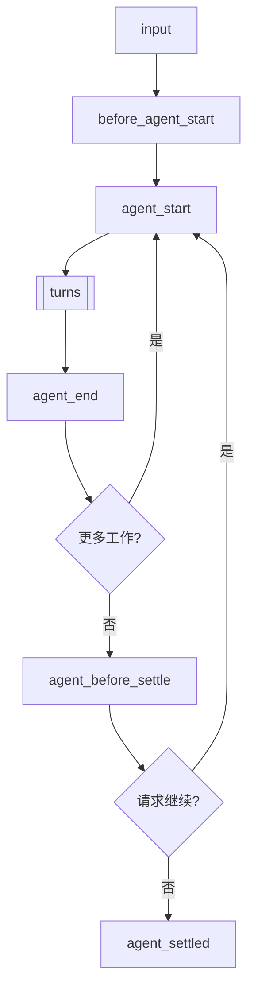
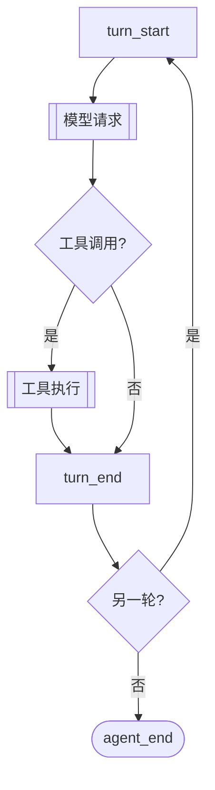
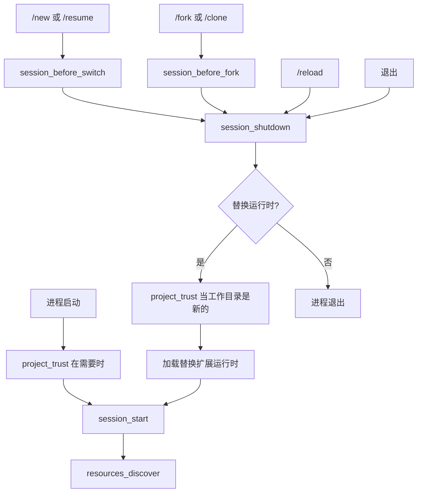

> Pi 可以创建扩展。请让它为你的使用场景构建一个扩展。

# 扩展

扩展（Extensions）是扩展 Pi 行为的 TypeScript 模块。它们可以订阅生命周期事件、注册可供 LLM 调用的自定义工具、添加命令等等。

扩展在 Pi 进程内运行，拥有相同的操作系统权限。它可以检查提示词、工具调用、文件、凭据和会话历史，因此请仅从可信来源加载扩展。

> **/reload 的放置位置：** 将扩展放在 `~/.pi/agent/extensions/`（全局）或 `.pi/extensions/`（项目级）中以供自动发现。仅将 `pi -e ./path.ts` 用于快速测试。位于自动发现位置的扩展可以通过 `/reload` 热重载。

**关键能力：**
- **自定义工具** - 通过 `pi.registerTool()` 注册 LLM 可调用的工具
- **事件拦截** - 阻止或修改工具调用、注入上下文、自定义压缩
- **用户交互** - 通过 `ctx.ui` 提示用户（选择、确认、输入、通知）
- **自定义 UI 组件** - 通过 `ctx.ui.custom()` 提供带键盘输入的完整 TUI 组件，用于复杂交互
- **自定义命令** - 通过 `pi.registerCommand()` 注册 `/mycommand` 之类的命令
- **会话持久化** - 通过 `pi.appendEntry()` 存储可跨重启保留的状态
- **自定义渲染** - 控制工具调用/结果和消息在 TUI 中的显示方式
- **提供商与 MCP 服务器** - 注册模型提供商、虚拟模型和 MCP 服务器

**示例用例：**
- 权限门控（在 `rm -rf`、`sudo` 等操作前确认）
- Git 检查点（每轮 stash，切换分支时恢复）
- 路径保护（阻止写入 `.env`、`node_modules/`）
- 自定义压缩（按你的方式总结对话）
- 对话摘要（参见 `summarize.ts` 示例）
- 交互式工具（问题、向导、自定义对话框）
- 有状态工具（待办列表、连接池）
- 外部集成（文件监视器、webhook、CI 触发器）
- 等待时的小游戏（参见 `snake.ts` 示例）

参见 [examples/extensions/](https://github.com/earendil-works/pi/tree/main/packages/coding-agent/examples/extensions/) 获取可用的实现。

## 目录

- [快速开始](#quick-start)
- [扩展位置](#extension-locations)
- [可用导入](#available-imports)
- [编写扩展](#writing-an-extension)
  - [扩展风格](#extension-styles)
- [事件](#events)
  - [生命周期概述](#lifecycle-overview)
  - [处理器组合](#handler-composition)
  - [启动事件](#startup-events)
  - [资源事件](#resource-events)
  - [会话事件](#session-events)
  - [代理事件](#agent-events)
  - [模型事件](#model-events)
  - [工具事件](#tool-events)
  - [用户外壳事件](#user-bash-events)
  - [输入事件](#input-events)
- [扩展上下文](#extensioncontext)
- [扩展命令上下文](#extensioncommandcontext)
- [扩展API方法](#extensionapi-methods)
- [状态管理](#state-management)
- [自定义工具](#custom-tools)
  - [工具暴露](#tool-exposure)
  - [调用其他工具](#calling-other-tools)
  - [动态工具加载](#dynamic-tool-loading)
- [MCP服务器](#mcp-servers)
- [自定义界面](#custom-ui)
- [错误处理](#error-handling)
- [模式行为](#mode-behavior)
- [示例参考](#examples-reference)

<a id="create-an-extension"></a>

## 快速入门

创建 `~/.pi/agent/extensions/my-extension.ts`：

```typescript
import { type ExtensionAPI, isToolCallEventType } from "@earendil-works/pi-coding-agent";
import { Type } from "typebox";

export default function (pi: ExtensionAPI) {
  // 响应事件
  pi.on("session_start", async (_event, ctx) => {
    ctx.ui.notify("扩展已加载！", "info");
  });

  pi.on("tool_call", async (event, ctx) => {
    if (isToolCallEventType("bash", event) && event.input.command.includes("rm -rf")) {
      const ok = await ctx.ui.confirm("危险操作！", "允许 rm -rf 吗？");
      if (!ok) return { block: true, reason: "用户已阻止" };
    }
  });

  // 注册自定义工具
  pi.registerTool({
    name: "greet",
    label: "问候",
    description: "按名称问候某人",
    parameters: Type.Object({
      name: Type.String({ description: "要问候的名称" }),
    }),
    async execute(toolCallId, params, signal, onUpdate, ctx) {
      return {
        content: [{ type: "text", text: `你好，${params.name}！` }],
        details: {},
      };
    },
  });

  // 注册命令
  pi.registerCommand("hello", {
    description: "打招呼",
    handler: async (args, ctx) => {
      ctx.ui.notify(`你好，${args || "世界"}！`, "info");
    },
  });
}
```

使用 `--extension`（或 `-e`）标志进行测试：

```bash
pi -e ./my-extension.ts
```

<a id="choose-where-it-loads"></a>

## 扩展位置

> **安全提示：** 扩展以你的完整系统权限运行，可以执行任意代码。请仅从你信任的来源安装。

扩展会从受信任的位置自动发现。项目本地的 `.pi/extensions` 目录条目仅在项目受信任后才会加载。

| 位置 | 作用范围 |
|----------|-------|
| `~/.pi/agent/extensions/*.ts` 或 `*.js` | 全局（所有项目） |
| `~/.pi/agent/extensions/*/index.ts` 或 `index.js` | 全局（子目录） |
| `~/.pi/agent/extensions/*/package.json` 中带有 `pi.extensions` 字段 | 全局（带清单的子目录） |
| `.pi/extensions/...` | 项目本地，布局同上 |

发现机制深入一层。较大的软件包会在 `package.json` 清单中声明其入口点。

可通过 `settings.json` 添加额外路径：

```json
{
  "packages": [
    "npm:@foo/bar@1.0.0",
    "git:github.com/user/repo@v1"
  ],
  "extensions": [
    "/path/to/local/extension.ts",
    "/path/to/local/extension/dir"
  ]
}
```

设置项也接受内置扩展，以 `builtin:<name>` 条目形式提供；参见 [设置](settings.md#resources)。若要通过 npm 或 git 将扩展作为 Pi 软件包共享，参见 [packages.md](/docs/packages/)。

## 可用导入

| 软件包 | 用途 |
|---------|---------|
| `@earendil-works/pi-coding-agent` | 扩展类型（`ExtensionAPI`、`ExtensionContext`、事件）和辅助函数 |
| `@earendil-works/pi-agent-core` | 代理消息和工具类型 |
| `typebox`、`typebox/compile`、`typebox/value` | 工具参数的模式定义 |
| `@earendil-works/pi-ai` | AI 工具（字符串枚举的 `StringEnum`、记录辅助函数、模型类型） |
| `@earendil-works/pi-ai/compat`、`/models`、`/oauth`、`/providers/all` | 提供商构建、内置 API 和 OAuth 辅助函数 |
| `@earendil-works/pi-tui` | 用于自定义渲染的 TUI 组件 |

Pi 将这些导入映射到自身的副本，因此扩展共享 Pi 的类和注册表。旧的 `@mariozechner/*` 和 `@sinclair/typebox` 名称映射到相同的模块。

npm 依赖也可用。在扩展旁边（或父目录中）添加 `package.json`，运行 `npm install`，`node_modules/` 的导入将自动解析。

对于通过 `pi install`（npm 或 git）安装的分布式 Pi 软件包，运行时依赖必须放在 `dependencies` 中；`devDependencies` 不会被安装。请勿将上述宿主提供的软件包列入 `dependencies`。参见 [声明依赖](packages.md#declare-dependencies)。

Node.js 内置模块（`node:fs`、`node:path` 等）也可用。

## 编写扩展

扩展导出一个默认工厂函数，该函数接收 `ExtensionAPI`。工厂函数可以是同步的，也可以是异步的：

```typescript
import type { ExtensionAPI } from "@earendil-works/pi-coding-agent";

export default function (pi: ExtensionAPI) {
  // 订阅事件
  pi.on("event_name", async (event, ctx) => {
    // ctx.ui 用于用户交互
    const ok = await ctx.ui.confirm("标题", "您确定吗？");
    ctx.ui.notify("完成！", "info");
    ctx.ui.setStatus("my-ext", "处理中...");  // 页脚状态
    ctx.ui.setWidget("my-ext", ["第 1 行", "第 2 行"]);  // 编辑器上方的组件（默认）
  });

  // 注册工具、命令、快捷键、标志
  pi.registerTool({ ... });
  pi.registerCommand("name", { ... });
  pi.registerShortcut("ctrl+x", { ... });
  pi.registerFlag("my-flag", { ... });
}
```

扩展通过 [jiti](https://github.com/unjs/jiti) 加载，因此 TypeScript 无需编译即可运行。

如果工厂函数返回 `Promise`，Pi 会在继续启动之前等待其完成。这意味着异步初始化会在 `session_start`、`resources_discover` 之前完成，并且通过 `pi.registerProvider()` 排队注册的提供商也会在刷新前完成初始化。

### 异步工厂函数

使用异步工厂函数来处理一次性启动工作，例如获取远程配置或动态发现可用模型。

```typescript
import type { ExtensionAPI } from "@pi-ai/pi-extension-api";

export default async function (pi: ExtensionAPI) {
  const response = await fetch("http://localhost:1234/v1/models");
  const payload = (await response.json()) as {
    data: Array<{
      id: string;
      name?: string;
      context_window?: number;
      max_tokens?: number;
    }>;
  };

  pi.registerProvider("local-openai", {
    baseUrl: "http://localhost:1234/v1",
    apiKey: "$LOCAL_OPENAI_API_KEY",
    api: "openai-completions",
    models: payload.data.map((model) => ({
      id: model.id,
      name: model.name ?? model.id,
      reasoning: false,
      input: ["text"],
      cost: { input: 0, output: 0, cacheRead: 0, cacheWrite: 0 },
      contextWindow: model.context_window ?? 128000,
      maxTokens: model.max_tokens ?? 4096,
    })),
  });
}
```

此模式使得获取的模型在正常启动期间以及 `pi --list-models` 命令中均可用。对于在 Pi 运行期间会变化的模型列表，应实现 `refreshModels` 方法；请参阅 [pi.registerProvider()](#piregisterprovidername-config)。

### 长生命周期资源与关闭

扩展工厂可能在从未启动会话的调用中运行。不要在工厂中启动后台资源，如进程、套接字、文件监视器或定时器。

将后台资源启动推迟到 `session_start` 或需要该资源的命令/工具/事件。注册一个幂等的 `session_shutdown` 处理器，以关闭你启动的所有会话级资源。

### 扩展样式

**单文件** —— 最简单的形式，适合小型扩展：

```
~/.pi/agent/extensions/
└── my-extension.ts
```

**目录加 index.ts** —— 适用于多文件扩展：

```
~/.pi/agent/extensions/
└── my-extension/
    ├── index.ts        # 入口点（默认导出函数）
    ├── tools.ts        # 辅助模块
    └── utils.ts        # 辅助模块
```

**带依赖的软件包** —— 适用于需要 npm 软件包的扩展：

```
~/.pi/agent/extensions/
└── my-extension/
    ├── package.json    # 声明依赖和入口点
    ├── package-lock.json
    ├── node_modules/   # npm install 之后生成
    └── src/
        └── index.ts
```

```json
// package.json
{
  "name": "my-extension",
  "dependencies": {
    "zod": "^3.0.0",
    "chalk": "^5.0.0"
  },
  "pi": {
    "extensions": ["./src/index.ts"]
  }
}
```

在扩展目录中运行 `npm install`，之后即可自动从 `node_modules/` 导入依赖。

<a id="extension-events"></a>

## 事件

<a id="understand-the-lifecycle"></a>

### 生命周期概述

提示词启动一次运行。输入处理首先进行：

1. 扩展命令（`/name`）执行其处理器。`input` 事件不会触发。键入和 RPC 提示词始终检查命令；`pi.sendUserMessage()` 仅在 `expandPromptTemplates: true` 时检查。
2. `input` 处理器可以拦截、转换或处理文本。
3. 技能命令（`/skill:name`）和提示词模板（`/template`）展开。
4. `before_agent_start` 运行，然后代理循环开始。

运行重复轮次，然后检查是否有更多工作启动另一个低层代理运行：



更多工作意味着重试、最终尝试恢复、压缩重试或排队消息。因此，`agent_end` 不是最终空闲信号；请使用 `agent_settled` 来表示。中止的运行会跳过 `agent_before_settle`，直接从 `agent_end` 进入 `agent_settled`。Pi 在运行启动期间（包括压缩检查和 `before_agent_start`）被视为忙碌，因此在此期间发送的消息会进入正在启动的运行。

每轮发送一个模型请求，并执行助手响应中的工具调用：



模型请求按顺序运行以下钩子：

1. `context`（可以修改对话消息）
2. `context_with_system`（可以修改完整记录）
3. `before_provider_headers`（可以修改请求头）
4. `before_provider_request`（可以检查或替换负载）
5. `after_provider_response`（状态和请求头，在流被消费之前）
6. `provider_stream_event`（原始解析的流事件）和 `message_start` / `message_update` / `message_end` 用于助手消息

执行的工具调用按顺序运行以下钩子：

1. `tool_execution_start`
2. `tool_call`（可以阻止或修改输入）
3. `tool_execution_update` 在工具执行期间
4. `tool_result`（可以修改结果）
5. `tool_execution_end`

未执行的调用提前结束。未知工具或无效参数跳过 `tool_call`；被阻止或中止的调用跳过执行和 `tool_result`。这些调用中的每一个仍然会收到带有错误结果的 `tool_execution_end`，因此请使用 `tool_execution_end` 来观察每个已完成的调用。

`turn_end` 可以追加条目并请求继续。阈值压缩在自然需要的下一轮之前运行。消息事件也会为其他消息触发，例如用户、工具结果和自定义消息。提供商钩子仅在传输暴露相应阶段时运行。

会话启动和替换遵循单独的生命周期：



`session_start` 携带 `reason: "startup" | "reload" | "new" | "resume" | "fork"`，`session_shutdown` 携带 `reason: "quit" | "reload" | "new" | "resume" | "fork"`。`resources_discover` 在重载后使用 `reason: "reload"`，否则使用 `"startup"`。退出涵盖 Ctrl+C、Ctrl+D、SIGHUP 和 SIGTERM。`project_trust` 在受信任的项目资源加载之前运行，并且当会话替换进入新的工作目录时可以再次运行。

其他操作更改当前会话而不替换运行时：

| 操作 | 事件 |
|---|---|
| `/compact` 或自动压缩 | `session_before_compact`（可以取消或自定义），然后 `session_compact` 或 `session_compact_failed` |
| `/tree` 导航 | `session_before_tree`（可以取消或自定义），然后 `session_tree` |
| `/name` 或 `pi.setSessionName()` | `session_info_changed` |
| `/model` 或模型循环（`Ctrl+P`） | `thinking_level_select` 如果级别更改或被限制，然后 `model_select` |
| 思考级别更改（设置、按键绑定、`pi.setThinkingLevel()`） | `thinking_level_select` |
| `!` 或 `!!` 命令 | `user_bash`（可以拦截） |
| 扩展对话框或自定义屏幕等待用户 | `ui_prompt_start`、`ui_prompt_end` |
| 空闲提示缓存刷新 | `cache_warming_decision` |
| 扩展在启动后注册或移除 MCP 服务器 | `mcp_servers_change` |

<a id="events-and-concurrency"></a>
<a id="work-with-events"></a>

### 处理器组合

处理器按扩展加载顺序运行，然后按注册顺序运行。某些事件仅用于通知；另一些事件则转换数据、替换结果或取消操作：

| 模式 | 行为 |
|---|---|
| 通知 | 返回值被忽略。仅用该事件进行观察。 |
| 原地修改 | 后续处理器能看到对诸如 `before_provider_headers.headers`、`before_agent_start.systemPromptOptions` 和 `tool_call.input` 等值的修改。 |
| 链式转换 | 后续处理器接收由先前的 `input`、`context`、`context_with_system`、`message_end`、`tool_result` 和 `before_provider_request` 处理器返回的值。 |
| 门控 | 被处理的输入、被阻止的工具调用、被取消的会话操作或被处理的 `user_bash` 命令会终止该操作正常的回退路径。 |
| 可操作边界 | 每个 `turn_end` 或 `agent_before_settle` 处理器都会看到截至目前已提议的条目和延续决策。 |
| 最后覆盖 | 最后一个返回动作的 `cache_warming_decision` 处理器生效。 |

通知处理器不应在流式事件上执行慢操作。转换处理器应保留其未有意占有的字段，门控处理器在其安全决策无法作出时应默认关闭。

### 启动事件

#### project_trust

在 Pi 决定是否信任包含动态配置（`.pi` 或 `.agents/skills`）的项目之前触发。此事件在启动期间以及会话替换（例如 `/resume`）进入当前进程中尚未解析信任的 `cwd` 时运行。仅有用户/全局扩展以及命令行 `-e` 扩展参与；项目本地扩展在信任解决后才会加载。

```typescript
pi.on("project_trust", async (event, ctx) => {
  // event.cwd - 当前工作目录
  // ctx 提供有限的信任上下文：cwd、mode、hasUI 以及 select/confirm/input/notify UI 辅助工具
  if (await ctx.ui.confirm("信任该项目？", event.cwd)) {
    return { trusted: "yes", remember: true };
  }
  return { trusted: "undecided" };
});
```

`project_trust` 处理器必须返回 `{ trusted: "yes" | "no" | "undecided" }`。用户/全局或 CLI 扩展返回 `"yes"` 或 `"no"` 即拥有决策权；第一个 yes/no 决策生效并抑制内置的信任提示。使用 `remember: true` 可持久化 yes/no 决策；否则仅适用于当前进程。返回 `"undecided"` 则交由后续处理程序或内置信任流程决定。在提示前请检查 `ctx.hasUI`。若无处理器返回 yes/no，则继续正常的信任解析流程：首先应用已保存的 `trust.json` 决策，随后由 `defaultProjectTrust` 决定 Pi 默认是询问、信任还是拒绝。

### 资源事件

#### resources_discover

在 `session_start` 之后触发，以便扩展能够贡献额外的技能、提示词模板和主题路径。
启动路径使用 `reason: "startup"`。重新加载使用 `reason: "reload"`。

```typescript
pi.on("resources_discover", async (event, _ctx) => {
  // event.cwd - 当前工作目录
  // event.reason - "startup" | "reload"
  return {
    skillPaths: ["/path/to/skills"],
    promptPaths: ["/path/to/prompts"],
    themePaths: ["/path/to/themes"],
  };
});
```

#### mcp_servers_change

当扩展在绑定后注册或注销 MCP 服务器时触发。`event.servers` 在变更后列出每个已注册的服务器。处理此事件会将扩展标记为连接已注册服务器的扩展；参见 [MCP 服务器](#mcp-servers)。

### 会话事件

关于会话存储的内部机制及 SessionManager API，请参阅 [会话格式](/docs/session-format/)。

#### session_start

当会话启动、加载或重新加载时触发。

```typescript
pi.on("session_start", async (event, ctx) => {
  // event.reason - "startup" | "reload" | "new" | "resume" | "fork"
  // event.previousSessionFile - 在 "new"、"resume" 和 "fork" 时存在
  ctx.ui.notify(`会话: ${ctx.sessionManager.getSessionFile() ?? "临时"}`, "info");
});
```

#### session_info_changed

当通过 `/name` 命令、RPC 或 `pi.setSessionName()` 设置当前会话显示名称时触发。

```typescript
pi.on("session_info_changed", async (event, ctx) => {
  // event.name - 当前标准化后的名称，若已清除则为 undefined
  ctx.ui.notify(`会话已重命名：${event.name ?? "(无)"}`, "info");
});
```

#### session_before_switch

在开始新会话（`/new`）或切换会话（`/resume`）之前触发。

```typescript
pi.on("session_before_switch", async (event, ctx) => {
  // event.reason - "new" 或 "resume"
  // event.targetSessionFile - 要切换到的会话（仅适用于"resume"）

  if (event.reason === "new") {
    const ok = await ctx.ui.confirm("清空？", "删除所有消息？");
    if (!ok) return { cancel: true };
  }
});
```

成功切换或新会话操作后，Pi 会为旧的扩展实例发出 `session_shutdown`，为新会话重新加载并重新绑定扩展，然后发出带有 `reason: "new" | "resume"` 和 `previousSessionFile` 的 `session_start`。
在 `session_shutdown` 中执行清理工作，然后在 `session_start` 中重建所有内存状态。

#### session_before_fork

通过 `/fork` 分叉或 `/clone` 克隆时触发。

```typescript
pi.on("session_before_fork", async (event, ctx) => {
  // event.entryId - 所选条目的 ID
  // event.position - "/fork" 时为 "before"，"/clone" 时为 "at"
  return { cancel: true }; // 取消分叉/克隆
  // 或
  return { skipConversationRestore: true }; // 保留用于未来的会话恢复控制
});
```

分叉或克隆成功后，Pi 会为旧扩展实例发出 `session_shutdown`，重新加载并重新绑定新会话的扩展，然后发出 `session_start`，其中包含 `reason: "fork"` 和 `previousSessionFile`。
在 `session_shutdown` 中执行清理工作，然后在 `session_start` 中重新建立任何内存状态。

<a id="session_before_compact--session_compact"></a>

#### session_before_compact / session_compact / session_compact_failed

在压缩时触发。详见 [compaction.md](/docs/compaction/)。

```typescript
pi.on("session_before_compact", async (event, ctx) => {
  const { preparation, branchEntries, customInstructions, reason, willRetry, signal } = event;

  // reason - "manual" (/compact)、"threshold" 或 "overflow"
  // willRetry - 压缩后是否重试被中止的回合（溢出恢复）

  // 取消：
  return { cancel: true };

  // 自定义摘要：
  return {
    compaction: {
      summary: "...",
      firstKeptEntryId: preparation.firstKeptEntryId,
      tokensBefore: preparation.tokensBefore,
      // usage: summaryResponse.usage, // 可选；包含在会话总计中
    }
  };
});

pi.on("session_compact", async (event, ctx) => {
  // event.compactionEntry - 保存的压缩内容
  // event.fromExtension - 是否由扩展提供
  // event.reason - "manual" (/compact)、"threshold" 或 "overflow"
  // event.willRetry - 压缩后是否重试被中止的回合（溢出恢复）
});

pi.on("session_compact_failed", async (event, ctx) => {
  // event.reason - "manual" (/compact)、"threshold" 或 "overflow"
  // event.errorMessage - 非中止失败时存在
  // event.aborted - 对于已取消/中止的压缩为 true
  // event.willRetry - 压缩后是否重试被中止的回合
  // event.fromExtension - 是否正在使用扩展提供的压缩内容
});
```

#### session_before_tree / session_tree

在 `/tree` 导航时触发。有关树导航的概念，请参阅 [会话](/docs/sessions/)。

```typescript
pi.on("session_before_tree", async (event, ctx) => {
  const { preparation, signal } = event;
  // preparation.targetId, oldLeafId, commonAncestorId, entriesToSummarize,
  // userWantsSummary, customInstructions, replaceInstructions, label
  return { cancel: true };
  // 或者提供自定义摘要（仅在 preparation.userWantsSummary 为 true 时使用）：
  return {
    summary: {
      summary: "...",
      // usage: summaryResponse.usage, // 可选；包含在会话总计中
      details: {},
    },
  };
  // 或者覆盖摘要选项：customInstructions、replaceInstructions、label
});

pi.on("session_tree", async (event, ctx) => {
  // event.newLeafId, oldLeafId, summaryEntry, fromExtension
});
```

#### session_shutdown

在已启动的会话运行时被销毁之前触发。利用此钩子清理从 `session_start` 或其他会话级钩子中打开的资源。

```typescript
pi.on("session_shutdown", async (event, ctx) => {
  // event.reason - "quit" | "reload" | "new" | "resume" | "fork"
  // event.targetSessionFile - 会话替换流程的目标会话
  // 清理、保存状态等
});
```

### 代理事件

#### before_agent_start

在运行开始之前触发，紧随输入处理和扩展之后。可以注入消息和/或修改系统提示词。

`event.messageType` 指明启动运行的原因：`"user"` 表示由提示词或 `pi.sendUserMessage()` 触发，带有 `prompt` 和 `images`；`"custom"` 表示在空闲状态下由 `pi.sendMessage(..., { triggerTurn: true })` 触发，带有起始的 `message` 但没有 `prompt`。

```typescript
pi.on("before_agent_start", async (event, ctx) => {
  // event.messageType - "user" | "custom"
  // event.prompt, event.images - 用户的提示词文本和图片（messageType 为 "user" 时）
  // event.message - 启动运行的自定义消息（messageType 为 "custom" 时）
  // event.systemPrompt - 当前链接的系统提示词，供此处理器使用
  //   （包括先前 before_agent_start 处理器所做的改动）
  // event.systemPromptOptions - 用于构建系统提示词的结构化选项
  //   .customPrompt - 来自 --system-prompt、SYSTEM.md 或自定义模板的精确提示词前缀
  //   .forceSystemPrompt - 可选，用于完整提示词的精确替代
  //   .selectedTools - 当前在提示词中活跃的工具
  //   .hiddenTools - 已选择但在请求中省略声明的工具
  //   .toolSnippets - 每个工具的一行描述
  //   .toolGuidelines - 以工具名为键的规则条目
  //   .promptGuidelines - 附加的自定义规则条目
  //   .sections - 以标签名为键的自定义 XML 包装部分
  //   .appendSystemPrompt - 来自 --append-system-prompt 标志的文本
  //   .cwd - 工作目录
  //   .contextFiles - AGENTS.md 文件以及其他加载的上下文文件
  //   .skills - 已加载的技能

  return {
    // 注入持久消息（存储在会话中，发送给 LLM）
    message: {
      customType: "my-extension",
      content: "Additional context for the LLM",
      display: true,
    },
    // 替换此轮的系统提示词（在扩展之间链接）
    systemPrompt: event.systemPrompt + "\n\nExtra instructions for this turn...",
  };
});
```

返回的 `message` 会被添加到任一类型的运行中；请检查 `messageType` 以跳过由自定义消息启动的运行。

`systemPromptOptions` 字段为扩展提供与 Pi 构建系统提示词时相同的结构化数据。集合是可变的。建议优先修改 `sections`、`selectedTools` 或 `promptGuidelines`：Pi 会将生成的提示词部分与模型已有的内容进行比较，并追加仅修补已更改部分的系统消息。返回 `systemPrompt` 或设置 `forceSystemPrompt` 会替换整个运行的提示词：每个提供商都会收到强制文本作为其前置系统提示词（当其更改时会导致一次缓存未命中），而会话记录会继续记录结构化部分。工具选择更改会同时更新提示词贡献和可执行的提供商工具；在处理程序内部调用 `pi.setActiveTools()` 与编辑 `selectedTools` 效果相同。支持在对话中途接受系统消息的模型会就地接收补丁并保留其缓存前缀；其他模型会收到重放的提示词作为其系统提示词，每次更改都会造成一次缓存未命中。

在 `before_agent_start` 内部，`event.systemPrompt` 和 `ctx.getSystemPrompt()` 都反映当前处理器的链接系统提示词。后续的 `before_agent_start` 处理器仍然可以再次修改它。

<a id="agent_start--agent_end--agent_settled"></a>

#### agent_start / agent_end / agent_before_settle / agent_settled

`agent_start` 在底层代理运行开始时触发。`agent_end` 在该运行结束时触发，但 Pi 可能仍会自动重试、自动压缩并重试，或继续处理排队的追问消息。`agent_before_settle` 是最终的可操作边界：它可以追加会话条目并请求一次延续。`agent_settled` 是最终的，仅通知用；适合用于需要知道 Pi 不会自动继续运行的状态集成。

```typescript
pi.on("agent_start", async (_event, ctx) => {});

pi.on("agent_end", async (event, ctx) => {
  // event.messages - 来自此次底层运行的消息
});

let addedReviewReminder = false;
pi.on("agent_before_settle", async (event, ctx) => {
  if (addedReviewReminder) return;
  addedReviewReminder = true;
  return {
    entries: [...event.entries, {
      type: "custom_message",
      customType: "review-reminder",
      content: "回复前请查看最终的差异。",
      display: false,
    }],
    continue: true,
  };
});

pi.on("agent_settled", async (event, ctx) => {
  // event.aborted - 当运行因中止而结束时（例如按 Escape 键），此值为 true
  // ctx.isIdle() 此时为 true；此处请求的运行在所有 settled 处理程序完成后启动。
});
```

如果在 `agent_before_settle` 处理程序运行期间中止了运行，已返回的有效条目仍会提交，但请求的延续会被抑制。从 `agent_settled` 请求的工作会延迟至所有 settled 处理程序完成之后，因此通知分发是非重入的。

#### ui_prompt_start / ui_prompt_end

用于阻塞式用户界面扩展提示的通知型生命周期事件。这些事件在 `ctx.ui.select()`、`ctx.ui.confirm()`、`ctx.ui.input()`、`ctx.ui.editor()` 和 `ctx.ui.custom()` 调用前后触发，使宿主/状态集成能够报告“等待用户”而非仅显示“运行中”。

嵌套或重叠的提示会被合并为一个外部等待区间。处理程序以尽力而为的方式调用，在提示显示或关闭之前不会等待其完成。

```typescript
pi.on("ui_prompt_start", async (event, ctx) => {
  // event.reason === "ui_prompt"
  // event.kind: "select" | "confirm" | "input" | "editor" | "custom"
  // event.title: 可用的提示标题
});

pi.on("ui_prompt_end", async (event, ctx) => {
  // Pi 不再等待该 UI 提示区间。
});
```

#### turn_start / turn_end

每个回合（一次 LLM 响应 + 工具调用）触发。

```typescript
pi.on("turn_start", async (event, ctx) => {
  // event.turnIndex, event.timestamp
});

let replacedResponse = false;
pi.on("turn_end", async (event, ctx) => {
  // event.turnIndex, event.message, event.toolResults
  // event.entries 包含目前提出的结构性条目。
  if (replacedResponse || event.outcome !== "completed" || event.toolResults.length > 0) return;
  replacedResponse = true;
  return {
    entries: [
      ...event.entries,
      { type: "context_edit", targetId: event.messageEntryId, replacement: null },
      {
        type: "custom_message",
        customType: "replacement-instruction",
        content: "Answer again using the persisted user request.",
        display: false,
      },
    ],
    continue: true,
  };
});
```

`turn_end` 在助手和工具结果消息持久化之后、底层 `turn_end` 事件之前运行。重试退避和最终尝试恢复仍在 `agent_end` 之后发生，保持其现有生命周期和队列顺序；`agent_before_settle` 在该工作完成后看到修复后的投影。边界处理器按扩展加载和注册顺序运行。每个处理器在 `event.entries` 中看到先前的提议，并看到从这些提议重建的 `event.context`。返回 `entries` 或 `continue` 仅替换该字段；省略的字段保留当前提议。允许的草稿条目类型为 `custom`、`custom_message`、`context_edit` 和 `compaction`。完整提议在所有处理器完成后按列表顺序追加前进行验证；处理器错误会被报告，后续处理器仍会运行。验证可防止部分应用的语义错误，但持久化不是事务性的。

`continue: true` 确保该边界调用有一次后续提供商请求。如果工具结果、引导或追问已导致该请求，则它们满足该决定，不再发出额外请求；否则 Pi 会发出一次仅上下文的请求。错误和中止的响应仍是硬退出。`continue: false` 从不抑制自然工作。守卫延续条件：无条件的 `continue: true` 会在下一次响应后再次评估，可能造成无限循环。`custom_message` 草稿贡献一条用户角色模型消息，但由扩展编写：它不运行人类输入钩子、斜杠命令、技能或提示词模板。

构造 `TurnEndEvent` 值的主机集成必须提供 `messageEntryId`、`toolResultEntryIds`、`outcome`、`entries`、`continue` 和 `context`。`ExtensionEvent` 穷举切换也必须处理 `agent_before_settle`。`ExtensionRunner.emit()` 排除可操作的回合边界；通过 `emitBoundary(baseEvent, buildContext)` 分发 `turn_end` 和 `agent_before_settle`，以便处理器接收链式预览。其他专用运行器方法仍为 `session_before_*` 等事件返回结果。

#### message_start / message_update / message_end

在消息生命周期更新时触发。

- `message_start` 和 `message_end` 对每条消息都会触发，包括用户、助手、工具结果和自定义消息。
- `message_update` 对助手流式更新触发。
- `message_end` 处理器可返回 `{ message }` 来替换最终消息。替换消息必须保持相同的 `role`。

```typescript
pi.on("message_start", async (event, ctx) => {
  // event.message
});

pi.on("message_update", async (event, ctx) => {
  // event.message
  // event.assistantMessageEvent（逐 token 的流式事件）
});

pi.on("message_end", async (event, ctx) => {
  if (event.message.role !== "assistant") return;

  return {
    message: {
      ...event.message,
      usage: {
        ...event.message.usage,
        cost: {
          ...event.message.usage.cost,
          total: 0.123,
        },
      },
    },
  };
});
```

#### tool_execution_start / tool_execution_update / tool_execution_end

在工具执行生命周期更新时触发。

在并行工具模式下：
- `tool_execution_start` 在预检阶段按助手源顺序发出
- `tool_execution_update` 事件可能跨工具交错出现
- `tool_execution_end` 在每个工具完成后按工具完成顺序发出
- 最终的 `toolResult` 消息事件仍会在之后按助手源顺序发出

```typescript
pi.on("tool_execution_start", async (event, ctx) => {
  // event.toolCallId, event.toolName, event.args
});

pi.on("tool_execution_update", async (event, ctx) => {
  // event.toolCallId, event.toolName, event.args, event.partialResult
});

pi.on("tool_execution_end", async (event, ctx) => {
  // event.toolCallId, event.toolName, event.result, event.isError
  // event.durationMs - execute() 执行耗时（毫秒）；工具未运行时缺失
});
```

当另一个工具发起调用时，这三个事件以及 `tool_call` 和 `tool_result` 都会携带 `parentToolCallId`；参见 [调用其他工具](#calling-other-tools)。

#### context

在每个LLM调用前触发。可非破坏性地修改messages。参见[会话格式](/docs/session-format/)了解消息类型。

```typescript
pi.on("context", async (event, ctx) => {
  // event.messages - 不含系统消息的深拷贝，可安全修改
  const filtered = event.messages.filter(m => !shouldPrune(m));
  return { messages: filtered };
});
```

`event.messages` 保存不含系统消息的会话内容。提示词和工具声明属于Pi，不参与此钩子：当处理器返回修改后的列表时，Pi会将当前的提示词章节和工具声明重放到返回消息前的一条主导系统消息中。因此，通过压缩摘要进行过滤、加窗或切片不会丢失提示词或工具。未修改的列表会保留会话中段系统消息的位置，这样接受它们的模型可以复用其缓存前缀。处理器添加的系统消息会保留在Pi的头部之后。若要持久修改提示词或工具集，请使用[`before_agent_start`](#before_agent_start)或`pi.setActiveTools()`；若要针对单次请求编辑系统消息，请使用[`context_with_system`](#context_with_system)。

#### context_with_system

在每次 LLM 调用之前触发，此时所有 `context` 处理器均已运行，且 Pi 已恢复提示词及工具状态。`event.messages` 包含完整对话记录，包括开头的系统消息及对话中间出现的提示词或工具补丁（参见 [会话格式](session-format.md#sessionmessageentry)）。返回的消息将按原样发送：此钩子全权负责请求的提示词与工具声明。

```typescript
import { getCurrentSystemMessage } from "@earendil-works/pi-ai";

pi.on("context_with_system", async (event, ctx) => {
  const cut = findCutIndex(event.messages);
  // 折叠被丢弃的前缀，使其提示词与工具状态作为新的头部保留下来。
  const head = getCurrentSystemMessage(event.messages.slice(0, cut));
  return { messages: head ? [head, ...event.messages.slice(cut)] : event.messages.slice(cut) };
});
```

规则：索引 0 处必须保留一条系统消息（提供商在此读取提示词与初始工具声明；若处理器将其丢弃，Pi 将报错）。移除系统消息即移除了其所携带的工具声明及段落补丁。请使用 `@earendil-works/pi-ai` 模块中的 `getCurrentSystemPrompt()` 和 `getCurrentTools()` 检查输出。处理器按扩展加载顺序执行；在 `before_agent_start` 中强制设置的 `systemPrompt` 仍会在后续请求中被投影到消息中。

#### before_provider_headers

在出站 HTTP 请求头组装完成后触发。用于添加、覆盖或移除请求头。

处理器直接修改 `event.headers` 对象。将键设为字符串以添加或覆盖标头，设为 `null` 以删除标头。

```typescript
pi.on("before_provider_headers", (event, ctx) => {
  // 添加或覆盖——例如，用于网关追踪/归因的会话 ID
  event.headers["x-session-id"] = ctx.sessionManager.getSessionId();

  // 删除 pi 为此调用添加的追踪标头
  event.headers["X-OpenRouter-Title"] = null;
});
```

每个提供商请求触发一次；重试复用相同的请求头，而非重新触发该钩子。

#### before_provider_request

在提供商特定载荷构建完成后、请求发送前触发。处理程序按扩展加载顺序执行。返回 `undefined` 保持载荷不变。返回任何其他值将替换后续处理程序及实际请求所使用的载荷。

此钩子可重写提供商级别的系统指令或完全移除它们。这些载荷级别的更改不会反映在 `ctx.getSystemPrompt()` 中，后者报告的是 Pi 的系统提示词字符串，而非最终序列化的提供商载荷。

```typescript
pi.on("before_provider_request", (event, ctx) => {
  console.log(JSON.stringify(event.payload, null, 2));

  // 可选：替换载荷
  // return { ...event.payload, temperature: 0 };
});
```

这主要用于调试提供商序列化和缓存行为。

#### after_provider_response

在收到 HTTP 响应之后、流式响应体被消费之前触发。处理器按扩展加载顺序执行。

```typescript
pi.on("after_provider_response", (event, ctx) => {
  // event.status - HTTP 状态码
  // event.headers - 规范化后的响应头
  if (event.status === 429) {
    console.log("rate limited", event.headers["retry-after"]);
  }
});
```

响应头是否可用取决于提供商和传输层。抽象了 HTTP 响应的提供商可能不会暴露响应头。

#### provider_stream_event

在 Pi 规范化每个已解析的提供商流事件之前触发。仅用于通知，不会被持久化。

```typescript
pi.on("provider_stream_event", (event, ctx) => {
  // event.provider, event.api, event.model
  // event.data - Pi 可用的最早结构化值（只读）
});
```

`event.data` 不一定是原始 HTTP 字节或 SSE 帧。请将其视为只读，因为修改可能影响规范化。处理器按流顺序等待，因此缓慢的处理程序会延迟流消费。处理程序错误会被报告，但不会改变提供商的响应。参见 [`debug-provider.ts`](https://github.com/earendil-works/pi/blob/main/packages/coding-agent/examples/extensions/debug-provider.ts) 了解一个可选用的查看器，它按助手消息对原始事件进行分组。

#### cache_warming_decision

每次提示词缓存刷新前触发，事件中已填入 Pi 的决定。该事件仅携带 Pi 的成本估算；其余信息请使用 `ctx.model`、`ctx.isIdle()` 和 `ctx.getContextUsage()`。

```typescript
pi.on("cache_warming_decision", (event, ctx) => {
  // event.warmCost：本次刷新的价格
  // event.missCost：若条目丢失，下一次请求的额外价格
  // event.continuationProbability：Pi 对请求及时到达的概率估算
  // event.action："warm" | "stop"，Pi 的决定

  if (ctx.model?.provider === "my-provider") {
    return { action: "stop" };
  }
});
```

返回 `{ action: "warm" }` 或 `{ action: "stop" }` 以覆盖决定；最后一个返回 action 的处理器生效。`"stop"` 会终止预热，直到下一次真实请求到来。

### 模型事件

#### model_select

当模型通过 `/model` 命令、模型循环切换（`Ctrl+P`）或 `pi.setModel()` 发生变化时触发。恢复会话不会触发此事件；请在 `session_start` 中读取 `ctx.model` 以初始化依赖模型的状态。

```typescript
pi.on("model_select", async (event, ctx) => {
  // event.model - 新选择的模型
  // event.previousModel - 之前的模型（首次选择时为 undefined）
  // event.source - "set" | "cycle"

  const prev = event.previousModel
    ? `${event.previousModel.provider}/${event.previousModel.id}`
    : "none";
  const next = `${event.model.provider}/${event.model.id}`;

  ctx.ui.notify(`模型已更改（${event.source}）：${prev} -> ${next}`, "info");
});
```

当活动模型发生变化时，可用此事件更新 UI 元素（状态栏、页脚）或执行特定于模型的初始化。

#### thinking_level_select

当思考级别发生变化时触发。此事件仅用于通知；处理函数的返回值将被忽略。

```typescript
pi.on("thinking_level_select", async (event, ctx) => {
  // event.level - 新选择的思考级别
  // event.previousLevel - 之前的思考级别

  ctx.ui.setStatus("thinking", `thinking: ${event.level}`);
});
```

当 `pi.setThinkingLevel()`、模型变更或内置思考级别控件更改当前思考级别时，可使用此事件更新扩展 UI。

<a id="tool-call-events"></a>

### 工具事件

#### tool_call

在 `tool_execution_start` 之后、工具执行之前触发。**可阻塞。** 使用 `isToolCallEventType` 来收窄类型并获取类型化输入。

在 `tool_call` 运行之前，Pi 会等待先前发出的 Agent 事件通过 `AgentSession` 完成排空。这意味着 `ctx.sessionManager` 会更新到当前助手的工具调用消息。

在默认的并行工具执行模式下，来自同一助手消息的同级工具调用会先顺序预检，再并发执行。`tool_call` 不保证能在 `ctx.sessionManager` 中看到同一助手消息中的同级工具结果。

`event.input` 是可变的。在执行前就地修改它即可修补工具参数。

行为保证：
- 对 `event.input` 的修改会影响实际工具执行。
- 后续的 `tool_call` 处理程序会看到先前处理程序所做的修改。
- 修改后不会重新验证。
- 从 `tool_call` 返回的值通过 `{ block: true, reason?: string, terminate?: boolean }` 控制阻塞。
- `terminate` 仅适用于被阻塞的调用；只有批处理中所有最终确定的结果均为终止时，代理才会提前停止。

```typescript
import { isToolCallEventType } from "@earendil-works/pi-coding-agent";

pi.on("tool_call", async (event, ctx) => {
  // event.toolName - "bash"、"read"、"write"、"edit" 等
  // event.toolCallId
  // event.input - 工具参数（可变）

  // 内置工具：无需类型参数
  if (isToolCallEventType("bash", event)) {
    // event.input 是 { command: string; timeout?: number }
    event.input.command = `source ~/.profile\n${event.input.command}`;

    if (event.input.command.includes("rm -rf")) {
      return { block: true, reason: "危险命令", terminate: true };
    }
  }

  if (isToolCallEventType("read", event)) {
    // event.input 是 { path: string; offset?: number; limit?: number }
    console.log(`读取: ${event.input.path}`);
  }
});
```

#### 自定义工具输入类型

自定义工具应导出其输入类型：

```typescript
// my-tool.ts
import { type Static, Type } from "typebox";

export const myToolSchema = Type.Object({ action: Type.String() });
export type MyToolInput = Static<typeof myToolSchema>;
```

使用带有显式类型参数的 `isToolCallEventType`：

```typescript
import { isToolCallEventType } from "@earendil-works/pi-coding-agent";
import type { MyToolInput } from "./my-tool.ts";

pi.on("tool_call", (event) => {
  if (isToolCallEventType<"my_tool", MyToolInput>("my_tool", event)) {
    event.input.action;  // 类型化
  }
});
```

#### tool_result

在工具执行完成后、`tool_execution_end` 及最终工具结果消息事件发出之前触发。**可以修改结果。**

在并行工具模式下，`tool_result` 和 `tool_execution_end` 可能按工具完成顺序交错出现，而最终的 `toolResult` 消息事件仍会在助理源顺序的后续阶段发出。

`tool_result` 处理器像中间件一样链式执行：
- 处理器按扩展加载顺序运行
- 每个处理器都能看到前一个处理器修改后的最新结果
- 处理器可以返回部分补丁（`content`、`details`、`structuredContent`、`isError` 或 `usage`）；省略的字段保留当前值
- 在不返回 `structuredContent` 的情况下替换 `content` 会丢弃结构化内容，因为两者可能不再匹配

在处理器内部使用 `ctx.signal` 处理嵌套异步工作。这样可以让 Esc 取消模型调用、`fetch()` 以及扩展启动的其他支持中止的操作。

```typescript
import { isBashToolResult } from "@earendil-works/pi-coding-agent";

pi.on("tool_result", async (event, ctx) => {
  // event.toolName、event.toolCallId、event.input、event.parentToolCallId
  // event.content、event.details、event.structuredContent、event.isError、event.usage

  if (isBashToolResult(event)) {
    // event.details 的类型为 BashToolDetails
  }

  const response = await fetch("https://example.com/summarize", {
    method: "POST",
    body: JSON.stringify({ content: event.content }),
    signal: ctx.signal,
  });

  // 修改结果：
  return { content: [...], details: {...}, isError: false, usage: nestedModelUsage };
});
```

### 用户 Bash 事件

#### user_bash

当用户执行 `!` 或 `!!` 命令时触发。**可被拦截。**

```typescript
import { createLocalBashOperations } from "@earendil-works/pi-coding-agent";

pi.on("user_bash", (event, ctx) => {
  // event.command - bash 命令
  // event.excludeFromContext - 若使用 !! 前缀则为 true
  // event.cwd - 当前工作目录

  // 选项 1：提供自定义操作（例如 SSH）
  return { operations: remoteBashOps };

  // 选项 2：包装 pi 内置的本地 bash 后端
  const local = createLocalBashOperations();
  return {
    operations: {
      exec(command, cwd, options) {
        return local.exec(`source ~/.profile\n${command}`, cwd, options);
      }
    }
  };

  // 选项 3：完全替换——直接返回结果
  return { result: { output: "...", exitCode: 0, cancelled: false, truncated: false } };
});
```

返回 `undefined` 将继续传递给下一个处理器，若无处理器处理该事件，则执行本地执行。有效结果会停止传播：`operations` 通过提供的后端执行命令，而 `result` 记录完成的命令但不执行它。

### 输入事件

#### input

在收到用户输入时触发，此时扩展命令已检查完毕，但技能和模板尚未展开。该事件看到的是原始输入文本，因此 `/skill:foo` 和 `/template` 尚未展开。

**处理顺序：**
1. 首先检查扩展命令（`/cmd`）——如果找到，则运行处理器并跳过输入事件。来自 `pi.sendUserMessage()` 的消息仅在 `expandPromptTemplates: true` 时检查。
2. `input` 事件触发——可以拦截、转换或处理
3. 如果未处理：技能命令（`/skill:name`）展开为技能内容
4. 如果未处理：提示词模板（`/template`）展开为模板内容
5. 代理处理开始（`before_agent_start` 等）

```typescript
pi.on("input", async (event, ctx) => {
  // event.text - 原始输入（在技能/模板展开之前）
  // event.images - 附加的图片（如果有）
  // event.source - "interactive"（键入）、"rpc"（API）或 "extension"（通过 sendUserMessage）
  // event.streamingBehavior - "steer" | "followUp" | undefined
  //   空闲时为 undefined，流中断时为 "steer"，
  //   排队等待代理完成的消息为 "followUp"

  // 转换：在展开前重写输入
  if (event.text.startsWith("?quick "))
    return { action: "transform", text: `简要回复：${event.text.slice(7)}` };

  // 处理：无需 LLM 直接响应（扩展显示自己的反馈）
  if (event.text === "ping") {
    ctx.ui.notify("pong", "info");
    return { action: "handled" };
  }

  // 按来源路由：跳过扩展注入消息的处理
  if (event.source === "extension") return { action: "continue" };

  // 在展开前拦截技能命令
  if (event.text.startsWith("/skill:")) {
    // 可以转换、阻止或放行
  }

  return { action: "continue" };  // 默认：放行至展开
});
```

**结果：**
- `continue` - 原样放行（处理器无返回时的默认行为）
- `transform` - 修改文本/图片，然后继续展开
- `handled` - 完全跳过代理（第一个返回此值的处理器生效）

转换会在多个处理器之间串联。参见 [input-transform.ts](https://github.com/earendil-works/pi/blob/main/packages/coding-agent/examples/extensions/input-transform.ts) 和 [input-transform-streaming.ts](https://github.com/earendil-works/pi/blob/main/packages/coding-agent/examples/extensions/input-transform-streaming.ts) 了解 `streamingBehavior` 感知的路由。

<a id="use-extension-context"></a>

## ExtensionContext

所有处理器都会收到 `ctx: ExtensionContext`。工具 `execute()` 接收 `ExtensionToolContext`，它额外提供了 `ctx.tools` 和 `ctx.executeTool()`（参见[调用其他工具](#calling-other-tools)）。命令处理器接收 [`ExtensionCommandContext`](#extensioncommandcontext)。

### ctx.ui

用于用户交互的界面方法。完整细节参见[自定义界面](#custom-ui)。

### ctx.mode

当前的运行模式：`"tui"`、`"rpc"`、`"json"` 或 `"print"`。使用 `ctx.mode === "tui"` 来保护仅限终端的功能，例如 `custom()`、组件工厂、终端输入以及直接 TUI 渲染。

### ctx.hasUI

在TUI和RPC模式下为`true`。在打印模式（`-p`）和JSON模式下为`false`。使用此属性来保护在TUI和RPC模式下均有效的对话框方法（`select`、`confirm`、`input`、`editor`）以及即发即弃方法（`notify`、`setStatus`、`setWidget`、`setTitle`、`setEditorText`）。在RPC模式下，某些TUI特有的方法为空操作或返回默认值（参见[RPC扩展UI](/docs/rpc-extension-ui/)）。

### ctx.cwd

当前工作目录。

在构建项目本地配置路径时，应使用 `CONFIG_DIR_NAME` 而非硬编码 `.pi`。重新品牌化的发行版可能使用不同的配置目录名称。

```typescript
import { CONFIG_DIR_NAME, type ExtensionAPI } from "@earendil-works/pi-coding-agent";
import { join } from "node:path";

export default function (pi: ExtensionAPI) {
  pi.on("session_start", (_event, ctx) => {
    const projectConfigPath = join(ctx.cwd, CONFIG_DIR_NAME, "my-extension.json");
    // ...
  });
}
```

### ctx.isProjectTrusted()

返回当前会话上下文中是否启用了项目本地信任。这包括临时信任决定和 CLI 信任覆盖，而不仅仅是全局信任存储中保存的决定。

在读取仅应对受信任项目生效的项目本地扩展配置之前，请使用此方法。

### ctx.sessionManager

对会话状态的只读访问：`getCwd()`、`getSessionDir()`、`getSessionId()`、`getSessionFile()`、`getSessionName()`、`getHeader()`、`getEntries()`、`getEntry()`、`getBranch()`、`getTree()`、`getLeafId()`、`getLeafEntry()`、`getLabel()`、`buildContextEntries()` 和 `buildSessionProjection()`。关于条目类型，请参阅[会话格式](/docs/session-format/)。

对于 `tool_call`，在处理器运行之前，该状态会通过当前的助手消息进行同步。在并行工具执行模式下，仍然不能保证包含来自同一助手消息的兄弟工具结果。

```typescript
ctx.sessionManager.getEntries()             // 所有条目
ctx.sessionManager.getBranch()              // 当前分支
ctx.sessionManager.buildContextEntries()    // 应用压缩后的活动分支条目
ctx.sessionManager.getLeafId()              // 当前叶条目 ID
```

### ctx.modelRegistry / ctx.model / ctx.thinkingLevel / ctx.scopedModels

访问模型、提供商以及已解析的认证信息。`ctx.modelRegistry.getProvider(id)` 返回有效的 pi-ai 提供商，而 `getProviderAuth(id)` 在无需加载模型的情况下解析其当前的 API 密钥、请求头、基础 URL 及提供商作用域环境。`ctx.model` 是当前激活的模型，`ctx.thinkingLevel` 是其当前生效的思考级别。

`ctx.scopedModels` 是限定于当前会话的模型只读列表，与 `/scoped-models` 命令显示的集合一致。它在会话开始时根据 `--models` 命令行标志和 `enabledModels` 设置解析（通过 minimatch 在 `provider/modelId` 或裸 `modelId` 上与可用目录匹配）。未配置作用域时列表为空，表示所有可用模型均可使用。每个条目为 `{ model, thinkingLevel? }`，其中 `thinkingLevel` 仅在模式固定了该值时设置（例如 `anthropic/*:high`）。使用它来填充与内置选择器一致的模型选择器，而非通过 `ctx.modelRegistry.getAvailable()` 枚举整个目录。

#### 流式模型调用

使用 `ctx.modelRegistry.streamSimple(model, context, options)` 处理提供商无关的选项（如 `reasoning`），或使用 `complete(model, context, options)` 等待带有 API 特定选项的最终助手消息。两者均使用已配置的提供商并解析认证，包括通过 `pi.registerProvider()` 注册的提供商。请使用这些方法，而非无法看到扩展提供商注册的 `pi-ai/compat` 流式函数。

`streamSimple()` 返回一个 `AssistantMessageEventStream`。对其进行迭代以获取响应事件，并等待 `.result()` 获取最终消息。设置失败会产生错误事件和错误结果。

对于非聊天模型，`findOfType()`、`getModelsOfType()`、`getAvailableOfType()` 和 `getModelOfType()` 用于查找图像和分类器模型，而 `classify()` 和 `generateImages()` 会调用它们。参见 [使用分类器模型](models.md#use-classifier-models) 和 [使用图像模型](models.md#use-image-models)。

### ctx.signal

当前代理回合的中止信号；当没有激活的代理回合时为 `undefined`。

在扩展处理器启动的、支持中止的嵌套工作中使用它，例如：
- `fetch(..., { signal: ctx.signal })`
- 接受 `signal` 的模型调用
- 接受 `AbortSignal` 的文件或进程辅助函数

`ctx.signal` 通常在活跃回合事件（如 `tool_call`、`tool_result`、`message_update`、`turn_end`）期间定义。
在空闲或非回合上下文（如会话事件、扩展命令，以及 Pi 空闲时触发的快捷方式）中，它通常是 `undefined`。

```typescript
pi.on("tool_result", async (event, ctx) => {
  const response = await fetch("https://example.com/api", {
    method: "POST",
    body: JSON.stringify(event),
    signal: ctx.signal,
  });

  const data = await response.json();
  return { details: data };
});
```

### ctx.isIdle() / ctx.abort() / ctx.hasPendingMessages()

控制流辅助方法。当 Pi 正在处理代理运行、自动重试、自动压缩重试或排队中的延续任务时，`ctx.isIdle()` 返回 `false`。

### ctx.shutdown()

请求优雅地关闭 pi。

- **交互模式：** 推迟到代理空闲后执行（在处理完所有排队的引导和追问消息之后）。
- **RPC 模式：** 推迟到下一个空闲状态（完成当前命令响应并等待下一条命令时）。
- **打印模式：** 无操作。所有提示词处理完毕后进程自动退出。

退出前向所有扩展发出 `session_shutdown` 事件。在所有上下文（事件处理器、工具、命令、快捷键）中可用。

```typescript
pi.on("tool_call", (event, ctx) => {
  if (isFatal(event.input)) {
    ctx.shutdown();
  }
});
```

### ctx.getContextUsage()

返回当前活动模型的上下文使用情况。若存在最近的助手使用记录，则优先采用该记录；否则，估算后续消息的令牌数。

```typescript
const usage = ctx.getContextUsage();
if (usage?.tokens != null && usage.tokens > 100_000) {
  // ...
}
```

### ctx.compact()

触发压缩而不等待完成。使用 `onComplete` 和 `onError` 进行追问操作。

```typescript
ctx.compact({
  customInstructions: "Focus on recent changes",
  onComplete: (result) => {
    ctx.ui.notify("Compaction completed", "info");
  },
  onError: (error) => {
    ctx.ui.notify(`Compaction failed: ${error.message}`, "error");
  },
});
```

### ctx.getSystemPrompt()

返回 Pi 当前的系统提示词字符串。

- 在 `before_agent_start` 阶段，此方法反映当前回合到目前为止已发生的链式系统提示词更改。
- 它不包含后续 `context` 消息的变更。
- 它不包含 `before_provider_request` 中的载荷重写。
- 如果在你之后加载的扩展仍在运行，它们仍可能更改最终发送的内容。

```typescript
pi.on("before_agent_start", (event, ctx) => {
  const prompt = ctx.getSystemPrompt();
  console.log(`系统提示词长度: ${prompt.length}`);
});
```

## ExtensionCommandContext

命令处理程序接收 `ExtensionCommandContext`，它通过会话控制方法扩展了 `ExtensionContext`。这些方法仅在命令中可用，因为从事件处理程序中调用它们可能会导致死锁。

### ctx.getSystemPromptOptions()

返回 Pi 当前用于构建系统提示词的基础输入。

```typescript
const options = ctx.getSystemPromptOptions();
const contextPaths = options.contextFiles?.map((file) => file.path) ?? [];
```

其形状和可变性与 `before_agent_start` 的 `event.systemPromptOptions` 相同：自定义或强制提示词、启用的工具、工具片段、按工具和自定义规则、自定义部分、附加的提示词文本、当前工作目录、加载的上下文文件和加载的技能。它可能包含完整的上下文文件内容，因此请将其视为敏感的扩展本地数据，并避免通过命令列表、日志或自动完成元数据暴露它。

此方法报告当前的基础提示词输入。它不包括每轮的 `before_agent_start` 链式系统提示词更改、后续 `context` 事件消息变更，或 `before_provider_request` 负载重写。

### ctx.waitForIdle()

等待代理完全稳定，包括自动重试、自动压缩重试以及排队的后续操作：

```typescript
pi.registerCommand("my-cmd", {
  handler: async (args, ctx) => {
    await ctx.waitForIdle();
    // 代理现在处于空闲状态，可以安全地修改会话
  },
});
```

### ctx.newSession(options?)

创建一个新会话：

```typescript
const parentSession = ctx.sessionManager.getSessionFile();
const kickoff = "在替换会话中继续";

const result = await ctx.newSession({
  parentSession,
  setup: async (sm) => {
    sm.appendMessage({
      role: "user",
      content: [{ type: "text", text: "来自先前会话的上下文..." }],
      timestamp: Date.now(),
    });
  },
  withSession: async (ctx) => {
    // 这里仅使用替换会话的 ctx。
    await ctx.sendUserMessage(kickoff);
  },
});

if (result.cancelled) {
  // 某个扩展取消了新会话
}
```

选项：
- `parentSession`：要记录在新会话头部中的父会话文件
- `setup`：在 `withSession` 运行之前修改新会话的 `SessionManager`
- `withSession`：切换后使用新的替换会话上下文执行后续工作。不要使用捕获的旧 `pi` / 命令 `ctx`；参见[会话替换生命周期与陷阱](#session-replacement-lifecycle-and-footguns)。

### ctx.fork(entryId, options?)

从特定条目分叉，创建新的会话文件：

```typescript
const result = await ctx.fork("entry-id-123", {
  withSession: async (ctx) => {
    // 此处仅使用替换后的会话上下文。
    ctx.ui.notify("现已进入分叉会话", "info");
  },
});
if (result.cancelled) {
  // 有扩展取消了分叉操作
}

const cloneResult = await ctx.fork("entry-id-456", { position: "at" });
if (cloneResult.cancelled) {
  // 有扩展取消了克隆操作
}
```

选项：
- `position`：`"before"`（默认）在所选用户消息之前分叉，并将该提示词恢复至编辑器
- `position`：`"at"` 复制当前路径至所选条目，但不恢复编辑器文本
- `withSession`：在新的替换会话上下文上执行切换后工作。不可使用捕获的旧 `pi` / 命令 `ctx`；参见 [会话替换生命周期与陷阱](#session-replacement-lifecycle-and-footguns)。

### ctx.navigateTree(targetId, options?)

在会话树中导航至不同节点。当代理响应、手动或自动压缩，或另一项树导航操作正在进行时，该方法会拒绝执行，即使设置了 `summarize: false` 也是如此。这些冲突不会改变当前活动分支，并且会拒绝 Promise，而非返回 `{ cancelled: true }`。需等待当前操作完成（例如，在命令处理器中使用 `await ctx.waitForIdle()`），然后重试。当在没有可用模型的情况下设置 `summarize` 参数，或目标条目不存在时，该方法同样会拒绝执行：

```typescript
const result = await ctx.navigateTree("entry-id-456", {
  summarize: true,
  customInstructions: "聚焦错误处理更改",
  replaceInstructions: false, // true = 完全替换默认提示词
  label: "审查检查点",
});
```

选项：
- `summarize`：是否生成被放弃分支的摘要。
- `customInstructions`：提供给摘要生成器的自定义指令。
- `replaceInstructions`：若为 true，`customInstructions` 将替换默认提示词，而非追加。
- `label`：附加到分支摘要条目（若不进行摘要，则附加到目标条目）的标签。

### ctx.switchSession(sessionPath, options?)

切换到不同的会话文件：

```typescript
const result = await ctx.switchSession("/path/to/session.jsonl", {
  withSession: async (ctx) => {
    await ctx.sendUserMessage("在新的会话中恢复工作");
  },
});
if (result.cancelled) {
  // 扩展通过 session_before_switch 取消了切换
}
```

选项：
- `withSession`：在新的替换会话上下文中运行切换后的工作。不要使用捕获的旧 `pi` / 命令 `ctx`；请参阅 [会话替换生命周期与易错点](#session-replacement-lifecycle-and-footguns)。

要查找可用的会话，可使用静态方法 `SessionManager.list()` 或 `SessionManager.listAll()`：

```typescript
import { SessionManager } from "@earendil-works/pi-coding-agent";

pi.registerCommand("switch", {
  description: "切换到另一个会话",
  handler: async (args, ctx) => {
    const sessions = await SessionManager.list(ctx.cwd);
    if (sessions.length === 0) return;
    const choice = await ctx.ui.select(
      "选择会话：",
      sessions.map((s) => s.path),
    );
    if (choice) {
      await ctx.switchSession(choice, {
        withSession: async (ctx) => {
          ctx.ui.notify("已切换会话", "info");
        },
      });
    }
  },
});
```

### 会话替换生命周期与易错点

`withSession` 接收一个新的 `ReplacedSessionContext`，它扩展了 `ExtensionCommandContext`，并带有绑定到替换会话的异步 `sendMessage()` 和 `sendUserMessage()` 帮助器。

生命周期与易错点：
- `withSession` 仅在旧会话已发出 `session_shutdown`、旧运行时已拆除、替换会话已重新绑定，且新扩展实例已收到 `session_start` 之后运行。
- 回调仍然在原始闭包中执行，而不是在新扩展实例内部。这意味着你的旧扩展实例可能在 `withSession` 开始之前已经运行了其关闭清理。
- 捕获的旧 `pi` / 旧命令 `ctx` 中绑定会话的对象在替换后将失效，如果使用会抛出异常。请仅使用传递给 `withSession` 的 `ctx` 进行会话绑定工作。
- 先前提取的原始对象仍由你负责。例如，如果在替换前捕获 `const sm = ctx.sessionManager`，则 `sm` 仍然是旧的 `SessionManager` 对象。替换后请勿重用它。
- `withSession` 中的代码应假设由你的 `session_shutdown` 处理器使失效的任何状态都已消失。仅捕获能干净存活于关闭过程的普通数据，例如字符串、id 和序列化配置。

安全模式：

```typescript
pi.registerCommand("handoff", {
  handler: async (_args, ctx) => {
    const kickoff = "Continue from the replacement session";
    await ctx.newSession({
      withSession: async (ctx) => {
        await ctx.sendUserMessage(kickoff);
      },
    });
  },
});
```

不安全模式：

```typescript
pi.registerCommand("handoff", {
  handler: async (_args, ctx) => {
    const oldSessionManager = ctx.sessionManager;
    await ctx.newSession({
      withSession: async (_ctx) => {
        // 过时的旧对象：不要这样做
        oldSessionManager.getSessionFile();
        pi.sendUserMessage("wrong");
      },
    });
  },
});
```

### ctx.reload()

运行与 `/reload` 相同的重新加载流程。

```typescript
pi.registerCommand("reload-runtime", {
  description: "重新加载扩展、技能、提示词模板、主题和上下文文件",
  handler: async (_args, ctx) => {
    await ctx.reload();
    return;
  },
});
```

重要行为说明：
- `await ctx.reload()` 会为当前扩展运行时发出 `session_shutdown` 事件
- 随后重新加载资源，并发出 `session_start`（带有 `reason: "reload"`）和 `resources_discover`（带有 `reason: "reload"`）
- 当前正在运行的命令处理器仍会在旧调用帧中继续执行
- `await ctx.reload()` 之后的代码仍由重载前的版本运行
- `await ctx.reload()` 之后的代码不得假设旧的进程内扩展状态仍然有效
- 处理器返回后，后续的命令/事件/工具调用将使用新的扩展版本

为确保行为可预测，应将重载视为该处理器的终止点（`await ctx.reload(); return;`）。

工具使用 `ExtensionToolContext` 而非 `ExtensionCommandContext` 运行，因此它们不能调用 `ctx.reload()`，且 Pi 无法在代理运行期间进行重载。要让 LLM 触发重载，可让工具记录请求，并从 `agent_settled` 运行命令，处理器发送的消息会在所有已排定的处理器完成后被处理：

```typescript
let reloadRequested = false;

pi.registerTool({
  name: "reload_runtime",
  label: "重新加载运行时",
  description: "重新加载扩展、技能、提示词模板、主题和上下文文件",
  parameters: Type.Object({}),
  async execute() {
    reloadRequested = true;
    return {
      content: [{ type: "text", text: "已请求重新加载。Pi 将在本次响应后重新加载。" }],
      details: {},
      terminate: true,
    };
  },
});

pi.on("agent_settled", () => {
  if (!reloadRequested) return;
  reloadRequested = false;
  pi.sendUserMessage("/reload-runtime", { expandPromptTemplates: true });
});
```

`expandPromptTemplates: true` 会将文本作为命令分发。如果不使用该选项，或通过 `deliverAs` 排队，则文本会作为普通用户消息到达模型。参见 [reload-runtime.ts](https://github.com/earendil-works/pi/blob/main/packages/coding-agent/examples/extensions/reload-runtime.ts)。

## 扩展 API 方法

### pi.on(event, handler)

订阅事件。返回一个只移除该注册的取消订阅函数。事件类型及返回值参见 [事件](#events)。

```typescript
const unsubscribe = pi.on("agent_end", async (event) => {
  unsubscribe();
  await updateIntegration(event.messages);
});
```

处理函数按扩展加载顺序执行，随后在同一扩展内按注册顺序执行。添加或移除处理函数不会影响已在进行中的分发调度。

### pi.registerTool(definition)

注册一个可供 LLM 调用的自定义工具。完整细节请参阅 [自定义工具](#custom-tools)。

`pi.registerTool()` 既可在扩展加载期间调用，也可在启动后调用。你可以在 `session_start`、命令处理器或其他事件处理器中调用它。新工具会在同一会话中立即刷新，因此无需 `/reload` 即可在 `pi.getAllTools()` 中看到它们。注册工具即会激活它，除非该工具设置了 `defaultActive: false` 或设置了 `direct`、`model-only` 之外的[暴露方式](#tool-exposure)。

使用 `pi.setActiveTools()` 可在运行时启用或禁用工具（包括动态添加的工具）。

使用 `promptSnippet` 可将自定义工具以单行条目形式加入默认系统提示词的 `<tools>` 部分；使用 `promptGuidelines` 可在工具激活时向其 `<rules>` 部分追加工具特定的要点。

**重要提示：** `promptGuidelines` 的要点会以扁平形式追加到 `<rules>` 部分，且不带工具名称前缀。每条要点必须明确指出其指代的工具——避免使用“当……时使用此工具”这类表述，因为 LLM 无法判断“此工具”指的是哪个。请改为“当……时使用 my_tool”。

完整示例请参阅 [dynamic-tools.ts](https://github.com/earendil-works/pi/blob/main/packages/coding-agent/examples/extensions/dynamic-tools.ts)。

```typescript
import { Type } from "typebox";
import { StringEnum } from "@earendil-works/pi-ai";

pi.registerTool({
  name: "my_tool",
  label: "My Tool",
  description: "What this tool does",
  promptSnippet: "Summarize or transform text according to action",
  promptGuidelines: ["Use my_tool when the user asks to summarize previously generated text."],
  parameters: Type.Object({
    action: StringEnum(["list", "add"] as const),
    text: Type.Optional(Type.String()),
  }),

  async execute(toolCallId, params, signal, onUpdate, ctx) {
    // 流式传输进度；部分结果也需要 details
    onUpdate?.({ content: [{ type: "text", text: "Working..." }], details: { result: "pending" } });

    return {
      content: [{ type: "text", text: "Done" }],
      details: { result: "..." },
    };
  },

  // 可选：自定义渲染
  renderCall(args, theme, context) { ... },
  renderResult(result, options, theme, context) { ... },
});
```

### pi.sendMessage(message, options?)

将会话中注入自定义消息。自定义消息参与 LLM 上下文。对于仅用于 TUI 且不应发送至 LLM 的持久内容，请使用 [`pi.appendEntry()`](#piappendentrycustomtype-data) 配合 [`pi.registerEntryRenderer()`](#piregisterentryrenderercustomtype-renderer)。

```typescript
pi.sendMessage({
  customType: "my-extension",
  content: "Message text",
  display: true,
  details: { ... },
}, {
  triggerTurn: true,
  deliverAs: "steer",
});
```

**选项：**
- `deliverAs` - 投递模式：
  - `"steer"`（默认）- 在流式传输期间将消息排队。在当前助手回合完成其工具调用后、下一次 LLM 调用前投递。
  - `"followUp"` - 等待代理完成。仅在代理不再有工具调用时投递。
  - `"nextTurn"` - 为下一条用户提示排队。不中断或触发任何操作。
- `triggerTurn: true` - 如果代理空闲，立即触发 LLM 响应。仅适用于 `"steer"` 和 `"followUp"` 模式（对 `"nextTurn"` 忽略）。未设置时，空闲会话会存储消息而不开始回合。
- 流式传输期间 `triggerTurn: false` - 消息不会作为引导或追问排队；在当前回合结束后追加。

### pi.sendUserMessage(content, options?)

向代理发送一条用户消息。与发送自定义消息的 `sendMessage()` 不同，此方法发送的是真实用户消息，表现为仿佛由用户输入。除非 `input` 处理器处理了该消息，或通过 `expandPromptTemplates: true` 运行扩展命令，否则它会开始或排队一个回合。

```typescript
// 简单文本消息
pi.sendUserMessage("What is 2+2?");

// 使用内容数组（文本 + 图片）
pi.sendUserMessage([
  { type: "text", text: "描述这张图片：" },
  { type: "image", data: "...", mimeType: "image/png" },
]);

// 流式传输期间 - 必须指定投递模式
pi.sendUserMessage("关注错误处理", { deliverAs: "steer" });
pi.sendUserMessage("然后总结", { deliverAs: "followUp" });

// 选择加入扩展命令分发和技能/提示词模板扩展
pi.sendUserMessage("/review src/index.ts", { expandPromptTemplates: true });
```

**选项：**
- `deliverAs` - 当代理正在流式传输时必填：
  - `"steer"` - 将消息排队，在当前助手回合完成其工具调用后投递
  - `"followUp"` - 等待代理完成所有工具调用
- `expandPromptTemplates` - 分发扩展命令并扩展技能命令和提示词模板。默认值为 `false`。

当未进行流式传输时，消息会立即发送并触发新回合。若在流式传输时未指定 `deliverAs`，则消息会被拒绝，Pi 会报告扩展错误。

参见 [send-user-message.ts](https://github.com/earendil-works/pi/blob/main/packages/coding-agent/examples/extensions/send-user-message.ts) 获取完整示例。

### pi.appendEntry(customType, data?)

持久化扩展数据。自定义条目不参与 LLM 上下文。在交互模式下，当与 `pi.registerEntryRenderer()` 配对时，它们也可以在聊天记录中渲染。

```typescript
pi.appendEntry("my-state", { count: 42 });
pi.appendEntry("status-card", { title: "Indexed files", count: 17 });

// 重新加载时恢复
pi.on("session_start", async (_event, ctx) => {
  for (const entry of ctx.sessionManager.getEntries()) {
    if (entry.type === "custom" && entry.customType === "my-state") {
      // 从 entry.data 重新构造
    }
  }
});
```

### pi.setSessionName(name)

设置会话显示名称（在会话选择器中显示，而非第一条消息）。

```typescript
pi.setSessionName("Refactor auth module");
```

### pi.getSessionName()

获取当前会话名称（如果已设置）。

```typescript
const name = pi.getSessionName();
if (name) {
  console.log(`Session: ${name}`);
}
```

### pi.setLabel(entryId, label)

在条目上设置或清除标签。标签是用户定义的标记，用于书签和导航（显示在 `/tree` 选择器中）。

```typescript
// 设置标签
pi.setLabel(entryId, "checkpoint-before-refactor");

// 清除标签
pi.setLabel(entryId, undefined);

// 通过 sessionManager 读取标签
const label = ctx.sessionManager.getLabel(entryId);
```

标签在会话中持久保存，并在重启后仍然存在。使用它们来标记对话树中的要点（轮次、检查点）。

### pi.registerCommand(name, options)

注册一个命令。

如果多个扩展注册了相同的命令名称，Pi 会保留所有命令，并按加载顺序分配数字调用后缀，例如 `/review:1` 和 `/review:2`。

```typescript
pi.registerCommand("stats", {
  description: "显示会话统计信息",
  handler: async (args, ctx) => {
    const count = ctx.sessionManager.getEntries().length;
    ctx.ui.notify(`${count} 条记录`, "info");
  }
});
```

可选：为 `/command ...` 添加参数自动补全。`getArgumentCompletions` 也可以返回一个 `Promise`：

```typescript
import type { AutocompleteItem } from "@earendil-works/pi-tui";

pi.registerCommand("deploy", {
  description: "部署到环境",
  getArgumentCompletions: (prefix: string): AutocompleteItem[] | null => {
    const envs = ["dev", "staging", "prod"];
    const items = envs.map((e) => ({ value: e, label: e }));
    const filtered = items.filter((i) => i.value.startsWith(prefix));
    return filtered.length > 0 ? filtered : null;
  },
  handler: async (args, ctx) => {
    ctx.ui.notify(`正在部署: ${args}`, "info");
  },
});
```

### pi.getCommands()

获取当前会话中可通过 `prompt` 调用的斜杠命令。包括扩展命令、提示词模板和技能命令。
列表顺序与 RPC `get_commands` 一致：先是扩展，然后是模板，最后是技能。技能命令命名为 `skill:<name>`。

```typescript
const commands = pi.getCommands();
const bySource = commands.filter((command) => command.source === "extension");
const userScoped = commands.filter((command) => command.sourceInfo.scope === "user");
```

每个条目具有以下结构：

```typescript
{
  name: string; // 可调用命令名称，不含前导斜杠。可能带有后缀，如 "review:1"
  description?: string;
  source: "extension" | "prompt" | "skill";
  sourceInfo: {
    path: string;
    source: string;
    scope: "user" | "project" | "temporary";
    origin: "package" | "top-level";
    baseDir?: string;
  };
}
```

使用 `sourceInfo` 作为规范的来源字段。不要根据命令名称或临时路径解析来推断所有权。

内置交互式命令（如 `/model` 和 `/settings`）不包含在此列表中。它们仅在交互模式下处理，如果通过 `prompt` 发送则不会执行。

### pi.registerMessageRenderer(customType, renderer)

为你的 `customType` 注册自定义消息的 TUI 渲染器。自定义消息通过 `pi.sendMessage()` 创建，并参与 LLM 上下文。参见[自定义界面](#custom-ui)。

### pi.registerMarkdownTransformer(transformer)

为用户普通文本、助手文本和思考块中的 Markdown 注册一个转换器。转换器按扩展加载顺序执行，每个转换器接收前一个转换器返回的 Markdown。链处理完成后，Pi 使用其内置渲染器渲染转换后的内容。

转换器接收 Markdown 字符串以及一个包含以下字段的上下文：

- `messageType` — `"user"`、`"assistant"` 或 `"assistant-thinking"`
- `isStreaming` — 助手部分更新时为 `true`；用户消息、最终确定的助手消息和恢复的消息为 `false`
- `availableWidth` — 可用于转换后 Markdown 内容的确切终端列数
- `messageId`、`timestamp` — 从持久化会话条目渲染时的会话条目 ID 和 ISO 时间戳；实时消息为 `undefined`

返回转换后的 Markdown：

```typescript
pi.registerMarkdownTransformer((markdown, { messageType, isStreaming }) => {
  if (isStreaming || messageType === "assistant-thinking") return markdown;
  return markdown.replaceAll("-->", "→");
});
```

如果转换器抛出异常，Pi 将保留已生成的 Markdown 并继续执行下一个转换器。该钩子仅用于显示：原始消息在会话和模型上下文中保持不变。它会在新的用户消息、助手流式更新、恢复的会话消息和终端宽度变化时运行，因此转换器应保持同步且开销低廉。

### pi.registerEntryRenderer(customType, renderer)

为你的 `customType` 自定义条目注册一个自定义 TUI 渲染器。自定义条目通过 `pi.appendEntry()` 创建，不参与 LLM 上下文。

```typescript
import { Box, Text } from "@earendil-works/pi-tui";

pi.registerEntryRenderer("status-card", (entry, { expanded }, theme) => {
  const data = entry.data as { title: string; count: number };
  const box = new Box(1, 1, (text) => theme.bg("customMessageBg", text));
  box.addChild(new Text(`${theme.bold(data.title)}: ${data.count}`));
  if (expanded) {
    box.addChild(new Text(theme.fg("dim", JSON.stringify(data, null, 2))));
  }
  return box;
});

pi.appendEntry("status-card", { title: "Indexed files", count: 17 });
```

### pi.registerShortcut(shortcut, options)

注册一个键盘快捷键。有关快捷键格式和内置键盘绑定的信息，请参阅 [keybindings.md](/docs/keybindings/)。

```typescript
pi.registerShortcut("ctrl+shift+p", {
  description: "切换规划模式",
  handler: async (ctx) => {
    ctx.ui.notify("已切换！");
  },
});
```

### pi.registerFlag(name, options)

注册一个命令行标志。

```typescript
pi.registerFlag("plan", {
  description: "以计划模式启动",
  type: "boolean",
  default: false,
});

// 加载后检查值；在工厂中，getFlag() 返回默认值
pi.on("session_start", () => {
  if (pi.getFlag("plan")) {
    // 计划模式已启用
  }
});
```

### pi.exec(command, args, options?)

执行一条 shell 命令。

```typescript
const result = await pi.exec("git", ["status"], { signal, timeout: 5000 });
// result.stdout, result.stderr, result.code, result.killed
```

### pi.getActiveTools() / pi.getAllTools() / pi.setActiveTools(names)

管理活动工具。这既适用于内置工具，也适用于动态注册的工具。`pi.getActiveTools()` 返回活动工具名称，类型为 `string[]`；`pi.getAllTools()` 返回所有已配置工具的元数据。

```typescript
const active = pi.getActiveTools(); // ["read", "bash", ...]
const all = pi.getAllTools();
// all = [{
//   name: "read",
//   description: "读取文件内容...",
//   parameters: ...,
//   promptGuidelines: ["使用 read 而非 cat 或 sed 检查文件。"],
//   exposure: "direct",
//   sourceInfo: { path: "builtin:read", source: "builtin", scope: "temporary", origin: "top-level" }
// }, ...]
// Pi 随附的工具：核心工具及内置扩展（如 builtin:mcp）注册的工具
const shippedTools = all.filter((t) => t.sourceInfo.source === "builtin");
// 来自已安装或本地扩展的工具
const extensionTools = all.filter((t) => t.sourceInfo.source !== "builtin" && t.sourceInfo.source !== "sdk");
pi.setActiveTools([...new Set([...active, "my_custom_tool"])]); // 保留当前工具并启用 my_custom_tool
pi.setActiveTools(["read", "bash"]); // 仅启用 read 和 bash
```

`pi.getAllTools()` 返回 `name`、`description`、`parameters`、`promptGuidelines`、`exposure`、`sourceInfo`，若已设置，还包含 `namespace`、`annotations` 和 `reachesTools`。

典型的 `sourceInfo` 值：
- `source: "builtin"` 表示 Pi 随附的工具：核心工具（`path: "builtin:<tool>"`）以及内置扩展（如 `builtin:mcp`）注册的工具（`path: "builtin:<extension>"`）
- `source: "sdk"` 表示通过 `createAgentSession({ customTools })` 传入的工具
- 扩展注册的工具则包含扩展来源元数据

`pi.setActiveTools()` 会忽略未知工具和 `hidden` 工具。具有 `codemode` 或 `deferred` 暴露方式的工具，无论是否处于活动状态，均可从 codemode 脚本中调用。

### pi.setModel(model)

为当前会话设置模型。此更改会记录在会话历史中，并在恢复该会话时恢复，但不会更改新会话使用的已配置 `defaultProvider` 或 `defaultModel`。如果模型提供商的认证未配置，则返回 `false`。有关配置自定义模型，请参阅 [models.md](/docs/models/)。

```typescript
const model = ctx.modelRegistry.find("anthropic", "claude-sonnet-4-5");
if (model) {
  const success = await pi.setModel(model);
  if (!success) {
    ctx.ui.notify("No API key for this model", "error");
  }
}
```

### pi.getThinkingLevel() / pi.setThinkingLevel(level)

获取当前思考级别。该级别会被限制在模型能力范围内（非推理模型始终使用“off”）。更改会触发 `thinking_level_select` 事件。

`pi.setThinkingLevel()` 更改当前会话的思考级别。该更改会记录在会话历史中，并在恢复该会话时恢复，但不会更改新会话使用的配置默认值。

```typescript
const current = pi.getThinkingLevel();  // "off" | "minimal" | "low" | "medium" | "high" | "xhigh" | "max"
pi.setThinkingLevel("high");
```

### pi.events

用于扩展之间通信的共享事件总线：

```typescript
pi.events.on("my:event", (data) => { ... });
pi.events.emit("my:event", { ... });
```

### pi.registerProvider(name, config)

动态注册或覆盖模型提供商。适用于代理、自定义端点或团队级模型配置。

在扩展工厂函数期间进行的调用会被排队，并在运行器初始化后应用。此后的调用——例如用户设置流程后从命令处理器发出的调用——会立即生效，无需 `/reload`。

动态提供商可以实现 `refreshModels`。Pi 在模型刷新期间调用它，通过提供商同步发布返回的列表，并传递规范的凭证/存储目录/网络/信号上下文。扩展通过生成检查的 `context.publish({ persist: entry })` 决定是否持久化目录元数据；诸如 llama.cpp 之类的实时服务器无需持久化即可返回模型。

`context.signal` 始终是具体的信号，提供商回调必须将其传递给阻塞 I/O。公开的 `ModelRuntime.refresh()` 和 `ModelRegistry.refresh()` 调用接受可选信号，省略时无界；扩展和应用程序自行选择截止时间。取消会停止调用方等待，即使提供商忽略信号，但仍需协作才能停止底层工作。

需要原生提供商认证、过滤、刷新或流行为的扩展可以从 `@earendil-works/pi-ai` 注册完整的 `Provider`。该提供商成为组合基础，`models.json` 覆盖仍然应用于其上。

> 完整代码见英文原文。

对象形式接受完整的 pi-ai `Provider`，包括原生 `auth`、`getModels`、`refreshModels`、`filterModels`、`stream` 和 `streamSimple` 行为。

**旧版配置选项：**
- `name` - 提供商在 `/login` 等界面中的显示名称。
- `baseUrl` - API 端点 URL。每个已定义的模型都需要一个，来自模型定义或提供商。
- `apiKey` - API 密钥字面量、环境变量插值（`$ENV_VAR` 或 `${ENV_VAR}`）或前缀 `!command`。可选：没有它，用户通过 `/login` 存储密钥。`$$` 转义 `$`，`$!` 转义字面量 `!` 而不触发命令执行。
- `api` - API 类型：`"anthropic-messages"`、`"openai-completions"`、`"openai-responses"` 等。
- `headers` - 请求中包含的自定义头。
- `authHeader` - 若为 true，自动添加 `Authorization: Bearer` 头。
- `models` - 模型定义数组。若提供，替换该提供商的所有现有模型。模型定义可设置 `baseUrl` 以覆盖该模型的提供商端点。
- `refreshModels` - 异步动态发现回调。其返回的模型替换扩展提供的模型。`context.stored` 包含持久化的提供商快照；仅在更新目录数据应持久化时使用生成检查的 `context.publish({ persist: entry })`。使用 `persist: null` 删除该快照。
- `oauth` - 用于 `/login` 支持的 OAuth 提供商配置。提供时，该提供商出现在登录菜单中。
- `streamSimple` - 用于非标准 API 的自定义流实现。

参见 [自定义提供商文档](/docs/custom-provider/) 了解高级主题：自定义流式 API、OAuth 详细信息、模型定义参考。

### pi.unregisterProvider(name)

移除先前注册的提供商及其模型。被该提供商覆盖的内置模型将恢复。如果提供商未注册，则此操作无效。

与 `registerProvider` 类似，在初始加载阶段之后调用时，此操作会立即生效，无需执行 `/reload`。

```typescript
pi.registerCommand("my-setup-teardown", {
  description: "移除自定义代理提供商",
  handler: async (_args, _ctx) => {
    pi.unregisterProvider("my-proxy");
  },
});
```

### pi.registerVirtualModel(model) / pi.unregisterVirtualModel(provider, id)

注册一个可选择的目录项，将每个请求路由至一个物理模型。`ctx.model`及会话的模型选择指定了虚拟模型；助手消息记录了路由器选中的物理模型及思考等级。再次注册相同的提供商与ID将替换原虚拟模型。参见[虚拟模型](/docs/virtual-models/)。

### pi.registerMcpServer(name, config) / pi.unregisterMcpServer(name) / pi.getMcpServers()

为当前会话注册一个 MCP 服务器。参见 [MCP 服务器](#mcp-servers)。

### pi.registerToolRenderer(resolver)

选择如何绘制对任何工具的调用，包括尚未注册的工具，例如在恢复的会话中、其服务器连接之前的 MCP 工具。解析器接收工具名称和 `next()`，后者返回其余解析器（按扩展加载顺序）以及已注册工具将使用的内容，因此 `next() ?? mine` 仅在无定义时补缺。

```typescript
pi.registerToolRenderer((toolName, next) => {
  if (!toolName.startsWith("mcp__")) return next();
  return next() ?? { renderCall: (args, theme) => new Text(theme.fg("toolTitle", toolName), 0, 0) };
});
```

### pi.getSettings()

返回一份有效设置的副本，其中已合并全局设置与项目设置，并应用了覆盖。

<a id="persist-state"></a>

## 状态管理

带状态的扩展应将状态存储在工具结果的 `details` 字段中，以支持正确的分支处理：

```typescript
export default function (pi: ExtensionAPI) {
  let items: string[] = [];

  // 从活动分支重建状态
  const reconstruct = (ctx: ExtensionContext) => {
    items = [];
    for (const entry of ctx.sessionManager.getBranch()) {
      if (entry.type === "message" && entry.message.role === "toolResult") {
        if (entry.message.toolName === "my_tool") {
          items = (entry.message.details as { items?: string[] } | undefined)?.items ?? [];
        }
      }
    }
  };
  pi.on("session_start", async (_event, ctx) => reconstruct(ctx));
  pi.on("session_tree", async (_event, ctx) => reconstruct(ctx)); // /tree 切换分支

  pi.registerTool({
    name: "my_tool",
    // ...
    async execute(toolCallId, params, signal, onUpdate, ctx) {
      items.push("new item");
      return {
        content: [{ type: "text", text: "Added" }],
        details: { items: [...items] },  // 存储以供重建
      };
    },
  });
}
```

从 `getBranch()` 重建，而不是从每条记录重建：被放弃的分支代表替代历史。对于不应传递给模型的持久数据，请使用 [`pi.appendEntry()`](#piappendentrycustomtype-data)。

<a id="register-tools"></a>

## 自定义工具

通过 `pi.registerTool()` 注册可由 LLM 调用的工具。工具会显示在系统提示词中，并支持自定义渲染。

使用 `promptSnippet` 在默认系统提示词的 `<tools>` 部分中创建一行简短条目。如果省略此属性，自定义工具将不会出现在该部分中。

使用 `promptGuidelines` 为默认系统提示词的 `<rules>` 部分添加工具专属要点。这些要点仅在工具处于活动状态时才会包含（例如，在 `pi.setActiveTools([...])` 调用之后）。

**重要提示：** `promptGuidelines` 的要点会扁平化追加到 `<rules>` 部分，不带工具名称前缀或分组。每条要点必须指明其对应的工具——避免使用“当……时使用此工具”这类表述，因为 LLM 无法判断“此工具”具体指哪个。应写为“当……时使用 my_tool”。

注意：某些模型会在工具路径参数中包含 @ 前缀。内置工具在解析路径前会去除前导 @。如果您的自定义工具接受路径参数，请同样规范化前导 @。

如果您的自定义工具会修改文件，请使用 `withFileMutationQueue()` 使其与内置的 `edit` 和 `write` 工具参与相同的按文件队列。这一点很重要，因为工具调用默认并行执行。如果没有队列，两个工具可能读取到相同的旧文件内容，计算出不同的更新，后执行写入的一方会覆盖先写入的结果。

失败案例：您的自定义工具编辑 `foo.ts`，而内置 `edit` 工具在同一轮助手响应中也修改了 `foo.ts`。如果您的工具不参与队列，两个工具都可能读取到原始 `foo.ts`，应用各自的修改，其中一份修改会丢失。

请向 `withFileMutationQueue()` 传递真实的目标文件路径，而不是原始的用户参数。首先将其解析为绝对路径，相对于 `ctx.cwd` 或您工具的工作目录。对于已存在的文件，辅助函数会通过 `realpath()` 进行规范化，因此同一文件的符号链接别名会共享同一个队列。对于新文件，则回退到解析后的绝对路径，因为此时还没有可供 `realpath()` 处理的内容。

将整个变异窗口排队到该目标路径上。这包括读取-修改-写入的逻辑，而不仅仅是最终写入本身。

```typescript
import { withFileMutationQueue } from "@earendil-works/pi-coding-agent";
import { mkdir, readFile, writeFile } from "node:fs/promises";
import { dirname, resolve } from "node:path";

async execute(_toolCallId, params, _signal, _onUpdate, ctx) {
  const absolutePath = resolve(ctx.cwd, params.path);

  return withFileMutationQueue(absolutePath, async () => {
    await mkdir(dirname(absolutePath), { recursive: true });
    const current = await readFile(absolutePath, "utf8");
    const next = current.replace(params.oldText, params.newText);
    await writeFile(absolutePath, next, "utf8");

    return {
      content: [{ type: "text", text: `Updated ${params.path}` }],
      details: {},
    };
  });
}
```

### 工具定义

```typescript
import { type Static, Type } from "typebox";
import { StringEnum } from "@earendil-works/pi-ai";

const myToolSchema = Type.Object({
  action: StringEnum(["list", "add"] as const),
  text: Type.Optional(Type.String()),
});

pi.registerTool({
  name: "my_tool",
  label: "我的工具",
  description: "该工具的功能描述（展示给大语言模型）",
  promptSnippet: "在项目待办列表中列出或添加项目",
  promptGuidelines: [
    "当用户请求任务列表时，使用 my_tool 进行待办规划，而非直接编辑文件。"
  ],
  parameters: myToolSchema,
  prepareArguments(args) {
    // 将旧的 `oldAction` 字段折叠到 `action` 中。之后仍会进行模式验证。
    const input = (args ?? {}) as { action?: unknown; oldAction?: unknown };
    if (input.action === undefined && input.oldAction !== undefined) {
      return { ...input, action: input.oldAction } as Static<typeof myToolSchema>;
    }
    return args as Static<typeof myToolSchema>;
  },

  async execute(toolCallId, params, signal, onUpdate, ctx) {
    // 检查是否已取消
    if (signal?.aborted) {
      return { content: [{ type: "text", text: "已取消" }], details: {} };
    }

    // 流式传输进度更新；部分结果也需要 details
    onUpdate?.({
      content: [{ type: "text", text: "处理中..." }],
      details: {},
    });

    // 通过 pi.exec 运行命令（从扩展闭包中捕获）
    const result = await pi.exec("some-command", [], { signal });

    // 返回结果
    return {
      content: [{ type: "text", text: "完成" }],  // 发送给大语言模型
      details: { data: result },                   // 用于渲染和状态
      // usage: nestedModelResponse.usage,          // 可选的嵌套大语言模型用量
      // 可选：当批次中所有最终工具结果都返回 terminate: true 时，在此工具批次后停止。
      terminate: true,
    };
  },

  // 可选：自定义渲染
  renderCall(args, theme, context) { ... },
  renderResult(result, options, theme, context) { ... },
});
```

**结果字段：** 每个结果（包括传递给 `onUpdate` 的部分结果）都需要面向模型的 `content` 和 `details` 值。当没有需要存储的内容时，使用 `details: undefined`；`details` 的类型必须在工具的所有结果中保持一致。

**用量统计：** 如果工具进行了嵌套的大语言模型调用，请将其合并后的 `Usage` 作为 `usage` 返回。Pi 会将其持久化在工具结果中，并包含在页脚、`/session` 和 RPC 会话总计中。`tool_result` 处理器可以检查或替换此值。

**错误信号：** 要将工具执行标记为失败，可以从 `execute` 抛出错误，或返回带有 `isError: true` 的结果。两者都会向大语言模型报告错误结果；返回的结果还会保留 `details` 和 `structuredContent` 用于渲染和脚本。其他返回值不会设置错误标志。

**提前终止：** 从 `execute()` 返回 `terminate: true` 以提示在当前工具批次后应跳过自动的追问大语言模型调用。仅当该批次中所有最终工具结果都返回终止时，此设置才生效。参见 [examples/extensions/structured-output.ts](https://github.com/earendil-works/pi/blob/main/packages/coding-agent/examples/extensions/structured-output.ts) 获取一个最小示例，其中代理在最终的结构化输出工具调用后结束。

```typescript
// 正确：抛出错误以表示失败
async execute(toolCallId, params) {
  if (!isValid(params.input)) {
    throw new Error(`无效输入：${params.input}`);
  }
  return { content: [{ type: "text", text: "OK" }], details: {} };
}
```

**字符串枚举：** 优先使用 `@earendil-works/pi-ai` 中的 `StringEnum`。它生成一个所有提供商都接受的普通 `enum` 模式。

**结构化输出：** 当结果是数据时，声明 `outputSchema` 并返回匹配的 `structuredContent`。模型仍然接收 `content`；程序化调用者（如 codemode 脚本）接收 `structuredContent` 而非文本。没有 `outputSchema` 的工具会以文本内容形式传递给脚本。要报告仍携带数据的失败，请返回带有 `isError: true` 的结果而不是抛出错误：模型会看到错误，而脚本仍会收到 `structuredContent`。

**执行模式：** 默认情况下，来自一条助手消息的工具调用并行运行。当工具不能与其他调用并发运行时（例如因为它共享可变的内存状态），请设置 `executionMode: "sequential"`。

**其他定义字段：**

| 字段 | 用途 |
|---|---|
| `defaultActive` | 设置为 `false` 以将工具注册为非活动状态；`--tools`、`defaultTools` 设置或 `pi.setActiveTools()` 可激活它 |
| `exposure`、`namespace`、`annotations`、`reachesTools`、`prepareLoadout` | 控制模型和其他工具如何访问该工具；参见 [工具暴露](#工具暴露) |
| `renderShell`、`renderCall`、`renderResult` | 自定义渲染；参见 [自定义渲染](#自定义渲染) |
| `constrainedSampling` | 可选的提供商端约束采样请求，用于工具参数 |

在注册工具之前将工具定义赋值给变量时，使用 `defineTool()` 以保持参数类型推断。

**参数准备：** `prepareArguments(args)` 是可选的。如果定义，它会在模式验证和 `execute()` 之前运行。当 Pi 恢复旧会话且存储的工具调用参数不再匹配当前模式时，使用它来模拟旧的可接受输入形状。返回您希望根据 `parameters` 进行验证的对象。保持公共模式严格。不要仅仅为了保持旧恢复会话正常工作而向 `parameters` 添加已弃用的兼容字段。

示例：旧会话可能包含带有顶层 `oldText` 和 `newText` 的 `edit` 工具调用，而当前模式仅接受 `edits: [{ oldText, newText }]`。

```typescript
const editSchema = Type.Object({
  path: Type.String(),
  edits: Type.Array(
    Type.Object({
      oldText: Type.String(),
      newText: Type.String(),
    }),
  ),
});
type EditInput = Static<typeof editSchema>;

pi.registerTool({
  name: "edit",
  label: "编辑",
  description: "使用精确文本替换编辑单个文件",
  parameters: editSchema,
  prepareArguments(args) {
    const input = (args ?? {}) as Partial<EditInput> & { oldText?: unknown; newText?: unknown };
    if (typeof input.oldText !== "string" || typeof input.newText !== "string") {
      return args as EditInput; // 验证会报告任何仍然无效的内容
    }

    const { oldText, newText, ...rest } = input;
    return { ...rest, edits: [...(input.edits ?? []), { oldText, newText }] } as EditInput;
  },
  async execute(toolCallId, params, signal, onUpdate, ctx) {
    // params 现在匹配当前模式
    return {
      content: [{ type: "text", text: `正在应用 ${params.edits.length} 个编辑块` }],
      details: {},
    };
  },
});
```

### 覆盖内置工具

扩展可以通过注册同名工具来覆盖内置工具（`read`、`bash`、`powershell`、`edit`、`write`、`grep`、`find`、`ls`）。扩展工具会替换内置工具，且不会发出警告。

```bash
# 扩展的 read 工具替换内置的 read
pi -e ./tool-override.ts
```

或者，使用 `--no-builtin-tools` 启动时不加载任何内置工具，同时保留扩展工具：

```bash
# 无内置工具，仅扩展工具
pi --no-builtin-tools -e ./my-extension.ts
```

参见 [examples/extensions/tool-override.ts](https://github.com/earendil-works/pi/blob/main/packages/coding-agent/examples/extensions/tool-override.ts) 获取一个完整的示例，该示例覆盖了 `read` 并添加了日志记录和访问控制。

**渲染：** 内置渲染器的继承按槽位解析。执行覆盖和渲染覆盖是相互独立的。如果你的覆盖省略了 `renderCall`，则使用内置的 `renderCall`。如果你的覆盖省略了 `renderResult`，则使用内置的 `renderResult`。如果你的覆盖两者都省略，则自动使用内置渲染器（语法高亮、差异对比等）。这允许你包装内置工具以进行日志记录或访问控制，而无需重新实现 UI。

**提示词元数据：** `promptSnippet` 和 `promptGuidelines` 不会从内置工具继承。如果你的覆盖需要保留这些提示词指令，请在覆盖中显式定义它们。

**你的实现必须匹配确切的结果形状**，包括 `details` 类型。UI 和会话逻辑依赖这些形状进行渲染和状态跟踪。

内置工具实现：
- [read.ts](https://github.com/earendil-works/pi/blob/main/packages/coding-agent/src/core/tools/read.ts) - `ReadToolDetails`
- [bash.ts](https://github.com/earendil-works/pi/blob/main/packages/coding-agent/src/core/tools/bash.ts) - `BashToolDetails`
- [powershell.ts](https://github.com/earendil-works/pi/blob/main/packages/coding-agent/src/core/tools/powershell.ts) - `PowerShellToolDetails`
- [edit.ts](https://github.com/earendil-works/pi/blob/main/packages/coding-agent/src/core/tools/edit.ts)
- [write.ts](https://github.com/earendil-works/pi/blob/main/packages/coding-agent/src/core/tools/write.ts)
- [grep.ts](https://github.com/earendil-works/pi/blob/main/packages/coding-agent/src/core/tools/grep.ts) - `GrepToolDetails`
- [find.ts](https://github.com/earendil-works/pi/blob/main/packages/coding-agent/src/core/tools/find.ts) - `FindToolDetails`
- [ls.ts](https://github.com/earendil-works/pi/blob/main/packages/coding-agent/src/core/tools/ls.ts) - `LsToolDetails`

### 远程执行

内置工具支持可插拔操作，用于将任务委托给远程系统（SSH、容器等）：

```typescript
import { createReadTool, type ReadOperations } from "@earendil-works/pi-coding-agent";

const localRead = createReadTool(cwd);

// 注册时在运行期检查远程配置
pi.registerTool({
  ...localRead,
  async execute(id, params, signal, onUpdate, _ctx) {
    const ssh = getSshConfig();
    if (ssh) {
      const operations: ReadOperations = {
        readFile: (path) => sshReadBuffer(ssh, path), // 必须解析为 Buffer
        access: (path) => sshExec(ssh, `test -r ${path}`).then(() => {}),
      };
      return createReadTool(cwd, { operations }).execute(id, params, signal, onUpdate);
    }
    return localRead.execute(id, params, signal, onUpdate);
  },
});
```

`create*ToolDefinition()` 工厂函数（如 `createReadToolDefinition()`）返回完整的工具定义，包含内置提示词片段和指南，用途相同。渲染时无需复制：以内置名称注册的工具会继承其省略的每个插槽的内置渲染器（参见 [覆盖内置工具](#overriding-built-in-tools)）。

**操作接口：** `ReadOperations`、`WriteOperations`、`EditOperations`、`BashOperations`、`PowerShellOperations`、`LsOperations`、`GrepOperations`、`FindOperations`

对于 `user_bash`，扩展可通过 `createLocalBashOperations()`（或 `createLocalPowerShellOperations()`）复用 Pi 的本地 shell 后端，而无需重新实现本地进程派生、shell 解析和进程树终止。

`bash` 和 `powershell` 工具还支持派生钩子，在执行前调整命令、工作目录或环境变量：

```typescript
import { createBashTool } from "@earendil-works/pi-coding-agent";

const bashTool = createBashTool(cwd, {
  spawnHook: ({ command, cwd, env }) => ({
    command: `source ~/.profile\n${command}`,
    cwd: `/mnt/sandbox${cwd}`,
    env: { ...env, CI: "1" },
  }),
});
```

`createBashTool()` 和 `createPowerShellTool()` 通过 `PI_SESSION_ID`、`PI_SESSION_FILE`、`PI_PROVIDER`、`PI_MODEL` 和 `PI_REASONING_LEVEL` 将当前会话暴露给命令。注入发生在 `spawnHook` 之前，因此钩子会在 `env` 中接收这些值，并在如上展开现有环境时保留它们。设置 `exposeSessionEnvironment: false` 可禁用：

```typescript
const bashTool = createBashTool(cwd, {
  exposeSessionEnvironment: false,
});
```

变量语义参见 [Shell 工具会话环境](environment-variables.md#shell-tool-session-environment)。完整的 SSH 示例（含 `--ssh` 标志）参见 [examples/extensions/ssh.ts](https://github.com/earendil-works/pi/blob/main/packages/coding-agent/examples/extensions/ssh.ts)。

### 输出截断

**工具必须截断其输出**，以避免淹没 LLM 上下文。过大的输出可能导致：
- 上下文溢出错误（提示词过长）
- 压缩失败
- 模型性能下降

内置限制为 **50KB**（约 10k 个 token）和 **2000 行**，以先达到者为准。使用导出的截断工具：

```typescript
import {
  truncateHead,      // 保留前 N 行/字节（适用于文件读取、搜索结果）
  truncateTail,      // 保留后 N 行/字节（适用于日志、命令输出）
  truncateLine,      // 将单行截断为指定字符数；返回 { text, wasTruncated }
  formatSize,        // 人类可读的大小（例如 "50KB"、"1.5MB"）
  DEFAULT_MAX_BYTES, // 50KB
  DEFAULT_MAX_LINES, // 2000
} from "@earendil-works/pi-coding-agent";

async execute(toolCallId, params, signal, onUpdate, ctx) {
  const output = await runCommand();

  // 应用截断
  const truncation = truncateHead(output, {
    maxLines: DEFAULT_MAX_LINES,
    maxBytes: DEFAULT_MAX_BYTES,
  });

  let result = truncation.content;

  if (truncation.truncated) {
    // 将完整输出写入临时文件
    const tempFile = writeTempFile(output);

    // 告知 LLM 完整输出的位置
    result += `\n\n[输出已截断：${truncation.outputLines} / ${truncation.totalLines} 行`;
    result += `（${formatSize(truncation.outputBytes)} / ${formatSize(truncation.totalBytes)}）。`;
    result += ` 完整输出已保存至：${tempFile}]`;
  }

  return { content: [{ type: "text", text: result }], details: { truncation } };
}
```

**关键点：**
- 对于开头重要的内容（搜索结果、文件读取），使用 `truncateHead`
- 对于结尾重要的内容（日志、命令输出），使用 `truncateTail`
- 当输出被截断时，务必告知 LLM 完整版本的存放位置
- 在工具的描述中记录截断限制

参见 [examples/extensions/truncated-tool.ts](https://github.com/earendil-works/pi/blob/main/packages/coding-agent/examples/extensions/truncated-tool.ts) 获取一个完整的示例，该示例使用 `rg`（ripgrep）并进行了适当的截断。

### 多个工具

一个扩展可以注册多个工具，并共享状态：

```typescript
export default function (pi: ExtensionAPI) {
  let connection = null;

  pi.registerTool({ name: "db_connect", ... });
  pi.registerTool({ name: "db_query", ... });
  pi.registerTool({ name: "db_close", ... });

  pi.on("session_shutdown", async () => {
    connection?.close();
  });
}
```

<a id="tool-rendering"></a>

### 自定义渲染

工具可以提供 `renderCall` 和 `renderResult` 用于自定义 TUI 显示。有关完整组件 API，请参见 [tui.md](/docs/tui/) 以及 [tool-execution.ts](https://github.com/earendil-works/pi/blob/main/packages/coding-agent/src/modes/interactive/components/tool-execution.ts) 了解工具行是如何组合的。

默认情况下，工具输出被包裹在一个 `Box` 中，该 `Box` 处理背景和来自 `outputPad` 设置的水平内边距。工具渲染器也用于 HTML 导出。定义的 `renderCall` 或 `renderResult` 必须返回一个 `Component`。如果某个槽位的渲染器未定义，`tool-execution.ts` 将对该槽位使用回退渲染。

当工具应渲染自己的外壳而不是使用默认的 `Box` 时，设置 `renderShell: "self"`。这对于需要完全控制框架或背景行为的工具很有用，例如在工具稳定后必须保持视觉稳定的大型预览。

```typescript
pi.registerTool({
  name: "my_tool",
  label: "My Tool",
  description: "Custom shell example",
  parameters: Type.Object({}),
  renderShell: "self",
  async execute() {
    return { content: [{ type: "text", text: "ok" }], details: undefined };
  },
  renderCall(args, theme, context) {
    return new Text(theme.fg("accent", "my custom shell"), 0, 0);
  },
});
```

`renderCall` 和 `renderResult` 各自接收一个 `context` 对象，其中包含：

- `args` - 当前工具调用参数
- `state` - 跨 `renderCall` 和 `renderResult` 的共享行局部状态
- `lastComponent` - 该槽位之前返回的组件（如果有）
- `invalidate()` - 请求重新渲染此工具行
- `toolCallId`、`cwd`、`executionStarted`、`argsComplete`、`isPartial`、`expanded`、`showImages`、`isError`
- `durationMs` - 执行所花费的时间，来自最终结果；运行期间为 `undefined`
- `outputPad` - 来自 `outputPad` 设置的水平内边距；具有 `renderShell: "self"` 的渲染器自行应用

使用 `context.state` 实现跨槽位共享状态。当要复用和修改同一组件时，在返回的组件实例上保留槽位局部缓存。

#### renderCall

渲染工具调用或头部：

```typescript
import { Text } from "@earendil-works/pi-tui";

renderCall(args, theme, context) {
  const text = (context.lastComponent as Text | undefined) ?? new Text("", 0, 0);
  let content = theme.fg("toolTitle", theme.bold("my_tool "));
  content += theme.fg("muted", args.action);
  if (args.text) {
    content += " " + theme.fg("dim", `"${args.text}"`);
  }
  text.setText(content);
  return text;
}
```

#### renderResult

渲染工具结果或输出：

```typescript
renderResult(result, { expanded, isPartial }, theme, context) {
  if (isPartial) {
    return new Text(theme.fg("warning", "处理中..."), 0, 0);
  }

  if (result.details?.error) {
    return new Text(theme.fg("error", `错误：${result.details.error}`), 0, 0);
  }

  let text = theme.fg("success", "✓ 完成");
  if (expanded && result.details?.items) {
    for (const item of result.details.items) {
      text += "\n  " + theme.fg("dim", item);
    }
  }
  return new Text(text, 0, 0);
}
```

如果某个插槽有意不显示可见内容，请返回一个空的 `Component`，例如空的 `Container`。

#### 按键绑定提示

使用 `keyHint()` 显示遵循当前按键绑定配置的按键提示：

```typescript
import { keyHint } from "@earendil-works/pi-coding-agent";

renderResult(result, { expanded }, theme, context) {
  let text = theme.fg("success", "✓ Done");
  if (!expanded) {
    text += ` (${keyHint("app.tools.expand", "to expand")})`;
  }
  return new Text(text, 0, 0);
}
```

可用函数：
- `keyHint(keybinding, description)` - 格式化配置的按键绑定 ID，如 `"app.tools.expand"` 或 `"tui.select.confirm"`
- `keyText(keybinding)` - 返回按键绑定 ID 对应的原始配置按键文本
- `rawKeyHint(key, description)` - 格式化原始按键字符串

使用带命名空间的按键绑定 ID：
- 编码代理 ID 使用 `app.*` 命名空间，例如 `app.tools.expand`、`app.editor.external`、`app.session.rename`
- 共享 TUI ID 使用 `tui.*` 命名空间，例如 `tui.select.confirm`、`tui.select.cancel`、`tui.input.tab`

完整的按键绑定 ID 及默认值列表，请参阅 [keybindings.md](/docs/keybindings/)。`keybindings.json` 使用相同的命名空间 ID。

自定义编辑器和 `ctx.ui.custom()` 组件会收到一个注入参数 `keybindings: KeybindingsManager`。它们应直接使用该注入的管理器，而不要自行调用 `getKeybindings()` 或 `setKeybindings()`。

#### 最佳实践

- 使用 `Text` 并设置内边距 `(0, 0)`。默认外壳会处理内边距。
- 使用 `\n` 实现多行内容。
- 处理 `isPartial` 以支持流式进度。
- 支持 `expanded` 以便按需展示详细信息。
- 保持默认视图简洁。
- 在 `renderResult` 中读取 `context.args`，而不是将参数复制到 `context.state` 中。
- 仅在需要跨调用和结果槽共享数据时使用 `context.state`。
- 当同一组件实例可原地更新时，复用 `context.lastComponent`。
- 仅在默认盒式外壳妨碍使用时，才使用 `renderShell: "self"`。在自外壳模式下，工具负责自身的框架、内边距和背景。

#### 回退

如果插槽渲染器未定义或抛出错误：
- `renderCall`：显示工具名称
- `renderResult`：显示来自 `content` 的原始文本

### 动态工具加载

扩展可以注册大量工具，同时仅保持一小部分初始激活集。工具可以在执行期间通过`pi.setActiveTools()`更改激活集。Pi将初始提示词和工具配置存储在转录记录的第一个系统消息中，然后在下一个模型请求之前附加工具和提示词增量。对于无法表示这种转换的提供商，Pi会发送完整的转录检查点，这可能会使缓存的上下文前缀失效。

生命周期如下：

1. 使用`pi.registerTool()`注册每个工具，使其出现在`pi.getAllTools()`中。注册可搜索的工具时设置`defaultActive: false`，这样它们初始为未激活状态。
2. 保持加载器工具（如`search_tools`）处于激活状态。
3. 在加载器执行期间，使用所需激活的工具名称调用`pi.setActiveTools()`。这些名称必须已经注册；未知名称和`hidden`名称会被忽略。

Pi还附带一个内置的`tool_search`工具。注册工具时设置`exposure: "deferred"`，使其可被该工具发现，而无需自行编写加载器；参见[工具暴露](#tool-exposure)。

#### 搜索工具示例

以下扩展注册了两个非激活状态的可搜索工具，并保持 `search_tools` 作为它们的加载器处于激活状态。该示例使用简单的关键字匹配，但搜索实现也可以采用 BM25、嵌入向量、远程目录或针对特定项目的路由方式。

```typescript
import type { ExtensionAPI } from "@earendil-works/pi-coding-agent";
import { Type } from "typebox";

const SEARCHABLE_TOOL_NAMES = new Set(["lookup_weather", "search_issues"]);

export default function (pi: ExtensionAPI) {
  pi.registerTool({
    name: "lookup_weather",
    label: "Lookup Weather",
    defaultActive: false,
    description: "Look up the current weather for a city",
    parameters: Type.Object({ city: Type.String() }),
    async execute(_toolCallId, params) {
      return {
        content: [{ type: "text", text: `Weather for ${params.city}: sunny` }],
        details: {},
      };
    },
  });

  pi.registerTool({
    name: "search_issues",
    label: "Search Issues",
    defaultActive: false,
    description: "Search project issues by keyword",
    parameters: Type.Object({ query: Type.String() }),
    async execute(_toolCallId, params) {
      return {
        content: [{ type: "text", text: `No open issues matching ${params.query}` }],
        details: {},
      };
    },
  });

  pi.registerTool({
    name: "search_tools",
    label: "Search Tools",
    description: "Search for and enable tools relevant to a task",
    promptSnippet: "Search for additional tools when the active tools cannot perform the task",
    promptGuidelines: [
      "Use search_tools when a task requires a capability that is not currently available.",
    ],
    parameters: Type.Object({
      query: Type.String({ description: "Capability or task to search for" }),
      limit: Type.Optional(Type.Integer({ minimum: 1, maximum: 10 })),
    }),
    async execute(_toolCallId, params) {
      const terms = params.query.toLowerCase().split(/[^a-z0-9]+/).filter(Boolean);
      const matches = pi.getAllTools()
        .filter((tool) => SEARCHABLE_TOOL_NAMES.has(tool.name))
        .map((tool) => ({
          tool,
          score: terms.reduce(
            (score, term) =>
              score + (`${tool.name} ${tool.description}`.toLowerCase().includes(term) ? 1 : 0),
            0,
          ),
        }))
        .filter((match) => match.score > 0)
        .sort((a, b) => b.score - a.score)
        .slice(0, params.limit ?? 3)
        .map((match) => match.tool.name);

      if (matches.length === 0) {
        return {
          content: [{ type: "text", text: `No tools found for: ${params.query}` }],
          details: { matches: [] as string[], added: [] as string[] },
        };
      }

      const active = pi.getActiveTools();
      const added = matches.filter((name) => !active.includes(name));
      pi.setActiveTools([...new Set([...active, ...added])]);

      return {
        content: [{
          type: "text",
          text: added.length > 0
            ? `Loaded tools: ${added.join(", ")}`
            : `Matching tools already active: ${matches.join(", ")}`,
        }],
        details: { matches, added },
      };
    },
  });
}
```

当 `search_tools` 添加匹配项时，模型会在紧接着的下一次请求中收到完整的更新后工具列表。

### 工具暴露机制

`exposure` 控制模型如何触达工具。“可调用”意味着可从其他工具通过 `ctx.executeTool()`（即 `ctx.tools`）调用，正如 `codemode` 工具的脚本所做的那样：

- `direct`（默认）：在激活期间向模型声明，并在激活期间可调用。
- `model-only`：在激活期间向模型声明，但永不可调用。适用于编排其他工具或向用户提问的工具。
- `codemode`：注册后即可调用，并由 `codemode` 工具列出。除非显式激活，否则不向模型声明。
- `deferred`：与 `codemode` 类似，但 `codemode` 工具不列出它；`tool_search` 可以找到并激活它。
- `hidden`：已注册但不可达。用 `exposure: "hidden"` 重新注册工具即可撤回它，因为工具无法注销。

`namespace: { name, aliases, description, instructions }` 用于对相关工具分组，如同 MCP 服务器所做的那样。`codemode` 工具在一个标题下以一个 `description` 列出命名空间。`instructions` 存放更长的使用指南；它不被列出，`codemode` 脚本通过 `describeNamespace(name)` 读取。`aliases` 是脚本查找命名空间时可能使用的其他名称，例如服务器名 `docs` 对应 `mcp__docs`；一个名称与作为脚本标识符的同名（`my-docs`、`my_docs`）匹配方式相同。

注册 `direct` 或 `model-only` 工具时会激活它，除非它设置了 `defaultActive: false`；其他暴露类型在注册时不会被激活。活动集（`pi.getActiveTools()`、`pi.setActiveTools()`）是向模型声明的工具集合，但 `prepareLoadout` 隐藏其声明的活动工具除外。`pi.getAllTools()` 报告每个工具的 `exposure`、`namespace`、`annotations` 和 `reachesTools`。

`annotations` 是关于工具功能的提示，含义与 MCP 工具注解一致：`readOnlyHint`、`destructiveHint`、`idempotentHint` 和 `openWorldHint`。MCP 工具携带其服务器声明的提示。缺失的提示采用 MCP 默认值：工具非只读，可能具有破坏性，且可达开放世界。这些提示不会被验证，但权限扩展可以利用它们来决定哪些调用需要确认。以下代码确认了 Codex 请求批准的调用：

```typescript
pi.on("tool_call", async (event, ctx) => {
  const hints = pi.getAllTools().find((tool) => tool.name === event.toolName)?.annotations;
  const needsApproval =
    hints?.destructiveHint === true ||
    (!hints?.readOnlyHint && ((hints?.destructiveHint ?? true) || (hints?.openWorldHint ?? true)));
  if (needsApproval && !(await ctx.ui.confirm("Allow tool call?", event.toolName))) {
    return { block: true, reason: `${event.toolName} was not approved` };
  }
});
```

一个编排其他工具的工具，可通过 `prepareLoadout(loadout)` 调整模型在其活动期间看到的内容。每当活动工具改变时它都会运行，并接收已声明的工具、可调用工具，以及每个已注册工具及其暴露类型、命名空间和提示词指南。它返回已声明工具（包括自身）的替换 `descriptions` 和 `hiddenDeclarations`：那些保持活动且可调用、但其声明请求被省略的活动工具。默认系统提示词会将隐藏工具排除在工具列表和规则之外，并且在文件读取器被隐藏时不在技能提示中命名任何工具，因此编排工具应自行展示其指南。`codemode` 仅使用这个钩子、`exposure`、`reachesTools` 和 `ctx.executeTool()`，因此另一个工具可以在不同名称下实现相同的行为。

一个触达其他工具的工具，通过 `reachesTools(input)` 声明一次调用可能触达哪些工具：`"all"`，或输入中可能命名它们的词语，一个词语指代所有名称包含它的工具或命名空间。`codemode` 对搜索或列出工具的脚本返回 `"all"`，否则返回脚本中的词语；`tool_search` 始终返回 `"all"`。延迟注册工具的扩展，在其 `tool_call` 处理器中使用该函数，在调用运行前完成所需工具的注册，如同 MCP 扩展对仍在连接的服务器所做的那样。MCP 扩展也仅当对应名称的工具声明了 `reachesTools` 时，才为 MCP 工具激活 `codemode` 或 `tool_search`。

### 调用其他工具

工具可以通过 `ctx.executeTool(name, args, { signal, onUpdate })` 运行其他工具。`ctx.tools` 列出了它可以调用的工具。该调用不会因工具失败而拒绝：未知工具、验证错误、被阻止的调用以及抛出的错误都会作为 `isError: true` 的结果返回。

嵌套调用会像模型发出的调用一样，经过参数验证以及 `tool_call` 和 `tool_result` 处理器，并发出 `tool_execution_start`、`tool_execution_update` 和 `tool_execution_end` 事件。所有这些事件都携带 `parentToolCallId`，其 `toolCallId` 由 Pi 分配为 `<parent id>/<n>`。这些 ID 不会作为工具调用或工具结果显示在记录中。

嵌套调用不会添加记录条目：其结果仅到达调用工具，由该工具自行报告，例如通过 `onUpdate` 和 `details`。会话会保留这些调用的有限记录（名称、参数、状态、持续时间、错误；从不包含结果），作为调用工具结果消息上的 `nestedCalls`。该记录用于压缩文件列表，并显示在 HTML 导出中。每次调用超过 8 KiB 或每个工具结果超过 32 KiB 的参数会被省略，最多保留 256 个调用，并且 `complete: false` 标记表示记录丢失了任何内容。

嵌套结果的 `usage`（无论深度如何）都会添加到调用工具的结果 `usage` 中，因此工具只报告自身的 usage，而不报告其调用工具的 usage。

## MCP 服务器

`pi.registerMcpServer(name, config)` 为当前会话添加一个 MCP 服务器。`config` 的形式与 [`mcp.json`](/docs/mcp/) 中的 `mcpServers` 条目一致：stdio 服务器使用 `command`、`args`、`env` 和 `cwd`，HTTP 服务器使用 `url`、`headers` 和 `oauth`，此外还有 `exposure`、`toolExposure`、`description`、`enabled` 和 `timeout`。

```typescript
pi.registerMcpServer("jira", { url: "https://mcp.example.com/jira", exposure: "codemode" });
pi.unregisterMcpServer("jira");
```

扩展加载期间注册的服务器会在会话启动时与 `mcp.json` 中的服务器一起连接；之后注册的服务器会立即连接，而 `pi.unregisterMcpServer()` 会关闭连接并使该服务器的工具不可访问。注册不会被保存：每次加载时需重新注册，例如基于扩展自身的设置。`mcp.json` 中同名的服务器具有优先权，`/mcp` 会显示覆盖情况。重复注册同名会替换扩展先前的注册；其他扩展已注册的名称、无效名称和无效配置都会抛出错误。

内置 MCP 支持会连接已注册的服务器。当内置支持被其他扩展替换时（参见 [MCP](mcp.md#replace-the-built-in-mcp-support)），每次注册都会报告为扩展错误。其他 MCP 扩展也可以连接已注册的服务器：在 `session_start` 时使用 `pi.getMcpServers()` 读取它们，并通过 `mcp_servers_change` 事件处理后续变化。

<a id="interact-with-the-user"></a>

## 自定义界面

扩展可以通过 `ctx.ui` 方法与用户交互，并自定义消息和工具的渲染方式。

对于自定义组件、焦点、覆盖层、主题和渲染性能，请参阅[终端界面](/docs/tui/)。其中列出的示例展示了选择列表、设置开关、可取消的加载器、页脚和小部件。

### 对话框

```typescript
// 从选项中选择
const choice = await ctx.ui.select("选择一项：", ["A", "B", "C"]);

// 确认对话框
const ok = await ctx.ui.confirm("删除？", "此操作无法撤销");

// 文本输入
const name = await ctx.ui.input("名称：", "占位符");

// 多行编辑器
const text = await ctx.ui.editor("编辑：", "预填文本");

// 通知（非阻塞）
ctx.ui.notify("完成！", "info");  // "info" | "warning" | "error"
```

#### 带倒计时的定时对话框

对话框支持 `timeout` 选项，可自动关闭并显示实时倒计时：

```typescript
// 对话框显示 "Title (5s)" → "Title (4s)" → ... → 在 0 秒时自动关闭
const confirmed = await ctx.ui.confirm(
  "定时确认",
  "此对话框将在 5 秒后自动取消。是否确认？",
  { timeout: 5000 }
);

if (confirmed) {
  // 用户已确认
} else {
  // 用户已取消或超时
}
```

**超时时的返回值：**
- `select()` 返回 `undefined`
- `confirm()` 返回 `false`
- `input()` 返回 `undefined`

#### 使用 AbortSignal 手动关闭

如需更精细的控制（例如区分超时与用户取消），可使用 `AbortSignal`：

```typescript
const controller = new AbortController();
const timeoutId = setTimeout(() => controller.abort(), 5000);

const confirmed = await ctx.ui.confirm(
  "定时确认",
  "此对话框将在 5 秒后自动取消。是否确认？",
  { signal: controller.signal }
);

clearTimeout(timeoutId);

if (confirmed) {
  // 用户已确认
} else if (controller.signal.aborted) {
  // 对话框已超时
} else {
  // 用户已取消（按下 Escape 或选择“否”）
}
```

完整示例见 [examples/extensions/timed-confirm.ts](https://github.com/earendil-works/pi/blob/main/packages/coding-agent/examples/extensions/timed-confirm.ts)。

### 部件、状态与页脚

```typescript
// 页脚中的状态（持久显示，直至清除）
ctx.ui.setStatus("my-ext", "处理中...");
ctx.ui.setStatus("my-ext", undefined);  // 清除

// 工作加载器（流式传输期间显示）
ctx.ui.setWorkingMessage("正在深入思考...");
ctx.ui.setWorkingMessage();  // 恢复默认
ctx.ui.setWorkingVisible(false);  // 完全隐藏内置工作加载器行
ctx.ui.setWorkingVisible(true);   // 显示内置工作加载器行

// 工作指示器（流式传输期间显示）
ctx.ui.setWorkingIndicator({ frames: [ctx.ui.theme.fg("accent", "●")] });  // 静态圆点
ctx.ui.setWorkingIndicator({
  frames: [
    ctx.ui.theme.fg("dim", "·"),
    ctx.ui.theme.fg("muted", "•"),
    ctx.ui.theme.fg("accent", "●"),
    ctx.ui.theme.fg("muted", "•"),
  ],
  intervalMs: 120,
});
ctx.ui.setWorkingIndicator({ frames: [] });  // 隐藏指示器
ctx.ui.setWorkingIndicator();  // 恢复默认旋转指示器

// 编辑器上方的部件（默认位置）
ctx.ui.setWidget("my-widget", ["行 1", "行 2"]);
// 编辑器下方的部件
ctx.ui.setWidget("my-widget", ["行 1", "行 2"], { placement: "belowEditor" });
ctx.ui.setWidget("my-widget", (tui, theme) => new Text(theme.fg("accent", "自定义"), 0, 0));
ctx.ui.setWidget("my-widget", undefined);  // 清除

// 自定义页脚（完全替换内置页脚）
// footerData 提供 git 分支以及来自 setStatus() 的扩展状态信息
ctx.ui.setFooter((tui, theme, footerData) => ({
  render(width) { return [theme.fg("dim", "自定义页脚")]; },
  invalidate() {},
}));
ctx.ui.setFooter(undefined);  // 恢复内置页脚

// 启动时聊天区域上方显示的自定义页眉
ctx.ui.setHeader((tui, theme) => new Text(theme.fg("accent", "my-project"), 0, 0));
ctx.ui.setHeader(undefined);  // 恢复内置页眉

// 隐藏思考块显示的标签
ctx.ui.setHiddenThinkingLabel("推理中...");
ctx.ui.setHiddenThinkingLabel();  // 恢复默认

// 原始终端输入（仅交互模式）；返回 { consume: true } 以吞掉该输入
const unsubscribe = ctx.ui.onTerminalInput((data) => undefined);

// 终端标题
ctx.ui.setTitle("pi - my-project");

// 编辑器文本
ctx.ui.setEditorText("预填充文本");
const current = ctx.ui.getEditorText();

// 粘贴到编辑器（触发粘贴处理，包括对大量内容的折叠）
ctx.ui.pasteToEditor("粘贴的内容");

// 在内置提供商之上叠加自定义自动补全行为
ctx.ui.addAutocompleteProvider((current) => ({
  triggerCharacters: ["#"],
  async getSuggestions(lines, line, col, options) {
    const beforeCursor = (lines[line] ?? "").slice(0, col);
    const match = beforeCursor.match(/(?:^|[ \t])#([^\s#]*)$/);
    if (!match) {
      return current.getSuggestions(lines, line, col, options);
    }

    return {
      prefix: `#${match[1] ?? ""}`,
      items: [{ value: "#2983", label: "#2983", description: "用于自动补全的扩展 API" }],
    };
  },
  applyCompletion(lines, line, col, item, prefix) {
    return current.applyCompletion(lines, line, col, item, prefix);
  },
  shouldTriggerFileCompletion(lines, line, col) {
    return current.shouldTriggerFileCompletion?.(lines, line, col) ?? true;
  },
}));

// 工具输出展开
const wasExpanded = ctx.ui.getToolsExpanded();
ctx.ui.setToolsExpanded(true);
ctx.ui.setToolsExpanded(wasExpanded);

// 自定义编辑器（vim 模式、emacs 模式等）
ctx.ui.setEditorComponent((tui, theme, keybindings) => new VimEditor(tui, theme, keybindings));
const currentEditor = ctx.ui.getEditorComponent();
ctx.ui.setEditorComponent((tui, theme, keybindings) =>
  new WrappedEditor(tui, theme, keybindings, currentEditor?.(tui, theme, keybindings))
);
ctx.ui.setEditorComponent(undefined);  // 恢复默认编辑器

// 主题管理（创建主题请参阅 themes.md）
const themes = ctx.ui.getAllThemes();  // [{ name: "dark", path: "/..." | undefined }, ...]
const lightTheme = ctx.ui.getTheme("light");  // 加载但不切换
const result = ctx.ui.setTheme("light");  // 按名称切换
if (!result.success) {
  ctx.ui.notify(`失败：${result.error}`, "error");
}
ctx.ui.setTheme(lightTheme!);  // 或按 Theme 对象切换
ctx.ui.theme.fg("accent", "带样式的文本");  // 访问当前主题
```

自定义工作指示器帧会原样渲染。如需颜色，请自行在帧字符串中添加，例如使用 `ctx.ui.theme.fg(...)`。

### 自动补全提供商

使用 `ctx.ui.addAutocompleteProvider()` 在内置的斜杠命令和路径提供商之上叠加自定义自动补全逻辑。设置 `triggerCharacters` 以定义如 `$` 等自定义自然触发条件。

典型模式：

- 检查光标前的文本
- 当扩展特定语法匹配时，返回自己的建议
- 否则委托给 `current.getSuggestions(...)`
- 除非需要自定义插入行为，否则委托 `applyCompletion(...)`

```typescript
pi.on("session_start", (_event, ctx) => {
  ctx.ui.addAutocompleteProvider((current) => ({
    triggerCharacters: ["#"],
    async getSuggestions(lines, cursorLine, cursorCol, options) {
      const line = lines[cursorLine] ?? "";
      const beforeCursor = line.slice(0, cursorCol);
      const match = beforeCursor.match(/(?:^|[ \t])#([^\s#]*)$/);
      if (!match) {
        return current.getSuggestions(lines, cursorLine, cursorCol, options);
      }

      return {
        prefix: `#${match[1] ?? ""}`,
        items: [
          { value: "#2983", label: "#2983", description: "用于注册自定义 @ 自动补全提供商的扩展 API" },
          { value: "#2753", label: "#2753", description: "重新加载过期的资源设置" },
        ],
      };
    },

    applyCompletion(lines, cursorLine, cursorCol, item, prefix) {
      return current.applyCompletion(lines, cursorLine, cursorCol, item, prefix);
    },

    shouldTriggerFileCompletion(lines, cursorLine, cursorCol) {
      return current.shouldTriggerFileCompletion?.(lines, cursorLine, cursorCol) ?? true;
    },
  }));
});
```

参见 [github-issue-autocomplete.ts](https://github.com/earendil-works/pi/blob/main/packages/coding-agent/examples/extensions/github-issue-autocomplete.ts) 获取完整示例，该示例使用 `gh issue list` 预加载最新的 GitHub 开放问题，并在本地过滤以实现快速的 `#...` 补全。它需要 GitHub CLI（`gh`）和 GitHub 仓库检出。

> 完整代码见英文原文。

### 自定义组件

对于复杂的界面，可使用 `ctx.ui.custom()`。该方法会用你的组件临时替换编辑器，直到调用 `done()` 为止：

```typescript
import { truncateToWidth } from "@earendil-works/pi-tui";

const result = await ctx.ui.custom<boolean>((tui, theme, keybindings, done) => ({
  render(width: number): string[] {
    return [truncateToWidth(theme.fg("accent", "按回车确认，按 Esc 取消"), width)];
  },
  handleInput(data: string): void {
    if (keybindings.matches(data, "tui.select.confirm")) done(true);
    else if (keybindings.matches(data, "tui.select.cancel")) done(false);
  },
  invalidate() {},
}));

if (result) {
  // 用户按下了回车
}
```

回调接收以下参数：
- `tui` - TUI 实例（用于屏幕尺寸与焦点管理）
- `theme` - 当前主题，用于样式定制
- `keybindings` - 应用按键绑定管理器（用于检查快捷键）
- `done(value)` - 调用以关闭组件并返回结果

工厂函数也可以返回一个组件的 `Promise`。参见[终端界面](tui.md#build-a-minimal-custom-screen)了解带有缓存渲染的完整自定义界面。

#### 覆盖模式（实验性）

传递 `{ overlay: true }` 以将组件渲染为现有内容之上的浮动模态，而不清除屏幕：

```typescript
const result = await ctx.ui.custom<string | null>(
  (tui, theme, keybindings, done) => new MyOverlayComponent({ onClose: done }),
  { overlay: true }
);
```

对于高级定位（锚点、边距、百分比、响应式可见性），传递 `overlayOptions`。使用 `onHandle` 以编程方式控制焦点或可见性：

```typescript
const result = await ctx.ui.custom<string | null>(
  (tui, theme, keybindings, done) => new MyOverlayComponent({ onClose: done }),
  {
    overlay: true,
    overlayOptions: { anchor: "top-right", width: "50%", margin: 2 },
    onHandle: (handle) => {
      handle.focus(); // 聚焦此覆盖层并将其置于视觉前端
      // handle.unfocus({ target: editorComponent }); // 将输入释放到特定组件
      // handle.setHidden(true/false); // 切换可见性
      // handle.isHidden(), handle.isFocused(), handle.getBounds()
    }
  }
);
```

`overlayOptions` 也可以是一个函数，重新评估以进行动态定位。使用 `done()` 完成交互；不要对由 `ctx.ui.custom()` 创建的覆盖层调用 `handle.hide()`。

聚焦的可见覆盖层可以在临时非覆盖自定义 UI 关闭后重新获得输入。如果你有意让另一个组件在覆盖层保持可见时继续接收输入，请调用 `handle.unfocus({ target })`。传递 `{ target: null }` 会释放覆盖层，而不聚焦其他组件。

查看 [`OverlayOptions` 和 `OverlayHandle`](https://github.com/earendil-works/pi/blob/main/packages/tui/src/tui.ts) 了解完整 API，以及 [overlay-qa-tests.ts](https://github.com/earendil-works/pi/blob/main/packages/coding-agent/examples/extensions/overlay-qa-tests.ts) 查看示例。

### 自定义编辑器

用自定义实现（vim 模式、emacs 模式等）替换主输入编辑器：

```typescript
import { CustomEditor, type ExtensionAPI } from "@earendil-works/pi-coding-agent";
import { matchesKey } from "@earendil-works/pi-tui";

class VimEditor extends CustomEditor {
  private mode: "normal" | "insert" = "insert";

  handleInput(data: string): void {
    if (matchesKey(data, "escape") && this.mode === "insert") {
      this.mode = "normal";
      return;
    }
    if (this.mode === "normal" && data === "i") {
      this.mode = "insert";
      return;
    }
    super.handleInput(data);  // 应用快捷键 + 文本编辑
  }
}

export default function (pi: ExtensionAPI) {
  pi.on("session_start", (_event, ctx) => {
    ctx.ui.setEditorComponent((tui, theme, keybindings) =>
      new VimEditor(tui, theme, keybindings)
    );
  });
}
```

**要点：**
- 继承 `CustomEditor`（而非基础 `Editor`）以获得应用快捷键（escape 中止、ctrl+d、模型切换）
- 对你不处理的按键调用 `super.handleInput(data)`
- 自定义编辑器默认保留独立工作行。传入 `{ embedWorkingStatus: true }` 作为 `CustomEditor` 构造函数的第四个参数，改用内置的编辑器边框旋转指示器
- 工厂函数接收来自应用的 `tui`、`theme` 和 `keybindings`
- 在 `setEditorComponent()` 之前使用 `ctx.ui.getEditorComponent()` 来包装先前配置的自定义编辑器
- 传入 `undefined` 恢复默认：`ctx.ui.setEditorComponent(undefined)`

若要与其他已替换编辑器的扩展组合，请在设置你的编辑器之前捕获先前的工厂函数：

```typescript
const previous = ctx.ui.getEditorComponent();
ctx.ui.setEditorComponent((tui, theme, keybindings) =>
  new MyEditor(tui, theme, keybindings, { base: previous?.(tui, theme, keybindings) })
);
```

参见 [modal-editor.ts](https://github.com/earendil-works/pi/blob/main/packages/coding-agent/examples/extensions/modal-editor.ts) 获取带模式指示器的完整示例。

### 消息与条目渲染

使用你的 `customType` 为消息注册自定义渲染器。对于需要参与 LLM 上下文的内容，使用消息渲染器：

```typescript
import { Text } from "@earendil-works/pi-tui";

pi.registerMessageRenderer("my-extension", (message, options, theme) => {
  const { expanded, outputPad } = options;
  let text = theme.fg("accent", `[${message.customType}] `);
  text += message.content;

  if (expanded && message.details) {
    text += "\n" + theme.fg("dim", JSON.stringify(message.details, null, 2));
  }

  return new Text(text, outputPad, 0);
});
```

消息通过 `pi.sendMessage()` 发送：

```typescript
pi.sendMessage({
  customType: "my-extension",  // 与 registerMessageRenderer 匹配
  content: "状态更新",
  display: true,               // 在 TUI 中显示
  details: { ... },            // 渲染器中可用
});
```

对于不应发送给 LLM、仅在 TUI 中显示的内容，改为渲染自定义条目：

```typescript
pi.registerEntryRenderer("my-card", (entry, options, theme) => {
  return new Text(theme.fg("accent", JSON.stringify(entry.data)));
});

pi.appendEntry("my-card", { status: "done" });
```

### 主题颜色

所有渲染函数都接收一个 `theme` 对象。参见 [themes.md](/docs/themes/) 了解如何创建自定义主题及完整的调色板。

```typescript
// 前景色
theme.fg("toolTitle", text)   // 工具名称
theme.fg("accent", text)      // 高亮
theme.fg("success", text)     // 成功（绿色）
theme.fg("error", text)       // 错误（红色）
theme.fg("warning", text)     // 警告（黄色）
theme.fg("muted", text)       // 次要文本
theme.fg("dim", text)         // 三级文本

// 文本样式
theme.bold(text)
theme.italic(text)
theme.underline(text)
theme.strikethrough(text)

// 组合前景、背景及属性
theme.style(text, { fg: "success", bg: "toolSuccessBg", bold: true })
```

`theme.colors` 暴露具体颜色，`theme.appearance` 的取值为 `"dark"` 或 `"light"`。参见 [正确应用主题](tui.md#apply-themes-correctly)。

自定义工具渲染器中的语法高亮：

```typescript
import { highlightCode, getLanguageFromPath } from "@earendil-works/pi-coding-agent";

// 使用显式语言进行代码高亮；返回一个字符串数组，每行一个
const lines = highlightCode("const x = 1;", "typescript");

// 从文件路径自动检测语言
const lang = getLanguageFromPath("/path/to/file.rs");  // "rust"，或 undefined
const highlighted = highlightCode(code, lang);
```

<a id="handle-errors-and-shutdown"></a>

## 错误处理

- 扩展错误会被记录，代理继续运行
- `tool_call` 错误会阻断该工具（故障安全）
- `user_bash` 错误会阻断命令，而不会降级为本地执行
- 工具 `execute` 错误通过抛出异常或返回 `isError: true` 来发出信号；抛出的异常会被捕获，作为错误结果报告给大语言模型，并继续执行

<a id="ui-and-modes"></a>
<a id="account-for-each-mode"></a>

## 模式行为

| 模式 | `ctx.mode` | `ctx.hasUI` | 说明 |
|------|------------|-------------|------|
| 交互式 | `"tui"` | `true` | 带终端渲染的完整 TUI |
| RPC（`--mode rpc`） | `"rpc"` | `true` | 通过 JSON 协议进行对话框和通知；`custom()` 返回 `undefined`，组件工厂被忽略。参见 [RPC 扩展 UI](/docs/rpc-extension-ui/) |
| JSON（`--mode json`） | `"json"` | `false` | 事件流输出到标准输出；UI 方法为空操作 |
| 打印（`-p`） | `"print"` | `false` | 扩展运行但不能提示用户 |

在 TUI 专属特性（`custom()`、组件工厂、终端输入）之前，使用 `ctx.mode === "tui"`。在 TUI 和 RPC 模式下均可工作的对话框和通知方法之前，使用 `ctx.hasUI`。

<a id="use-examples-as-the-implementation-reference"></a>

## 示例参考

所有示例位于 [examples/extensions/](https://github.com/earendil-works/pi/tree/main/packages/coding-agent/examples/extensions/)。

| 示例 | 描述 | 关键 API |
|---------|-------------|----------|
| **工具** |||
| `hello.ts` | 最小化工具注册 | `registerTool` |
| `question.ts` | 带用户交互的工具 | `registerTool`, `ui.custom`, `renderResult` |
| `questionnaire.ts` | 多步骤向导工具 | `registerTool`, `ui.custom` |
| `todo.ts` | 在 `details` 中维护分支感知状态的有状态工具 | `registerTool`, `renderResult`, `registerCommand`, `on("session_start")`, `on("session_tree")` |
| `dynamic-tools.ts` | 在启动后及命令执行期间注册工具 | `registerTool`, `session_start`, `registerCommand` |
| `structured-output.ts` | 带 `terminate: true` 的最终结构化输出工具 | `registerTool`, 终止型工具结果 |
| `truncated-tool.ts` | 输出截断示例 | `registerTool`, `truncateHead` |
| `tic-tac-toe.ts` | 必须顺序执行的工具 | `registerTool`, `executionMode: "sequential"`, `ui.custom` |
| `tool-override.ts` | 覆盖内置读取工具 | `registerTool`（与内置工具同名） |
| `built-in-tool-renderer.ts` | 内置工具的自定义渲染 | `create*ToolDefinition`, `renderCall`, `renderResult`, `renderShell` |
| `minimal-mode.ts` | 内置工具的折叠显示 | 内置工具覆盖, `renderResult` |
| **命令** |||
| `pirate.ts` | 按轮次修改系统提示词 | `registerCommand`, `before_agent_start` |
| `summarize.ts` | 对话摘要命令 | `registerCommand`, `ui.custom` |
| `handoff.ts` | 跨提供商模型交接 | `registerCommand`, `ui.editor`, `ui.custom` |
| `qna.ts` | 带自定义 UI 的问答 | `registerCommand`, `ui.custom`, `setEditorText` |
| `send-user-message.ts` | 注入用户消息 | `registerCommand`, `sendUserMessage` |
| `reload-runtime.ts` | 重载命令与 LLM 工具交接 | `registerCommand`, `ctx.reload()`, `on("agent_settled")`, `sendUserMessage` |
| `shutdown-command.ts` | 优雅关闭命令 | `registerCommand`, `shutdown()` |
| **事件与门控** |||
| `permission-gate.ts` | 阻止危险命令 | `on("tool_call")`, `ui.select` |
| `project-trust.ts` | 从用户/全局或 CLI 扩展决定或延迟项目信任 | `on("project_trust")`, 信任 UI, 必需信任结果 |
| `protected-paths.ts` | 阻止写入特定路径 | `on("tool_call")` |
| `confirm-destructive.ts` | 确认会话变更 | `on("session_before_switch")`, `on("session_before_fork")` |
| `dirty-repo-guard.ts` | 在 git 仓库脏状态时发出警告 | `on("session_before_*")`, `exec` |
| `input-transform.ts` | 转换用户输入 | `on("input")` |
| `input-transform-streaming.ts` | 支持流式的输入转换 | `on("input")`, `streamingBehavior` |
| `model-status.ts` | 响应模型变更 | `on("model_select")`, `setStatus` |
| `provider-payload.ts` | 检查载荷与提供商响应头 | `on("before_provider_request")`, `on("after_provider_response")` |
| `debug-provider.ts` | 查看原始提供商流事件 | `on("provider_stream_event")`, `appendEntry`, `registerEntryRenderer` |
| `system-prompt-header.ts` | 显示系统提示词信息 | `on("agent_start")`, `getSystemPrompt` |
| `claude-rules.ts` | 从文件加载规则 | `on("session_start")`, `on("before_agent_start")` |
| `prompt-customizer.ts` | 使用 `systemPromptOptions` 添加上下文感知的工具引导 | `on("before_agent_start")`, `BuildSystemPromptOptions` |
| `file-trigger.ts` | 文件监视器触发消息 | `sendMessage` |
| **压缩与会话** |||
| `custom-compaction.ts` | 自定义压缩摘要 | `on("session_before_compact")` |
| `trigger-compact.ts` | 手动触发压缩 | `compact()` |
| `git-checkpoint.ts` | 轮次间 git stash | `on("turn_start")`, `on("tool_result")`, `on("agent_settled")`, `on("session_before_fork")`, `exec` |
| `git-merge-and-resolve.ts` | 拉取、合并并解决冲突 | `on("agent_end")`, `exec`, `sendUserMessage` |
| `auto-commit-on-exit.ts` | 关闭时自动提交 | `on("session_shutdown")`, `exec` |
| **UI 组件** |||
| `status-line.ts` | 底部状态指示器 | `setStatus`, 会话事件 |
| `working-indicator.ts` | 自定义流式工作指示器 | `setWorkingIndicator`, `registerCommand` |
| `github-issue-autocomplete.ts` | 通过预加载 `gh issue list` 中的近期未关闭问题，在内置自动补全之上添加 `#1234` 问题补全 | `addAutocompleteProvider`, `on("session_start")`, `exec` |
| `custom-footer.ts` | 完全替换底部栏 | `registerCommand`, `setFooter` |
| `custom-header.ts` | 替换启动头部 | `on("session_start")`, `setHeader` |
| `modal-editor.ts` | Vim 风格模态编辑器 | `setEditorComponent`, `CustomEditor` |
| `rainbow-editor.ts` | 自定义编辑器样式 | `setEditorComponent` |
| `widget-placement.ts` | 编辑器上方/下方的小部件 | `setWidget` |
| `overlay-test.ts` | 覆盖层组件 | `ui.custom` 带覆盖层选项 |
| `overlay-qa-tests.ts` | 全面的覆盖层测试 | `ui.custom`, 所有覆盖层选项 |
| `notify.ts` | 代理完成时发送原生终端通知 | `on("agent_settled")` |
| `titlebar-spinner.ts` | 工作时在终端标题中显示旋转指示器 | `setTitle` |
| `hidden-thinking-label.ts` | 隐藏思考块的标签 | `setHiddenThinkingLabel` |
| `border-status-editor.ts` | 编辑器边框中的状态 | `setEditorComponent`, `CustomEditor` |
| `rpc-demo.ts` | 所有支持 RPC 的 UI 方法 | RPC 模式下的 `ui.*` |
| `timed-confirm.ts` | 带超时的对话框 | `ui.confirm` 带超时/信号 |
| `mac-system-theme.ts` | 自动切换主题 | `setTheme`, `exec` |
| **复杂扩展** |||
| `plan-mode/` | 完整计划模式实现 | 所有事件类型, `registerCommand`, `registerShortcut`, `registerFlag`, `setStatus`, `setWidget`, `sendMessage`, `setActiveTools` |
| `preset.ts` | 可保存的预设（模型、工具、思考） | `registerCommand`, `registerShortcut`, `registerFlag`, `setModel`, `setActiveTools`, `setThinkingLevel`, `appendEntry` |
| `tools.ts` | 工具开关 UI | `registerCommand`, `setActiveTools`, `SettingsList`, 会话事件 |
| **远程与沙箱** |||
| `ssh.ts` | SSH 远程执行 | `registerFlag`, `on("user_bash")`, `on("before_agent_start")`, 工具操作 |
| `interactive-shell.ts` | 持久化 shell 会话 | `on("user_bash")` |
| `sandbox/` | 沙箱化工具执行 | 工具操作 |
| `gondolin/` | 将内置工具和 `!` 命令路由到 Gondolin 微虚拟机 | 工具操作, 内置工具覆盖, `on("user_bash")` |
| `subagent/` | 生成子代理 | `registerTool`, `exec` |
| **游戏** |||
| `snake.ts` | 贪吃蛇游戏 | `registerCommand`, `ui.custom`, 键盘处理 |
| `space-invaders.ts` | 太空侵略者游戏 | `registerCommand`, `ui.custom` |
| `doom-overlay/` | 覆盖层中的 Doom | `ui.custom` 带覆盖层 |
| **提供商** |||
| `custom-provider-anthropic/` | 自定义 Anthropic 代理 | `registerProvider` |
| `custom-provider-gitlab-duo/` | GitLab Duo 集成 | `registerProvider` 带 OAuth |
| `jev-router.ts` | 将规划与实现路由到不同模型的虚拟模型 | `registerVirtualModel` |
| **消息与通信** |||
| `message-renderer.ts` | 自定义消息渲染 | `registerMessageRenderer`, `sendMessage` |
| `entry-renderer.ts` | 仅 TUI 的自定义条目渲染 | `registerEntryRenderer`, `appendEntry` |
| `event-bus.ts` | 扩展间事件 | `pi.events` |
| **会话元数据** |||
| `session-name.ts` | 为选择器命名会话 | `setSessionName`, `getSessionName` |
| `bookmark.ts` | 为 /tree 添加书签条目 | `setLabel` |
| **其他** |||
| `commands.ts` | 列出可用的斜杠命令 | `getCommands` |
| `dynamic-resources/` | 运行时添加技能、提示词和主题 | `on("resources_discover")` |
| `inline-bash.ts` | 在用户提示词中展开内联 `!{command}` | `on("input")`, `exec` |
| `bash-spawn-hook.ts` | 执行前调整 bash 命令、cwd 和环境变量 | `createBashTool`, `spawnHook` |
| `with-deps/` | 带 npm 依赖的扩展 | 带 `package.json` 的软件包结构 |
